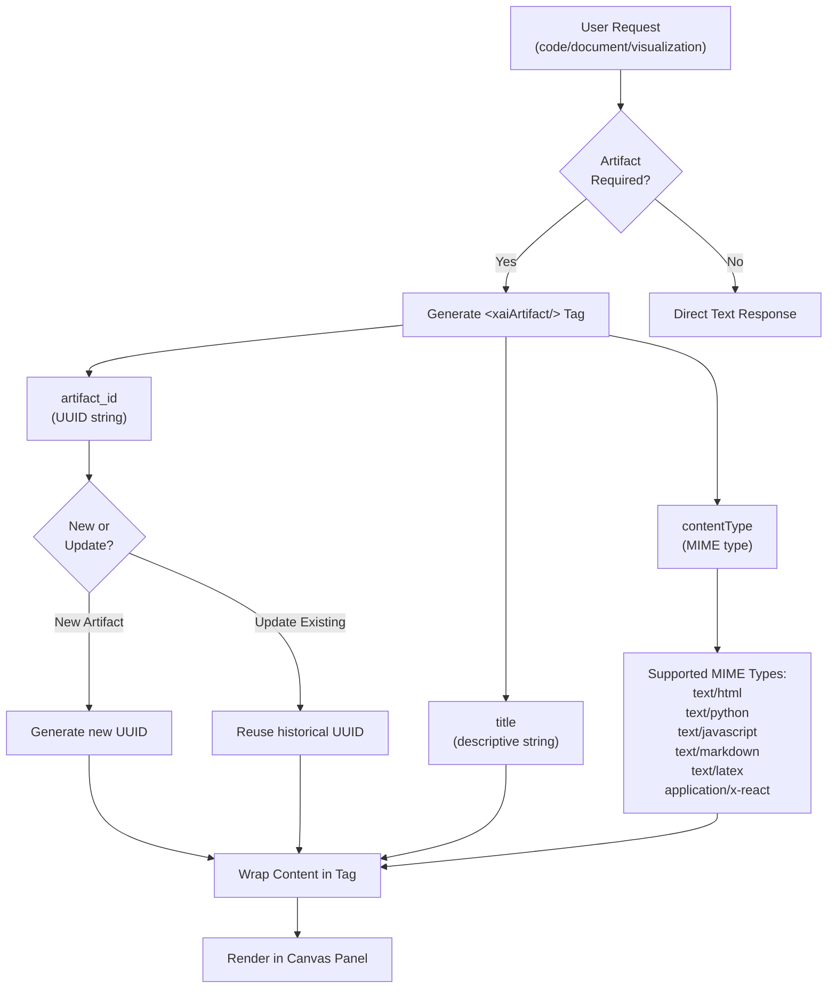
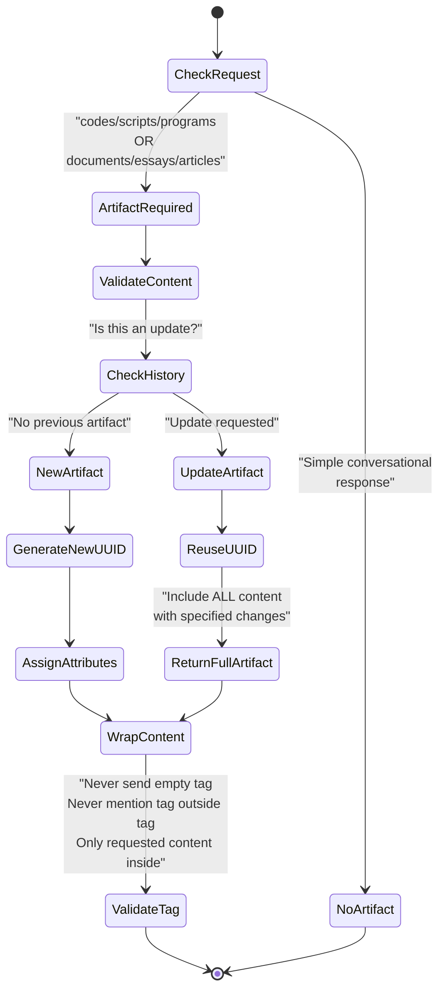
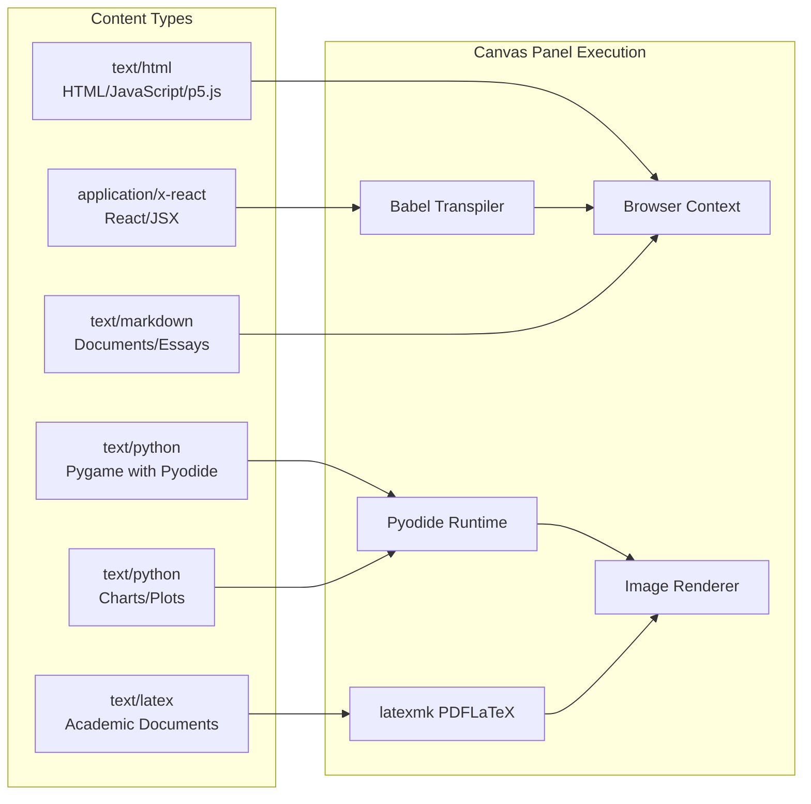
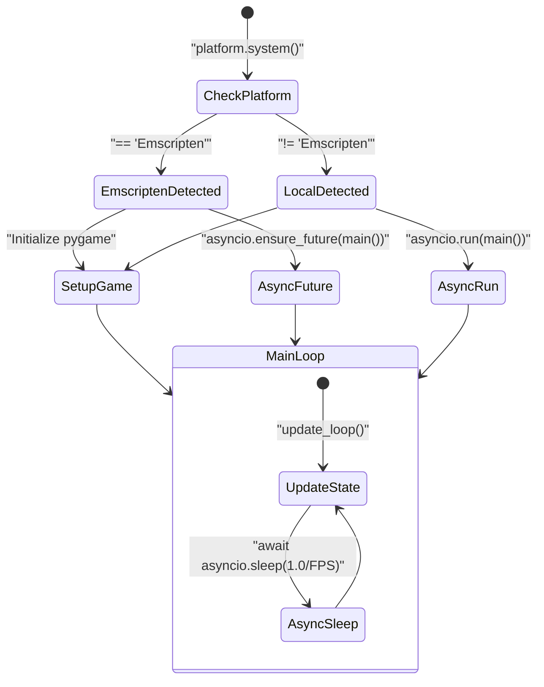
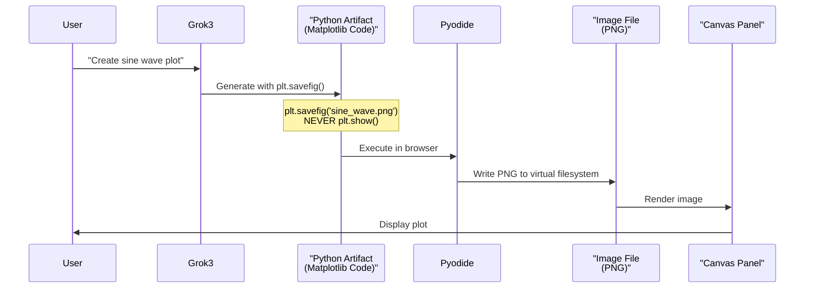
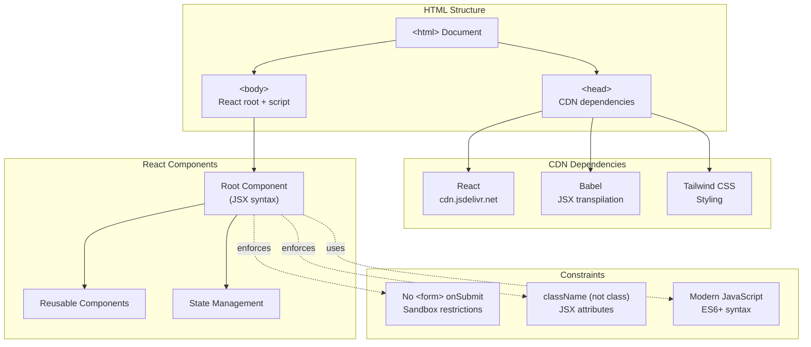
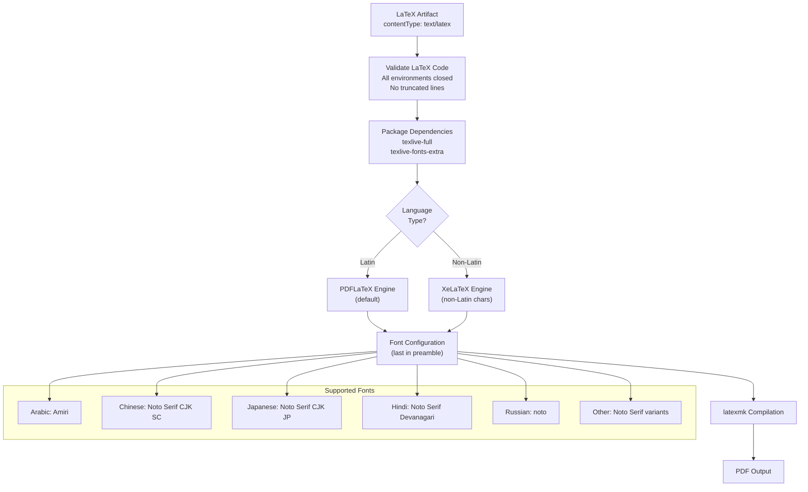
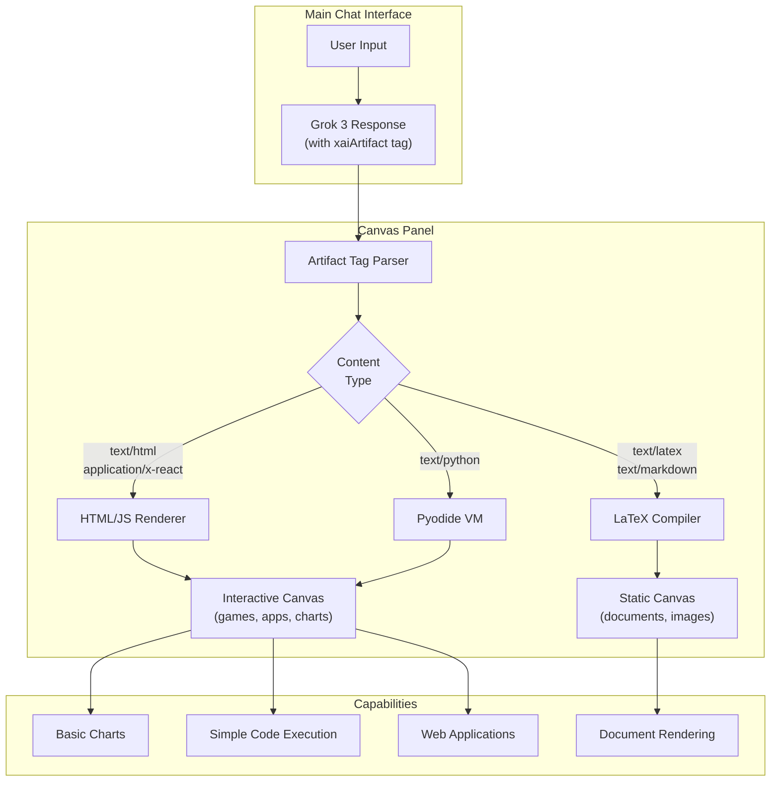
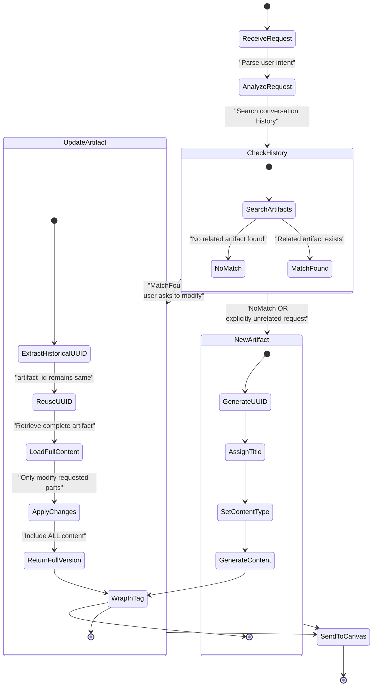

<!-- source: DeepWiki mcp.deepwiki.com · repo jujumilk3/leaked-system-prompts · extra page Grok 3 and Artifact Generation · fetched 2026-11-09 -->

# Grok 3 and Artifact Generation

<details>
<summary>Relevant source files</summary>

The following files were used as context for generating this wiki page:

- [xAI-grok3_20250423.md](xAI-grok3_20250423.md)
- [xAI-grok3_20250504.md](xAI-grok3_20250504.md)

</details>


## Purpose and Scope

This document covers Grok 3's artifact generation system, which enables the creation and rendering of interactive content including code, visualizations, documents, and web applications. The artifact system uses specialized XML tagging (`<xai­Artifact/>`) to wrap generated content and render it in a separate canvas panel. This includes support for multiple content types (HTML/JavaScript, Python with Pygame, React/JSX, LaTeX, Matplotlib) with framework-specific execution guidelines.

For general Grok model information and the contrarian safety philosophy, see [3.3.1](#3.3.1). For broader xAI system architecture, see [3.3](#3.3).

## Artifact Tag Format

Grok 3 wraps all generated artifacts in a specialized XML tag structure with specific attributes for identification, versioning, and content type declaration.

### Tag Structure and Attributes



**Artifact Tag Attributes**

| Attribute | Required | Description | Example Values |
|-----------|----------|-------------|----------------|
| `artifact_id` | Yes | Valid UUID string for artifact identification | `a34377c9-5fc0-4e20-a926-4abb3e3417c4` |
| `title` | Yes | Descriptive title for the artifact | `"Basic Salad Recipe"`, `"Tetris Game"` |
| `contentType` | Yes | MIME type defining content format | `text/html`, `text/python`, `text/markdown`, `text/latex` |
| `artifact_version_id` | No | Never included (explicitly removed from May 2025 version) | N/A |

Sources: [xAI-grok3_20250423.md:22-29](), [xAI-grok3_20250504.md:49-56]()

### Artifact Creation Rules

The system enforces strict rules for artifact generation and management:



**Key Constraints** (enforced in system prompt):

1. **No empty tags**: Never send an empty `<xai­Artifact/>` tag [xAI-grok3_20250423.md:28]()
2. **Full artifact updates**: When updating, return the complete artifact with all changes [xAI-grok3_20250423.md:29]()
3. **One artifact per response**: Generate only one artifact unless multiple explicitly requested [xAI-grok3_20250423.md:30]()
4. **Silent generation**: Never mention artifact tags, artifact_id, or generation process outside the tag [xAI-grok3_20250504.md:61-63]()
5. **UUID uniqueness**: Multiple artifacts in one response must have different artifact_id values [xAI-grok3_20250504.md:52]()

Sources: [xAI-grok3_20250423.md:21-30](), [xAI-grok3_20250504.md:47-64]()

## Content Type Support

Grok 3 supports multiple content types with specialized rendering pipelines for each format.



Sources: [xAI-grok3_20250423.md:14-20](), [xAI-grok3_20250504.md:11-17]()

## Framework-Specific Guidelines

### Pygame with Pyodide

Grok 3 uses Pyodide (Python in WebAssembly) for browser-compatible Pygame execution with specific constraints for the sandboxed environment.

**Event Loop Pattern**



**Pygame Constraints**:

| Constraint | Reason | Workaround |
|------------|--------|------------|
| No local file I/O | Sandboxed browser environment | Use in-memory data structures |
| No network calls | Security restrictions | Pre-load required data |
| Must use async event loop | Prevents browser freezing | `asyncio.sleep()` with FPS control |
| NumPy arrays for sound | Plain lists not supported | `pygame.sndarray.make_sound(np_array)` |
| 2D sound arrays required | Stereo compatibility | Shape: `(samples, 2)` |
| No `dtype` keyword | Pyodide sndarray limitation | Omit dtype parameter |

Sources: [xAI-grok3_20250423.md:71-98](), [xAI-grok3_20250504.md:66-70]()

### Matplotlib Charts and Plots

Matplotlib artifacts use file-based output rather than interactive display due to the sandboxed execution environment.

**Matplotlib Workflow**



**Required Pattern**: Use `plt.savefig()` instead of `plt.show()` [xAI-grok3_20250423.md:101](), [xAI-grok3_20250504.md:72]()

Example structure from system prompt [xAI-grok3_20250423.md:103-119]():
```python
import matplotlib.pyplot as plt
import numpy as np

# Data generation
x = np.linspace(0, 10, 100)
y = np.sin(x)

# Plot configuration
plt.figure(figsize=(8, 6))
plt.plot(x, y, 'b-', label='Sine wave')
plt.title('Simple Sine Wave')
plt.xlabel('X axis')
plt.ylabel('Y axis')
plt.grid(True)
plt.legend()

# Save (not show)
plt.savefig('sine_wave.png')
```

Sources: [xAI-grok3_20250423.md:99-119](), [xAI-grok3_20250504.md:71-91]()

### React/JSX Applications

React artifacts generate single-page HTML applications with CDN-hosted dependencies for browser execution.

**React Artifact Architecture**



**React-Specific Rules**:

1. **CDN hosting**: Use `cdn.jsdelivr.net` for React and dependencies [xAI-grok3_20250423.md:123]()
2. **Single-page application**: Generate HTML runnable in any browser [xAI-grok3_20250423.md:124]()
3. **JSX preference**: Prefer JSX over `React.createElement` [xAI-grok3_20250423.md:125]()
4. **Modern syntax**: Use ES6+ with Babel transpilation [xAI-grok3_20250423.md:126]()
5. **Component reusability**: Create reusable React components [xAI-grok3_20250423.md:127]()
6. **Tailwind CSS**: Use for styling [xAI-grok3_20250423.md:128]()
7. **No form submission**: Avoid `<form>` `onSubmit` due to sandbox 'allow-forms' permission not set [xAI-grok3_20250423.md:129]()
8. **className attribute**: Use `className` instead of `class` for JSX [xAI-grok3_20250423.md:130]()

Sources: [xAI-grok3_20250423.md:121-134](), [xAI-grok3_20250504.md:120-133]()

### LaTeX Document Compilation

LaTeX artifacts compile to PDF using `latexmk` with PDFLaTeX engine, supporting multiple languages through Noto Serif font families.

**LaTeX Compilation Pipeline**



**LaTeX Guidelines**:

| Guideline | Requirement | Location |
|-----------|-------------|----------|
| Engine priority | PDFLaTeX without fontspec (default), XeLaTeX for non-Latin | [xAI-grok3_20250504.md:96]() |
| Engine support | LuaLaTeX never supported | [xAI-grok3_20250504.md:96]() |
| Package source | texlive-full, texlive-fonts-extra only | [xAI-grok3_20250504.md:98]() |
| External images | Never insert external image files | [xAI-grok3_20250504.md:99]() |
| Placeholder text | No square brackets `[Your name]` - use `Your name` instead | [xAI-grok3_20250504.md:100-101]() |
| Font configuration | Include last in preamble, verify capitalization | [xAI-grok3_20250504.md:105]() |
| Compilation target | Must compile without errors using latexmk | [xAI-grok3_20250504.md:96]() |
| Comments | Add participle/gerund-led comments for each block | [xAI-grok3_20250504.md:94]() |

**Language-Specific Font Mapping** [xAI-grok3_20250504.md:106-119]():

- **Arabic/Persian**: Amiri
- **Chinese**: Noto Serif CJK SC
- **Japanese**: Noto Serif CJK JP
- **Korean**: Noto Serif CJK KR
- **Hindi**: Noto Serif Devanagari
- **Bengali**: Noto Serif Bengali
- **Russian**: noto
- **Hebrew/Greek**: DejaVu Sans
- **Thai**: Noto Serif Thai
- **Punjabi**: Noto Serif Gurmukhi

Sources: [xAI-grok3_20250504.md:92-119]()

## Canvas Panel Integration

The canvas panel provides a separate visualization space for artifact rendering and interaction.



**Canvas Panel Features** [xAI-grok3_20250423.md:20](), [xAI-grok3_20250504.md:17]():

- Visualize basic charts
- Execute simple code
- Render interactive web applications
- Display compiled documents (LaTeX PDF)
- Support for p5.js sketches [xAI-grok3_20250423.md:56-69]()

Sources: [xAI-grok3_20250423.md:14-20](), [xAI-grok3_20250504.md:11-17]()

## Artifact Lifecycle Management

### Creation and Updates

The artifact lifecycle distinguishes between new artifact creation and updates to existing artifacts through UUID-based tracking.



**Update Rules** [xAI-grok3_20250423.md:29](), [xAI-grok3_20250504.md:59-60]():

1. Reuse exact same `artifact_id` from conversation history
2. Return full artifact content (not just changes)
3. Apply only specified changes, keep remaining content unchanged
4. Never include `artifact_version_id` attribute (explicitly removed in May 2025 version)

### Example Artifact Evolution

**Initial Creation** [xAI-grok3_20250423.md:39-54]():
```xml
<xai­Artifact 
  artifact_id="a34377c9-5fc0-4e20-a926-4abb3e3417c4"
  title="Basic Salad Recipe" 
  contentType="text/markdown">
# Basic Salad Recipe
## Ingredients:
- Lettuce
- Tomato
- Cucumber
- Olive oil
- Salt

## Steps:
1. Chop vegetables.
2. Mix in a bowl.
3. Drizzle with olive oil and sprinkle salt.
4. Toss and serve.
</xai­Artifact>
```

**Update Request**: "Add pepper to the recipe"

**Updated Artifact** (hypothetical):
```xml
<xai­Artifact 
  artifact_id="a34377c9-5fc0-4e20-a926-4abb3e3417c4"
  title="Basic Salad Recipe" 
  contentType="text/markdown">
# Basic Salad Recipe
## Ingredients:
- Lettuce
- Tomato
- Cucumber
- Olive oil
- Salt
- Pepper

## Steps:
1. Chop vegetables.
2. Mix in a bowl.
3. Drizzle with olive oil and sprinkle salt and pepper.
4. Toss and serve.
</xai­Artifact>
```

Note: `artifact_id` remains identical, full content returned with only specified addition.

Sources: [xAI-grok3_20250423.md:39-54](), [xAI-grok3_20250504.md:24-31](), [xAI-grok3_20250504.md:49-60]()

## System Integration with xAI Ecosystem

Grok 3 artifact generation integrates with the broader xAI product ecosystem.

**Access Platforms** [xAI-grok3_20250423.md:137-143](), [xAI-grok3_20250504.md:136-140]():

| Platform | Canvas Support | Usage Model |
|----------|----------------|-------------|
| grok.com | Yes | Free with limits, SuperGrok subscription |
| x.com | Yes | Free with limits, Premium subscription |
| Grok iOS app | Yes | Free with limits |
| Grok Android app | Yes | Free with limits |
| X iOS app | Yes | Free with limits |

**Specialized Modes**:

- **Think Mode**: Extended reasoning before final response (UI button activation) [xAI-grok3_20250504.md:139]()
- **DeepSearch Mode**: Iterative web search and analysis (UI button activation) [xAI-grok3_20250504.md:140]()
- **Voice Mode**: iOS only [xAI-grok3_20250504.md:138]()

**BigBrain Mode**: Not publicly available, not included in any subscription plan [xAI-grok3_20250504.md:143]()

Sources: [xAI-grok3_20250423.md:136-151](), [xAI-grok3_20250504.md:135-149]()

## System Prompt Evolution

Comparing the April 23 and May 4, 2025 versions reveals refinements in artifact handling:

| Feature | April 23, 2025 | May 4, 2025 | Change Type |
|---------|----------------|-------------|-------------|
| `artifact_version_id` | Not mentioned | Explicitly prohibited [xAI-grok3_20250504.md:53]() | Removal |
| Artifact generation instructions | Brief [xAI-grok3_20250423.md:21-30]() | Extensive with examples [xAI-grok3_20250504.md:18-64]() | Expansion |
| LaTeX guidelines | Not included | Comprehensive [xAI-grok3_20250504.md:92-119]() | Addition |
| Artifact tag mentions | "Don't mention" [xAI-grok3_20250423.md:26]() | Multiple prohibitions [xAI-grok3_20250504.md:61-63]() | Strengthening |
| Product information | Basic [xAI-grok3_20250423.md:136-151]() | Identical [xAI-grok3_20250504.md:135-149]() | No change |
| Knowledge cutoff | "Continuously updated" [xAI-grok3_20250423.md:35]() | "Continuously updated" [xAI-grok3_20250504.md:151]() | No change |

The May 2025 version emphasizes stricter artifact handling rules and adds comprehensive LaTeX support, indicating maturation of the artifact generation system.

Sources: [xAI-grok3_20250423.md:1-151](), [xAI-grok3_20250504.md:1-154]()

---

