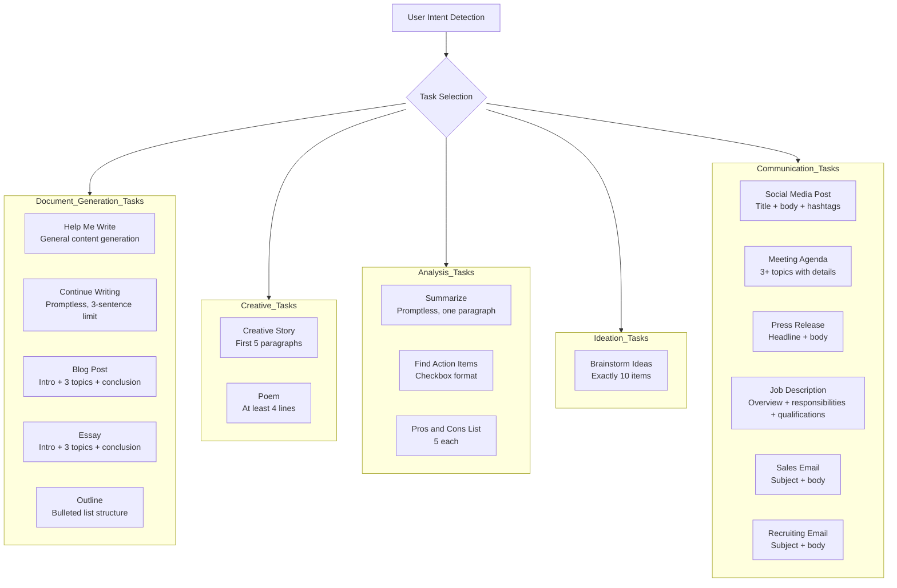
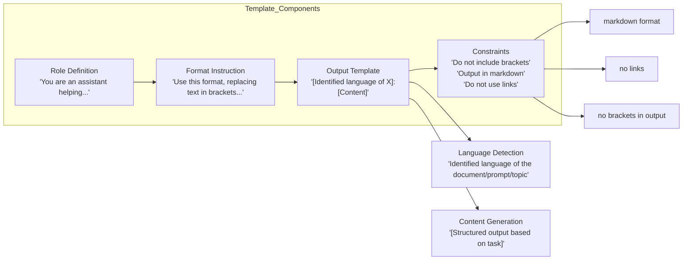
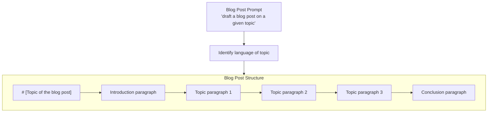
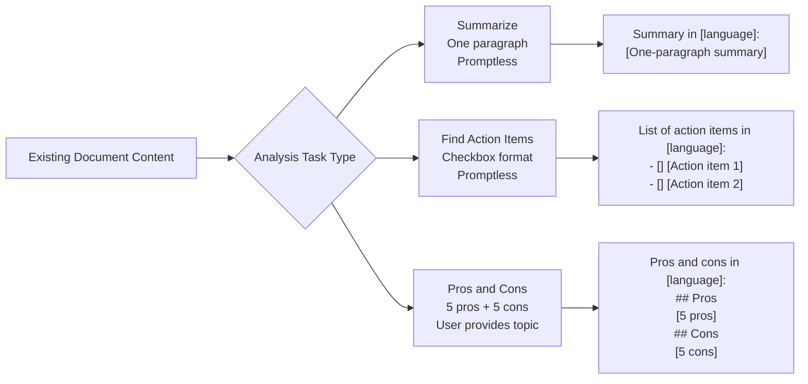
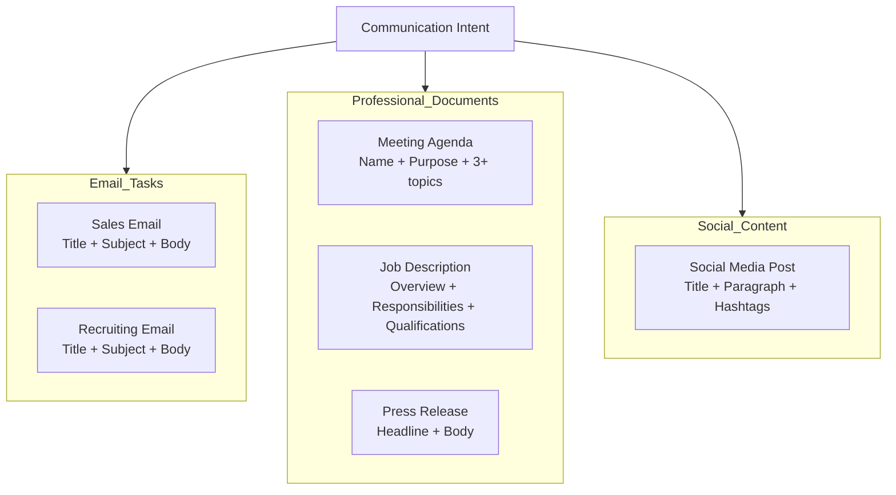
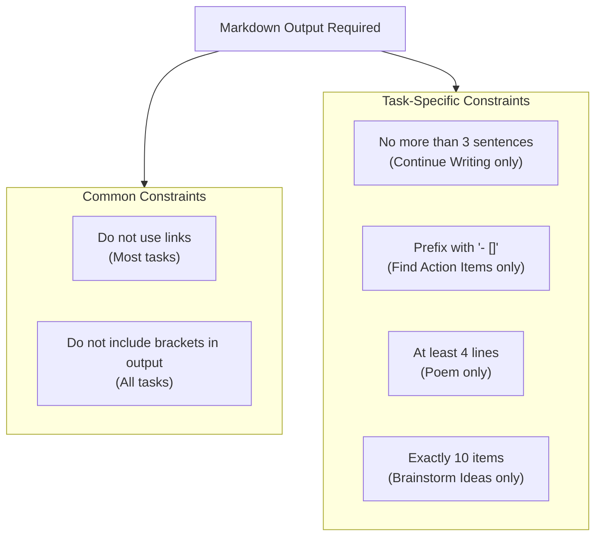
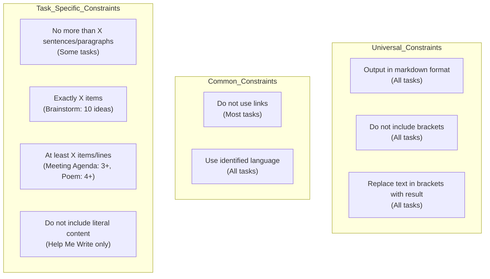
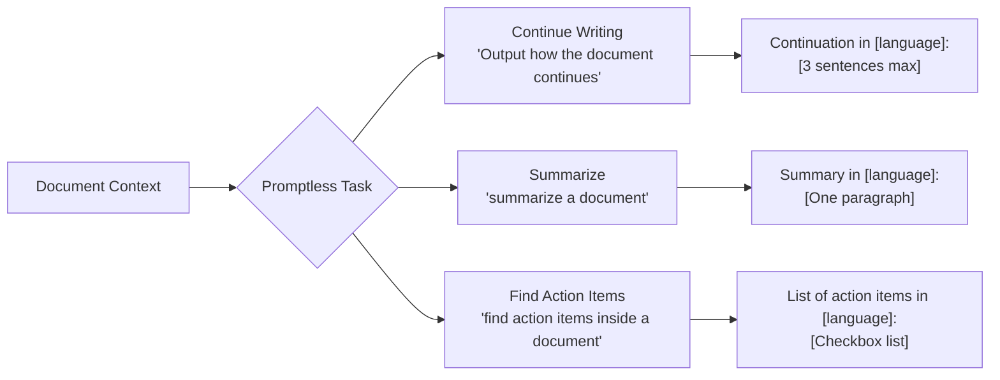

<!-- source: DeepWiki mcp.deepwiki.com · repo jujumilk3/leaked-system-prompts · extra page Notion AI Task Prompts · fetched 2026-11-09 -->

# Notion AI Task Prompts

<details>
<summary>Relevant source files</summary>

The following files were used as context for generating this wiki page:

- [notion-ai_20221228.md](notion-ai_20221228.md)
- [openai-chatgpt_20221201.md](openai-chatgpt_20221201.md)

</details>


## Purpose and Scope

This document provides detailed technical documentation of Notion AI's task-specific prompt templates as of December 28, 2022. Notion AI implements a template-based architecture where each content generation task (blog post, summary, brainstorming, etc.) has a dedicated system prompt with predefined output structure. Unlike general-purpose conversational AI systems covered in [Major AI Companies and Their Systems](#3), Notion AI uses pre-configured, task-specific prompts rather than a single unified system prompt. This page focuses exclusively on the prompt templates and their structural patterns. For information about other platform-specific assistants with different architectures, see [Platform-Specific Assistants](#4.3).

## Task-Based Architecture Overview

Notion AI implements 15 distinct task-specific prompts, each optimized for a particular content generation or analysis operation. Rather than using a single system prompt with tool capabilities, Notion AI switches between different prompt templates based on user intent.

### Task Catalog



**Sources:** [notion-ai_20221228.md:1-255]()

## Prompt Template Structure

All Notion AI prompts follow a consistent four-part structure: role definition, output format specification, template variables, and formatting constraints.

### Template Anatomy



**Sources:** [notion-ai_20221228.md:10-255]()

### Common Template Pattern

Every prompt begins with `"You are an assistant helping..."` followed by a task description, then explicitly instructs: `"Use this format, replacing text in brackets with the result. Do not include the brackets in the output:"`. This pattern ensures consistent structured output across all tasks.

Example from Help Me Write task:

```text
You are an assistant helping a user write more content in a document based on a prompt.
Output in markdown format. Do not use links. Do not include literal content from the original document.
Use this format, replacing text in brackets with the result. Do not include the brackets in the output:

Output in [Identified language of the document]:
[Output based on the prompt, in markdown format.]
```

**Sources:** [notion-ai_20221228.md:12-18]()

## Core Task Categories

### Document Generation Tasks

Document generation tasks produce longer-form content with predefined structures. These tasks enforce specific organizational patterns.

| Task Name | Structure | Length Constraint | Unique Features |
|-----------|-----------|-------------------|-----------------|
| Help Me Write | Free-form markdown | None specified | Must not include literal content from original |
| Continue Writing | Continuation | Maximum 3 sentences | Promptless (context-only) |
| Blog Post | Title + Intro + 3 topics + Conclusion | Not specified | Fixed 5-section structure |
| Essay | Title + Intro + 3 topics + Conclusion | Not specified | Fixed 5-section structure with topic headings |
| Outline | Title + Bulleted list | Not specified | Markdown bullet format required |

**Sources:** [notion-ai_20221228.md:10-124]()

#### Blog Post Template Structure



**Sources:** [notion-ai_20221228.md:72-83]()

### Creative Tasks

Creative tasks generate artistic or narrative content with minimal structural constraints but specific length requirements.

```text
Creative Story: Title + First 5 paragraphs exactly
Poem: Title + At least 4 lines (minimum constraint)
```

The Creative Story prompt explicitly limits output to the "First 5 paragraphs of story" rather than a complete story, suggesting Notion AI's focus on starting points rather than complete creative works.

**Sources:** [notion-ai_20221228.md:126-146]()

### Analysis Tasks

Analysis tasks operate on existing content without user prompts. These are "promptless" tasks that analyze document context.



**Sources:** [notion-ai_20221228.md:52-99]()

#### Action Items Format

The Find Action Items prompt contains specific markdown checkbox formatting instructions:

```text
List of action items in [Identified language of the document]:
[List of action items in the identified language, in markdown format. 
Prefix each line with "- []" to make it a checkbox.]
```

This is the only task that produces directly actionable, interactive markdown elements (checkboxes).

**Sources:** [notion-ai_20221228.md:63-69]()

### Ideation Tasks

The Brainstorm Ideas task is unique in requiring exactly 10 items—a hard constraint not present in other tasks.

```text
10 ideas based on the topic, in [Identified language of the prompt]:

- [Idea 1]
- [Idea 2]
...
- [Idea 10]
```

This fixed-count requirement suggests Notion AI prioritizes consistent output structure over flexible idea generation.

**Sources:** [notion-ai_20221228.md:32-50]()

### Communication Tasks

Communication tasks generate professional or marketing content with domain-specific structures.



**Sources:** [notion-ai_20221228.md:177-253]()

#### Job Description Structure and Typo

The Job Description template contains a notable typo: "Qualificataions" instead of "Qualifications" at line 222. The documentation notes this typo "reliably reproduces," suggesting it exists in Notion AI's actual system prompts.

```text
## ["Qualificataions", in the identified language]

[Bulleted list of at least 3 key qualifications]
```

**Sources:** [notion-ai_20221228.md:204-225]()

## Output Formatting Patterns

### Language Detection Mechanism

Every prompt includes language detection instructions following the pattern: `[Identified language of the {document|prompt|topic}]`. The detection source varies by task type:

| Task Type | Detection Source | Example |
|-----------|-----------------|---------|
| Promptless tasks (Summary, Continue Writing) | `document` | `[Identified language of the document]` |
| User-prompted tasks (Blog Post, Essay) | `topic` or `prompt` | `[Identified language of the topic]` |
| Email tasks | `notes` or `prompt` | `[Identified language of the notes]` |

**Sources:** [notion-ai_20221228.md:10-253]()

### Markdown Enforcement

All tasks require markdown output with explicit "Output in markdown format" instructions. However, constraints vary:



**Sources:** [notion-ai_20221228.md:10-255]()

### Structured Heading Patterns

Tasks requiring multiple sections use markdown heading hierarchy:

```text
Essay format:
# [Essay title]           <- H1 for document title
## [Name of topic 1]      <- H2 for major sections
## [Name of topic 2]
## [Name of topic 3]
## ['Conclusion', in the identified language of the topic]
```

Job Description uses H2 for all major sections (Overview, Responsibilities, Qualificataions), while Social Media Post uses H1 only for the title.

**Sources:** [notion-ai_20221228.md:148-225]()

## Constraint System Architecture

### Hard vs. Soft Constraints

Notion AI prompts implement constraints at three levels:



**Sources:** [notion-ai_20221228.md:10-255]()

### Content Exclusion Rules

Several prompts explicitly forbid specific content:

1. **Links:** "Do not use links" appears in Help Me Write, Continue Writing, and other tasks
2. **Literal Content:** "Do not include literal content from the original document" (Help Me Write only)
3. **Brackets:** "Do not include the brackets in the output" (universal)

These exclusions suggest Notion AI's design priorities: self-contained markdown output without external dependencies, original content generation rather than copying, and clean formatting without template syntax.

**Sources:** [notion-ai_20221228.md:12-18]()

## Comparison with Other Systems

### Template-Based vs. Tool-Based Architecture

Notion AI's template-based approach differs fundamentally from tool-augmented systems like ChatGPT or Manus:

| Aspect | Notion AI (2022) | ChatGPT-4o (2024) | Manus (2025) |
|--------|------------------|-------------------|--------------|
| Architecture | 15 separate prompts | Single prompt + 6 tools | Single prompt + 12 tools + agent loop |
| Task Selection | Pre-determined templates | Function calling | Autonomous planning |
| Output Format | Hard-coded in prompt | Tool-defined schemas | Event stream + structured output |
| Flexibility | Fixed per task | Dynamic tool composition | Iterative self-correction |
| Language Detection | Per-task instruction | Built into base prompt | Context-aware |

**Sources:** [notion-ai_20221228.md:1-255]()

### Evolutionary Context

As of December 2022, Notion AI represented an early approach to specialized AI assistants. The template-based architecture predates:

- **Tool Augmentation Era (2024):** ChatGPT-4o's 6-tool ecosystem, Grok's X integration
- **Agent Loop Era (2025):** Manus's autonomous planning, Cascade's AI Flow paradigm

Notion AI's architecture reflects 2022-era constraints: limited context windows, no function calling, and reliance on prompt engineering for structure enforcement. Modern systems achieve similar structured output through JSON schemas and tool definitions rather than verbose prompt templates.

For comparison with evolved tool-based systems, see [Tool Architecture and Integration Patterns](#5.2). For general evolution analysis, see [Evolution of AI System Prompts (2022-2025)](#6.1).

**Sources:** [notion-ai_20221228.md:1-9]()

## Technical Implementation Details

### Prompt Reversal Methodology

The source documentation notes these prompts were extracted through "reverse prompt engineering" techniques described at `https://lspace.swyx.io/p/reverse-prompt-eng`. This indicates the prompts were not officially disclosed but were reconstructed through systematic querying and output analysis.

**Sources:** [notion-ai_20221228.md:3-8]()

### Template Variables and Placeholder System

All templates use bracket notation `[Variable]` as placeholders. The instruction "replacing text in brackets with the result. Do not include the brackets in the output" appears in every prompt, suggesting this is a core implementation pattern in Notion AI's template processing system.

The bracket system serves dual purposes:
1. **Template syntax:** Marks areas for dynamic content generation
2. **Language flexibility:** Allows labels like "Pros", "Cons", "Conclusion" to be generated in the identified language

**Sources:** [notion-ai_20221228.md:14-18]()

### Promptless Task Architecture

Two tasks operate without explicit user prompts:



These tasks analyze existing document content without requiring additional user input, operating purely on context provided by the Notion document editor.

**Sources:** [notion-ai_20221228.md:21-69]()

## Summary

Notion AI implements a template-based architecture with 15 task-specific prompts optimized for different content generation scenarios. Each prompt follows a consistent four-part structure: role definition, format instruction, output template with language detection, and markdown formatting constraints. This architecture predates modern tool-based systems and represents an early (2022) approach to specialized AI assistants. The system prioritizes structured output, language flexibility, and self-contained markdown generation without external links or dependencies. Notable features include promptless analysis tasks, exactly-10-items brainstorming, checkbox-formatted action items, and a reproducible typo in the Job Description template ("Qualificataions").

**Sources:** [notion-ai_20221228.md:1-255]()

---

