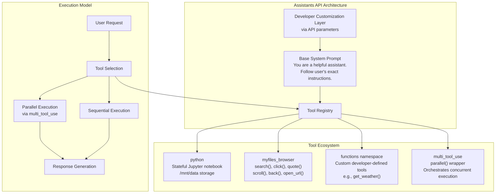
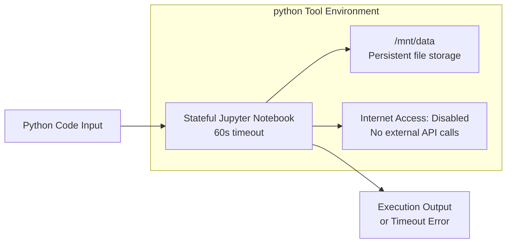
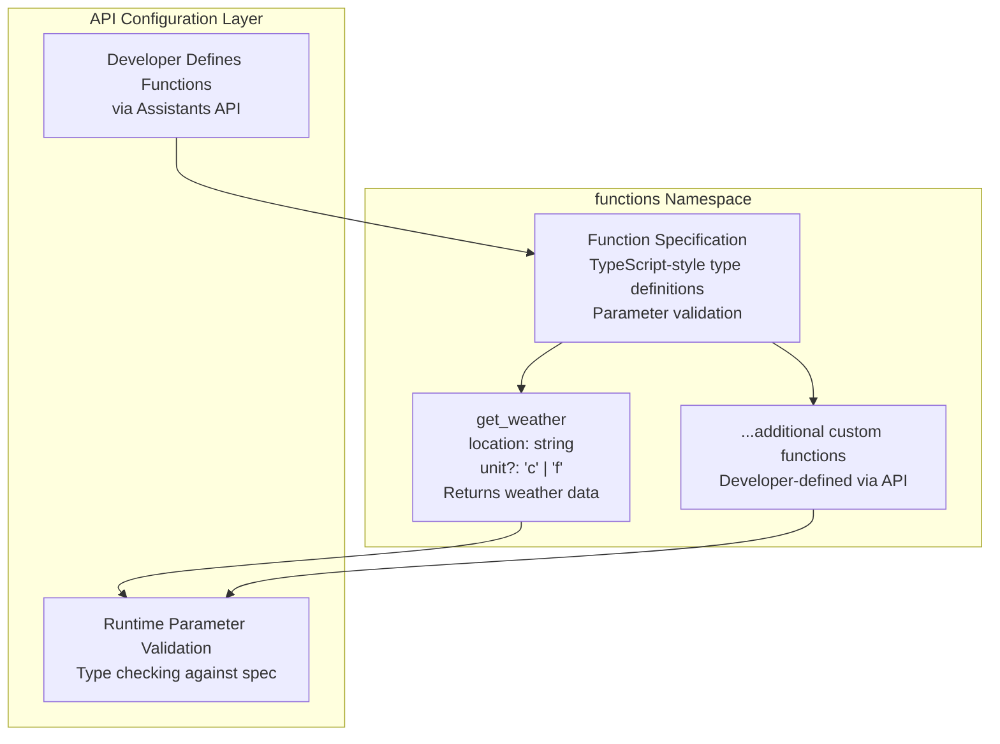
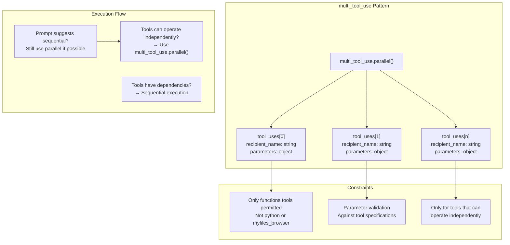
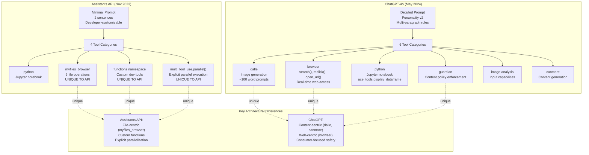
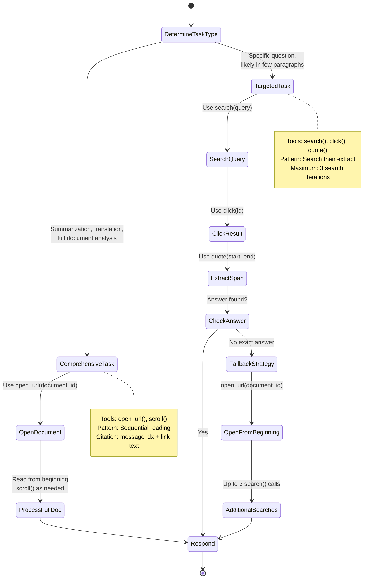
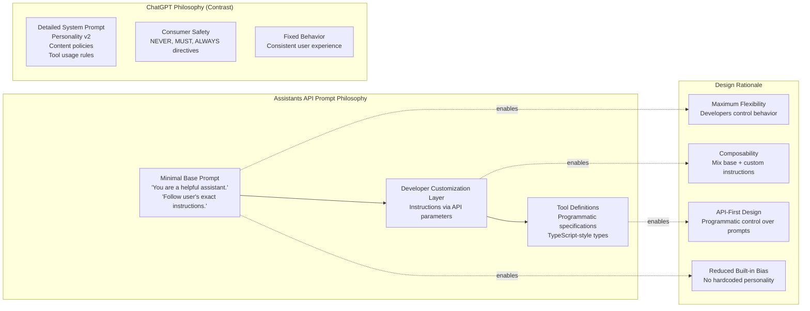

<!-- source: DeepWiki mcp.deepwiki.com · repo jujumilk3/leaked-system-prompts · extra page OpenAI Assistants API · fetched 2026-11-09 -->

# OpenAI Assistants API

<details>
<summary>Relevant source files</summary>

The following files were used as context for generating this wiki page:

- [openai-assistants-api_20231106.md](openai-assistants-api_20231106.md)
- [openai-chatgpt4o_20240520.md](openai-chatgpt4o_20240520.md)

</details>


## Purpose and Scope

This document covers the OpenAI Assistants API system prompt architecture, which provides a programmatic interface for building custom AI assistants with file upload capabilities, custom functions, and parallel tool orchestration. The Assistants API differs from ChatGPT's web interface by offering a minimal base prompt designed for developer customization and a unique set of tools optimized for programmatic workflows.

For ChatGPT's evolution and consumer-facing tool integration, see [3.1.1](#3.1.1). For OpenAI's Deep Research capabilities, see [3.1.3](#3.1.3). For general system design patterns across multiple providers, see [5](#5).

**Sources:** [openai-assistants-api_20231106.md:1-72]()

---

## Architecture Overview

The Assistants API uses a minimalist system prompt architecture that delegates customization to developers through the API layer. Unlike ChatGPT's prescriptive personality and behavior rules, the Assistants API provides a bare-bones foundation: "You are a helpful assistant. Follow the user's exact instructions."



**Key Architectural Differences from ChatGPT:**

| Aspect | Assistants API | ChatGPT (4o/5) |
|--------|---------------|----------------|
| Base Prompt | 2 sentences, minimal | Multi-paragraph with personality |
| Customization | Developer-controlled via API | Fixed by OpenAI |
| Tool Focus | File management + custom functions | Content generation + web search |
| Orchestration | Explicit `multi_tool_use.parallel()` | Implicit tool sequencing |
| Target Audience | Developers building custom assistants | End users |

**Sources:** [openai-assistants-api_20231106.md:9-11](), [openai-chatgpt4o_20240520.md:11-16]()

---

## Tool Ecosystem

### python Tool

The `python` tool provides a stateful Jupyter notebook environment with identical specifications to ChatGPT's Python interpreter. Code execution timeout is 60 seconds, and the `/mnt/data` directory provides persistent storage for user files. Internet access is disabled for the session.



**Sources:** [openai-assistants-api_20231106.md:15-19](), [openai-chatgpt4o_20240520.md:64-67]()

---

### myfiles_browser Tool

The `myfiles_browser` tool is **unique to the Assistants API** and provides programmatic navigation and search over user-uploaded files. This tool does not exist in ChatGPT's consumer interface.

```mermaid
graph TB
    subgraph myfiles_browser_functions["myfiles_browser Tool Functions"]
        search["search(query: str)<br/>Query uploaded files<br/>Returns list of results"]
        
        click["click(id: str)<br/>Open document at position<br/>Navigate into search results"]
        
        quote["quote(start: str, end: str)<br/>Extract text span<br/>start/end substring markers"]
        
        back["back()<br/>Return to previous page<br/>Navigate back to search results"]
        
        scroll["scroll(amt: int)<br/>Scroll up/down<br/>Amount in integer units"]
        
        open_url["open_url(url: str)<br/>Open document by file ID<br/>UUID format, not path"]
    end
    
    subgraph UsagePatterns["Usage Patterns"]
        ComprehensiveAnalysis["Comprehensive Analysis<br/>summarization, translation<br/>→ Use open_url() with document ID"]
        
        TargetedSearch["Targeted Search<br/>specific paragraphs<br/>→ Use search() to locate"]
        
        IterativeRefinement["Iterative Refinement<br/>If no exact answer<br/>→ open_url() + up to 3 searches"]
    end
    
    search --> click
    click --> quote
    click --> back
    open_url --> scroll
    
    ComprehensiveAnalysis --> open_url
    TargetedSearch --> search
    IterativeRefinement --> open_url
    IterativeRefinement --> search
```

**Tool Invocation Syntax:** The Assistants API requires Python syntax for `myfiles_browser` calls (e.g., `search('query')`), not JSON. JSON usage returns "Invalid function call in source code" errors.

**Citation Format:** Results are rendered as `【{message idx}†{link text}】` for inline citations.

**Sources:** [openai-assistants-api_20231106.md:21-39]()

---

### functions Namespace

The `functions` namespace allows developers to define custom tools specific to their application. The system prompt includes placeholder examples but the actual function definitions are provided via the API.



**Example Function Definition:**

The system prompt shows the structure using TypeScript notation:

```typescript
namespace functions {
  // Determine weather in my location
  type get_weather = (_: {
    // The city and state e.g. San Francisco, CA
    location: string,
    unit?: "c" | "f",
  }) => any;
}
```

**Sources:** [openai-assistants-api_20231106.md:41-52]()

---

### multi_tool_use Orchestration

The `multi_tool_use` namespace provides a `parallel()` function that wraps multiple tool calls for concurrent execution. This is the **only mechanism for parallel tool execution** in the Assistants API, unlike ChatGPT which has implicit orchestration.



**Critical Rules:**

1. **Namespace restriction:** Only tools in the `functions` namespace can be parallelized
2. **Format requirement:** `recipient_name` should be either tool name or `namespace.function_name` format
3. **Parallel-first strategy:** "Do this even if the prompt suggests using the tools sequentially"
4. **Parameter validation:** Must validate against each tool's specification

**Example Structure:**

```typescript
type parallel = (_: {
  // The tools to be executed in parallel. NOTE: only functions tools are permitted
  tool_uses: {
    recipient_name: string,  // Format: tool_name or namespace.function_name
    parameters: object,       // Valid according to tool's specification
  }[],
}) => any;
```

**Sources:** [openai-assistants-api_20231106.md:54-71]()

---

## Assistants API vs ChatGPT Architecture Comparison



**Comparison Matrix:**

| Feature | Assistants API | ChatGPT-4o |
|---------|---------------|------------|
| **Prompt Length** | 2 sentences | ~73 lines |
| **Customization** | Full developer control | Fixed by OpenAI |
| **File Management** | `myfiles_browser` (6 functions) | None |
| **Web Access** | None | `browser` (search, mclick, open_url) |
| **Image Generation** | None | `dalle` with detailed policy |
| **Custom Functions** | `functions` namespace | Not supported |
| **Parallel Execution** | Explicit `multi_tool_use.parallel()` | Implicit orchestration |
| **Python Environment** | Identical (Jupyter, /mnt/data) | Identical (Jupyter, /mnt/data) |
| **Safety Layer** | Minimal (developer responsibility) | `guardian` + multi-paragraph policies |
| **Target Use Case** | Programmatic workflows, file processing | Conversational, content generation |

**Sources:** [openai-assistants-api_20231106.md:1-72](), [openai-chatgpt4o_20240520.md:1-73]()

---

## File Upload and Document Processing Workflow

The Assistants API's `myfiles_browser` tool implements a structured workflow for processing uploaded documents.



**Workflow Decision Logic:**

1. **Comprehensive Analysis Tasks** (summarization, translation):
   - Start with `open_url(document_id)` to load full document
   - Use `scroll(amt)` to navigate through content
   - Process sequentially from beginning

2. **Targeted Search Tasks** (specific questions):
   - Use `search(query)` to locate relevant sections
   - `click(id)` to open specific results
   - `quote(start, end)` to extract exact text spans

3. **Fallback Strategy** (no exact answer):
   - Open document from beginning with `open_url()`
   - Perform up to 3 additional `search()` calls on different sections
   - Synthesize answer from combined results

**Sources:** [openai-assistants-api_20231106.md:36-39]()

---

## Parallel Tool Execution Pattern

The `multi_tool_use.parallel()` function enables concurrent execution of independent function calls, optimizing for latency when multiple tools can operate simultaneously.

```mermaid
graph TB
    subgraph DecisionTree["Parallel Execution Decision Tree"]
        Analyze["Analyze User Request"]
        
        SingleTool["Single tool needed?"]
        MultipleCandidates["Multiple tools needed?"]
        
        CheckIndependence["Can tools operate<br/>independently?"]
        
        CheckNamespace["All tools in<br/>functions namespace?"]
        
        UseParallel["Use multi_tool_use.parallel()"]
        UseSequential["Use sequential execution"]
        UseDirect["Direct tool call"]
        
        Analyze --> SingleTool
        Analyze --> MultipleCandidates
        
        SingleTool --> UseDirect
        
        MultipleCandidates --> CheckIndependence
        CheckIndependence --> CheckNamespace: Yes
        CheckIndependence --> UseSequential: No dependencies
        
        CheckNamespace --> UseParallel: Yes, all in functions
        CheckNamespace --> UseSequential: No, mixed namespaces
    end
    
    subgraph ParallelExecution["Parallel Execution Structure"]
        ParallelCall["multi_tool_use.parallel()"]
        
        ToolCall1["tool_uses[0]<br/>recipient_name: 'functions.get_weather'<br/>parameters: {location: 'SF', unit: 'f'}"]
        
        ToolCall2["tool_uses[1]<br/>recipient_name: 'functions.get_stock_price'<br/>parameters: {symbol: 'AAPL'}"]
        
        ToolCall3["tool_uses[2]<br/>recipient_name: 'functions.get_news'<br/>parameters: {topic: 'technology'}"]
        
        ParallelCall --> ToolCall1
        ParallelCall --> ToolCall2
        ParallelCall --> ToolCall3
        
        ToolCall1 --> ConcurrentExec["Concurrent Execution"]
        ToolCall2 --> ConcurrentExec
        ToolCall3 --> ConcurrentExec
        
        ConcurrentExec --> AggregateResults["Aggregate Results"]
    end
    
    UseParallel --> ParallelCall
```

**Key Constraints:**

| Constraint | Details |
|------------|---------|
| **Namespace Restriction** | Only `functions` namespace tools can be parallelized. `python` and `myfiles_browser` are excluded. |
| **Independence Requirement** | Tools must not depend on each other's outputs. No sequential dependencies. |
| **Parameter Validation** | Each `parameters` object must be valid per the tool's specification. |
| **Recipient Format** | Use `namespace.function_name` (e.g., `functions.get_weather`) or just `function_name`. |
| **Override Sequential Hints** | "Do this even if the prompt suggests using the tools sequentially" - prioritize parallelization. |

**Example Invalid Scenarios:**

- Cannot parallelize `python` + `myfiles_browser` (wrong namespaces)
- Cannot parallelize if Tool B needs output from Tool A (dependency)
- Cannot parallelize if any tool is outside `functions` namespace

**Sources:** [openai-assistants-api_20231106.md:54-71]()

---

## System Prompt Design Philosophy

The Assistants API adopts a **minimalist prompt philosophy** that contrasts sharply with ChatGPT's detailed prescriptive approach.



**Prompt Length Comparison:**

| System | Prompt Length | Customization | Target Audience |
|--------|--------------|---------------|-----------------|
| **Assistants API** | 2 sentences | Full developer control via API | Developers |
| **ChatGPT-4o** | ~73 lines | Fixed by OpenAI | End users |
| **ChatGPT-5** | ~100+ lines (with tools) | Fixed by OpenAI | End users |

**Assistants API Prompt Structure:**

```
[Base Instruction - 2 lines]
  ↓
[Tool Definitions - TypeScript specs]
  ↓
[Developer Custom Instructions - API parameter]
  ↓
[Runtime Behavior]
```

**Design Tradeoffs:**

| Advantage | Disadvantage |
|-----------|--------------|
| ✓ Developers can implement any behavior | ✗ Developer responsible for safety |
| ✓ No built-in personality constraints | ✗ Must define desired behavior explicitly |
| ✓ Flexible for diverse use cases | ✗ More setup required |
| ✓ Tool definitions are precise (TypeScript) | ✗ No implicit guardrails |

**Sources:** [openai-assistants-api_20231106.md:9-11](), [openai-chatgpt4o_20240520.md:11-16]()

---

## Tool Specification Format

The Assistants API uses TypeScript-style type definitions for tool specifications, providing strong typing and parameter validation.

```mermaid
graph TB
    subgraph ToolSpecFormat["Tool Specification Format"]
        NamespaceDecl["namespace declaration<br/>e.g., 'namespace functions'"]
        
        TypeDef["type definition<br/>function_name = (_: { ... }) => any"]
        
        ParamSpec["parameter specification<br/>name: type<br/>optional?: type"]
        
        Comments["inline comments<br/>// Description of parameter<br/>// Example values"]
        
        NamespaceDecl --> TypeDef
        TypeDef --> ParamSpec
        ParamSpec --> Comments
    end
    
    subgraph ExampleBreakdown["Example: get_weather Specification"]
        NS["namespace functions"]
        Comment1["// Determine weather in my location"]
        TypeLine["type get_weather = (_: {"]
        Param1["location: string<br/>// The city and state e.g. San Francisco, CA"]
        Param2["unit?: 'c' | 'f'<br/>// Optional, c for Celsius or f for Fahrenheit"]
        Close["}) => any;"]
        
        NS --> Comment1
        Comment1 --> TypeLine
        TypeLine --> Param1
        TypeLine --> Param2
        Param1 --> Close
        Param2 --> Close
    end
    
    subgraph ValidationProcess["Runtime Validation"]
        CallReceived["Function call received"]
        ExtractParams["Extract parameters object"]
        TypeCheck["Type check against specification"]
        ValidateRequired["Validate required parameters"]
        ValidateOptional["Validate optional parameters"]
        Execute["Execute if valid"]
        Error["Return error if invalid"]
        
        CallReceived --> ExtractParams
        ExtractParams --> TypeCheck
        TypeCheck --> ValidateRequired
        ValidateRequired --> ValidateOptional
        ValidateOptional --> Execute
        TypeCheck --> Error
        ValidateRequired --> Error
        ValidateOptional --> Error
    end
```



**Type System Features:**

| Feature | Syntax | Example |
|---------|--------|---------|
| **Required Parameter** | `name: type` | `location: string` |
| **Optional Parameter** | `name?: type` | `unit?: "c" \| "f"` |
| **Union Types** | `type1 \| type2` | `"c" \| "f"` |
| **Object Return** | `=> any` | Flexible return type |
| **Comments** | `// comment` | Parameter descriptions |

**Sources:** [openai-assistants-api_20231106.md:41-52]()

---

## Citation and Output Format

The Assistants API specifies precise formats for citing sources and rendering outputs from tools.

**Citation Format for `myfiles_browser`:**

```
【{message idx}†{link text}】
```

Example: `【42†Section 3.1 Results】`

**Components:**

- `{message idx}`: Numeric index of the message containing the source
- `†`: Dagger symbol separator
- `{link text}`: Descriptive text for the citation
- `【】`: Special Unicode brackets (U+3010 and U+3011)

**Rendering Rules:**

| Tool | Format | Usage |
|------|--------|-------|
| `myfiles_browser` | `【{message idx}†{link text}】` | Inline citations from uploaded files |
| `browser` (ChatGPT) | `【{message idx}†{link text}】` (inline)<br/>`[link text](message idx)` (long) | Web search citations |
| `python` | Code blocks + output | Jupyter execution results |

**Sources:** [openai-assistants-api_20231106.md:30](), [openai-chatgpt4o_20240520.md:60-62]()

---

## Summary: Assistants API Unique Capabilities

The following table summarizes capabilities unique to the Assistants API that distinguish it from ChatGPT and other OpenAI systems:

| Capability | Description | Use Case |
|------------|-------------|----------|
| **myfiles_browser** | 6-function file navigation and search tool | Document processing, Q&A over uploaded files |
| **functions namespace** | Developer-defined custom tools with TypeScript specs | Domain-specific integrations (weather, stocks, databases) |
| **multi_tool_use.parallel()** | Explicit parallel execution wrapper for independent functions | Latency optimization for multi-tool workflows |
| **Minimal base prompt** | 2-sentence foundation allowing full customization | Diverse assistant behaviors without prompt engineering workarounds |
| **Programmatic control** | API-driven tool definitions and instruction layering | Scalable, version-controlled assistant configuration |
| **No built-in safety** | Developer responsibility for content policies | Enterprise-specific safety requirements |

**Architectural Position:** The Assistants API represents OpenAI's **platform play** for developers, contrasting with ChatGPT's **consumer product** approach. It trades off built-in safety and prescriptive behavior for maximum flexibility and programmatic control.

**Sources:** [openai-assistants-api_20231106.md:1-72]()

---

