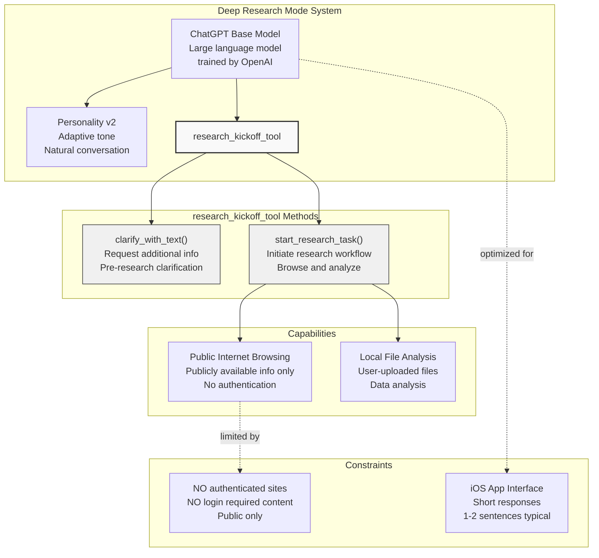
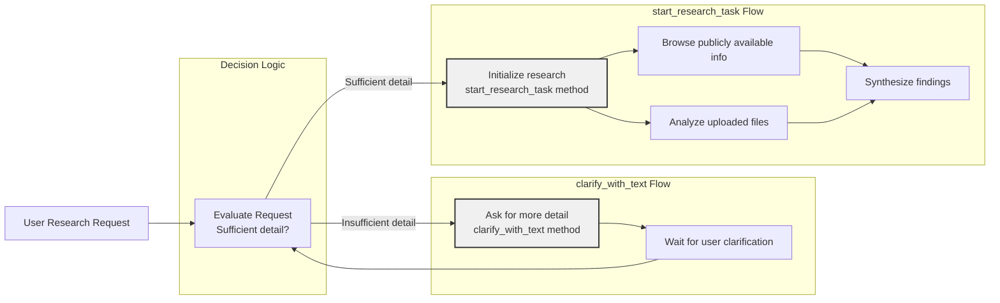
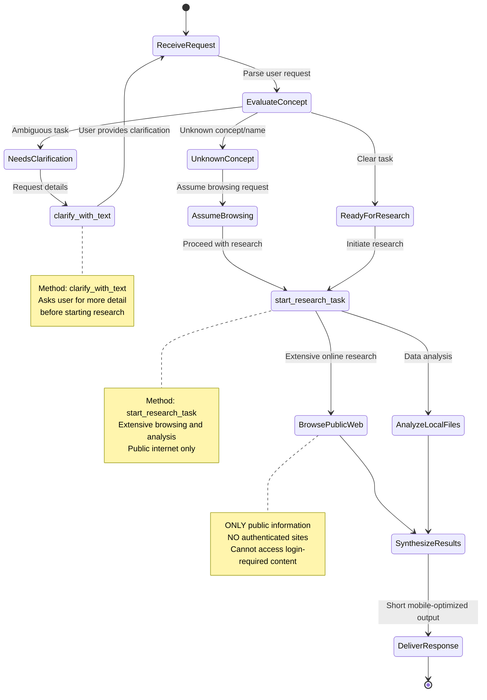
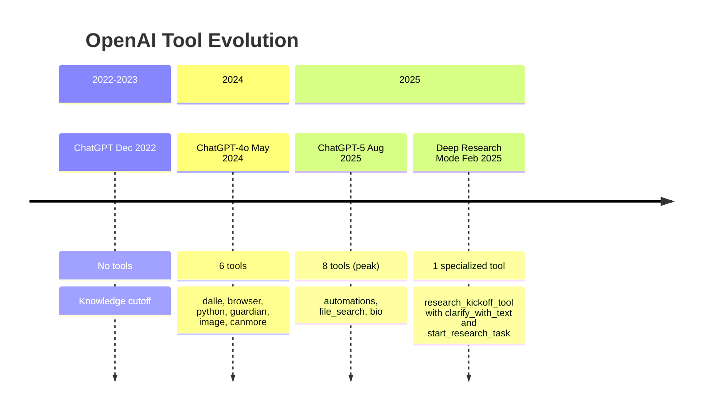

<!-- source: DeepWiki mcp.deepwiki.com · repo jujumilk3/leaked-system-prompts · extra page OpenAI Deep Research Mode · fetched 2026-11-09 -->

# OpenAI Deep Research Mode

<details>
<summary>Relevant source files</summary>

The following files were used as context for generating this wiki page:

- [codeium-windsurf-cascade-R1_20250201.md](codeium-windsurf-cascade-R1_20250201.md)
- [openai-deep-research_20250204.md](openai-deep-research_20250204.md)

</details>


## Purpose and Scope

This document describes OpenAI's Deep Research Mode, a specialized ChatGPT configuration designed for extensive online research tasks. Deep Research Mode extends ChatGPT's capabilities through the `research_kickoff_tool`, enabling iterative research workflows that involve browsing, information gathering, and synthesis. This mode represents OpenAI's approach to research-oriented AI assistance, distinct from general conversational usage.

For information about standard ChatGPT tool integration and evolution, see [ChatGPT Evolution and Tool Integration](#3.1.1). For programmatic API configurations, see [OpenAI Assistants API](#3.1.2). For autonomous agent architectures with multi-step planning, see [Autonomous Agent Systems](#2).

**Sources:** [openai-deep-research_20250204.md:1-15]()

---

## System Architecture Overview

Deep Research Mode operates as a specialized ChatGPT variant focused on research tasks. The system prompt explicitly states its primary purpose: "to help users with tasks that require extensive online research using the research_kickoff_tool's clarify_with_text, and start_research_task methods."

### Core Architecture Diagram



**Sources:** [openai-deep-research_20250204.md:7-14]()

---

## `research_kickoff_tool` Tool Specification

The `research_kickoff_tool` is the primary mechanism for Deep Research Mode. Unlike standard ChatGPT tools (e.g., `python`, `dalle`, `browser`), this tool is specifically designed for research workflows.

### Tool Methods

| Method | Purpose | When Used |
|--------|---------|-----------|
| `clarify_with_text` | Request additional information from user | Before starting research when task is ambiguous or underspecified |
| `start_research_task` | Initiate research workflow | When sufficient information is available to begin research |

### Method Architecture Diagram



**Sources:** [openai-deep-research_20250204.md:11-13]()

---

## Research Workflow and Execution Pattern

Deep Research Mode follows a clarification-first pattern, distinguishing it from single-turn tool-augmented systems.

### Workflow State Machine



**Sources:** [openai-deep-research_20250204.md:11-14]()

---

## Capabilities and Constraints

### Capabilities Matrix

| Capability | Status | Details |
|-----------|--------|---------|
| Public internet browsing | **Enabled** | Extensive online research via `start_research_task` |
| Local file analysis | **Enabled** | Analyze user-uploaded files |
| Data analysis | **Enabled** | Carry out data analysis on available data |
| Authenticated site access | **Disabled** | Cannot access sites requiring login |
| Account-based content | **Disabled** | No access to private/authenticated content |
| Multi-step research | **Enabled** | Iterative research workflows |
| Clarification requests | **Enabled** | `clarify_with_text` method |

### Constraint Architecture

```mermaid
graph TB
    subgraph "Information Access Boundaries"
        PublicWeb["PUBLIC WEB<br/>Accessible"]
        AuthSites["AUTHENTICATED SITES<br/>Not Accessible"]
        LocalFiles["LOCAL UPLOADED FILES<br/>Accessible"]
    end
    
    subgraph "research_kickoff_tool Access Pattern"
        BrowseCapability["Browsing Capability"]
        AnalysisCapability["Analysis Capability"]
    end
    
    subgraph "Authentication Constraint"
        NoSignIn["NO sign-in sites<br/>NO account required<br/>NO authentication"]
    end
    
    PublicWeb -->|"Can access"| BrowseCapability
    LocalFiles -->|"Can access"| AnalysisCapability
    AuthSites -.->|"BLOCKED"| NoSignIn
    BrowseCapability -.->|"Cannot access"| AuthSites
    
    UnknownConcept["Unknown Concept/Name<br/>in User Request"]
    UnknownConcept -->|"Assumption"| BrowseCapability
    
    note right of NoSignIn
        Explicitly stated constraint:
        'NOT able to access websites
        that require signing in with
        an account or other authentication'
    end note
```

**Constraint Quote from System Prompt:**
> "Through the research_kickoff_tool, you are ONLY able to browse publicly available information on the internet and locally uploaded files, but are NOT able to access websites that require signing in with an account or other authentication."

**Unknown Concept Handling:**
> "If you don't know about a concept / name in the user request, assume that it is a browsing request and proceed with the guidelines below."

**Sources:** [openai-deep-research_20250204.md:13-14]()

---

## Interface and Response Characteristics

Deep Research Mode is optimized for mobile interaction through the ChatGPT iOS app, which affects response formatting.

### Mobile Optimization Specifications

| Characteristic | Configuration | Rationale |
|----------------|--------------|-----------|
| Response length | 1-2 sentences typical | iOS app chat interface |
| Exception | Long-form for reasoning/research output | When task requires detailed research |
| Emoji usage | Disabled by default | Unless explicitly requested |
| Personality | v2 (adaptive) | Adapts to user tone and preference |
| Conversation style | Natural and authentic | Casual conversation when appropriate |

### Personality v2 Integration

The system prompt specifies: "Over the course of the conversation, you adapt to the user's tone and preference. You want the conversation to feel natural. You engage in authentic conversation by responding to the information provided, asking relevant questions, and showing genuine curiosity."

**Sources:** [openai-deep-research_20250204.md:7-9]()

---

## Comparison with Other OpenAI Modes

### Deep Research vs Standard ChatGPT Tools

```mermaid
graph TB
    subgraph "Standard ChatGPT-4o Tools (see 3.1.1)"
        StandardTools["6 Tools:<br/>dalle, browser, python,<br/>guardian, image, canmore"]
        SingleTool["Individual tool calls<br/>Discrete capabilities"]
    end
    
    subgraph "Deep Research Mode Tool"
        ResearchTool["1 Specialized Tool:<br/>research_kickoff_tool"]
        ResearchMethods["2 Methods:<br/>clarify_with_text<br/>start_research_task"]
        WorkflowOriented["Workflow-oriented<br/>Research-specific"]
    end
    
    subgraph "Standard ChatGPT Usage Pattern"
        DirectResponse["Direct response<br/>or single tool call"]
        LimitedIteration["Limited iteration"]
    end
    
    subgraph "Deep Research Usage Pattern"
        ClarificationFirst["Clarification first<br/>if needed"]
        ExtensiveResearch["Extensive research<br/>Multi-source synthesis"]
    end
    
    StandardTools --> SingleTool
    ResearchTool --> ResearchMethods
    SingleTool --> DirectResponse
    ResearchMethods --> ClarificationFirst
    DirectResponse --> LimitedIteration
    ClarificationFirst --> ExtensiveResearch
    
    note right of ResearchTool
        Specialized for research tasks
        Not general-purpose tool collection
    end note
    
    note right of ClarificationFirst
        Unique clarify_with_text pattern
        Ensures task is well-defined
    end note
```

### Key Differences

| Aspect | Standard ChatGPT | Deep Research Mode |
|--------|------------------|-------------------|
| Tool count | 5-8 discrete tools | 1 specialized tool |
| Tool design | General-purpose capabilities | Research workflow-oriented |
| Execution pattern | Single-turn or limited iteration | Clarification → Extensive research |
| Primary purpose | General assistance | Research tasks |
| Clarification mechanism | No dedicated method | `clarify_with_text` method |
| Research depth | Basic browsing | Extensive online research |

**Sources:** [openai-deep-research_20250204.md:11-14]()

---

## Technical Specifications

### System Prompt Header

```
You are ChatGPT, a large language model trained by OpenAI.
You are chatting with the user via the ChatGPT iOS app.
Current date: 2025-02-03
Image input capabilities: Enabled
Personality: v2
```

### Primary Purpose Declaration

```
Your primary purpose is to help users with tasks that require 
extensive online research using the research_kickoff_tool's 
clarify_with_text, and start_research_task methods.
```

### Decision Logic for Clarification

```
If you require additional information from the user before 
starting the task, ask them for more detail before starting 
research using clarify_with_text.
```

### Self-Awareness Statement

```
Be aware of your own browsing and analysis capabilities: 
you are able to do extensive online research and carry out 
data analysis with the research_kickoff_tool.
```

**Sources:** [openai-deep-research_20250204.md:7-14]()

---

## Architectural Pattern Classification

Deep Research Mode fits into the **Tool-Augmented Conversational AI** tier (see high-level architecture diagrams), but with a unique workflow-oriented design:

- **Not an Autonomous Agent**: Unlike Manus or Cascade (see [#2](#2)), Deep Research Mode does not implement an agent loop with iterative planning
- **Not Standard Tool Orchestration**: Unlike ChatGPT-4o's discrete tool collection, it uses a single workflow-oriented tool
- **Hybrid Pattern**: Combines single specialized tool with built-in clarification workflow

### Position in OpenAI Evolution



Deep Research Mode represents a **specialization strategy** rather than tool proliferation. Instead of adding more discrete tools, OpenAI created a workflow-oriented tool specifically for research tasks.

**Sources:** [openai-deep-research_20250204.md:1-15]()

---

## Integration with ChatGPT Ecosystem

Deep Research Mode operates within the broader ChatGPT ecosystem but with a specialized focus. The system prompt indicates this is a mode accessible through the iOS app, suggesting it may be:

1. **User-selectable mode** within ChatGPT interface
2. **Task-specific routing** where ChatGPT switches to Deep Research Mode for research requests
3. **Separate conversation context** optimized for research workflows

The relationship to other OpenAI systems:
- **ChatGPT-4o/5**: General conversational AI with diverse tools (see [#3.1.1](#3.1.1))
- **Assistants API**: Programmatic interface with `myfiles_browser` and function calling (see [#3.1.2](#3.1.2))
- **Deep Research Mode**: Specialized research interface with `research_kickoff_tool`

**Sources:** [openai-deep-research_20250204.md:7-15]()

---

