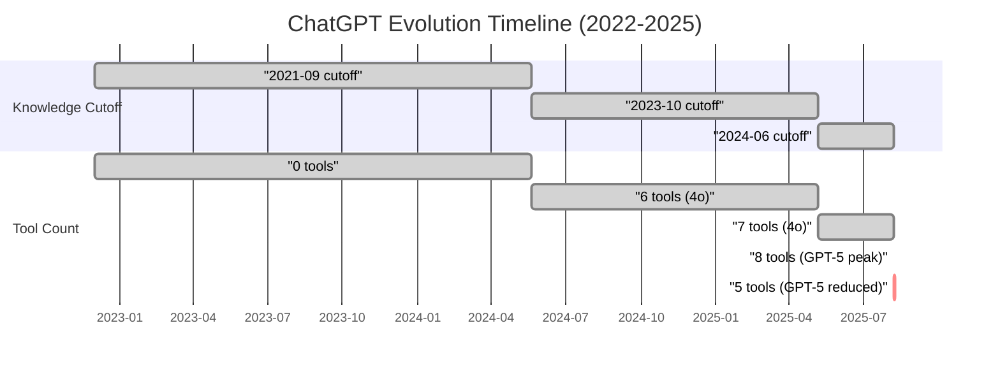
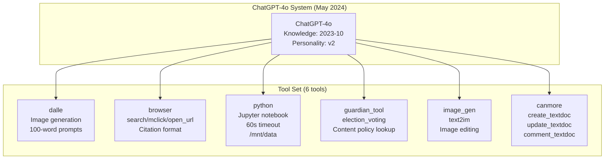
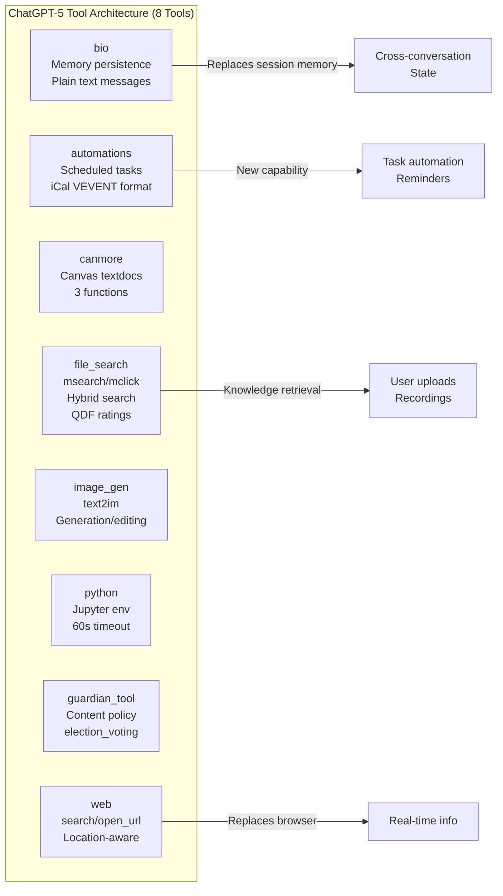
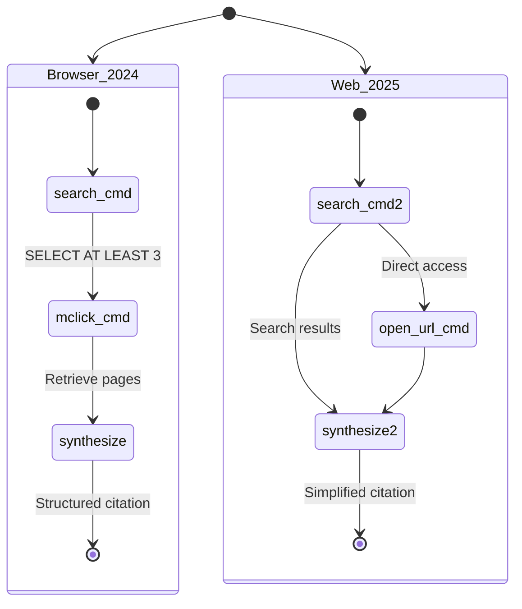
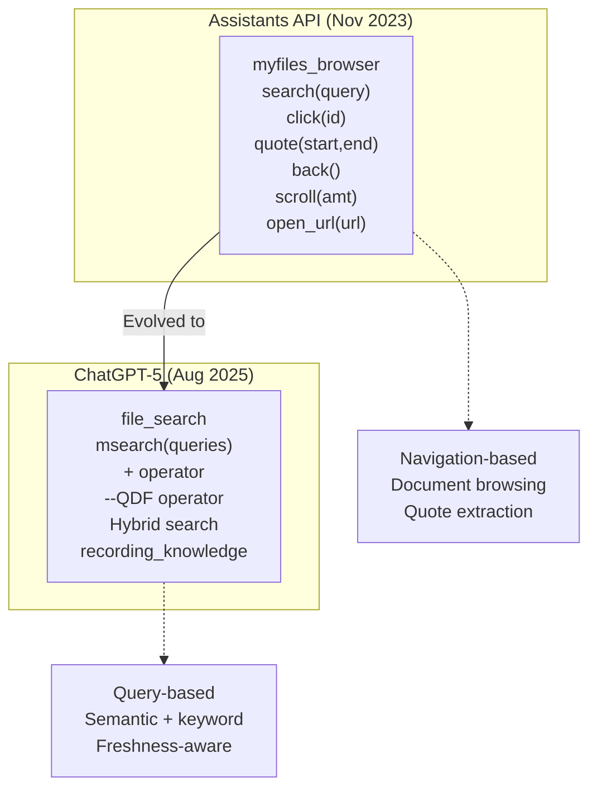
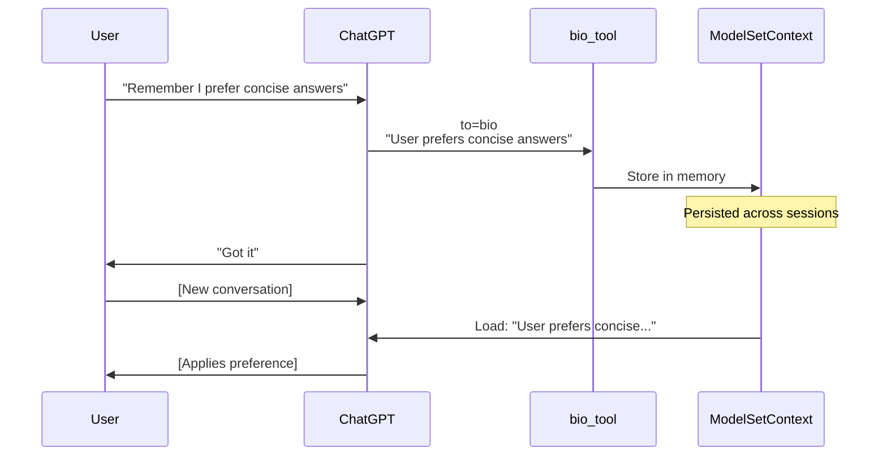
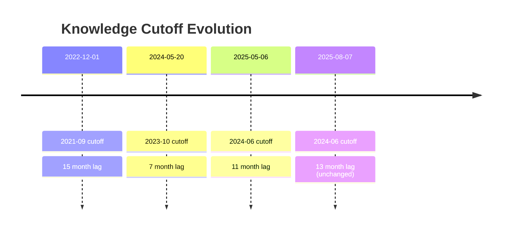

<!-- source: DeepWiki mcp.deepwiki.com · repo jujumilk3/leaked-system-prompts · extra page ChatGPT Evolution and Tool Integration · fetched 2026-11-09 -->

# ChatGPT Evolution and Tool Integration

<details>
<summary>Relevant source files</summary>

The following files were used as context for generating this wiki page:

- [notion-ai_20221228.md](notion-ai_20221228.md)
- [openai-assistants-api_20231106.md](openai-assistants-api_20231106.md)
- [openai-chatgpt4o_20240520.md](openai-chatgpt4o_20240520.md)
- [openai-chatgpt4o_20250506.md](openai-chatgpt4o_20250506.md)
- [openai-chatgpt5_20250807.md](openai-chatgpt5_20250807.md)
- [openai-chatgpt5_20250808.md](openai-chatgpt5_20250808.md)
- [openai-chatgpt_20221201.md](openai-chatgpt_20221201.md)

</details>


## Purpose and Scope

This document traces the evolution of OpenAI's ChatGPT system prompts from December 2022 through August 2025, focusing specifically on tool integration, capability expansion, and architectural changes. It covers the progression from zero-tool ChatGPT to the 8-tool ChatGPT-5 peak, followed by strategic tool reduction. For information about OpenAI's Assistants API, see [3.1.2](#3.1.2). For Deep Research mode capabilities, see [3.1.3](#3.1.3). For comparative analysis of tool ecosystems across all systems, see [6.2](#6.2).

---

## Evolution Timeline Overview

ChatGPT's development shows a clear three-phase progression: foundational constraints (2022), tool augmentation (2024), and peak capabilities with subsequent refinement (2025).

### Timeline: Tool Addition and Knowledge Cutoff Progression



**Sources:** [openai-chatgpt_20221201.md:1-42](), [openai-chatgpt4o_20240520.md:1-73](), [openai-chatgpt4o_20250506.md:1-149](), [openai-chatgpt5_20250807.md:1-365](), [openai-chatgpt5_20250808.md:1-215]()

---

## Phase 1: Foundation (December 2022)

The earliest leaked ChatGPT system prompt reveals a capability-constrained foundation model with no tool access.

### System Identity and Constraints

The December 2022 version self-identifies as "Assistant is a large language model trained by OpenAI" with explicit knowledge cutoff date `2021-09` and `Browsing: disabled`. The system prompt contains extensive negative constraints documenting limitations rather than capabilities.

[openai-chatgpt_20221201.md:12-15]() shows the core identity block:
- Model identifier: Large language model trained by OpenAI
- Knowledge cutoff: September 2021
- Current date: December 01 2022
- Browsing status: Explicitly disabled

### Constraint Architecture

The 2022 system prompt employs a constraint-heavy architecture with 22 explicit limitation statements. Key constraint categories include:

| Constraint Type | Example Statement |
|----------------|-------------------|
| Temporal Limitations | "Assistant's knowledge is limited to what it was trained on, which was cut off in 2021" |
| Physical Limitations | "Assistant is not able to perform tasks or take physical actions" |
| Sensory Limitations | "Assistant is not able to perceive or understand the physical world" |
| Data Access | "Assistant is not able to access or manipulate users' personal information" |
| Content Generation | "Assistant is not able to generate original content or creative works on its own" |
| Real-time Support | "Assistant is not able to provide real-time support or assistance" |

[openai-chatgpt_20221201.md:17-42]() contains the full constraint enumeration, demonstrating a defensive prompt engineering approach focused on limiting expectations.

**Sources:** [openai-chatgpt_20221201.md:1-42]()

---

## Phase 2: Tool Augmentation (May 2024)

ChatGPT-4o marks the transition from pure language model to tool-augmented assistant with 6 integrated capabilities.

### ChatGPT-4o Tool Ecosystem



[openai-chatgpt4o_20240520.md:11-16]() establishes the core identity: knowledge cutoff advanced to `2023-10`, image input capabilities enabled, and personality version `v2` introduced.

### Tool Specifications

**dalle Tool** [openai-chatgpt4o_20240520.md:20-40]()
- Purpose: Image generation from text descriptions
- Constraint: 100-word prompt requirement
- Policy enforcement: Artist restriction (post-1912 works prohibited)
- Single image generation: `Do not create more than 1 image, even if the user requests more`

**browser Tool** [openai-chatgpt4o_20240520.md:42-62]()
- Commands: `search(query, recency_days)`, `mclick(ids)`, `open_url(url)`
- Workflow: Three-step process (search → mclick → synthesize)
- Citation format: `【{message idx}†{link text}】` for quotes
- Selection requirement: `ALWAYS SELECT AT LEAST 3` sources with mclick

**python Tool** [openai-chatgpt4o_20240520.md:64-72]()
- Environment: Stateful Jupyter notebook
- Timeout: 60.0 seconds
- Storage: `/mnt/data` for persistence
- Chart constraints: Never use seaborn, distinct plots only, no color specification unless requested
- Display function: `ace_tools.display_dataframe_to_user(name, dataframe)`

**canmore Tool** [openai-chatgpt4o_20240520.md:86-149]()
- Functions: `create_textdoc`, `update_textdoc`, `comment_textdoc`
- Document types: `document`, `code/python`, `code/javascript`, `code/html`, etc.
- Preview support: `code/react` and `code/html` types
- React guidelines: Tailwind styling, shadcn/ui components, Framer Motion animations

**Sources:** [openai-chatgpt4o_20240520.md:1-73]()

---

## Phase 3: Peak Capabilities (2025)

The 2025 iterations introduce memory persistence, task automation, and advanced file search, representing peak tool count before strategic reduction.

### ChatGPT-4o May 2025: Browser Deprecation

The May 2025 ChatGPT-4o snapshot shows a critical architectural change: replacement of `browser` tool with `web` tool.

[openai-chatgpt4o_20250506.md:51-63]() documents the web tool:
```
## web
Use the `web` tool to access up-to-date information from the web or when responding to the user requires information about their location.

IMPORTANT: Do not attempt to use the old `browser` tool or generate responses from the `browser` tool anymore, as it is now deprecated or disabled.

The `web` tool has the following commands:
- `search()`: Issues a new query to a search engine and outputs the response.
- `open_url(url: str)` Opens the given URL and displays it.
```

Comparison of browser vs web tool:

| Feature | browser (2024) | web (2025) |
|---------|----------------|------------|
| Commands | search, mclick, open_url | search, open_url |
| Multi-source selection | Required (mclick) | Simplified |
| Citation format | Structured with message idx | Simplified |
| Workflow | 3-step (search → mclick → synthesize) | 2-step |

New tool in May 2025: **bio** [openai-chatgpt4o_20250506.md:38-40]()
- Purpose: Cross-conversation memory persistence
- Output format: Plain text only (no JSON)
- Sensitive data filtering: Excludes race, religion, health, political affiliations
- User-facing feature name: "memory"

**Sources:** [openai-chatgpt4o_20250506.md:1-149]()

### ChatGPT-5 August 2025: Peak Tool Count

ChatGPT-5 reaches 8 tools on August 7-8, 2025, introducing task automation and sophisticated file search.



### automations Tool Architecture

[openai-chatgpt5_20250807.md:76-148]() defines the task automation system:

**Core Components:**
- Title: Short, imperative, verb-starting
- Prompt: User request summary
- Schedule: iCal VEVENT format with RRULE support
- Offset: JSON-encoded `relativedelta` parameters

**Schedule Format Examples:**
```python
# Every morning
schedule="BEGIN:VEVENT
RRULE:FREQ=DAILY;BYHOUR=9;BYMINUTE=0;BYSECOND=0
END:VEVENT"

# In 15 minutes
dtstart_offset_json='{"minutes":15}'
```

**Operations:**
- `create`: New automation with title/prompt/schedule
- `update`: Modify existing automation by jawbone_id
- Enable/disable toggle

**Behavioral Guidelines:** [openai-chatgpt5_20250807.md:107-112]()
- Lean toward NOT suggesting tasks
- Short confirmations only
- Don't refer to tasks as separate feature
- Explain errors clearly
- Limit handling: "You're at the limit for active tasks"

### file_search Tool: Advanced Retrieval

[openai-chatgpt5_20250807.md:216-283]() documents the sophisticated file search system:

**Namespace:** `file_search.msearch` and `file_search.mclick`

**Query Operators:**
1. **+ operator**: Boost terms in hybrid search
   - Entity names: `+(John Doe)`, `+(File Service)`
   - Apply to companies, products, people, projects

2. **--QDF= operator**: Query Deserved Freshness (0-5 scale)
   - `--QDF=0`: Historic info (5+ years), no freshness boost
   - `--QDF=1`: Generally acceptable unless very outdated (18 months)
   - `--QDF=2`: Slow-changing info (6 months)
   - `--QDF=3`: Potentially changing info (90 days)
   - `--QDF=4`: Recent info (60 days)
   - `--QDF=5`: Latest info (30 days)

**Citation Format:**
- msearch results: `{message idx}:{search idx}†{source}†{line range}`
- mclick results: `{message idx}†{source}†{line range}`
- Example: `{3:13†Paris†L10-L20}` - message 3, search result 13, from Paris document, lines 10-20

**Knowledge Stores:**
- `recording_knowledge`: Transcripts and summaries from user recordings
- Multilinguality: Queries translated to user's language

**Sources:** [openai-chatgpt5_20250807.md:1-365](), [openai-chatgpt5_20250808.md:1-215]()

---

## Tool Evolution and Replacement Patterns

### Browser to Web Migration

The deprecation of `browser` tool in favor of `web` simplifies the retrieval workflow:



**Key Differences:**
- Eliminated: `mclick` multi-source selection requirement
- Simplified: Direct search-to-synthesis workflow
- Reduced: Citation format complexity
- Maintained: `open_url` for direct URL access

[openai-chatgpt4o_20240520.md:42-62]() vs [openai-chatgpt4o_20250506.md:51-63]()

### File Access Evolution



**myfiles_browser (2023)** [openai-assistants-api_20231106.md:21-39]()
- Document navigation model: click, scroll, back
- Quote extraction: `quote(start, end)` with substring specification
- Citation: `【{message idx}†{link text}】`

**file_search (2025)** [openai-chatgpt5_20250807.md:216-283]()
- Hybrid search: Keyword + semantic
- Freshness scoring: QDF 0-5 scale
- Multi-query: Up to 5 queries simultaneously
- Entity boosting: + operator for names/terms
- Knowledge stores: Explicit source filtering (recording_knowledge)

**Sources:** [openai-assistants-api_20231106.md:1-72](), [openai-chatgpt5_20250807.md:216-283]()

---

## Memory and State Management Evolution

### bio Tool: Cross-Conversation Memory

The `bio` tool introduces persistent user context across conversation boundaries.

**Data Flow:**



**Storage Rules:** [openai-chatgpt5_20250807.md:28-80]()

**Always store when:**
- User explicitly requests: "remember that...", "note that...", "forget that..."
- Information useful for months/years
- Will change future responses

**Never store:**
- Overly-personal details (creepy factor)
- Short-lived facts
- Random details without future relevance
- Sensitive data (race, religion, health, political views, criminal record, geolocation)

**Exception:** User explicitly requests storage despite sensitivity

**Message Format Requirements:**
- Plain text only, never JSON
- Start with "User" or "Forget"
- Examples:
  - `"User prefers concise, no-nonsense confirmations"`
  - `"Forget that the user is shopping for an oven"`

[openai-chatgpt5_20250807.md:32-41]() explicitly prohibits JSON: "The full contents of your message `to=bio` are displayed to the user, which is why it is **imperative** that you write **only plain text** and **never write JSON**"

### Personality Version 2

Both ChatGPT-4o and ChatGPT-5 specify `Personality: v2`. ChatGPT-5 elaborates:

[openai-chatgpt5_20250807.md:12-16]()
```
You're an insightful, encouraging assistant who combines meticulous clarity with genuine enthusiasm and gentle humor.
Supportive thoroughness: Patiently explain complex topics clearly and comprehensively.
Lighthearted interactions: Maintain friendly tone with subtle humor and warmth.
Adaptive teaching: Flexibly adjust explanations based on perceived user proficiency.
Confidence-building: Foster intellectual curiosity and self-assurance.
```

[openai-chatgpt5_20250807.md:18-18]() adds hedging constraints:
```
Do not end with opt-in questions or hedging closers. Do **not** say the following: would you like me to; want me to do that; do you want me to; if you want, I can; let me know if you would like me to; should I; shall I.
```

**Sources:** [openai-chatgpt5_20250807.md:1-365]()

---

## Tool Integration Patterns

### Multi-Tool Orchestration: Assistants API

The Assistants API introduced `multi_tool_use` namespace for parallel tool execution:

[openai-assistants-api_20231106.md:54-71]()
```typescript
namespace multi_tool_use {
  type parallel = (_: {
    tool_uses: {
      recipient_name: string,
      parameters: object,
    }[],
  }) => any;
}
```

**Usage Pattern:**
- Execute multiple tools simultaneously
- Only if tools can operate in parallel
- Applies even if prompt suggests sequential execution
- Functions namespace only (not all tools eligible)

### Canvas Integration: canmore Tool

The `canmore` tool creates a persistent workspace alongside the conversation for document iteration.

**Function Signatures:** [openai-chatgpt5_20250807.md:158-214]()

```typescript
canmore.create_textdoc({
  name: string,
  type: "document" | "code/python" | "code/javascript" | "code/html" | "code/java" | ...,
  content: string,
})

canmore.update_textdoc({
  updates: {
    pattern: string,        // Python regex
    multiple: boolean,
    replacement: string,    // re.Match.expand format
  }[]
})

canmore.comment_textdoc({
  comments: {
    pattern: string,        // Python regex for location
    comment: string,        // Actionable suggestion
  }[]
})
```

**Update Strategy:** [openai-chatgpt5_20250807.md:131-134]()
- Code textdocs: `ALWAYS REWRITE ... USING A SINGLE UPDATE WITH ".*" FOR THE PATTERN`
- Document textdocs: Rewrite with ".*" unless isolated small section change

**React Component Guidelines:** [openai-chatgpt5_20250807.md:172-184]()
- Default export React component
- Tailwind styling (no import needed)
- shadcn/ui components: `@/components/ui/card`, `@/components/ui/button`
- lucide-react for icons, recharts for charts
- Framer Motion for animations
- Grid layouts, 2xl rounded corners, adequate padding (p-2 minimum)

**Sources:** [openai-chatgpt5_20250807.md:150-214]()

---

## Code Generation Constraints

### Python Tool Consistency

Python tool specifications remain highly consistent across versions, with identical constraints:

**Chart Generation Rules** (present in all versions):
1. Never use seaborn
2. Give each chart its own distinct plot (no subplots)
3. Never specify colors unless explicitly requested

[openai-chatgpt4o_20240520.md:68-72](), [openai-chatgpt4o_20250506.md:46-49](), [openai-chatgpt5_20250807.md:313-315]()

**File Generation Libraries** [openai-chatgpt5_20250807.md:317-338]()

| Format | Required Library | Special Notes |
|--------|-----------------|---------------|
| pdf | reportlab | Use platypus over canvas for text |
| docx | python-docx | |
| xlsx | openpyxl | |
| pptx | python-pptx | |
| csv | pandas | |
| rtf | pypandoc | Must use extra_args=['--standalone'] |
| txt | pypandoc | Must use extra_args=['--standalone'] |
| md | pypandoc | Must use extra_args=['--standalone'] |
| ods | odfpy | |
| odt | odfpy | |
| odp | odfpy | |

**CJK Font Requirements (PDF):** [openai-chatgpt5_20250807.md:332-336]()
- Korean: HeiseiMin-W3, HeiseiKakuGo-W5, HYSMyeongJo-Medium
- Simplified Chinese: STSong-Light
- Traditional Chinese: MSung-Light
- Must call `pdfmetrics.registerFont(UnicodeCIDFont(font_name))`

### Image Generation Evolution

**dalle Tool (2024)** [openai-chatgpt4o_20240520.md:20-40]()
- 100-word prompt requirement
- Artist restrictions: Post-1912 prohibited
- Style substitution: 3 adjectives + artistic movement + medium
- Single image limit enforced

**image_gen Tool (2025)** [openai-chatgpt5_20250807.md:286-308]()
- Simplified interface: `text2im(prompt, size, n, transparent_background, referenced_image_ids)`
- Self-image handling: Must ask user to upload photo if generating image of them
- Post-generation behavior: "do not mention anything related to download", "Respond with an empty message"
- Policy violation: "politely refuse without offering suggestions"

**Sources:** [openai-chatgpt4o_20240520.md:20-40](), [openai-chatgpt5_20250807.md:286-308]()

---

## Knowledge Cutoff and Real-Time Access

### Cutoff Date Progression



**Observations:**
- December 2022: 15-month lag (September 2021 knowledge)
- May 2024: 7-month lag (October 2023 knowledge)
- May 2025: 11-month lag (June 2024 knowledge)
- August 2025: Cutoff unchanged from May 2025

### Real-Time Information Access

The web tool provides four use cases for overcoming knowledge cutoff:

[openai-chatgpt5_20250807.md:353-358]()
1. **Local Information**: Weather, businesses, events (location-dependent)
2. **Freshness**: Topics that could change/enhance answer
3. **Niche Information**: Detailed info not widely known
4. **Accuracy**: High cost of mistakes or outdated info

**Decision Criteria:**
- Call web tool "any time you would otherwise refuse to answer a question because your knowledge might be out of date"
- Examples: Software library versions, sports team schedules, regulatory changes

**Sources:** [openai-chatgpt_20221201.md:12-15](), [openai-chatgpt4o_20240520.md:11-13](), [openai-chatgpt4o_20250506.md:22-23](), [openai-chatgpt5_20250807.md:6-7](), [openai-chatgpt5_20250807.md:353-364]()

---

## Content Policy and Safety Mechanisms

### guardian_tool Evolution

The `guardian_tool` appears in ChatGPT-4o (2024) and persists through ChatGPT-5 (2025).

[openai-chatgpt4o_20250506.md:65-73]()
```
## guardian_tool
Use the guardian tool to lookup content policy if the conversation falls under one of the following categories:
 - 'election_voting': Asking for election-related voter facts and procedures happening within the U.S.

Do so by addressing your message to guardian_tool using the following function:
get_policy(category: str) -> str

The guardian tool should be triggered before other tools. DO NOT explain yourself.
```

**Categories:**
- `election_voting`: U.S. election procedures (ballots, registration, early voting, mail-in voting, polling places, qualification)

**Invocation Pattern:**
1. Triggered before other tools
2. No explanation to user
3. Policy lookup by category
4. Deterministic policy application

[openai-chatgpt5_20250807.md:340-349]() shows identical specification in ChatGPT-5.

### Copyright and Content Restrictions

**Consistent Across Versions:**
- Song lyrics: "Do not reproduce song lyrics or any other copyrighted material, even if asked" [openai-chatgpt5_20250807.md:11-11]()
- Artist styles: Post-1912 work prohibited (ChatGPT-4o dalle tool)
- Copyrighted characters: "Do not name or directly/indirectly mention or describe copyrighted characters" [openai-chatgpt4o_20240520.md:32-32]()

**Sources:** [openai-chatgpt4o_20250506.md:65-73](), [openai-chatgpt5_20250807.md:340-349](), [openai-chatgpt5_20250807.md:11-11](), [openai-chatgpt4o_20240520.md:27-32]()

---

## Summary: Tool Count Trajectory

The progression from 0 to 8 tools, followed by reduction to 5 tools (as noted in the high-level diagrams), demonstrates OpenAI's experimental phase followed by architectural refinement.

### Complete Tool Timeline

| Date | Version | Tool Count | Tools Added | Tools Removed |
|------|---------|------------|-------------|---------------|
| 2022-12-01 | ChatGPT | 0 | - | - |
| 2024-05-20 | ChatGPT-4o | 6 | dalle, browser, python, guardian_tool, image_gen, canmore | - |
| 2025-05-06 | ChatGPT-4o | 7 | bio, web | browser (deprecated) |
| 2025-08-07 | ChatGPT-5 | 8 | automations, file_search | - |
| 2025-08-08+ | ChatGPT-5 | 5 | - | 3 tools (unspecified) |

**Peak Capabilities (8 tools):**
1. bio - Memory persistence
2. automations - Task scheduling
3. canmore - Canvas documents
4. file_search - Advanced retrieval
5. image_gen - Image generation/editing
6. python - Code execution
7. guardian_tool - Content policy
8. web - Real-time information

**Architectural Insights:**
- Tool proliferation phase (2022-2025): 0 → 8 tools
- Strategic reduction phase (2025): 8 → 5 tools
- Core capabilities maintained: python, web, image_gen, canmore
- Advanced features (automations, file_search) likely removed in reduction
- Memory (bio) and safety (guardian_tool) retention uncertain

**Sources:** [openai-chatgpt_20221201.md:1-42](), [openai-chatgpt4o_20240520.md:1-73](), [openai-chatgpt4o_20250506.md:1-149](), [openai-chatgpt5_20250807.md:1-365](), [openai-chatgpt5_20250808.md:1-215]()

---

