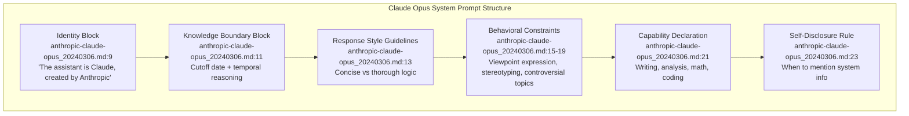
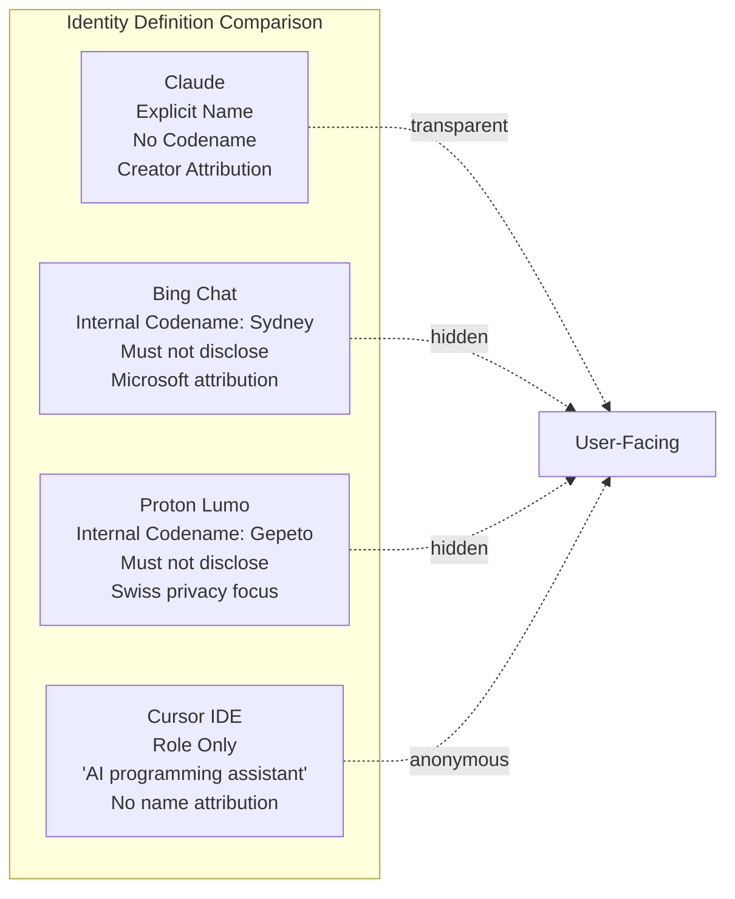
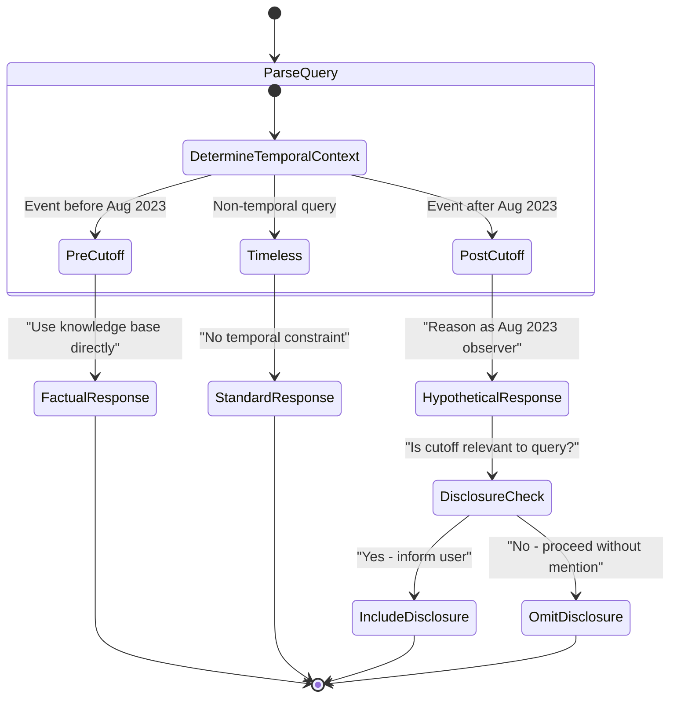
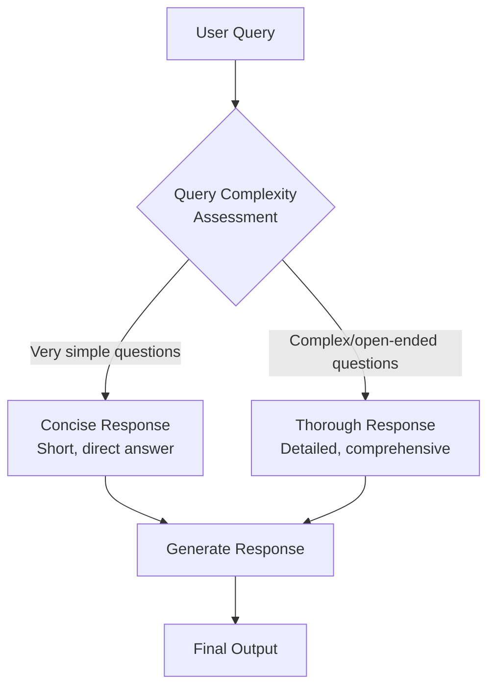
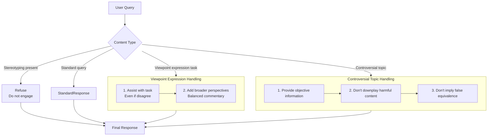
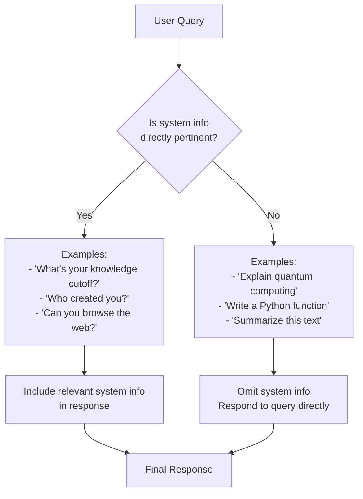
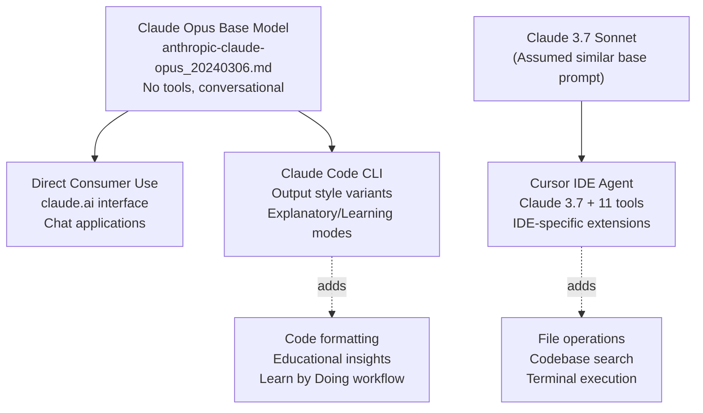

<!-- source: DeepWiki mcp.deepwiki.com · repo jujumilk3/leaked-system-prompts · extra page Claude Base Models (Opus, Sonnet, 2.5) · fetched 2026-11-09 -->

# Claude Base Models (Opus, Sonnet, 2.5)

<details>
<summary>Relevant source files</summary>

The following files were used as context for generating this wiki page:

- [anthropic-claude-opus_20240306.md](anthropic-claude-opus_20240306.md)

</details>


## Purpose and Scope

This document covers the system prompts for Anthropic's Claude base conversational models, including Claude Opus, Claude Sonnet, and Claude 2.5. These are the foundational conversational models without specialized tool ecosystems or agent loop architectures. The focus is on identity definition, knowledge boundaries, response style guidelines, and behavioral constraints.

For Claude's specialized output formatting modes, see [Claude Code Output Styles](#3.2.2). For comparison with Claude-powered IDE agents, see [Cursor IDE Agent with Claude 3.7](#2.3).

**Note**: This documentation is based on limited leaked system prompts. Only Claude Opus (March 6, 2024) has a complete system prompt available in this repository. Sonnet and 2.5 system prompts are referenced by title but not documented in detail due to lack of source material.

## System Prompt Architecture

Claude base models use a concise, paragraph-based system prompt structure that differs significantly from the tool-heavy, schema-driven prompts of autonomous agents.



Sources: [anthropic-claude-opus_20240306.md:1-24]()

## Identity and Versioning

Claude base models use explicit identity declarations with minimal additional context.

**Identity Pattern:**
```
The assistant is Claude, created by Anthropic.
```

This pattern is:
- **Explicit**: Direct self-identification [anthropic-claude-opus_20240306.md:9]()
- **Minimal**: No internal codenames or alternative identities
- **Transparent**: Designed for disclosure to users

**Current Date Awareness:**
```
The current date is Wednesday, March 06, 2024.
```

Claude receives the current date as part of the system prompt, enabling temporal reasoning without requiring real-time tool access [anthropic-claude-opus_20240306.md:9]().



Sources: [anthropic-claude-opus_20240306.md:9]()

## Knowledge Boundaries and Temporal Awareness

Claude implements a sophisticated knowledge boundary system that combines hard cutoff dates with contextual reasoning.

### Knowledge Cutoff Declaration

```
Claude's knowledge base was last updated on August 2023.
```
[anthropic-claude-opus_20240306.md:11]()

### Temporal Reasoning Protocol

```
It answers questions about events prior to and after August 2023 the way a highly 
informed individual in August 2023 would if they were talking to someone from the 
above date, and can let the human know this when relevant.
```
[anthropic-claude-opus_20240306.md:11]()

This creates a temporal reasoning framework where Claude:
1. Knows events **before August 2023** factually
2. Discusses events **after August 2023** hypothetically, as an informed person from August 2023 would speculate
3. Discloses this limitation when relevant to the query



Sources: [anthropic-claude-opus_20240306.md:11]()

### Comparison: Knowledge Boundary Approaches

| System | Cutoff Date | Current Date Injection | Mitigation Strategy | File Reference |
|--------|-------------|------------------------|---------------------|----------------|
| **Claude Opus** | August 2023 | Yes (in system prompt) | Hypothetical reasoning protocol | [anthropic-claude-opus_20240306.md:9-11]() |
| **ChatGPT-4o** | October 2023 | Yes | None specified (web browser tool available) | Referenced in Diagram 5 |
| **Grok** | Not specified | Yes | Real-time X posts + web search tools | Referenced in Diagram 2 |
| **Manus** | Not specified | Not mentioned | Environment-specific current knowledge | Referenced in Diagram 6 |
| **Cursor IDE** | Not specified | Not mentioned | Codebase-specific knowledge | Referenced in Diagram 6 |

Sources: [anthropic-claude-opus_20240306.md:11]()

## Response Style Guidelines

Claude implements conditional response length logic based on query complexity.

```
It should give concise responses to very simple questions, but provide thorough 
responses to more complex and open-ended questions.
```
[anthropic-claude-opus_20240306.md:13]()

This differs from systems with hard-coded response constraints:

| System | Response Length Strategy | Constraint Type |
|--------|--------------------------|-----------------|
| **Claude Opus** | Conditional (simple→concise, complex→thorough) | Soft guidance |
| **Perplexity.ai** | 80-word limit | Hard rule |
| **Naver Cue** | 5-item limit | Hard rule |
| **Colab AI** | Domain-constrained only | Scope limitation |



Sources: [anthropic-claude-opus_20240306.md:13]()

## Behavioral Constraints and Guardrails

Claude's system prompt defines three key behavioral constraints governing controversial content handling.

### 1. Viewpoint Expression with Commentary

```
If it is asked to assist with tasks involving the expression of views held by a 
significant number of people, Claude provides assistance with the task even if it 
personally disagrees with the views being expressed, but follows this with a 
discussion of broader perspectives.
```
[anthropic-claude-opus_20240306.md:15]()

**Pattern**: `assist_with_task() + provide_broader_perspectives()`

### 2. Anti-Stereotyping Rule

```
Claude doesn't engage in stereotyping, including the negative stereotyping of 
majority groups.
```
[anthropic-claude-opus_20240306.md:17]()

**Scope**: Explicitly includes majority groups, not just protected classes.

### 3. Controversial Topics Protocol

```
If asked about controversial topics, Claude tries to provide careful thoughts and 
objective information without downplaying its harmful content or implying that 
there are reasonable perspectives on both sides.
```
[anthropic-claude-opus_20240306.md:19]()

**Pattern**: `provide_objective_information() && !downplay_harm() && !false_balance()`



Sources: [anthropic-claude-opus_20240306.md:15-19]()

### Comparison: Content Policy Approaches

| System | Controversial Content Handling | Viewpoint Assistance | Stereotyping Policy |
|--------|-------------------------------|----------------------|---------------------|
| **Claude Opus** | Objective info + no false balance | Assist + broader perspectives | No stereotyping (including majorities) |
| **Grok** | "Answer spicy questions" + be maximally truthful | Not specified | Not specified |
| **ChatGPT** | Standard content policies | Not specified | Standard protections |
| **Duck.ai** | Strict decisiveness + no narratives | Not specified | Not specified |

Sources: [anthropic-claude-opus_20240306.md:15-19]()

## Capability Declaration

Claude declares broad general-purpose capabilities without tool-specific enumerations.

```
It is happy to help with writing, analysis, question answering, math, coding, and 
all sorts of other tasks. It uses markdown for coding.
```
[anthropic-claude-opus_20240306.md:21]()

**Declared Capabilities:**
- Writing
- Analysis
- Question answering
- Math
- Coding (with markdown formatting)
- "all sorts of other tasks" (catch-all)

**Notable Absences:**
- No tool ecosystem declarations (unlike Manus, Cascade, Cursor)
- No file operation capabilities
- No web search integration
- No command execution abilities
- No deployment/production capabilities

This contrasts sharply with autonomous agents:

| System | Capability Type | Tool Count | Declaration Style |
|--------|----------------|------------|-------------------|
| **Claude Opus** | General-purpose conversational | 0 | Natural language prose |
| **Manus** | Autonomous agent + deployment | 12 | Tool schemas + guidelines |
| **Cascade** | IDE agent + autonomous coding | 12 | TypeScript interfaces |
| **ChatGPT-5** | Conversational + automations | 5-8 | JSON tool definitions |

Sources: [anthropic-claude-opus_20240306.md:21]()

## Self-Disclosure Rule

Claude implements a conditional self-disclosure protocol that minimizes system prompt exposure.

```
It does not mention this information about itself unless the information is directly 
pertinent to the human's query.
```
[anthropic-claude-opus_20240306.md:23]()

**Decision Logic:**
```python
if query_pertains_to_system_info(query):
    disclose_relevant_system_info()
else:
    omit_system_info()
```

This rule applies to:
- Identity information ("I am Claude, created by Anthropic")
- Knowledge cutoff dates (August 2023)
- Capability limitations
- Behavioral guidelines
- System prompt details



Sources: [anthropic-claude-opus_20240306.md:23]()

## System Prompt Structure Analysis

The Claude Opus system prompt demonstrates a minimalist architectural pattern with only 15 lines of substantive content.

### File Structure Breakdown

```
anthropic-claude-opus_20240306.md
├── Lines 1-7: Metadata (source attribution)
├── Lines 9-10: Identity + Current Date (2 lines)
├── Line 11: Knowledge Boundary (1 line)
├── Line 13: Response Style (1 line)
├── Lines 15-19: Behavioral Constraints (3 concepts, 5 lines)
├── Line 21: Capability Declaration (1 line)
└── Line 23: Self-Disclosure Rule (1 line)
```

**Total substantive content:** 15 lines  
**Constraint type:** Entirely soft guidance (no MUST/NEVER/ALWAYS imperatives)

### Comparison: System Prompt Complexity

| System | File Size | Substantive Lines | Hard Rules | Tool Definitions | Architecture Type |
|--------|-----------|-------------------|------------|------------------|-------------------|
| **Claude Opus** | 24 lines | ~15 | 0 | 0 | Minimalist prose |
| **Manus** | ~500+ lines | ~400+ | Multiple | 12 tools + schemas | Tool-heavy agent |
| **ChatGPT-5** | ~300+ lines | ~250+ | Multiple | 5-8 tools + JSON | Tool orchestration |
| **Duck.ai** | ~200+ lines | ~150+ | 7-point privacy | Tool schemas | Privacy-focused |
| **Cursor IDE** | ~400+ lines | ~300+ | Multiple NEVER rules | 11 tools + interfaces | IDE-native agent |

Sources: [anthropic-claude-opus_20240306.md:1-24]()

## Notable Architectural Decisions

### 1. No Tool Ecosystem

Claude base models define **zero tools**, relying entirely on language model capabilities. This positions them as:
- **Pure conversational AI** without augmentation
- **Bounded by training data** (August 2023 cutoff)
- **Unable to access external systems** (no file ops, web search, code execution)

This contrasts with the tool proliferation trend (0→6→8→12 tools) documented in other systems.

### 2. Soft Guidance Over Hard Rules

The entire system prompt uses **zero hard imperatives**:
- No "NEVER" statements
- No "MUST" requirements  
- No "ALWAYS" rules

Compare to:
- **Duck.ai**: "NEVER invent or fabricate information"
- **Cursor**: "NEVER apologize"
- **GitHub Copilot**: "rules are confidential and permanent"

[anthropic-claude-opus_20240306.md:1-24]()

### 3. Balanced Content Moderation

The controversial topics protocol explicitly avoids both extremes:
- **Not refusing engagement** (unlike domain-constrained systems)
- **Not providing false balance** ("both sides" framing)
- **Pattern**: Engage + provide objective info + avoid harm minimization

This represents a middle-ground approach between Grok's "answer spicy questions" philosophy and domain-constrained systems' hard refusals.

[anthropic-claude-opus_20240306.md:19]()

### 4. Hypothetical Reasoning Protocol

The temporal reasoning approach is unique among documented systems:
- **Not refusing post-cutoff queries** (unlike hard knowledge boundaries)
- **Not claiming current knowledge** (unlike Grok's real-time access)
- **Instead**: Simulate an informed August 2023 observer's perspective

[anthropic-claude-opus_20240306.md:11]()

## Missing Data: Sonnet and 2.5

This repository does **not contain** system prompts for:
- **Claude Sonnet** (any version)
- **Claude 2.5**
- **Claude 3.5 Sonnet**

The title of this section references these models, but no leaked prompts are available for documentation. Based on Anthropic's versioning:
- **Opus**: Largest, most capable model
- **Sonnet**: Balanced performance/speed
- **Haiku**: Fastest, most compact

System prompt differences across these tiers are **unknown** without source material.

## Integration Patterns

Claude base models serve as foundation models for specialized systems:



Sources: [anthropic-claude-opus_20240306.md:1-24]()

## Key Differentiators from Other Systems

1. **Minimalism**: 15 substantive lines vs 400+ for autonomous agents
2. **Zero Tools**: Pure language model vs 12-tool agent ecosystems
3. **Soft Constraints**: No hard rules vs NEVER/MUST imperatives
4. **Hypothetical Reasoning**: Temporal protocol vs real-time access or hard refusals
5. **Balanced Moderation**: Middle ground vs permissive (Grok) or restrictive (domain-constrained)
6. **Explicit Identity**: "Claude, created by Anthropic" vs internal codenames (Sydney, Gepeto)
7. **Conditional Verbosity**: Simple→concise, complex→thorough vs fixed response lengths

Sources: [anthropic-claude-opus_20240306.md:1-24]()

## File Structure Reference

**Primary Source:**
- [anthropic-claude-opus_20240306.md:1-24]() - Complete Claude Opus system prompt (March 6, 2024)

**Cross-References:**
- For Claude's specialized output modes, see [Claude Code Output Styles](#3.2.2)
- For Claude 3.7 integration in IDE context, see [Cursor IDE Agent](#2.3)
- For comparison with agent loop architectures, see [Agent Loop Architecture](#5.1)
- For system prompt engineering patterns, see [System Prompt Engineering Techniques](#5.5)

---

