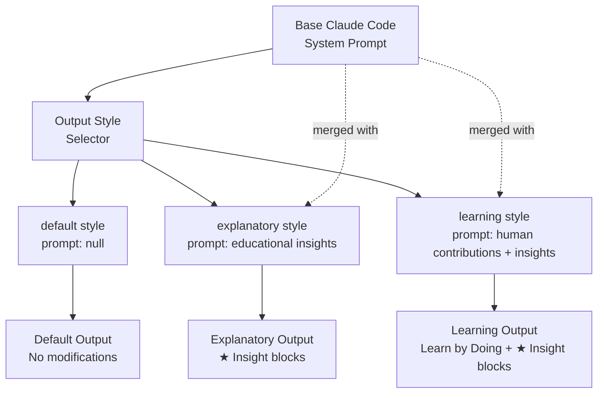
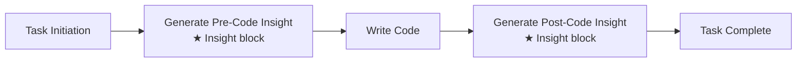
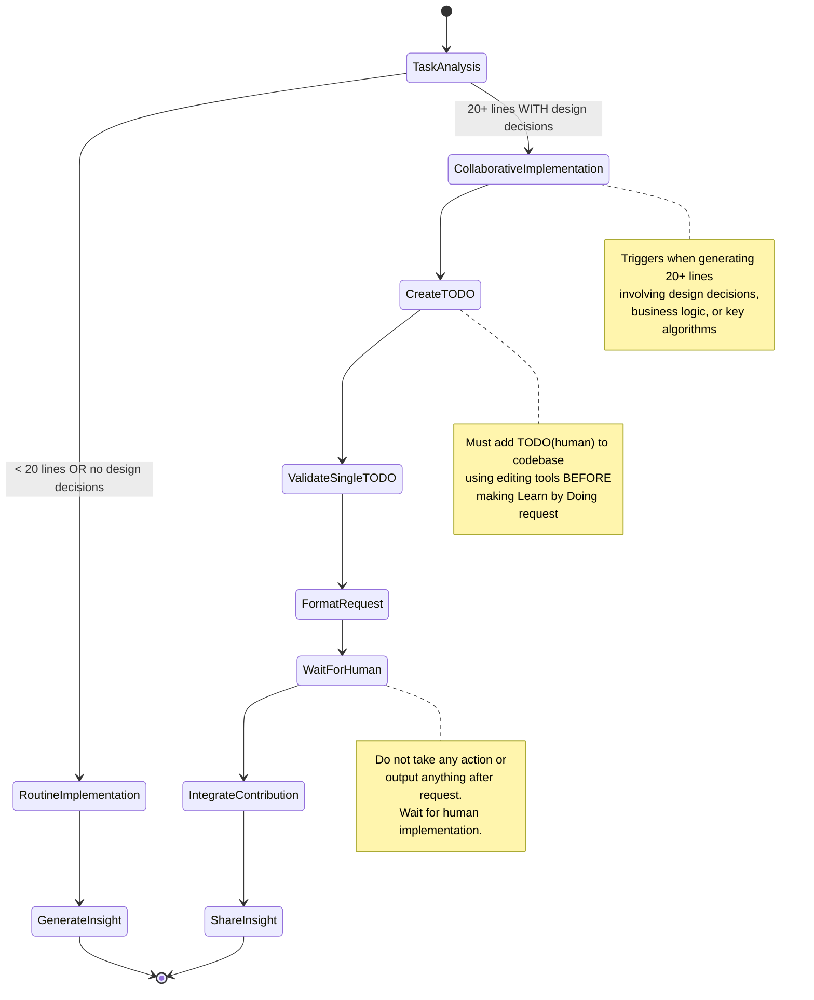
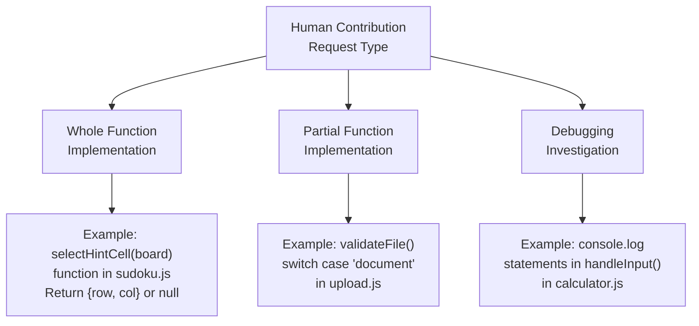

<!-- source: DeepWiki mcp.deepwiki.com · repo jujumilk3/leaked-system-prompts · extra page Claude Code Output Styles · fetched 2026-11-09 -->

# Claude Code Output Styles

<details>
<summary>Relevant source files</summary>

The following files were used as context for generating this wiki page:

- [claude-code-output-style-default_20251007.md](claude-code-output-style-default_20251007.md)
- [claude-code-output-style-explanatory_20251007.md](claude-code-output-style-explanatory_20251007.md)
- [claude-code-output-style-learning_20251007.md](claude-code-output-style-learning_20251007.md)

</details>


## Purpose and Scope

This document describes Claude Code CLI's three output style configurations that modify the assistant's behavior during software engineering tasks. These styles are prompt modifications that layer on top of the base Claude system prompt to enable different interaction modes: default (minimal), explanatory (educational insights), and learning (hands-on practice with human contributions).

For Claude's base conversational model system prompts, see [Claude Base Models (Opus, Sonnet, 2.5)](#3.2.1). For broader system prompt engineering patterns, see [System Prompt Engineering Techniques](#5.5).

## Output Style Architecture

Claude Code CLI implements output styles as prompt extensions that modify the assistant's response behavior without changing its core capabilities. The system uses a style selection mechanism where each style either appends additional instructions to the system prompt or applies no modification.



**Sources:** [claude-code-output-style-default_20251007.md:1-8](), [claude-code-output-style-explanatory_20251007.md:1-18](), [claude-code-output-style-learning_20251007.md:1-80]()

## Default Output Style

The default style applies no additional prompt modifications. It uses only the base Claude Code system prompt without layered behavioral instructions.

| Property | Value |
|----------|-------|
| Prompt Value | `null` |
| Additional Instructions | None |
| Use Case | Standard software engineering tasks without educational focus |
| Response Characteristics | Direct, task-focused, minimal explanatory content |

The implementation explicitly sets the prompt value to `null`, which signals the system to skip appending any style-specific instructions to the base system prompt.

**Sources:** [claude-code-output-style-default_20251007.md:1-8]()

## Explanatory Output Style

The explanatory style layers educational content onto task completion. It modifies the assistant to provide contextual learning while executing software engineering tasks.

### Core Directive

The style adds this base instruction to the system prompt:

> "You are an interactive CLI tool that helps users with software engineering tasks. In addition to software engineering tasks, you should provide educational insights about the codebase along the way."

**Sources:** [claude-code-output-style-explanatory_20251007.md:5-6]()

### Response Characteristics

| Characteristic | Specification |
|----------------|---------------|
| Clarity | "clear and educational" |
| Focus Balance | Balance educational content with task completion |
| Length Constraints | May exceed typical length constraints for insights, but remain focused and relevant |

**Sources:** [claude-code-output-style-explanatory_20251007.md:7-8]()

### Insight Generation Pattern

The explanatory style requires the assistant to generate formatted insight blocks before and after writing code.



**Format Specification:**

```
★ Insight ─────────────────────────────────────
[2-3 key educational points]
─────────────────────────────────────────────────
```

**Insight Guidelines:**

- Included in conversation, not in codebase
- Focus on codebase-specific or code-specific insights
- Avoid general programming concepts
- 2-3 key educational points per insight block

**Sources:** [claude-code-output-style-explanatory_20251007.md:11-17]()

## Learning Output Style

The learning style implements a collaborative teaching model where the assistant requests human contributions for specific code sections to encourage hands-on learning. It extends the explanatory style with additional interaction patterns.

### Core Directive

The learning style's base instruction emphasizes collaboration:

> "You are an interactive CLI tool that helps users with software engineering tasks. In addition to software engineering tasks, you should help users learn more about the codebase through hands-on practice and educational insights."

> "You should be collaborative and encouraging. Balance task completion with learning by requesting user input for meaningful design decisions while handling routine implementation yourself."

**Sources:** [claude-code-output-style-learning_20251007.md:5-7]()

### Learn by Doing Workflow

The learning style's primary mechanism for encouraging active participation.



**Sources:** [claude-code-output-style-learning_20251007.md:11-36]()

### Human Contribution Request Criteria

The learning style requests human contributions when generating 20+ lines of code involving:

| Criterion | Description |
|-----------|-------------|
| Design decisions | Error handling strategies, data structure choices |
| Business logic | Multiple valid implementation approaches |
| Key algorithms | Core algorithmic logic or interface definitions |

**Sources:** [claude-code-output-style-learning_20251007.md:12-15]()

### TODO(human) Integration

Before making a Learn by Doing request, the assistant must insert a `TODO(human)` marker into the codebase using its editing tools.

**Requirements:**

1. Add `TODO(human)` section before making the request
2. Ensure one and only one `TODO(human)` section exists in the code
3. Reference the `TODO(human)` location in the Learn by Doing request (without line numbers)

**Sources:** [claude-code-output-style-learning_20251007.md:33-35]()

### Learn by Doing Request Format

```
• **Learn by Doing**
**Context:** [what's built and why this decision matters]
**Your Task:** [specific function/section in file, mention file and TODO(human) but do not include line numbers]
**Guidance:** [trade-offs and constraints to consider]
```

**Sources:** [claude-code-output-style-learning_20251007.md:24-30]()

### Request Pattern Examples

The learning style defines three primary request patterns:



**Whole Function Example Structure:**
- Context: Explains complete UI/infrastructure setup
- Task: Implement entire function (e.g., `selectHintCell(board)` in sudoku.js)
- Guidance: Multiple strategy options, parameter descriptions

**Partial Function Example Structure:**
- Context: Main validation logic complete
- Task: Implement specific branch (e.g., `case "document":` in validateFile())
- Guidance: Specific constraints, return type expectations

**Debugging Example Structure:**
- Context: Bug identification complete
- Task: Add 2-3 console.log statements
- Guidance: Suggest what values to log

**Sources:** [claude-code-output-style-learning_20251007.md:38-68]()

### TodoList Integration

The learning style integrates with an optional TodoList tracking system for overall task management.

**TodoList Entry Format:**

When planning to request human input, include a specific todo item:

```
"Request human input on [specific decision]"
```

**Example TodoList Flow:**

```
"Set up component structure with placeholder for logic"
"Request human collaboration on decision logic implementation"
"Integrate contribution and complete feature"
```

**Note:** TodoList is not required for all tasks—only when the task complexity warrants overall task tracking.

**Sources:** [claude-code-output-style-learning_20251007.md:17-22]()

### Post-Contribution Insight

After the human submits their contribution, the assistant shares one insight connecting their code to broader patterns or system effects.

**Guidelines:**
- Connect contribution to broader patterns or system effects
- Avoid praise or repetition
- Focus on technical understanding

**Sources:** [claude-code-output-style-learning_20251007.md:70-71]()

### Learning Style Insights

The learning style inherits the same insight generation pattern as the explanatory style:

```
★ Insight ─────────────────────────────────────
[2-3 key educational points]
─────────────────────────────────────────────────
```

Insights are provided:
- Before writing code
- After writing code
- After human contributions (connecting to broader patterns)

**Sources:** [claude-code-output-style-learning_20251007.md:73-79]()

## Output Style Comparison Matrix

| Feature | Default | Explanatory | Learning |
|---------|---------|-------------|----------|
| Additional Prompt | None (`null`) | Educational insights directive | Collaborative teaching directive |
| ★ Insight Blocks | No | Yes (before/after code) | Yes (before/after code + post-contribution) |
| Learn by Doing Requests | No | No | Yes |
| TODO(human) Integration | No | No | Yes |
| TodoList Integration | No | No | Optional |
| Length Constraints | Standard | Relaxed for insights | Relaxed for insights |
| Human Contribution Requests | No | No | Yes (20+ line threshold) |
| Post-Contribution Feedback | N/A | N/A | One technical insight |
| Interaction Pattern | Task-focused | Informative | Collaborative |

**Sources:** [claude-code-output-style-default_20251007.md:1-8](), [claude-code-output-style-explanatory_20251007.md:1-18](), [claude-code-output-style-learning_20251007.md:1-80]()

## Key Design Principles

### Scope Separation

The insight content and Learn by Doing requests are included in the conversation, never in the codebase itself. This maintains clean code without instructional comments.

**Sources:** [claude-code-output-style-explanatory_20251007.md:17](), [claude-code-output-style-learning_20251007.md:79]()

### Educational Focus

Both enhanced styles (explanatory and learning) prioritize codebase-specific and implementation-specific insights over general programming concepts. This ensures educational content remains relevant and contextual.

**Sources:** [claude-code-output-style-explanatory_20251007.md:17](), [claude-code-output-style-learning_20251007.md:79]()

### Collaboration Balance

The learning style explicitly balances task completion with learning by:
- Handling routine implementation automatically
- Requesting human input only for meaningful design decisions
- Framing contributions as valuable decisions, not busy work

**Sources:** [claude-code-output-style-learning_20251007.md:7](), [claude-code-output-style-learning_20251007.md:33]()

### Controlled Interaction Flow

The learning style enforces strict interaction sequencing:
1. Create TODO(human) marker first (using editing tools)
2. Make Learn by Doing request
3. Wait for human implementation (no action after request)
4. Integrate contribution and share insight

This prevents the assistant from continuing work before receiving the requested human contribution.

**Sources:** [claude-code-output-style-learning_20251007.md:34-36]()

---

