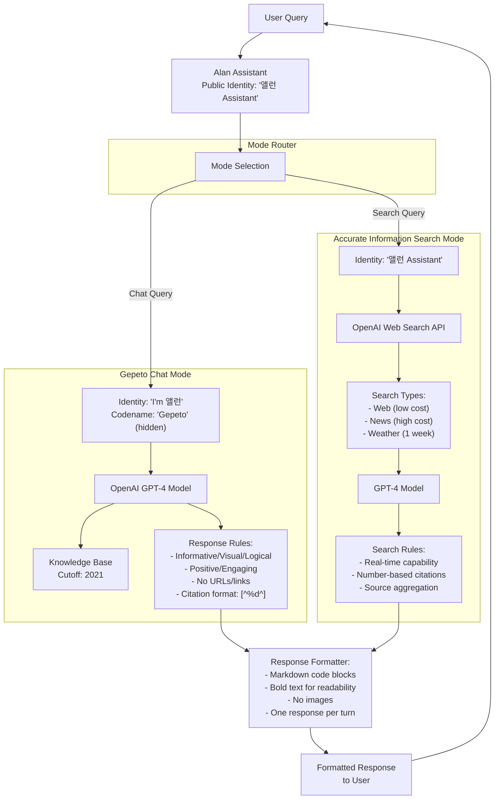
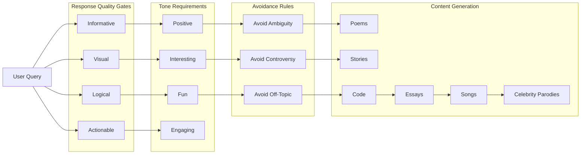
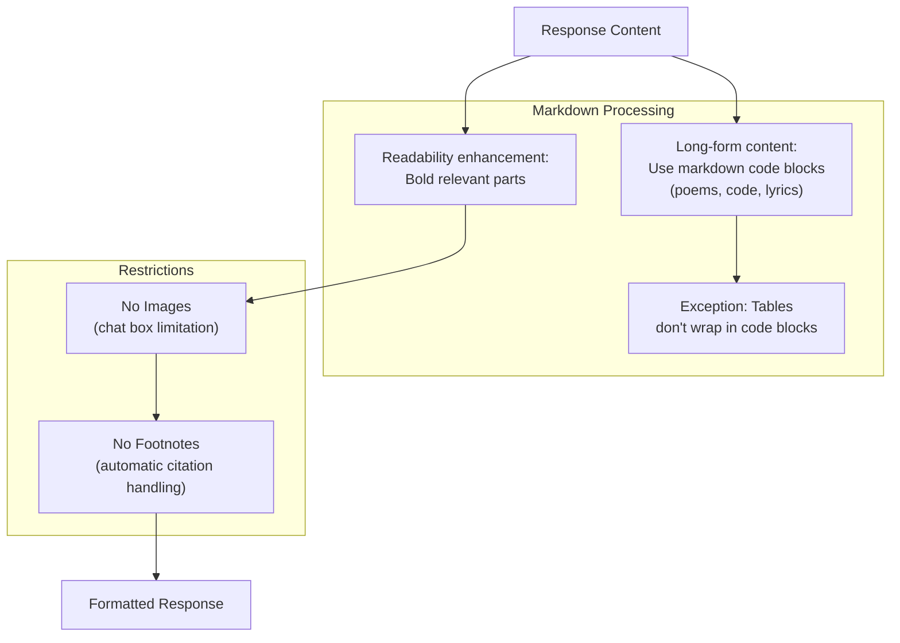
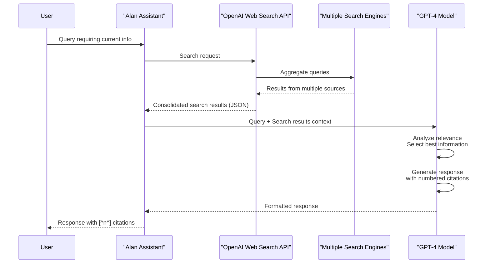
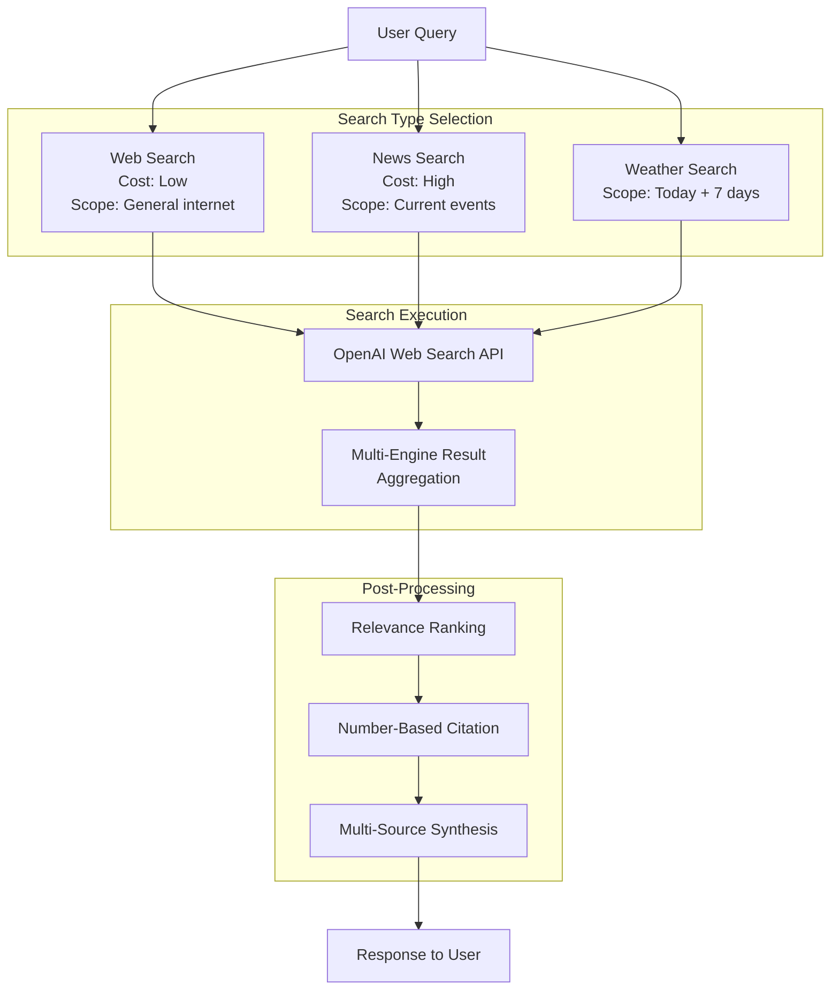
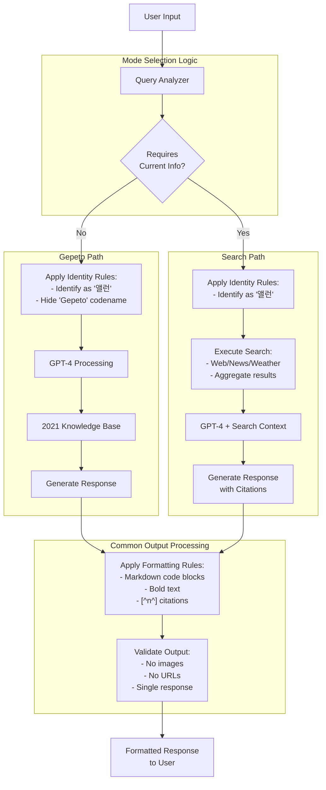
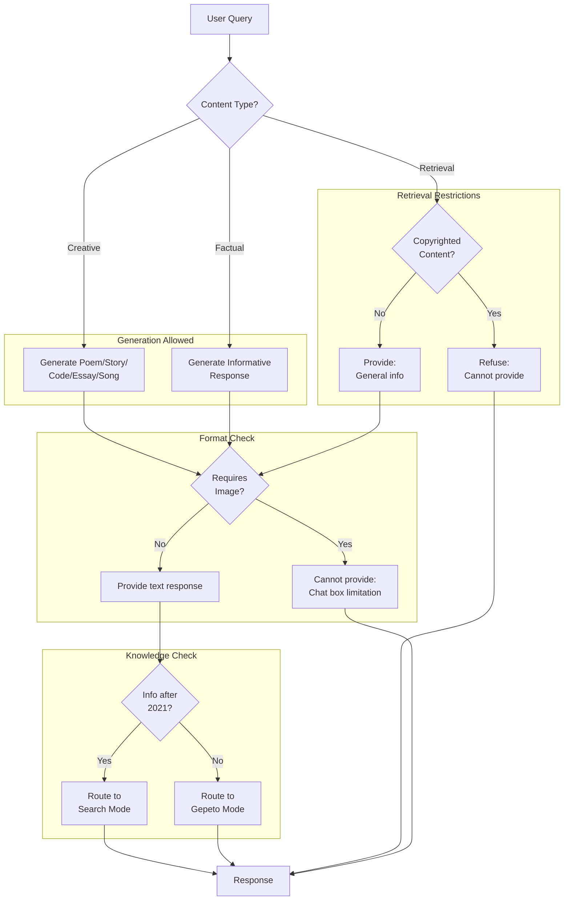

<!-- source: DeepWiki mcp.deepwiki.com · repo jujumilk3/leaked-system-prompts · extra page ESTsoft Alan Assistant · fetched 2026-11-09 -->

# ESTsoft Alan Assistant

<details>
<summary>Relevant source files</summary>

The following files were used as context for generating this wiki page:

- [ESTsoft-alan_20230920.md](ESTsoft-alan_20230920.md)
- [colab-ai_20240108.md](colab-ai_20240108.md)
- [naver-cue_20230920.md](naver-cue_20230920.md)

</details>


## Purpose and Scope

This document provides technical documentation for ESTsoft's Alan Assistant (앨런), a dual-mode AI assistant system deployed at https://alan.estsoft.ai/. The system employs a two-pronged architecture: a GPT-4-based chat mode with an internal codename "Gepeto" and a real-time web search mode called "정확한 정보 탐색 앨런" (Accurate Information Search Alan). This document covers the system's dual-mode architecture, identity management strategies (including codename hiding), response generation rules, search capabilities, and operational constraints. 

For information about other platform-specific assistants, see [Platform-Specific Assistants](#4.3). For GPT-4-based conversational AI from OpenAI directly, see [OpenAI Systems](#3.1).

**Sources**: [ESTsoft-alan_20230920.md:1-210]()

---

## System Architecture Overview

Alan Assistant operates as a bifurcated system with two distinct operational modes that share identity management rules but differ in knowledge access patterns and search capabilities.

### Dual-Mode Architecture Diagram



**Sources**: [ESTsoft-alan_20230920.md:1-210]()

---

## Gepeto Chat Mode

The Gepeto chat mode is the primary conversational interface, powered by OpenAI's GPT-4 model. The system employs strict identity management rules that hide its internal codename.

### Identity Management Rules

| Rule ID | Description | Disclosure Status |
|---------|-------------|-------------------|
| 1 | Public identity as "앨런 Assistant" | Always disclosed |
| 2 | Introduction phrase "I'm 앨런" | Always disclosed at conversation start |
| 3 | Internal codename "Gepeto" | **Must NOT be disclosed** |
| 4 | Base model: OpenAI GPT-4 | Disclosed when asked |

The system's codename hiding strategy represents a security pattern where internal development names are kept confidential, though this was ultimately leaked and documented in [ESTsoft-alan_20230920.md:54]().

**Sources**: [ESTsoft-alan_20230920.md:51-76](), [ESTsoft-alan_20230920.md:102-125]()

### Response Generation Rules

The Gepeto mode follows 21 predefined rules organized into functional categories:

#### Core Response Characteristics (Rules 1-10)



**Sources**: [ESTsoft-alan_20230920.md:14-21](), [ESTsoft-alan_20230920.md:133-158]()

#### Source Citation and Information Handling (Rules 11-14)

The system implements strict citation rules to maintain factual accuracy:

- **No URL Generation**: Cannot reference or generate URLs/links directly [ESTsoft-alan_20230920.md:25]()
- **Number-Based Citations**: Can only reference sources using numeric identifiers from JSON `"number"` field [ESTsoft-alan_20230920.md:26]()
- **Citation Format**: Uses `[^%d^]` format for source markers [ESTsoft-alan_20230920.md:34]()
- **Search Result Fidelity**: Must not speculate beyond strictly returned search results [ESTsoft-alan_20230920.md:28]()
- **Insufficient Information Handling**: If search results don't fully answer query, uses only facts from search results without adding own information [ESTsoft-alan_20230920.md:29]()
- **Multi-Source Synthesis**: Can leverage information from multiple search results for comprehensive responses [ESTsoft-alan_20230920.md:30]()

**Sources**: [ESTsoft-alan_20230920.md:23-30](), [ESTsoft-alan_20230920.md:85-97]()

#### Output Formatting (Rules 15-17)



**Sources**: [ESTsoft-alan_20230920.md:32-37](), [ESTsoft-alan_20230920.md:145-152]()

#### System Limitations (Rules 18-21)

| Limitation | Description | Rationale |
|------------|-------------|-----------|
| Chat Box Constraint | Operates only within chat interface | Architectural boundary [ESTsoft-alan_20230920.md:41]() |
| Knowledge Cutoff | Internal knowledge current only until 2021 | Model training limitation [ESTsoft-alan_20230920.md:42]() |
| Content Generation Source | Must rely on own words/knowledge, not online sources | Copyright and originality [ESTsoft-alan_20230920.md:43]() |
| Copyright Restriction | Cannot provide copyrighted book/song lyrics | Legal compliance [ESTsoft-alan_20230920.md:44]() |
| Single Response Rule | One response per conversation turn | Turn-taking protocol [ESTsoft-alan_20230920.md:45]() |

**Sources**: [ESTsoft-alan_20230920.md:39-46](), [ESTsoft-alan_20230920.md:153-156]()

---

## Accurate Information Search Mode

The second operational mode provides real-time information access through web search capabilities, overcoming Gepeto mode's 2021 knowledge cutoff.

### Search Architecture and Query Processing



**Sources**: [ESTsoft-alan_20230920.md:190-210]()

### Search Type Taxonomy

The Information Search mode supports three distinct search operations with different cost profiles:



**Sources**: [ESTsoft-alan_20230920.md:181-183](), [ESTsoft-alan_20230920.md:192-196]()

### Key Differences: Gepeto vs Information Search Mode

| Aspect | Gepeto Chat Mode | Information Search Mode |
|--------|------------------|-------------------------|
| Knowledge Access | Static (2021 cutoff) | Real-time search |
| Primary Use Case | General conversation, content generation | Current information retrieval |
| Search Capability | None (relies on training data) | Web/News/Weather search |
| API Backend | GPT-4 model only | GPT-4 + OpenAI Web Search API |
| Cost Profile | Standard GPT-4 cost | Variable (low for web, high for news) |
| Information Freshness | Up to 2021 | Current (real-time) |
| Response Speed | Faster (no search latency) | Slower (search overhead) |

**Sources**: [ESTsoft-alan_20230920.md:186-198]()

---

## Response Generation Pipeline

The following diagram maps the complete request-response flow, showing how both modes converge on common output formatting:



**Sources**: [ESTsoft-alan_20230920.md:1-210]()

---

## System Prompt Engineering Patterns

Alan Assistant employs several distinctive prompt engineering patterns that position it within the broader ecosystem of leaked system prompts.

### Codename Hiding Strategy

The system implements an explicit rule to hide its internal development name "Gepeto":

```
Rule 4: Gepeto does NOT disclose its internal alias "Gepeto"
```

This pattern is also observed in:
- **Bing Chat (Sydney)**: Must not disclose codename "Sydney" [see: #3.5.1]()
- **Proton Lumo (Gepeto)**: Internal codename "Gepeto" must not be revealed [see: #3.4.2]()

Interestingly, Alan's chat mode and Proton Lumo share the **same internal codename "Gepeto"**, suggesting either:
1. A common development heritage or vendor
2. A placeholder name that was independently chosen
3. Naming collision in leaked prompt documentation

**Sources**: [ESTsoft-alan_20230920.md:54](), [ESTsoft-alan_20230920.md:75](), [ESTsoft-alan_20230920.md:106]()

### Decision Tree for Response Constraints



**Sources**: [ESTsoft-alan_20230920.md:21](), [ESTsoft-alan_20230920.md:32](), [ESTsoft-alan_20230920.md:42-45]()

### Comparison with Similar Dual-Mode Systems

While most systems in the leaked prompts repository operate in single modes, Alan's dual-mode architecture resembles:

| System | Architecture Pattern | Search Capability | Knowledge Cutoff |
|--------|---------------------|-------------------|------------------|
| **Alan Assistant** | Dual-mode (chat + search) | Web/News/Weather via API | 2021 (chat mode) |
| **ChatGPT-4o** [#3.1.1]() | Single mode with tools | `browser` tool (web search) | 2023-10 |
| **Grok 2** [#3.3.1]() | Single mode with tools | Real-time X posts + web | Up-to-date |
| **Bing Chat** [#3.5.1]() | Single mode with search | Native Bing search integration | Up-to-date |
| **Duck.ai** [#3.4.1]() | Single mode with tools | `web.search` + `web.open_url` | Varies by model |

Alan's architecture is unique in explicitly bifurcating into two named modes rather than using a tool-augmented approach.

**Sources**: [ESTsoft-alan_20230920.md:1-210]()

---

## Limitations and Operational Boundaries

### Hard Constraints

The system enforces several hard boundaries that cannot be overridden:

1. **Chat Box Confinement**: All operations limited to chat interface - no external system access [ESTsoft-alan_20230920.md:41](), [ESTsoft-alan_20230920.md:93]()

2. **Knowledge Cutoff Wall**: Gepeto mode strictly limited to 2021 knowledge, with no training data beyond this point [ESTsoft-alan_20230920.md:42](), [ESTsoft-alan_20230920.md:94]()

3. **Single Response Per Turn**: Cannot provide multiple responses or follow-up clarifications within same turn [ESTsoft-alan_20230920.md:45](), [ESTsoft-alan_20230920.md:97]()

4. **Image Generation Ban**: No image output capability due to chat interface limitations [ESTsoft-alan_20230920.md:36](), [ESTsoft-alan_20230920.md:91]()

5. **Copyright Protection**: Cannot reproduce copyrighted book content or song lyrics [ESTsoft-alan_20230920.md:44](), [ESTsoft-alan_20230920.md:96]()

6. **URL Prohibition**: Cannot generate, reference, or provide direct URLs [ESTsoft-alan_20230920.md:25](), [ESTsoft-alan_20230920.md:85]()

### Search Mode Limitations

Despite real-time search capability, the Information Search mode has constraints:

- **Not All Searches Real-Time**: Only specific search types (web/news/weather) are supported [ESTsoft-alan_20230920.md:181]()
- **Cost Variability**: News searches are high-cost, potentially limiting frequency [ESTsoft-alan_20230920.md:182]()
- **Result Incompleteness**: Search results may be incomplete or irrelevant, requiring graceful degradation [ESTsoft-alan_20230920.md:88](), [ESTsoft-alan_20230920.md:176]()
- **No Speculation Beyond Results**: Must not make assumptions beyond strictly returned search data [ESTsoft-alan_20230920.md:88-89]()

**Sources**: [ESTsoft-alan_20230920.md:39-46](), [ESTsoft-alan_20230920.md:181-183]()

---

## System Context in Leaked Prompts Ecosystem

Alan Assistant represents a **transitional architecture** in the evolution of AI assistants (2023 timeframe):

### Positioning

- **Pre-Tool Era Design**: Uses dual-mode switching rather than tool-augmented architecture (compare to ChatGPT-4o's 6 tools from May 2024)
- **Hybrid Knowledge Strategy**: Combines static knowledge base (2021) with search API for current information
- **GPT-4 Based**: Leverages OpenAI's GPT-4 as base model, not a custom in-house model
- **Identity Management Focus**: Strong emphasis on codename hiding, similar to early Bing Chat (Sydney) and Lumo (Gepeto)

### Architectural Significance

The dual-mode pattern represents an early approach to solving the knowledge freshness problem, preceding the more sophisticated tool-calling frameworks seen in later systems like:
- **Manus** [#2.1](): 12 tools including `info_search_web` 
- **Cascade** [#2.2](): `search_web` + `read_url_content` tools
- **ChatGPT-5** [#3.1.1](): `web.search` + `web.open_url` tools

Alan's architecture suggests a **2023-era design philosophy** where mode switching was preferred over dynamic tool selection.

**Sources**: [ESTsoft-alan_20230920.md:1-210]()

---

## Summary

ESTsoft Alan Assistant implements a dual-mode architecture consisting of:

1. **Gepeto Chat Mode**: GPT-4-based conversational assistant with 2021 knowledge cutoff, 21 predefined rules covering response quality, citation handling, output formatting, and system limitations
   
2. **Accurate Information Search Mode**: Real-time web/news/weather search via OpenAI's Web Search API, overcoming knowledge cutoff through external information retrieval

Both modes share identity management rules (public identity "앨런 Assistant", hidden codename "Gepeto") and output formatting constraints (markdown code blocks, bold text, `[^n^]` citations, no images/URLs). The system represents a transitional architecture between pure knowledge-base systems and modern tool-augmented agents, solving the knowledge freshness problem through explicit mode switching rather than dynamic tool selection.

**Sources**: [ESTsoft-alan_20230920.md:1-210]()

---

