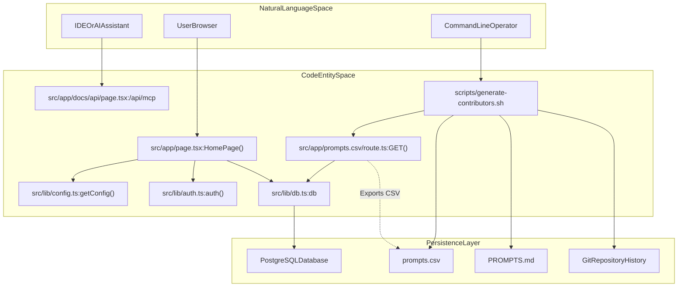
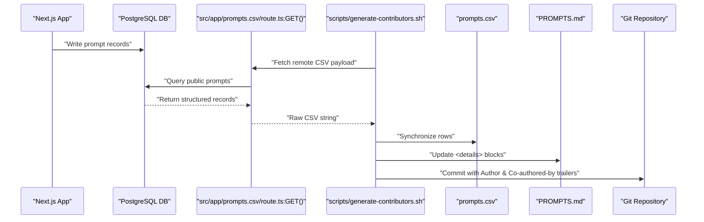

<!-- source: DeepWiki mcp.deepwiki.com · repo f/prompts.chat · page 1 Overview · fetched 2026-11-09 -->

# Overview

Relevant source files

The following files were used as context for generating this wiki page:

- [.github/PULL_REQUEST_TEMPLATE.md](.github/PULL_REQUEST_TEMPLATE.md)
- [PROMPTS.md](PROMPTS.md)
- [README.md](README.md)
- [next.config.ts](next.config.ts)
- [prompts.csv](prompts.csv)
- [scripts/generate-contributors.sh](scripts/generate-contributors.sh)
- [scripts/rebuild-history.sh](scripts/rebuild-history.sh)
- [src/app/about/page.tsx](src/app/about/page.tsx)
- [src/app/page.tsx](src/app/page.tsx)
- [src/app/prompts.csv/route.ts](src/app/prompts.csv/route.ts)
- [src/app/prompts.json/route.ts](src/app/prompts.json/route.ts)
- [src/components/admin/import-prompts.tsx](src/components/admin/import-prompts.tsx)
- [tests/generate-contributors-format.test.js](tests/generate-contributors-format.test.js)

## Purpose and Scope

prompts.chat is an open-source AI prompt library and management platform designed to curate, manage, and distribute high-quality AI prompts compatible with various modern large language models including ChatGPT, Claude, Gemini, Llama, and Mistral [README.md:1-16](). Originating as "Awesome ChatGPT Prompts" in December 2022 [README.md:18](), [README.md:43](), the codebase has evolved into a full-stack Next.js application supporting prompt browsing, execution, versioning, contribution tracking, self-hosting, and Model Context Protocol (MCP) server integration [README.md:100-174]().

This page documents the high-level technical architecture, dual-persistence model, contributor attribution system, and core integration points of the `prompts.chat` repository.

Sources:
[README.md:1-43](), [README.md:100-174]()

---

## Technical Stack & Data Flow

The platform is built on Next.js using React Server Components, Prisma ORM as the data access layer, and PostgreSQL as the primary database store. User authentication is managed via NextAuth [src/app/page.tsx:6](). The system maintains a dual-persistence model where prompts stored in PostgreSQL are synchronously mirrored to flat files (`prompts.csv` and `PROMPTS.md`) to preserve version control history and GitHub contributor attribution.

### System Architecture and Data Flow Diagram

**Legend:**  
- `HomePage()`: Root React Server Component rendering landing and discovery views [src/app/page.tsx:35-50]().  
- `GET()`: API endpoint exporting public prompts in CSV format [src/app/prompts.csv/route.ts:29-92]().  
- `generate-contributors.sh`: Shell script orchestrating remote CSV synchronization, Git commits, and markdown regeneration [scripts/generate-contributors.sh:1-130]().  
- `/api/mcp`: Model Context Protocol endpoint for AI assistant integration [src/app/docs/api/page.tsx:73]().

Sources:  
[src/app/page.tsx:35-50](), [src/app/prompts.csv/route.ts:29-92](), [scripts/generate-contributors.sh:1-130](), [src/app/docs/api/page.tsx:73]()

---

## Dual Persistence Architecture & CSV Sync

To reconcile rich relational database queries with flat-file open-source distribution, `prompts.chat` implements a bidirectional synchronization mechanism between PostgreSQL and repository-tracked files (`prompts.csv` and `PROMPTS.md`).

1.  **Database Canonical Store**: All prompt mutations (creations, edits, deletions) occur through Prisma models targeting PostgreSQL [src/app/prompts.csv/route.ts:31-63]().
2.  **CSV Export Endpoint**: The route handler `src/app/prompts.csv/route.ts` queries all non-private, non-unlisted prompts, escaping fields via `escapeCSVField` and constructing structured contributor strings via `getUserIdentifier` [src/app/prompts.csv/route.ts:5-83](). This endpoint is configured to revalidate every 3600 seconds (1 hour) [src/app/prompts.csv/route.ts:27]().

Sources:
[src/app/prompts.csv/route.ts:5-92](), [src/app/prompts.csv/route.ts:27]()

---

## Contributor Attribution & Git Commit Sync

The shell utility `scripts/generate-contributors.sh` ensures that updates made via the web interface are accurately reflected in Git history with individual contributor attribution:

-   Fetches the latest prompt records from the running instance's CSV endpoint [scripts/generate-contributors.sh:15-21]().
-   Compares local and remote datasets, staging new additions [scripts/generate-contributors.sh:35-120]().
-   Resolves commit author identities from the primary contributor field and appends `Co-authored-by` Git commit trailers for multi-author prompts [scripts/generate-contributors.sh:108-114]().
-   Regenerates human-readable collapsible `
` blocks inside `PROMPTS.md` [scripts/generate-contributors.sh:155-186]().

### Synchronization Sequence Diagram

Sources:
[scripts/generate-contributors.sh:1-186](), [src/app/prompts.csv/route.ts:29-92]()

---

## Self-Hosting & Configuration System

The project is architected for seamless self-hosting [README.md:113-115](). Instances are configured via `prompts.config.ts` combined with runtime environment variable overrides (`PCHAT_*`), allowing custom branding, theme parameters, authentication provider selection (GitHub, Google, Apple, Azure, or credentials), and feature flag toggles [SELF-HOSTING.md:149-203](). Configuration values are accessed synchronously or asynchronously via helper functions in `src/lib/config` [src/app/page.tsx:39](). The `npx prompts.chat new` command provides a quick start for new self-hosted instances, including an interactive setup wizard [SELF-HOSTING.md:81-93]().

Sources:
[README.md:113-115](), [SELF-HOSTING.md:149-203](), [src/app/page.tsx:39](), [SELF-HOSTING.md:81-93]()

---

## Model Context Protocol (MCP) Integration

To support programmatic AI workflow automation, `prompts.chat` hosts a native MCP server endpoint at `/api/mcp` [src/app/docs/api/page.tsx:73](). This endpoint exposes standard tools allowing IDE extensions and CLI agents like Claude Code to query and manage prompt data directly [src/app/docs/api/page.tsx:60-69](). Authentication for MCP requests can be done via API keys passed in headers or environment variables [src/app/docs/api/page.tsx:116-141]().

Sources:
[src/app/docs/api/page.tsx:73](), [src/app/docs/api/page.tsx:60-69](), [src/app/docs/api/page.tsx:116-141]()

---

## Technical References

| Component / Function | File Path & Line Range | Role |
|---|---|---|
| CSV Export Handler | `src/app/prompts.csv/route.ts:29-97` | Serializes public database prompts into standard CSV format. |
| Contributor Sync Script | `scripts/generate-contributors.sh:1-130` | Syncs remote CSV data into local Git commits and Markdown blocks. |
| Homepage Server Component | `src/app/page.tsx:35-62` | Handles SSR rendering, session auth checks, and configuration resolution. |
| MCP API Endpoint | `src/app/docs/api/page.tsx:73` | Provides the Model Context Protocol server for AI tool integration. |
| Next.js Configuration | `next.config.ts:15-104` | Defines Next.js build and runtime configurations, including redirects and headers. |
| Footer Component | `src/components/layout/footer.tsx:15-46` | Renders the application footer with links to documentation, API, and GitHub. |

Sources:
[src/app/prompts.csv/route.ts:29-97](), [scripts/generate-contributors.sh:1-130](), [src/app/page.tsx:35-62](), [src/app/docs/api/page.tsx:73](), [next.config.ts:15-104](), [src/components/layout/footer.tsx:15-46]()

---

