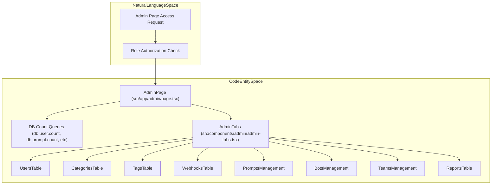
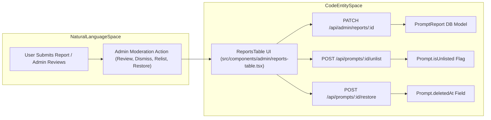
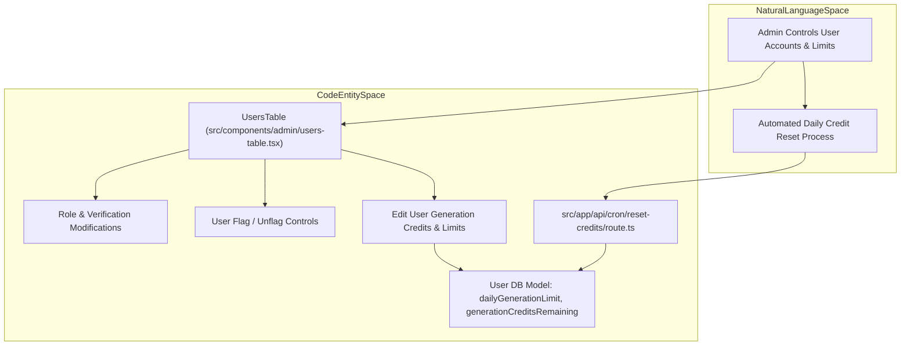
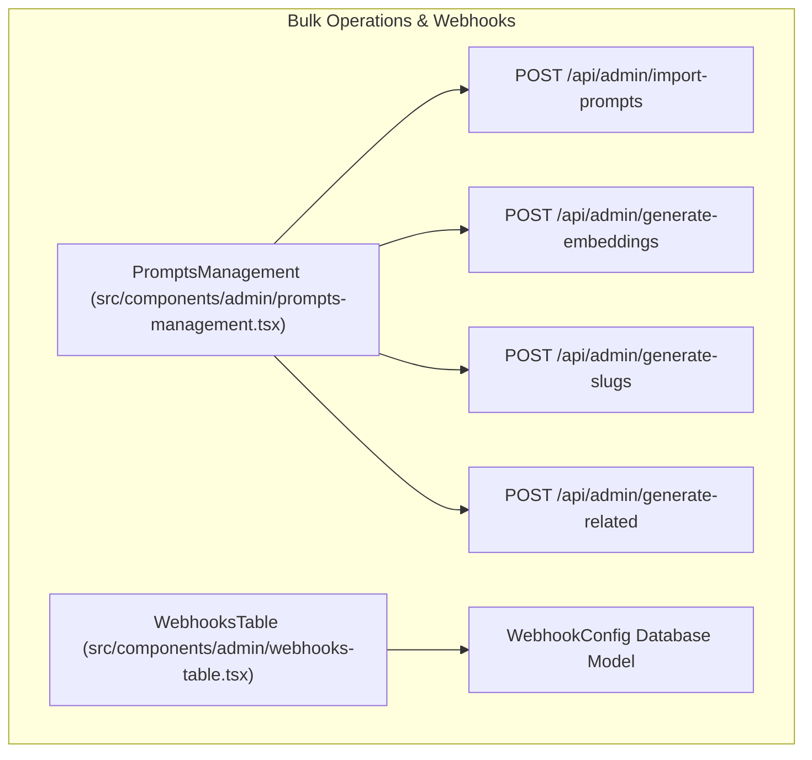

<!-- source: DeepWiki mcp.deepwiki.com · repo f/prompts.chat · page 10 Admin System · fetched 2026-11-09 -->

# Admin System

Relevant source files

The following files were used as context for generating this wiki page:

- [src/app/admin/page.tsx](src/app/admin/page.tsx)
- [src/components/admin/admin-tabs.tsx](src/components/admin/admin-tabs.tsx)
- [src/components/admin/prompts-management.tsx](src/components/admin/prompts-management.tsx)

The Admin System provides a comprehensive set of administrative features needed to manage the prompts.chat platform, accessible exclusively to users with the `ADMIN` role. This system covers platform statistics, content moderation, user management, taxonomy configuration, and bulk data operations. It integrates closely with authentication and prompt CRUD operations for secured, effective governance.

---

## Admin Dashboard

The Admin Dashboard is the central hub for administrative oversight and control. It is implemented in `src/app/admin/page.tsx`, where access is guarded by a session user role check requiring `ADMIN` privileges [src/app/admin/page.tsx:31-33](). Upon loading, the dashboard performs multiple database count queries to collect system-wide metrics such as users, prompts, categories, and tags, plus AI search feature status and prompt embedding statistics [src/app/admin/page.tsx:36-78](). The main UI uses the `AdminTabs` component (`src/components/admin/admin-tabs.tsx`) to organize feature pages under tabs like Users, Categories, Tags, Webhooks, Prompts, Bots, Teams, and Reports [src/app/admin/page.tsx:184-207](), [src/components/admin/admin-tabs.tsx:7-104]().

**Admin Dashboard Interaction Diagram**

Sources: [src/app/admin/page.tsx:31-207](), [src/components/admin/admin-tabs.tsx:7-104]()

For detailed features of the dashboard including stats cards and tab navigation UI, see [Admin Dashboard](#10.1).

---

## Content Moderation

Content moderation is a critical part of the admin features, built around tracking user reports and managing prompt visibility. Reports are stored in the `PromptReport` model and shown in the `ReportsTable` UI, allowing admins to review, dismiss, or act on reported prompts [src/app/admin/page.tsx:112-134](). Admins may relist unlisted prompts or restore deleted ones via corresponding API endpoints triggered from this interface.

**Content Moderation Workflow Diagram**

Sources: [src/app/admin/page.tsx:112-134]()

For more details about quality checks, automatic delisting, spam workflows, relist requests, and manual moderation, see [Content Moderation](#10.2).

---

## User Management

The user management module gives admins control over platform users, enabling verification toggling, flagging for policy violations, role assignments including making/removing admin status, credit editing, and enforcement of daily prompt generation limits. This is implemented primarily via the `UsersTable` component [src/app/admin/page.tsx:198](). The system maintains fields like `dailyGenerationLimit` and `generationCreditsRemaining` on the `User` model, which are reset automatically through a scheduled cron job implemented in `src/app/api/cron/reset-credits/route.ts` and triggered via GitHub Actions.

**User Management Administration Diagram**

Sources: [src/app/admin/page.tsx:198](), [src/app/api/cron/reset-credits/route.ts]()

For a deep dive into user admin capabilities including verification, flagging, credit adjustments, and generation limits, see [User Management](#10.3).

---

## Bulk Operations & Webhooks

Bulk administrative operations are handled through the `PromptsManagement` component, which provides UI controls for batch importing prompts, generating embeddings for AI semantic search, creating slugs for SEO, and generating related prompt links. These operations invoke dedicated backend API routes to process data efficiently and keep content in sync [src/components/admin/prompts-management.tsx:197-208](). Meanwhile, webhook configurations are managed in the `WebhooksTable`, representing `WebhookConfig` entities that deliver outbound notifications for admin-integrated systems [src/app/admin/page.tsx:110-112]().

**Bulk Operations & Webhooks Diagram**

Sources: [src/app/admin/page.tsx:110-112](), [src/components/admin/prompts-management.tsx:197-208]()

For comprehensive guides on AI embedding workflows, slug and related prompt batch generation, CSV import/export, and webhook setup and delivery, see [Bulk Operations & Webhooks](#10.4).

---

This parent page provides an overview of the administrative capabilities in prompts.chat and how major features are organized and interconnected. Readers should consult the respective child pages for implementation details, UI documentation, and operational workflows.

---

