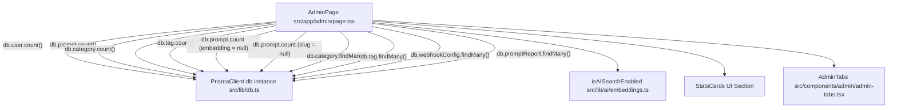
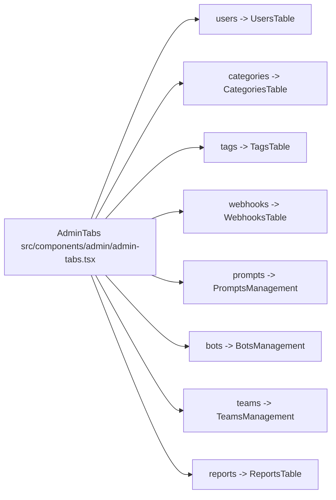
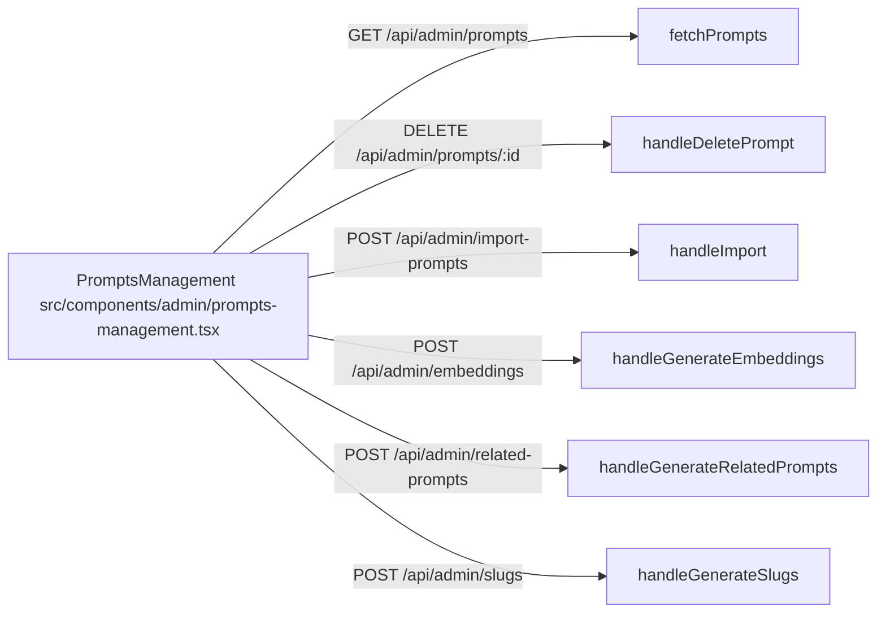
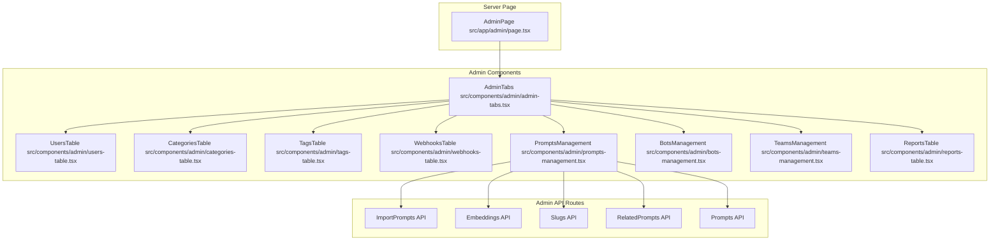

<!-- source: DeepWiki mcp.deepwiki.com · repo f/prompts.chat · page 10.1 Admin Dashboard · fetched 2026-11-09 -->

# Admin Dashboard

<details>
<summary>Relevant source files</summary>

The following files were used as context for generating this wiki page:

- [src/app/admin/page.tsx](src/app/admin/page.tsx)
- [src/components/admin/admin-tabs.tsx](src/components/admin/admin-tabs.tsx)
- [src/components/admin/prompts-management.tsx](src/components/admin/prompts-management.tsx)

</details>


This page documents the Admin Dashboard for the prompts.chat project, accessible at the `/admin` route [src/app/admin/page.tsx:1](). It is a central interface designed for administrators to manage core platform entities such as users, prompts, categories, tags, webhooks, bots, teams, and user reports [src/app/admin/page.tsx:8-17](). The dashboard provides statistical insights, efficient navigation via tabs, and comprehensive management interfaces, including bulk operations and moderation tools [src/app/admin/page.tsx:136-215]().

---

## Purpose and Scope

- Manage platform-wide counts and statistics to monitor user engagement and content [src/app/admin/page.tsx:36-42]().
- Provide tabbed navigation between users, categories, tags, webhooks, prompts, bots, teams, and reports [src/components/admin/admin-tabs.tsx:7-108]().
- Facilitate administrative operations like prompt import, deletion, embedding generation, slug generation, and moderation [src/components/admin/prompts-management.tsx:132-208]().
- Enforce access control by restricting dashboard access to users with `ADMIN` role [src/app/admin/page.tsx:31-33]().
- Integration with server APIs to safely perform CRUD, bulk, and moderation actions [src/components/admin/prompts-management.tsx:141-208]().

This page covers data flows, key components, and the internal implementation of the Admin Dashboard.

Sources: [src/app/admin/page.tsx:26-42](), [src/components/admin/admin-tabs.tsx:7-108](), [src/components/admin/prompts-management.tsx:132-208]()

---

## Access Control

- The admin dashboard is implemented as a Next.js server component at `src/app/admin/page.tsx` [src/app/admin/page.tsx:26]().
- It invokes the `auth()` function from the authentication library to retrieve the user's session [src/app/admin/page.tsx:27]().
- Immediately redirects non-admin users to the homepage `/` by verifying `session.user.role === "ADMIN"` [src/app/admin/page.tsx:31-33]().

```typescript
const session = await auth();
if (!session?.user || session.user.role !== "ADMIN") {
  redirect("/");
}
```
This ensures the dashboard and all its operations are restricted to authorized administrators only, enforced also at the API route layer.

Sources: [src/app/admin/page.tsx:26-33]()

---

## Dashboard Layout and Data Flow

The `AdminPage` server component fetches all required data for the dashboard using Prisma ORM calls and internal utility functions [src/app/admin/page.tsx:36-134](). Data is fetched in parallel for efficiency via `Promise.all`.

### Data fetched includes:

- User count via `db.user.count()` [src/app/admin/page.tsx:37]()
- Prompt count via `db.prompt.count()` [src/app/admin/page.tsx:38]()
- Category count via `db.category.count()` [src/app/admin/page.tsx:39]()
- Tag count via `db.tag.count()` [src/app/admin/page.tsx:40]()
- Number of prompts without embeddings and total public prompts (conditional on AI search via `isAISearchEnabled()`) [src/app/admin/page.tsx:41-63]()
- Number of prompts missing URL slugs and total prompts [src/app/admin/page.tsx:66-78]()
- Lists of categories, tags, webhook configurations, and prompt reports for rendering tables [src/app/admin/page.tsx:81-134]()

### Diagram: Admin Page Data Flow and Code Entity Mapping (Natural Language to Code Entity Space)



Sources: [src/app/admin/page.tsx:26-134](), [src/lib/ai/embeddings.ts]()

---

## Stats Cards Section

At the top of the dashboard UI, four data cards display key counts for users, prompts, categories, and tags [src/app/admin/page.tsx:143-181]():

| Metric     | Icon               | Prisma Query                         |
|------------|--------------------|------------------------------------|
| Users      | `Users`            | `db.user.count()` [src/app/admin/page.tsx:37]() |
| Prompts    | `FileText`         | `db.prompt.count()` [src/app/admin/page.tsx:38]() |
| Categories | `FolderTree`       | `db.category.count()` [src/app/admin/page.tsx:39]() |
| Tags       | `Tags`             | `db.tag.count()` [src/app/admin/page.tsx:40]() |

Each card displays the count with iconography for quick visual identification.

Sources: [src/app/admin/page.tsx:143-181]()

---

## Tab Navigation Layout

The dashboard uses the `AdminTabs` client component for tabbed navigation across major admin sections [src/components/admin/admin-tabs.tsx:32-110]().

- Tabs include: `users`, `categories`, `tags`, `webhooks`, `prompts`, `bots`, `teams`, and `reports` [src/components/admin/admin-tabs.tsx:7]()
- Tab state is synchronized with the URL hash (e.g., `/#prompts`) allowing permalinkable views and persistence across refreshes [src/components/admin/admin-tabs.tsx:36-50]()
- Tab changes update the URL fragment using `window.history.replaceState` [src/components/admin/admin-tabs.tsx:52-55]()
- The active tab is initialized from the hash on mount [src/components/admin/admin-tabs.tsx:43-46]()

### Diagram: Admin Tabs Navigation Structure



The `reports` tab shows a badge counting the number of reports with status `PENDING` to alert admins [src/components/admin/admin-tabs.tsx:92-96]().

Sources: [src/components/admin/admin-tabs.tsx:7-108](), [src/app/admin/page.tsx:184-212]()

---

## PromptsManagement Component

A React client component in `src/components/admin/prompts-management.tsx` provides an interactive panel for managing prompt data and bulk operations [src/components/admin/prompts-management.tsx:99-208](). It supports:

- Prompt search and pagination [src/components/admin/prompts-management.tsx:132-155]()
- Prompt deletion with confirmation [src/components/admin/prompts-management.tsx:172-195]()
- Importing community prompts (conditional on clone branding) [src/components/admin/prompts-management.tsx:106]()
- Generating AI embeddings, URL slugs, and related prompts with progress indicators [src/components/admin/prompts-management.tsx:112-120]()
- Status badges and filtering options for the prompts list [src/components/admin/prompts-management.tsx:130-170]()

### Properties of `PromptsManagement`

| Prop                    | Type     | Description                                                        |
|-------------------------|----------|--------------------------------------------------------------------|
| `aiSearchEnabled`       | boolean  | Shows embedding generation controls if true (requires OpenAI key) [src/components/admin/prompts-management.tsx:92]() |
| `promptsWithoutEmbeddings` | number | Counts prompts pending embeddings generation [src/components/admin/prompts-management.tsx:93]() |
| `totalPublicPrompts`    | number   | Total public prompts for gating regenerate operation [src/components/admin/prompts-management.tsx:94]() |
| `promptsWithoutSlugs`   | number   | Number of prompts missing slugs [src/components/admin/prompts-management.tsx:95]() |
| `totalPrompts`          | number   | Total prompt count for regenerate slug operation [src/components/admin/prompts-management.tsx:96]() |

### Branding and Operation Restrictions

The dashboard uses a branding check via `useBranding()` and its `useCloneBranding` flag to restrict certain operations (import and bulk delete) to clones of the site [src/components/admin/prompts-management.tsx:31-106]().

```typescript
const branding = useBranding();
const canModifyCommunityPrompts = branding.useCloneBranding;
```

This prevents modifications to the canonical dataset on the main `prompts.chat` instance.

Sources: [src/components/admin/prompts-management.tsx:31-106]()

### Diagram: PromptsManagement Operations and API Integration (Natural Language to Code Entity Space)



It manages asynchronous operations with streaming progress updates via Server-Sent Events on embedding, slug, and related prompt generation.

Sources: [src/components/admin/prompts-management.tsx:132-208]()

### Prompts List Fetching

The prompts list is fetched with paging (10 per page), search by title, and filtering options (`all`, `featured`, `unlisted`, `deleted`) [src/components/admin/prompts-management.tsx:132-140]():

- Parameters passed as URL query string to `/api/admin/prompts` [src/components/admin/prompts-management.tsx:135-140]()
- Results update the component's state and UI table [src/components/admin/prompts-management.tsx:148-149]()
- Supports actions like deleting individual prompts post-confirmation [src/components/admin/prompts-management.tsx:172-195]()

Sources: [src/components/admin/prompts-management.tsx:132-155](), [src/components/admin/prompts-management.tsx:172-195]()

### AI Embedding Generation UI

- Visible only when `aiSearchEnabled` is true (requires configured OpenAI key) [src/components/admin/prompts-management.tsx:92]()
- Calls `POST /api/admin/embeddings` and consumes SSE stream to show progress bars for successful and failed jobs.
- Uses `ProgressState` interface to represent progress metrics [src/components/admin/prompts-management.tsx:43-48]().

```typescript
interface ProgressState {
  current: number;
  total: number;
  success: number;
  failed: number;
}
```

Sources: [src/components/admin/prompts-management.tsx:43-48]()

---

## Overall Component Architecture

### Diagram: Admin Component Tree and API Route Connections



Sources: [src/app/admin/page.tsx:184-215](), [src/components/admin/admin-tabs.tsx:32-108](), [src/components/admin/prompts-management.tsx:141-208]()

---

## Summary

The Admin Dashboard is a secure, integrated panel for managing prompts.chat platform content at scale. It offers critical metrics, a smooth tabbed interface, and detailed user, category, tag, webhook, prompt, bot, team, and report management [src/app/admin/page.tsx:136-215](). Heavy operations like embedding or slug generation use event streaming for progress feedback [src/components/admin/prompts-management.tsx:112-120](). Access control and branding safeguards protect operations to maintain dataset integrity [src/app/admin/page.tsx:31-33](), [src/components/admin/prompts-management.tsx:106]().

Sources: [src/app/admin/page.tsx:31-215](), [src/components/admin/prompts-management.tsx:106-120]()

---

