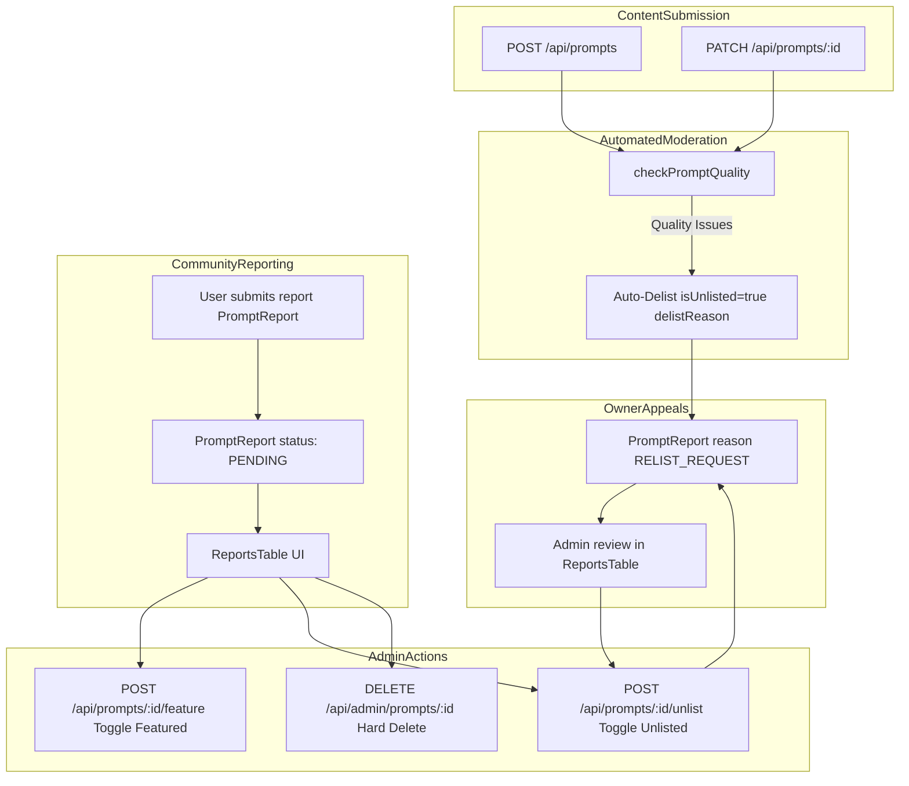
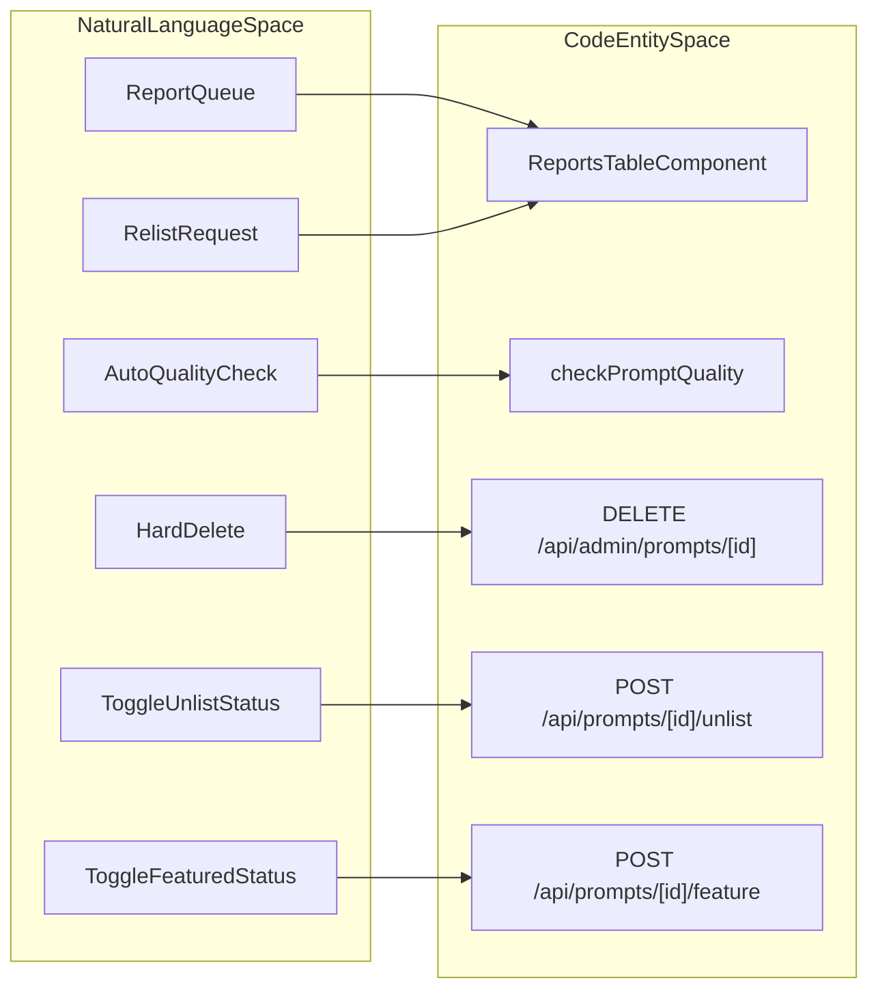
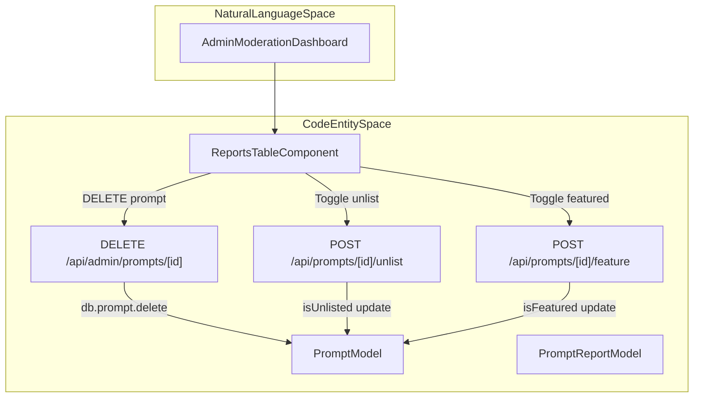

<!-- source: DeepWiki mcp.deepwiki.com · repo f/prompts.chat · page 10.2 Content Moderation · fetched 2026-11-09 -->

# Content Moderation

Relevant source files

The following files were used as context for generating this wiki page:

- [.github/workflows/docker-publish.yml](.github/workflows/docker-publish.yml)
- [.github/workflows/update-contributors.yml](.github/workflows/update-contributors.yml)
- [prisma/migrations/20251217173000_add_delist_reason/migration.sql](prisma/migrations/20251217173000_add_delist_reason/migration.sql)
- [src/app/api/admin/prompts/[id]/route.ts](src/app/api/admin/prompts/[id]/route.ts)
- [src/app/api/prompt-builder/chat/prompt-builder-agent.prompt.yml](src/app/api/prompt-builder/chat/prompt-builder-agent.prompt.yml)
- [src/app/api/prompts/[id]/feature/route.ts](src/app/api/prompts/[id]/feature/route.ts)
- [src/app/api/prompts/[id]/unlist/route.ts](src/app/api/prompts/[id]/unlist/route.ts)
- [src/lib/ai/load-prompt.ts](src/lib/ai/load-prompt.ts)
- [src/lib/ai/quality-check.prompt.yml](src/lib/ai/quality-check.prompt.yml)
- [src/lib/ai/quality-check.ts](src/lib/ai/quality-check.ts)
- [src/lib/ai/sql-generation.prompt.yml](src/lib/ai/sql-generation.prompt.yml)
- [src/lib/ai/translate.prompt.yml](src/lib/ai/translate.prompt.yml)

## Purpose and Scope

This document details the content moderation system in `prompts.chat`. It explains how submissions are auto-delisted based on quality checks, managed through a report queue, subject to manual review by administrators, and handled via relist requests and spam-check workflows.

The key focus areas include the AI-powered prompt quality check logic implemented in `checkPromptQuality()` [src/lib/ai/quality-check.ts:72-164](), automated prompt quality rules defined in [src/lib/ai/quality-check.prompt.yml:1-62](), report queues for user reports, and admin endpoints for toggling prompt visibility, featured state, or hard deletion.

For related administrative interface and user management features, see Admin Dashboard (10.1) and User Management (10.3).

Sources:
[src/lib/ai/quality-check.ts:1-173](),
[src/lib/ai/quality-check.prompt.yml:1-62](),
[src/app/api/prompts/[id]/unlist/route.ts:6-71](),
[src/app/api/prompts/[id]/feature/route.ts:5-59]()

---

## Content Moderation Architecture

The moderation system integrates several subsystems: automated quality checks, a report queue, spam detection workflows, and manual admin moderation actions. Submissions enter the system via HTTP API calls or GitHub contributions, undergo automated AI-powered content evaluation, may be flagged through user reporting, and can be manually moderated by administrators.

### System Data Flow Diagram

This flow shows how prompts are checked automatically on create/update using `checkPromptQuality()` defined in [src/lib/ai/quality-check.ts:72-164](). Prompts failing quality checks are auto-delisted (hidden from discovery) with specific reasons. User reports appear in a queue for admin review, who can take actions such as feature toggling, unlisting (delisting), or hard deleting prompts via [src/app/api/prompts/[id]/unlist/route.ts:6-71]() and [src/app/api/admin/prompts/[id]/route.ts:6-72](). Delisted prompts can generate relist requests that admins can approve or deny.

Sources:
[src/app/api/prompts/[id]/unlist/route.ts:43-52](),
[src/lib/ai/quality-check.ts:72-164](),
[src/app/api/prompts/[id]/feature/route.ts:5-59]()

---

## Automated Controls and Quality

### AI-Powered Prompt Quality Checks

The core quality evaluation happens in `checkPromptQuality()` implemented in [src/lib/ai/quality-check.ts:72-164](). This function takes the prompt title, content, and optional description, and returns a `QualityCheckResult` that specifies if the prompt should be delisted, the reason, and confidence.

#### Main Steps in `checkPromptQuality`

1.  **Length Heuristics**  
    The helper `checkLength()` validates the prompt content length: minimum 50 characters and at least 10 non-empty words [src/lib/ai/quality-check.ts:28-64](). If too short, it marks for delisting immediately with reason `"TOO_SHORT"` [src/lib/ai/quality-check.ts:47-54]().

2.  **OpenAI GPT LLM Quality Check**  
    If length checks pass and an OpenAI API key is configured, the function proceeds to call the generative model (defaulting to `gpt-4o`) with a loaded prompt template from [src/lib/ai/quality-check.prompt.yml:1-43]().  
    The AI is instructed to be conservative, only flagging prompts that are clearly problematic based on English language usage, quality, and whether the text looks like a proper LLM instruction [src/lib/ai/quality-check.prompt.yml:13-35]().  
    The JSON format response includes:  
    -   `shouldDelist` (boolean)  
    -   `reason` among `NOT_ENGLISH`, `LOW_QUALITY`, or `NOT_LLM_INSTRUCTION`  
    -   `confidence` (0.0 to 1.0)  
    -   `details` string  

3.  **Confidence Threshold**  
    The implementation requires a confidence level of at least 0.85 to auto-delist prompts [src/lib/ai/quality-check.ts:129-136](). Responses below this threshold are treated as approvals to prevent false positives. On errors or parsing issues, the system defaults to approval [src/lib/ai/quality-check.ts:145-162]().

4.  **Auto-Delist Flag & Enum**  
    The system uses the `isUnlisted` flag on prompts to hide them from public discovery when quality checks fail. Delist reasons correspond to an enum type `DelistReason` (`"TOO_SHORT"`, `"NOT_ENGLISH"`, `"LOW_QUALITY"`, `"NOT_LLM_INSTRUCTION"`, `"MANUAL"`) defined in [prisma/migrations/20251217173000_add_delist_reason/migration.sql:1-5]() and referenced in [src/lib/ai/quality-check.ts:6-7]().

Sources:
[src/lib/ai/quality-check.ts:28-164](),
[src/lib/ai/quality-check.prompt.yml:1-62](),
[prisma/migrations/20251217173000_add_delist_reason/migration.sql:1-5]()

---

## Report Queue System & Relist Requests

### `PromptReport` Model

Users can submit reports flagging problematic prompts. Reports are stored in the database and tracked via status fields and reasons:

| Field      | Type          | Description                                                              |
| :--------- | :------------ | :----------------------------------------------------------------------- |
| `reason`   | `ReportReason` | Reasons like `SPAM`, `INAPPROPRIATE`, `COPYRIGHT`, `MISLEADING`, `RELIST_REQUEST`, `OTHER` |
| `status`   | `ReportStatus` | Status values: `PENDING`, `REVIEWED`, `DISMISSED`                        |
| `details`  | `string?`     | Optional additional information from reporter                            |

### Admin Review Workflow & Relist Requests

-   The reports interface displays pending reports and allows admins to update report status.  
-   Status changes invoke PATCH requests to update report states on the server.  
-   Admins can handle relisting requests by calling the API endpoint to toggle `unlist` status back to visible [src/app/api/prompts/[id]/unlist/route.ts:6-71]().  
-   Hard deletes and prompt restores are also accessible from the administrative interface [src/app/api/admin/prompts/[id]/route.ts:6-72]().

Sources:
[src/app/api/prompts/[id]/unlist/route.ts:6-71](),
[src/app/api/admin/prompts/[id]/route.ts:6-72]()

---

## Admin Moderation Tools

Administrative users have several tools available via the Admin UI and corresponding API endpoints:

| Action                   | UI Code/Function             | Server Implementation                                      |
| :----------------------- | :--------------------------- | :--------------------------------------------------------- |
| **Hard Delete Prompt**   | `handleDeletePrompt` in Admin UI | `DELETE /api/admin/prompts/[id]` [src/app/api/admin/prompts/[id]/route.ts:6-72]() |
| **Toggle Featured Status** | Button/API call in Admin UI | `POST /api/prompts/[id]/feature` for toggling `isFeatured` [src/app/api/prompts/[id]/feature/route.ts:5-59]() |
| **Toggle Unlisted Status** | Button/API call in Admin UI | `POST /api/prompts/[id]/unlist` for toggling `isUnlisted` [src/app/api/prompts/[id]/unlist/route.ts:6-71]() |

Sources:
[src/app/api/admin/prompts/[id]/route.ts:6-72](),
[src/app/api/prompts/[id]/feature/route.ts:5-59](),
[src/app/api/prompts/[id]/unlist/route.ts:6-71]()

---

## Visibility and Code Entities Mapping Diagram

This diagram connects natural language concepts of moderation with their code implementations for clarity, bridging Natural Language Space to Code Entity Space.

Sources:
[src/lib/ai/quality-check.ts:72-164](),
[src/app/api/admin/prompts/[id]/route.ts:6-72](),
[src/app/api/prompts/[id]/unlist/route.ts:6-71](),
[src/app/api/prompts/[id]/feature/route.ts:5-59]()

---

## Moderation Data Flow and API Endpoints Diagram

This diagram illustrates components, API routes, and database models involved in moderation tasks, also mapping system functions to code entities.

Sources:
[src/app/api/admin/prompts/[id]/route.ts:6-72](),
[src/app/api/prompts/[id]/unlist/route.ts:6-71](),
[src/app/api/prompts/[id]/feature/route.ts:5-59]()

---

