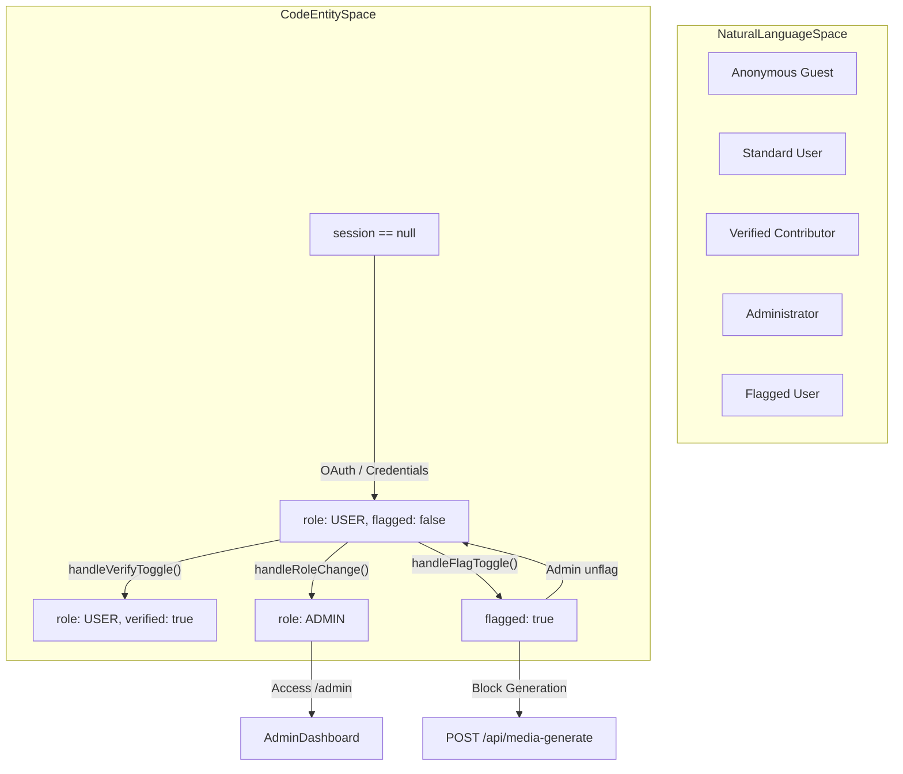
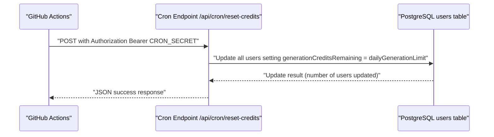
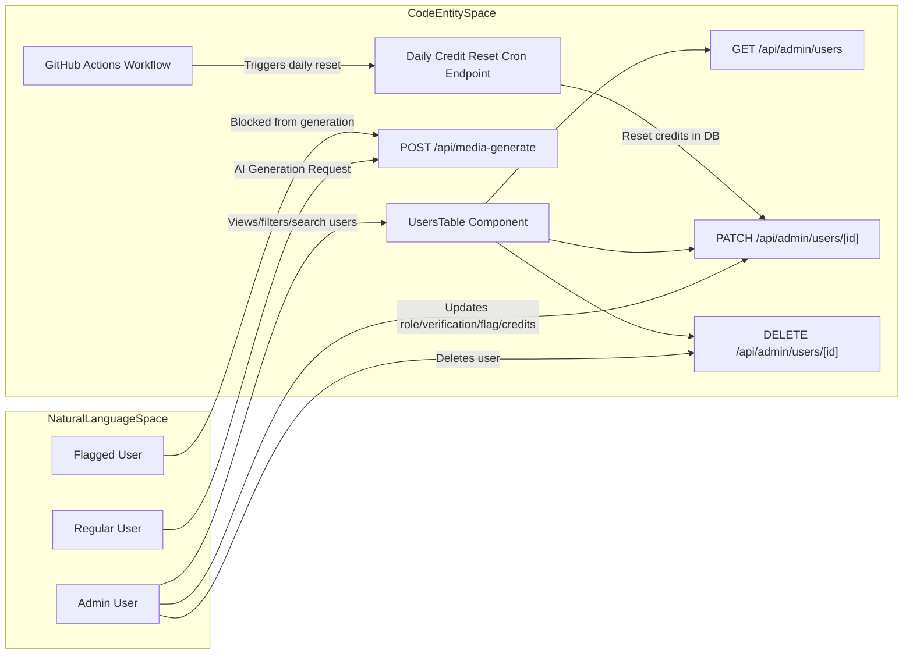

<!-- source: DeepWiki mcp.deepwiki.com · repo f/prompts.chat · page 10.3 User Management · fetched 2026-11-09 -->

# User Management

Relevant source files

The following files were used as context for generating this wiki page:

- [.github/workflows/reset-credits.yml](.github/workflows/reset-credits.yml)
- [prisma/migrations/20251222132600_add_user_flagged_and_unusual_activity/migration.sql](prisma/migrations/20251222132600_add_user_flagged_and_unusual_activity/migration.sql)
- [prisma/migrations/20251225000000_add_generation_credits/migration.sql](prisma/migrations/20251225000000_add_generation_credits/migration.sql)
- [src/app/api/admin/users/[id]/route.ts](src/app/api/admin/users/[id]/route.ts)
- [src/app/api/admin/users/route.ts](src/app/api/admin/users/route.ts)
- [src/app/api/cron/reset-credits/route.ts](src/app/api/cron/reset-credits/route.ts)
- [src/app/api/media-generate/route.ts](src/app/api/media-generate/route.ts)
- [src/components/admin/users-table.tsx](src/components/admin/users-table.tsx)
- [src/components/prompts/media-generator.tsx](src/components/prompts/media-generator.tsx)
- [src/lib/plugins/media-generators/index.ts](src/lib/plugins/media-generators/index.ts)

This page documents the administrative tools and technical implementation for managing user accounts in prompts.chat, including role assignment, verification, account flagging, credit management, and user-related moderation.

---

## 1. Purpose and Scope

The user management subsystem provides administrators with programmatic and UI-based controls to manage user identities, authorization tiers, resource quotas, and platform safety flags. These tools are accessible exclusively to users holding the `ADMIN` role and are implemented via Next.js API routes and React client components backed by the Prisma ORM.

Sources: [src/app/api/admin/users/route.ts:18-24](), [src/components/admin/users-table.tsx:46-63]()

---

## 2. User Role & Status Hierarchy

The system defines user capabilities through a combination of roles and status flags stored in the `User` model. The `ADMIN` role is required to access management interfaces, while flags like `verified` and `flagged` control visibility and resource access.

### Title: User State Transitions and Capabilities

Sources: [src/components/admin/users-table.tsx:46-63](), [src/components/admin/users-table.tsx:130-181](), [src/app/api/media-generate/route.ts:67-72]()

- The `role` property distinguishes regular users (`USER`) from administrators (`ADMIN`) [src/components/admin/users-table.tsx:46-63]().
- The `verified` boolean flags trusted contributors, enabling recognition badges [src/components/admin/users-table.tsx:46-63]().
- The `flagged` boolean marks suspicious or problematic accounts, restricting capabilities [src/components/admin/users-table.tsx:46-63]().
- Admins manage all user states through the admin dashboard.
- Flagged users are blocked from AI media generation actions [src/app/api/media-generate/route.ts:67-72]().

Sources: [src/components/admin/users-table.tsx:46-63](), [src/app/api/admin/users/[id]/route.ts:21-30]()

---

## 3. Administrative Operations

### User Listing and Filtering

The `UsersTable` React component provides the primary interface for user management in the admin UI [src/components/admin/users-table.tsx:72-113](). It fetches paginated user data from the `/api/admin/users` endpoint with support for:

- Text search filtering on email, username, or display name [src/app/api/admin/users/route.ts:73-79]().
- Role-based filters (`admin`, `user`) [src/app/api/admin/users/route.ts:50-55]().
- Status filters (`verified`, `unverified`, `flagged`) [src/app/api/admin/users/route.ts:56-64]().

The `fetchUsers` function builds query parameters (`page`, `limit`, `search`, `filter`) for the backend [src/app/api/admin/users/route.ts:26-33](). Users are returned with metadata including prompt counts and timestamps [src/app/api/admin/users/route.ts:88-114]().

Sources: [src/components/admin/users-table.tsx:90-113](), [src/app/api/admin/users/route.ts:26-116]()

### Role and Verification Management

Admins can update user roles and verification status in the UI via dropdowns and toggles. These actions call the `PATCH /api/admin/users/[id]` API endpoint [src/components/admin/users-table.tsx:130-163]().

- Role changes (`USER` ↔ `ADMIN`) are validated to ensure only valid role strings are accepted [src/app/api/admin/users/[id]/route.ts:31-36]().
- Verification toggles modify the `verified` boolean attribute [src/app/api/admin/users/[id]/route.ts:38-40]().
- Protected by verifying that `session.user.role === "ADMIN"` [src/app/api/admin/users/[id]/route.ts:11-14]().

Sources: [src/components/admin/users-table.tsx:130-163](), [src/app/api/admin/users/[id]/route.ts:11-40]()

### Account Flagging

Flagging a user sets `flagged` to `true`, records the reason in `flaggedReason`, and timestamps `flaggedAt` [src/app/api/admin/users/[id]/route.ts:42-50](). If unflagged, these fields are reset to `null`.

Flagged users are suspended from certain platform functionalities:
- The media generation API (`POST /api/media-generate`) checks `user.flagged` and returns a `403 Forbidden` response if true [src/app/api/media-generate/route.ts:67-72]().

Sources: [src/components/admin/users-table.tsx:165-181](), [src/app/api/media-generate/route.ts:67-72](), [src/app/api/admin/users/[id]/route.ts:42-51]()

---

## 4. Generation Credits & Limits

To regulate resource usage, the system employs a daily credit system limiting AI media generation per user.

### Implementation Details

- **Database Schema:** Introduced in migration `20251225000000_add_generation_credits` [prisma/migrations/20251225000000_add_generation_credits/migration.sql]() with three key columns on the `users` table:
  - `dailyGenerationLimit`: Maximum daily credits (default `10`) [prisma/migrations/20251225000000_add_generation_credits/migration.sql:2]().
  - `generationCreditsRemaining`: Current available credits [prisma/migrations/20251225000000_add_generation_credits/migration.sql:3]().
  - `generationCreditsResetAt`: Timestamp of the last credit reset [prisma/migrations/20251225000000_add_generation_credits/migration.sql:4]().
- **Credit Deduction:** Successfully starting a media generation (`POST /api/media-generate`) atomically decrements `generationCreditsRemaining` by `1` [src/app/api/media-generate/route.ts:118-125]().
- **Admin Override:** Admins can adjust a user's `dailyGenerationLimit` via `PATCH /api/admin/users/[id]`, which also updates `generationCreditsRemaining` to match the new limit [src/app/api/admin/users/[id]/route.ts:53-61]().

Sources: [prisma/migrations/20251225000000_add_generation_credits/migration.sql:1-4](), [src/app/api/media-generate/route.ts:118-125](), [src/app/api/admin/users/[id]/route.ts:53-61]()

### Daily Reset Workflow

Generation credits are reset daily for all users via a scheduled cron job:
- Endpoint: `POST /api/cron/reset-credits` executes a raw SQL update setting `generationCreditsRemaining` to `dailyGenerationLimit` and updating `generationCreditsResetAt` [src/app/api/cron/reset-credits/route.ts:40-44]().
- Protected by the `CRON_SECRET` environment variable checked against the `Authorization: Bearer` header [src/app/api/cron/reset-credits/route.ts:18-36]().
- Triggered daily at midnight UTC via GitHub Actions workflow `.github/workflows/reset-credits.yml` [`.github/workflows/reset-credits.yml:1-30`]().

### Title: Daily Credit Reset Data Flow

Sources: [.github/workflows/reset-credits.yml:1-30](), [src/app/api/cron/reset-credits/route.ts:16-60]()

---

## 5. Technical Reference: User Deletion

User deletion is a destructive operation restricted to administrators.
- Triggered in the UI via an `AlertDialog` confirming the action, calling `DELETE /api/admin/users/[id]` [src/components/admin/users-table.tsx:35-43](), [src/components/admin/users-table.tsx:183-203]().
- The API handler prevents self-deletion by verifying `id !== session.user.id` [src/app/api/admin/users/[id]/route.ts:104-106]().
- Upon success, the database record is deleted and `{ success: true }` is returned [src/app/api/admin/users/[id]/route.ts:108-112]().

Sources: [src/components/admin/users-table.tsx:35-43](), [src/components/admin/users-table.tsx:183-203](), [src/app/api/admin/users/[id]/route.ts:91-117]()

---

## 6. Bridging Natural Language to Code Entities: Overall User Admin Flow

### Title: User Administration Flow Integration

Sources: [src/components/admin/users-table.tsx:1-222](), [src/app/api/admin/users/route.ts:1-134](), [src/app/api/admin/users/[id]/route.ts:1-118](), [src/app/api/media-generate/route.ts:1-141](), [src/app/api/cron/reset-credits/route.ts:1-66](), [.github/workflows/reset-credits.yml:1-30]()

---

## Summary

The user management subsystem implements robust controls for maintaining platform security, regulating AI resource consumption via daily generation limits, and executing administrative actions safely through protected API routes and structured frontend tables.

Sources: [src/components/admin/users-table.tsx:1-222](), [src/app/api/admin/users/route.ts:1-134](), [src/app/api/admin/users/[id]/route.ts:1-118]()

---

