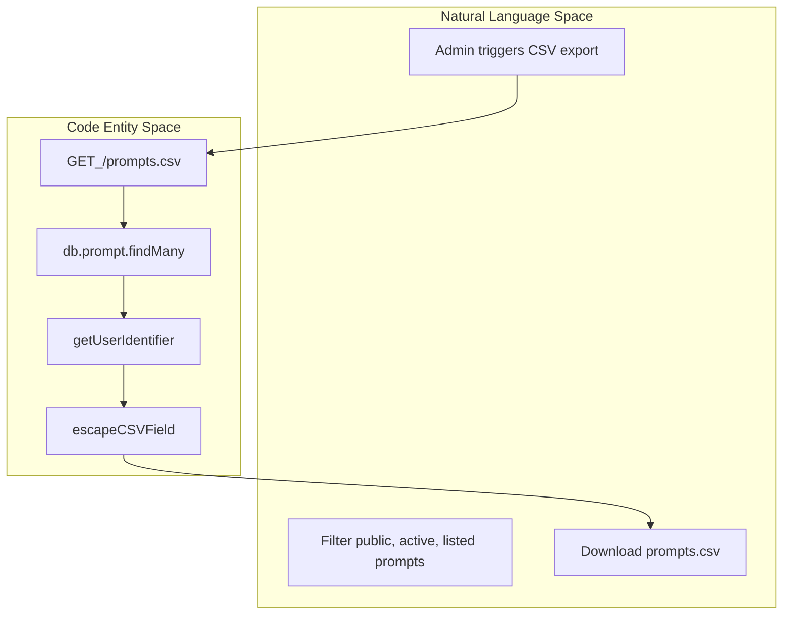
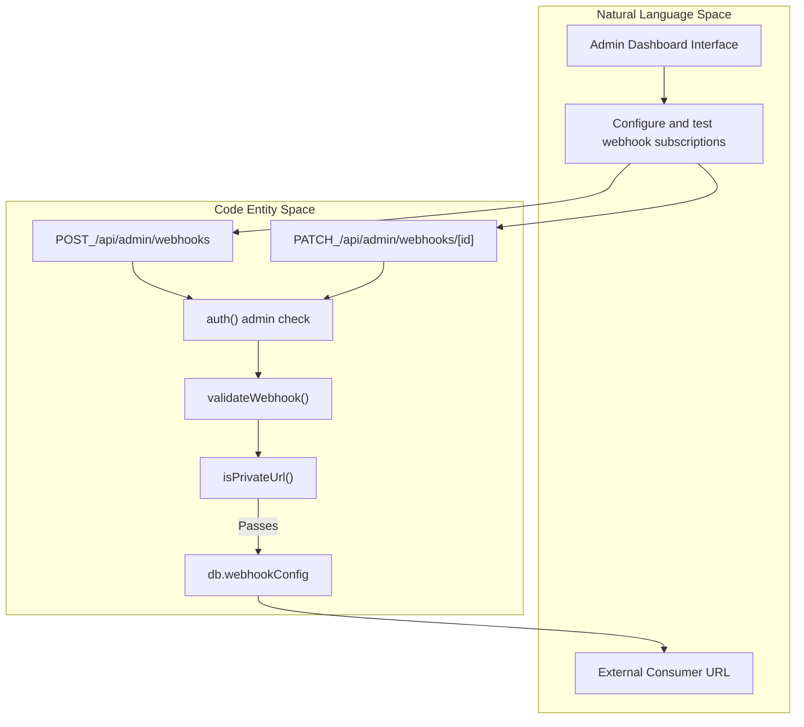
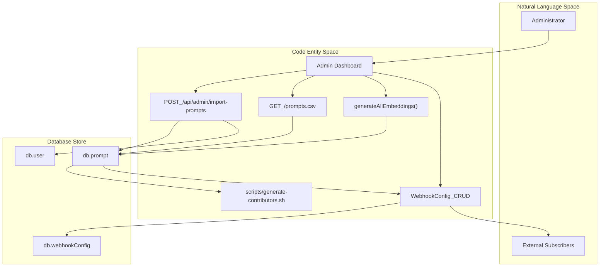

<!-- source: DeepWiki mcp.deepwiki.com · repo f/prompts.chat · page 10.4 Bulk Operations & Webhooks · fetched 2026-11-09 -->

# Bulk Operations & Webhooks

Relevant source files

The following files were used as context for generating this wiki page:

- [.github/PULL_REQUEST_TEMPLATE.md](.github/PULL_REQUEST_TEMPLATE.md)
- [PROMPTS.md](PROMPTS.md)
- [README.md](README.md)
- [next.config.ts](next.config.ts)
- [prompts.csv](prompts.csv)
- [scripts/generate-contributors.sh](scripts/generate-contributors.sh)
- [scripts/rebuild-history.sh](scripts/rebuild-history.sh)
- [src/app/prompts.csv/route.ts](src/app/prompts.csv/route.ts)
- [src/app/prompts.json/route.ts](src/app/prompts.json/route.ts)
- [src/components/admin/import-prompts.tsx](src/components/admin/import-prompts.tsx)
- [src/lib/ai/embeddings.ts](src/lib/ai/embeddings.ts)
- [src/lib/ai/query-translator.prompt.yml](src/lib/ai/query-translator.prompt.yml)
- [tests/generate-contributors-format.test.js](tests/generate-contributors-format.test.js)

This page provides full technical documentation for the bulk operations available within the administrative interface of `prompts.chat`. It details how the system handles prompt embeddings, slug generation, related prompts discovery, CSV import/export synchronization, contributor attribution scripts, and administrative webhook configuration and delivery.

---

## Administrative Interface for Bulk Operations

The administration panel relies on frontend controllers to orchestrate batch tasks against backend routes. The `PromptsManagement` component acts as the primary orchestrator for bulk prompt updates `[src/components/admin/prompts-management.tsx:41-46]()`.

### Implementation & State Control

- **Progress Tracking:** Operations use React state hooks (`useState`) to manage tracking metrics, tracking success counts, failure counts, and execution states via a typed progress interface `[src/components/admin/prompts-management.tsx:41-46]()`.
- **Branding Protection:** Administrative mutations are guarded by configuration flags like `useCloneBranding` to prevent unauthorized alteration in white-labeled deployments `[src/components/admin/prompts-management.tsx:103-103]()`.
- **Feedback & Notifications:** Toast notifications via `sonner` relay feedback regarding task completion, success rates, and caught exceptions `[src/components/admin/prompts-management.tsx:111-117]()`.
- **Dashboard Metrics:** The parent `AdminPage` aggregates metadata deficiencies (such as prompts lacking slugs or embeddings) to notify administrators when bulk actions are required `[src/app/admin/page.tsx:41-75]()`.

Sources: `[src/components/admin/prompts-management.tsx:41-128]`, `[src/app/admin/page.tsx:41-75]()`

---

## CSV Import & Export System

The platform maintains synchronization between PostgreSQL and the repository-level `prompts.csv` file.

### CSV Export Mechanism (`/prompts.csv`)

- Exports active, public, and listed prompts. Unlisted and soft-deleted records are automatically filtered out `[src/app/prompts.csv/route.ts:31-37]()`.
- Escaping follows RFC 4180 rules, handling embedded quotes, commas, and multiline values via `escapeCSVField()` `[src/app/prompts.csv/route.ts:5-15]()`.
- Contributor identifiers are resolved deterministically using `getUserIdentifier()`, prioritizing GitHub usernames, followed by unclaimed proxy handles (`@unclaimed.prompts.chat`), and email fallbacks `[src/app/prompts.csv/route.ts:18-25]`, `[src/app/prompts.csv/route.ts:74-80]()`.

#### CSV Export Flow (Natural Language to Code Entity Bridge)

Sources: `[src/app/prompts.csv/route.ts:1-95]()`

### CSV Import (`/api/admin/import-prompts`)

- Reads and parses CSV files from the project root or uploaded buffers, handling multiline quoted records and unescaping sequences `[src/app/api/admin/import-prompts/route.ts:15-90]()`.
- Validates uniqueness by prompt title to prevent duplicate entries.
- Unclaimed authors and contributors are automatically upserted as placeholder records utilizing `@unclaimed.prompts.chat` domains `[src/app/api/admin/import-prompts/route.ts:136-172]()`.
- Coding prompts are automatically linked or upserted into the "Coding" category `[src/app/api/admin/import-prompts/route.ts:190-209]()`.

Sources: `[src/app/api/admin/import-prompts/route.ts:1-209]`, `[src/components/admin/import-prompts.tsx:35-220]()`

---

## AI & Metadata Bulk Operations

Bulk metadata enrichment operations scale prompt indexing for vector search and graph connectivity.

### Embedding Generation (`generateAllEmbeddings`)

- **Purpose:** Vectorizes prompt content for semantic search capabilities.
- **Data Pipeline:** `generateAllEmbeddings()` queries public, active prompts missing embedding fields (`embedding: Prisma.DbNull`), combines title, description, and raw content, and computes vector representations `[src/lib/ai/embeddings.ts:124-131]()`.
- **Provider Integration:** Calls OpenAI's embedding API (`embeddings.create`) with the configured `EMBEDDING_MODEL` (`text-embedding-3-small`) `[src/lib/ai/embeddings.ts:26-76]()`.
- **Rate Limiting:** Enforces an asynchronous `delay()` of 1,000ms between records to avoid provider rate exhaustion `[src/lib/ai/embeddings.ts:111-157]()`.
- **Feature Flag Guard:** Aborts execution unless `config.features.aiSearch` is explicitly enabled `[src/lib/ai/embeddings.ts:120-123]()`.

### Related Prompts & Slug Generation

- **Related Prompts Discovery:** Computes cosine similarity matrices over prompt embedding vectors to populate `PromptConnection` relations.
- **Slug Generation:** Bulk generates URL-safe slugs for records where `slug = null` via the `handleGenerateSlugs` administrative handler `[src/components/admin/prompts-management.tsx:107-107]()`.

Sources: `[src/lib/ai/embeddings.ts:70-159]`, `[src/components/admin/prompts-management.tsx:243-320]`, `[src/app/admin/page.tsx:41-75]()`

---

## Webhook Configuration & Delivery

External services receive real-time notifications about prompt lifecycle transitions via configurable webhook endpoints.

### Supported Events & CRUD APIs

- **Events:** `PROMPT_CREATED`, `PROMPT_UPDATED`, `PROMPT_DELETED`.
- **Endpoints:**
  - List / Create: `GET` and `POST` on `/api/admin/webhooks` `[src/app/api/admin/webhooks/route.ts:80-135]()`
  - Get / Update / Delete: `GET`, `PATCH`, `DELETE` on `/api/admin/webhooks/[id]` `[src/app/api/admin/webhooks/[id]/route.ts:1-178]()`
- **Security & Validation:** Endpoints require administrator authorization via NextAuth session checks. URLs undergo SSRF validation via `isPrivateUrl()` to reject internal or private network targets `[src/lib/webhook.ts:159-214]()`.
- **Payload Templates:** Supports template substitutions like `{{PROMPT_TITLE}}`, `{{AUTHOR_USERNAME}}`, and `{{CHATGPT_URL}}` `[src/lib/webhook.ts:25-41]()`.

#### Webhook Management Flow (Natural Language to Code Entity Bridge)

Sources: `[src/app/api/admin/webhooks/route.ts:1-135]`, `[src/app/api/admin/webhooks/[id]/route.ts:1-178]`, `[src/lib/webhook.ts:1-241]()`

---

## Contributor Attribution Sync

Git history ownership is maintained automatically via the shell script `scripts/generate-contributors.sh`.

### Attribution Workflow

1. **Remote Fetching:** Downloads `prompts.csv` from the live site endpoint `[scripts/generate-contributors.sh:15-19]()`.
2. **Diff Processing:** Runs an internal Python subprocess to isolate new or altered prompt records `[scripts/generate-contributors.sh:38-41]()`.
3. **Email Formatting:** `make_email()` maps contributor identifiers to standard git-compatible pseudo-emails (`@users.noreply.github.com`) `[scripts/generate-contributors.sh:102-106]()`.
4. **Commit Generation:** Stages changes and invokes `git commit`, setting primary authors and appending secondary contributors via `Co-authored-by` commit message trailers `[scripts/generate-contributors.sh:108-130]()`.
5. **Markdown Sync:** Regenerates formatted contributor links and block elements inside `PROMPTS.md` `[scripts/generate-contributors.sh:155-172]()`.

Sources: `[scripts/generate-contributors.sh:1-171]`, `[tests/generate-contributors-format.test.js:1-26]()`

---

## Summary Diagram: Bulk Operations & Webhook Integration

Sources: `[src/components/admin/prompts-management.tsx:41-128]`, `[src/app/api/admin/import-prompts/route.ts:1-209]`, `[src/app/prompts.csv/route.ts:1-95]`

---

## References

- Bulk Operations UI and logic: `[src/components/admin/prompts-management.tsx:41-128]()`
- CSV Import backend: `[src/app/api/admin/import-prompts/route.ts:1-209]()`
- CSV Export backend: `[src/app/prompts.csv/route.ts:1-95]()`
- Embeddings generation library: `[src/lib/ai/embeddings.ts:70-159]()`
- Admin dashboard metrics: `[src/app/admin/page.tsx:41-75]()`
- Webhook management API: `[src/app/api/admin/webhooks/route.ts:1-135]()`, `[src/app/api/admin/webhooks/[id]/route.ts:1-178]()`
- Webhook utility and validation: `[src/lib/webhook.ts:1-241]()`
- Contributor attribution script: `[scripts/generate-contributors.sh:1-171]()`

---

