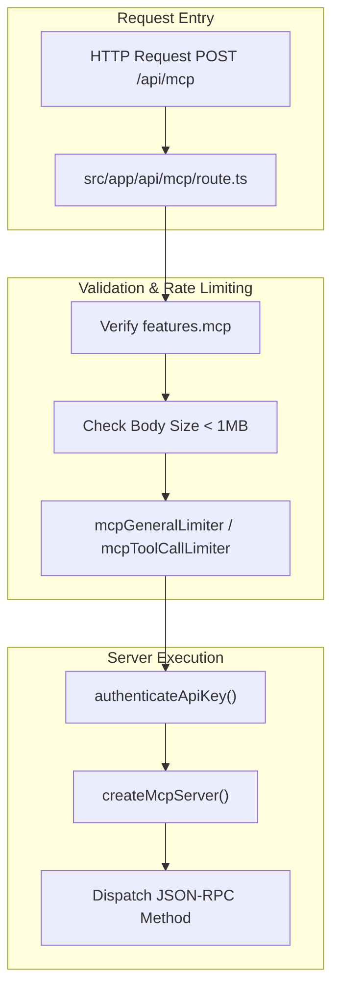
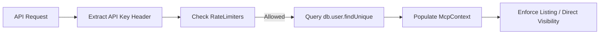
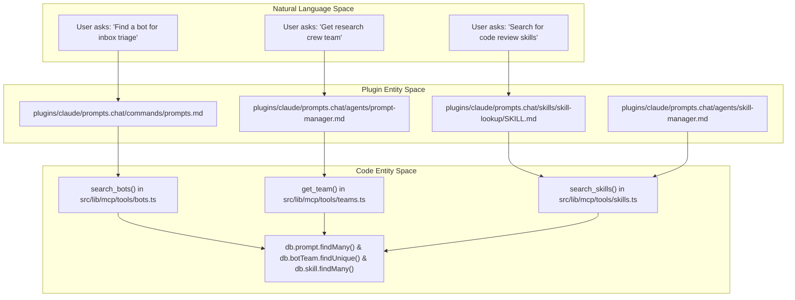
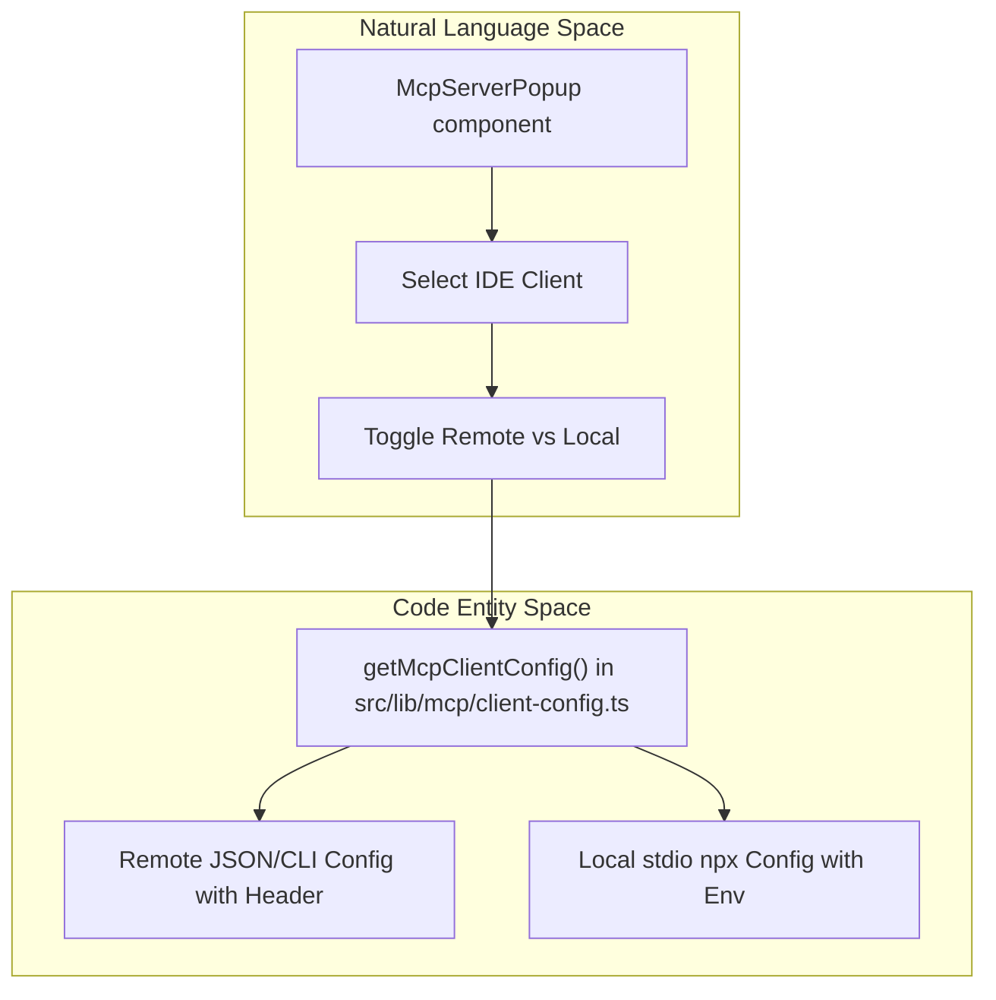

<!-- source: DeepWiki mcp.deepwiki.com · repo f/prompts.chat · page 11.1 MCP Server Integration · fetched 2026-11-09 -->

# MCP Server Integration

<details>
<summary>Relevant source files</summary>

The following files were used as context for generating this wiki page:

- [.claude-plugin/marketplace.json](.claude-plugin/marketplace.json)
- [CLAUDE-PLUGIN.md](CLAUDE-PLUGIN.md)
- [plugins/claude/prompts.chat/.claude-plugin/plugin.json](plugins/claude/prompts.chat/.claude-plugin/plugin.json)
- [plugins/claude/prompts.chat/.mcp.json](plugins/claude/prompts.chat/.mcp.json)
- [plugins/claude/prompts.chat/agents/prompt-manager.md](plugins/claude/prompts.chat/agents/prompt-manager.md)
- [plugins/claude/prompts.chat/agents/skill-manager.md](plugins/claude/prompts.chat/agents/skill-manager.md)
- [plugins/claude/prompts.chat/commands/prompts.md](plugins/claude/prompts.chat/commands/prompts.md)
- [plugins/claude/prompts.chat/commands/skills.md](plugins/claude/prompts.chat/commands/skills.md)
- [plugins/claude/prompts.chat/skills/prompt-lookup/SKILL.md](plugins/claude/prompts.chat/skills/prompt-lookup/SKILL.md)
- [plugins/claude/prompts.chat/skills/skill-lookup/SKILL.md](plugins/claude/prompts.chat/skills/skill-lookup/SKILL.md)
- [src/components/comments/comment-form.tsx](src/components/comments/comment-form.tsx)
- [src/components/mcp/mcp-config-tabs.tsx](src/components/mcp/mcp-config-tabs.tsx)
- [src/components/mcp/mcp-server-popup.tsx](src/components/mcp/mcp-server-popup.tsx)
- [src/components/prompts/add-to-collection-button.tsx](src/components/prompts/add-to-collection-button.tsx)
- [src/components/prompts/translate-button.tsx](src/components/prompts/translate-button.tsx)
- [src/hooks/use-mobile.ts](src/hooks/use-mobile.ts)

</details>


This page documents the Model Context Protocol (MCP) server implementation at `src/app/api/mcp/route.ts`, core tool registrations (`src/lib/mcp/tools/`), authentication systems, IDE client configuration generators, and the Claude Code plugin marketplace integration.

---

## MCP Server Routing & API Implementation

The MCP server is hosted as a Next.js App Router API route at `src/app/api/mcp/route.ts`. It leverages the `@modelcontextprotocol/sdk/server/mcp.js` package to manage JSON-RPC message exchange over HTTP/SSE transports [src/__tests__/api/mcp-handler.test.ts:34-40]().

- `POST` handlers receive JSON-RPC payloads, parse requests, run rate limiting checks, and route method calls to registered tools or prompts [src/__tests__/api/mcp-handler.test.ts:101-146]().
- `GET` requests without an active event stream return `405 Method Not Allowed` with `cache-control: no-store` [src/__tests__/api/mcp-handler.test.ts:67-78]().
- `DELETE` requests terminate sessions gracefully with a `204 No Content` status [src/__tests__/api/mcp-handler.test.ts:80-84]().

**MCP Server Request Routing Diagram**


Sources: [src/__tests__/api/mcp-handler.test.ts:30-177]()

---

## Authentication, Authorization & Rate Limiting

### API Key Authentication and Visibility

- MCP write operations and private prompt access require a `pchat_*` format API key [src/__tests__/api/mcp-handler.test.ts:27-28]().
- Authentication headers and query parameters supported include `PROMPTS_API_KEY`, `prompts-api-key`, `Authorization: Bearer`, and `?api_key=` [src/__tests__/api/mcp-handler.test.ts:162-167]().
- Cached user lookup via `db.user.findUnique` retrieves user entity records (`id`, `username`, `role`, `mcpPromptsPublicByDefault`) [src/__tests__/api/mcp-handler.test.ts:28]().

### Rate Limiting Layers

The system protects against resource exhaustion using distinct rate limiters defined in `src/lib/rate-limit.ts`:
- `mcpGeneralLimiter`: General POST request throttling [src/__tests__/api/mcp-handler.test.ts:61-64]().
- `mcpToolCallLimiter`: Tool execution throttling (`tools/call`) [src/__tests__/api/mcp-handler.test.ts:61-64]().
- `mcpWriteToolLimiter`: Mutation operations (`save_prompt`, `save_bot`, `save_team`) [src/__tests__/api/mcp-handler.test.ts:61-64]().
- `mcpAiToolLimiter`: AI-powered utilities (`improve_prompt`, semantic search) [src/__tests__/api/mcp-handler.test.ts:61-64]().

**Authentication and Rate Limiting Data Flow Diagram**


Sources: [src/__tests__/api/mcp-handler.test.ts:27-177]()

---

## Tool Registration & Shared Schemas

The MCP server registers modular toolkits covering prompts, skills, bots, and bot teams [src/__tests__/api/mcp-handler.test.ts:126-145]():

| Tool Category | Key Functions / Files | Description |
|---|---|---|
| **Prompt Tools** | `src/lib/mcp/tools/prompts.ts` | `search_prompts`, `get_prompt`, `save_prompt`, `improve_prompt` [src/__tests__/api/mcp-handler.test.ts:126-130]() |
| **Skill Tools** | `src/lib/mcp/tools/skills.ts` | `search_skills`, `get_skill`, `save_skill`, `add_file_to_skill`, `update_skill_file`, `remove_file_from_skill` [src/__tests__/api/mcp-handler.test.ts:131-136]() |
| **Bot Tools** | `src/lib/mcp/tools/bots.ts` | `search_bots`, `get_bot`, `save_bot`, `list_my_bots`, `get_my_bot` [src/__tests__/api/mcp-handler.test.ts:137-141]() |
| **Team Tools** | `src/lib/mcp/tools/teams.ts` | `list_teams`, `get_team`, `save_team` [src/__tests__/api/mcp-handler.test.ts:142-145]() |

Shared input/output schemas (e.g., `limitInput`, `cursorInput`, `taxonomyOutput`, `botSummaryOutput`) are centralized in `src/lib/mcp/schemas.ts` and ensure strict Zod runtime validation across all MCP tool responses [src/lib/mcp/schemas.ts:1-130]().

Sources: [src/__tests__/api/mcp-handler.test.ts:126-145](), [src/lib/mcp/schemas.ts:1-130]()

---

## Claude Code Plugin Marketplace & Natural Language Mapping

The repository integrates with Claude Code and other agent runners via plugin definitions located under `plugins/claude/prompts.chat/` and `.claude-plugin/marketplace.json`. The official prompts.chat plugin for Claude Code provides commands, agents, and auto-activating skills [CLAUDE-PLUGIN.md:1-18]().

**Installation for Claude Code:**
Users can add the prompts.chat marketplace and install the plugin using Claude Code commands:
```
/plugin marketplace add f/prompts.chat
/plugin install prompts.chat@prompts.chat
```
[CLAUDE-PLUGIN.md:9-18]()

**Plugin Structure:**
The plugin is structured as follows:
```
plugins/claude/prompts.chat/
├── .claude-plugin/
│   └── plugin.json          # Plugin manifest
├── .mcp.json                 # MCP server configuration
├── commands/
│   ├── prompts.md           # /prompts.chat:prompts command
│   └── skills.md            # /prompts.chat:skills command
├── agents/
│   ├── prompt-manager.md    # Prompt management agent
│   └── skill-manager.md     # Skill management agent
└── skills/
    ├── prompt-lookup/
    │   └── SKILL.md         # Prompt discovery skill
    └── skill-lookup/
        └── SKILL.md         # Skill discovery skill
```
[CLAUDE-PLUGIN.md:165-181]()

**Natural Language to Code Entity Space Mapping Diagram (Plugins & Agents)**


Sources: [src/lib/mcp/tools/bots.ts:76-156](), [src/lib/mcp/tools/teams.ts:78-173](), [plugins/claude/prompts.chat/skills/skill-lookup/SKILL.md:1-76](), [plugins/claude/prompts.chat/agents/prompt-manager.md:1-67](), [CLAUDE-PLUGIN.md:1-181]()

---

## IDE Client Configurations & Transport Modes

Users can configure their IDE clients (Cursor, Claude Code, VS Code, Codex, Windsurf, Gemini) through interactive UI popups (`McpServerPopup` and `McpConfigTabs`) [src/components/mcp/mcp-config-tabs.tsx:46-182](), [src/components/mcp/mcp-server-popup.tsx:51-184]().

- **Remote Mode:** Configures the client to connect directly via HTTP/SSE transport to `/api/mcp`, passing `PROMPTS_API_KEY` in headers [src/components/mcp/mcp-config-tabs.tsx:51-60]().
- **Local Mode:** Configures the client to execute the local stdio runner package (`npx -y @fkadev/prompts.chat-mcp`) with environment variable bindings [src/components/mcp/mcp-config-tabs.tsx:62-73]().

**Client Configuration Flow Diagram (Natural Language UI to Code Execution)**


Sources: [src/components/mcp/mcp-config-tabs.tsx:46-182](), [src/components/mcp/mcp-server-popup.tsx:51-184]()

---

