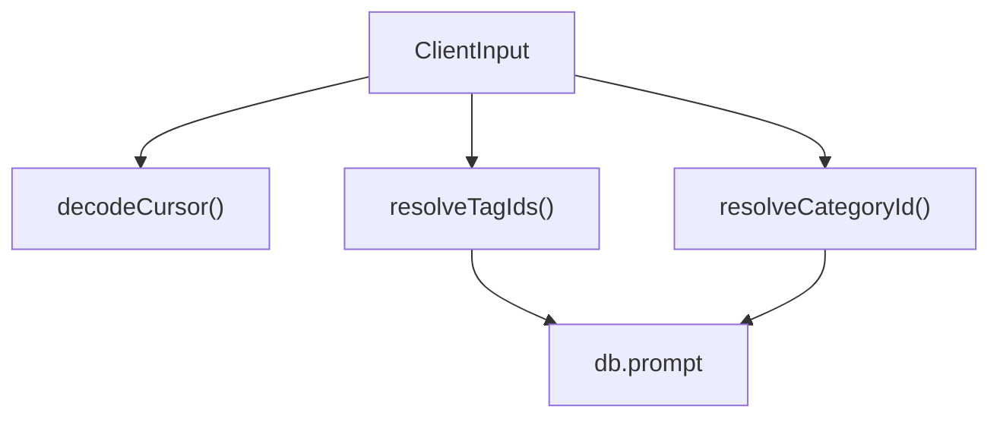
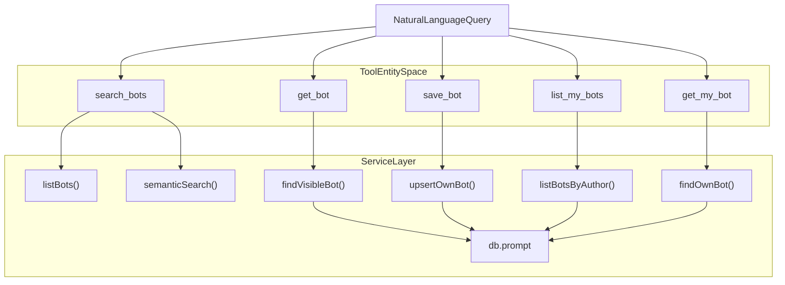
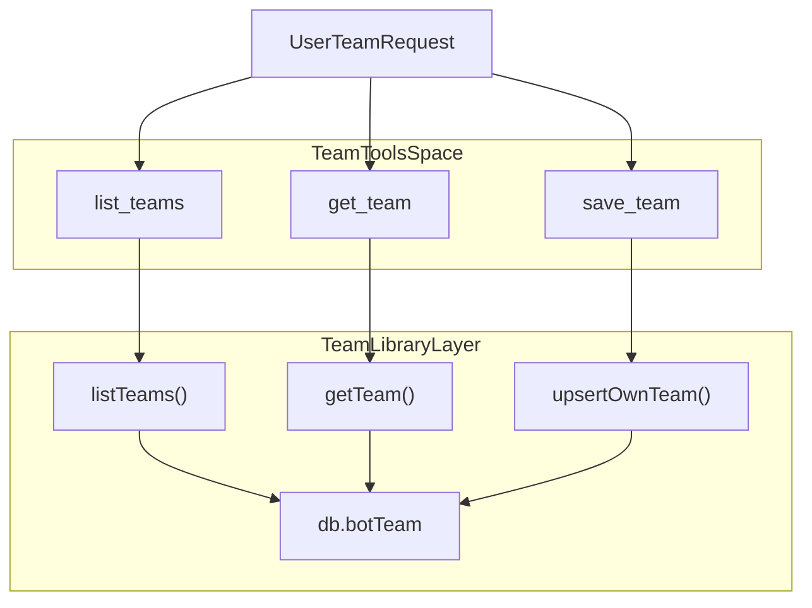

<!-- source: DeepWiki mcp.deepwiki.com · repo f/prompts.chat · page 11.2 MCP Tools Reference · fetched 2026-11-09 -->

# MCP Tools Reference

Relevant source files

The following files were used as context for generating this wiki page:

- [src/__tests__/api/bot-teams.test.ts](src/__tests__/api/bot-teams.test.ts)
- [src/__tests__/api/mcp-bots.test.ts](src/__tests__/api/mcp-bots.test.ts)
- [src/__tests__/api/mcp-handler.test.ts](src/__tests__/api/mcp-handler.test.ts)
- [src/__tests__/api/mcp-server.test.ts](src/__tests__/api/mcp-server.test.ts)
- [src/__tests__/api/mcp-teams.test.ts](src/__tests__/api/mcp-teams.test.ts)
- [src/__tests__/lib/bot-upsert.test.ts](src/__tests__/lib/bot-upsert.test.ts)
- [src/app/api/bots/teams/route.ts](src/app/api/bots/teams/route.ts)
- [src/lib/bots/teams.ts](src/lib/bots/teams.ts)
- [src/lib/bots/upsert.ts](src/lib/bots/upsert.ts)
- [src/lib/mcp/resources.ts](src/lib/mcp/resources.ts)
- [src/lib/mcp/schemas.ts](src/lib/mcp/schemas.ts)
- [src/lib/mcp/shared.ts](src/lib/mcp/shared.ts)
- [src/lib/mcp/tools/bots.ts](src/lib/mcp/tools/bots.ts)
- [src/lib/mcp/tools/prompts.ts](src/lib/mcp/tools/prompts.ts)
- [src/lib/mcp/tools/skills.ts](src/lib/mcp/tools/skills.ts)
- [src/lib/mcp/tools/teams.ts](src/lib/mcp/tools/teams.ts)

## Purpose & Scope

This page details all Model Context Protocol (MCP) tools exposed by the `prompts.chat` MCP API endpoint located at [src/__tests__/api/mcp-handler.test.ts:1-100]() and defined across `src/lib/mcp/tools/`. These tools allow AI assistants, IDE integrations, and automated workflows to programmatically search, retrieve, create, and manage AI prompts, multi-file agent skills, specialized platform bots, and multi-bot teams.

Sources: [src/__tests__/api/mcp-handler.test.ts:1-100](), [src/lib/mcp/tools/bots.ts:1-76]()

---

## Shared Schemas and Utility Functions (`src/lib/mcp`)

The MCP layer relies on shared validation schemas and helper functions under `src/lib/mcp/` to standardize input pagination, secure cursor decoding, tag/category resolution, and resource linking.

- **Cursors & Pagination**: `cursorInput`, `decodeCursor`, `encodeCursor`, and `nextCursor` handle base64url-encoded offset pagination safely [src/lib/mcp/schemas.ts:5-46](). An invalid cursor throws a structured `ToolError` with code `invalid_cursor` [src/__tests__/api/mcp-server.test.ts:71-77]().
- **Taxonomy Resolution**: `resolveTagIds()` matches names/slugs case-insensitively against existing database records without auto-creating tags (which is restricted to admins), returning unknown tags in `unknownTags` [src/lib/mcp/shared.ts:63-103](). `resolveCategoryId()` maps category slugs to Prisma IDs [src/lib/mcp/shared.ts:105-111]().
- **Resource Linking**: `resourceLink()` and `resourceUri()` construct `prompts-chat://` resource URIs for clients supporting MCP resources [src/lib/mcp/shared.ts:9-28]().

Diagram: Taxonomy and Pagination Data Flow

Sources: [src/lib/mcp/schemas.ts:1-50](), [src/lib/mcp/shared.ts:1-111](), [src/__tests__/api/mcp-server.test.ts:71-77]()

---

## Prompt Tools Reference

Prompt tools handle searching, retrieving, creating, and enhancing non-bot prompts (text, structured, image, audio, video) [src/lib/mcp/tools/prompts.ts:33-44]().

### `search_prompts`
- **Description**: Searches public prompts and the caller's private prompts using case-insensitive keyword matching across titles, descriptions, and content [src/lib/mcp/tools/prompts.ts:50-53]().
- **Parameters**: `query` (string), `limit` (number, default 10, max 50), `cursor` (string), `type` (enum), `category` (string), `tag` (string) [src/lib/mcp/tools/prompts.ts:55-61]().
- **Returns**: Summaries with `contentPreview`, author info, votes, and resource links [src/lib/mcp/tools/prompts.ts:63-68]().

### `get_prompt`
- **Description**: Retrieves a specific prompt by ID, extracting template variables formatted as `${name}` or `${name:default}` [src/lib/mcp/tools/prompts.ts:135-138]().
- **Parameters**: `id` (string), `variables` (record of string values) [src/lib/mcp/tools/prompts.ts:140-146]().
- **Behavior**: If `variables` are passed, template strings are filled. If required variables are missing, `missingVariables` is returned [src/__tests__/api/mcp-server.test.ts:94-110]().

### `save_prompt`
- **Description**: Creates or updates a non-bot prompt record for the authenticated user via the underlying prompt write pipeline.
- **Parameters**: `title`, `content`, `type`, `isPrivate`, `category`, `tags`.

### `improve_prompt`
- **Description**: Leverages OpenAI integration to improve prompt phrasing and structure when the prompt enhancer feature flag is enabled [src/__tests__/api/mcp-server.test.ts:82-101]().

Sources: [src/lib/mcp/tools/prompts.ts:1-180](), [src/__tests__/api/mcp-server.test.ts:79-124]()

---

## Skill Management Tools Reference

Multi-file agent skills store multiple files inside a single database record using ASCII control character delimiters `\x1F` (Unit Separator) and `\x1E` (Record Separator) [src/lib/skill-files.ts:1-28]().

### `search_skills` & `get_skill`
- `search_skills`: Discovers reusable AI agent capabilities filtered by category, tag, or keywords [src/lib/mcp/tools/skills.ts:95-106]().
- `get_skill`: Retrieves a skill by ID along with all parsed files (`SKILL.md`, reference docs, scripts) via `parseSkillFiles()` [src/lib/skill-files.ts:52-82](), [src/lib/mcp/tools/skills.ts:181-188]().

### `save_skill`, `add_file_to_skill`, `update_skill_file`, `remove_file_from_skill`
- Manage file contents within a skill record.
- Deletion of `SKILL.md` is strictly prohibited to preserve skill integrity [src/lib/skill-files.ts:30](). Filenames are sanitized against path traversal [src/lib/skill-files.ts:201-211]().

Sources: [src/lib/mcp/tools/skills.ts:1-198](), [src/lib/skill-files.ts:1-211]()

---

## Bot Tools Reference

Bot tools (`src/lib/mcp/tools/bots.ts`) manage ready-made agents with instructions, routines, skills, and connectors for platforms like OpenCLAW, Hermes, and Grok.

Diagram: Bot Tools Natural Language to Code Entity Space

### `search_bots`
- **Description**: Searches the public bots directory filtered by platform, computer requirement (`NONE`, `CLOUD`, `LOCAL`), category, and tags [src/lib/mcp/tools/bots.ts:81-103](). Supports AI semantic search when `semantic: true` is set and enabled on the server [src/lib/mcp/tools/bots.ts:118-141]().

### `get_bot`
- **Description**: Retrieves a public bot by ID or slug, including its full definition, routines, skills, connectors, and install instructions for various platforms [src/lib/mcp/tools/bots.ts:162-287]().

### `save_bot`
- **Description**: Creates or updates a private bot record for the authenticated user using `upsertOwnBot()` and the standard prompt creation pipeline [src/__tests__/api/mcp-bots.test.ts:115-160]().
- **Parameters**: `name` (string), `instructions` (string), `platforms` (array), `computerRequirement`, `routines`, `skills`, `connectors`, `tags`, `category` [src/__tests__/api/mcp-bots.test.ts:126-136]().

### `list_my_bots`
- **Description**: Lists all bots owned by the authenticated user, including private and unlisted ones [src/lib/mcp/tools/bots.ts:290-341]().

### `get_my_bot`
- **Description**: Retrieves a specific bot owned by the authenticated user, including private and unlisted details [src/lib/mcp/tools/bots.ts:344-391]().

Sources: [src/lib/mcp/tools/bots.ts:1-391](), [src/__tests__/api/mcp-bots.test.ts:1-166]()

---

## Team Tools Reference

Team tools (`src/lib/mcp/tools/teams.ts`) manage groups of bots that hand work off to each other.

Diagram: Team Tools Natural Language to Code Entity Space

### `list_teams` & `get_team`
- `list_teams`: Lists bot teams, featured first, then newest, with keyword, category, and tag filtering [src/lib/mcp/tools/teams.ts:85-122]().
- `get_team`: Retrieves team description, member roles, directed handoff flows, and platform-specific install prompts via `getTeamInstallOptions()` [src/lib/mcp/tools/teams.ts:131-172]().

### `save_team`
- **Description**: Creates or updates a bot team with validated members and links (handoffs) [src/__tests__/api/mcp-teams.test.ts:111-120](). Marked as an idempotent write tool with `idempotentHint: true` [src/__tests__/api/mcp-teams.test.ts:119]().

Sources: [src/lib/mcp/tools/teams.ts:1-278](), [src/__tests__/api/mcp-teams.test.ts:1-120]()

---

