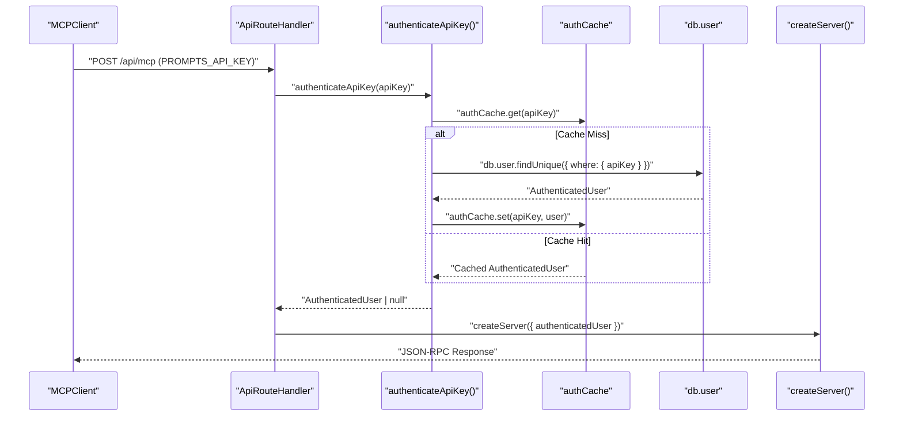
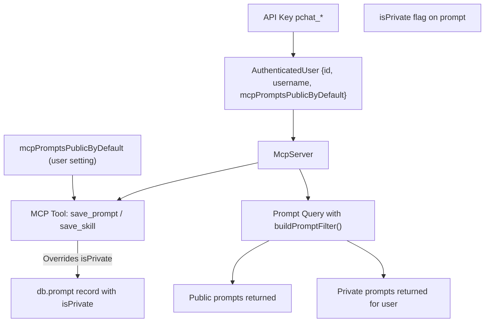

<!-- source: DeepWiki mcp.deepwiki.com · repo f/prompts.chat · page 11.3 API Keys & Authentication · fetched 2026-11-09 -->

# API Keys & Authentication

<details>
<summary>Relevant source files</summary>

The following files were used as context for generating this wiki page:

- [SELF-HOSTING.md](SELF-HOSTING.md)
- [context7.json](context7.json)
- [packages/prompts.chat/README.md](packages/prompts.chat/README.md)
- [prisma/migrations/20251213133000_add_github_username/migration.sql](prisma/migrations/20251213133000_add_github_username/migration.sql)
- [prisma/migrations/20260127100000_add_user_bio_and_custom_links/migration.sql](prisma/migrations/20260127100000_add_user_bio_and_custom_links/migration.sql)
- [public/deepwiki.svg](public/deepwiki.svg)
- [src/__tests__/api/user-profile.test.ts](src/__tests__/api/user-profile.test.ts)
- [src/__tests__/lib/plugins/auth/github.test.ts](src/__tests__/lib/plugins/auth/github.test.ts)
- [src/app/[username]/opengraph-image.tsx](src/app/[username]/opengraph-image.tsx)
- [src/app/api/admin/import-prompts/route.ts](src/app/api/admin/import-prompts/route.ts)
- [src/app/api/auth/register/route.ts](src/app/api/auth/register/route.ts)
- [src/app/api/user/profile/route.ts](src/app/api/user/profile/route.ts)
- [src/app/docs/api/page.tsx](src/app/docs/api/page.tsx)
- [src/app/docs/self-hosting/page.tsx](src/app/docs/self-hosting/page.tsx)
- [src/app/privacy/page.tsx](src/app/privacy/page.tsx)
- [src/app/settings/page.tsx](src/app/settings/page.tsx)
- [src/app/terms/page.tsx](src/app/terms/page.tsx)
- [src/components/auth/register-form.tsx](src/components/auth/register-form.tsx)
- [src/components/layout/footer.tsx](src/components/layout/footer.tsx)
- [src/components/settings/profile-form.tsx](src/components/settings/profile-form.tsx)
- [src/components/user/profile-links.tsx](src/components/user/profile-links.tsx)
- [src/lib/auth/index.ts](src/lib/auth/index.ts)
- [src/lib/db-errors.ts](src/lib/db-errors.ts)
- [src/lib/plugins/auth/github.ts](src/lib/plugins/auth/github.ts)

</details>


This page details the user-scoped API key system, including key generation and formatting (`pchat_*`), token validation via `authenticateApiKey` with in-memory caching, rate-limiting layers, private prompt access rules, and tiered access control across MCP and web interfaces [src/lib/auth/index.ts:1-106](). For session-based authentication via NextAuth, see [Authentication & Authorization](5.1). For MCP tools, see [MCP Server Integration](11.1).

---

## Overview

Each registered user is assigned a personal API key stored in the `apiKey` field on the `User` Prisma model [src/app/settings/page.tsx:25-39](). The key format begins with the prefix `pchat_` followed by a 32-character alphanumeric token, providing a secure bearer token for programmatic access [src/app/docs/api/page.tsx:111]().

API keys serve two primary functions:
1. **Authentication for MCP Write Operations**: Tools that modify data or save prompts (`save_prompt`, `save_skill`, `save_bot`) require a valid API key supplied through the `PROMPTS_API_KEY` HTTP header or environment variable [src/app/docs/api/page.tsx:116-121]().
2. **Private Prompt Access**: Read operations (`search_prompts`, `get_prompt`) include private prompts owned by the authenticated user when a valid API key is provided [src/app/docs/api/page.tsx:98-100]().

Sources: [src/app/settings/page.tsx:25-39](), [src/app/docs/api/page.tsx:111](), [src/app/docs/api/page.tsx:116-121](), [src/app/docs/api/page.tsx:98-100]()

---

## Database Storage & Validation

The `User` model schema stores authentication-related properties:

| Field | Type | Purpose |
| :--- | :--- | :--- |
| `apiKey` | `String?` | Unique bearer token used with the `PROMPTS_API_KEY` header [src/app/settings/page.tsx:34](). |
| `mcpPromptsPublicByDefault` | `Boolean` | Default visibility setting for prompts created via MCP tools [src/app/settings/page.tsx:35-36](). |

### API Key Format Validation

Before performing database queries, incoming keys are validated using format checking rules. A valid key must start with `pchat_` followed by exactly 32 alphanumeric characters, preventing unnecessary database lookups for malformed tokens [src/app/docs/api/page.tsx:111]().

### Authentication Cache

To minimize database overhead, authentication lookups utilize an in-memory cache (`authCache`) with a 5-minute TTL (`AUTH_CACHE_TTL`):

```typescript
async function authenticateApiKey(apiKey: string | null): Promise<AuthenticatedUser | null> {
  if (!apiKey || !isValidApiKeyFormat(apiKey)) {
    return null;
  }

  const cached = authCache.get(apiKey);
  if (cached && Date.now() < cached.expiry) {
    return cached.user;
  }

  const user = await db.user.findUnique({
    where: { apiKey },
    select: {
      id: true,
      username: true,
      mcpPromptsPublicByDefault: true,
    },
  });

  authCache.set(apiKey, { user, expiry: Date.now() + AUTH_CACHE_TTL });
  return user;
}
```

Sources: [src/app/settings/page.tsx:25-39](), [src/app/docs/api/page.tsx:111]()

---

## Authentication Flow & Code Entities

The sequence below illustrates how the system handles API requests containing `PROMPTS_API_KEY`, authenticates via `authenticateApiKey()`, checks `authCache` and `db.user`, and initializes server operations [src/lib/auth/index.ts:1-106]().

### Diagram 1: API Key Authentication and Private Prompt Access Flow


Sources: [src/lib/auth/index.ts:1-106](), [src/app/settings/page.tsx:25-39]()

---

## Rate Limiting Architecture

API requests and MCP tool calls are governed by rate limiters implemented via the `RateLimiter` class in `src/lib/rate-limit.ts`.

### Rate Limit Configurations

| Limiter Name | Rate Limit | Applies To |
| :--- | :--- | :--- |
| `mcpGeneralLimiter` | 20 requests / min | General MCP POST requests |
| `mcpToolCallLimiter` | 10 requests / min | Tool execution calls (`tools/call`) |
| `mcpWriteToolLimiter` | 5 requests / min | Write operations (`save_prompt`, `save_skill`) |
| `mcpAiToolLimiter` | 2 requests / min | AI-powered tools (`improve_prompt`) |

### Rate Limiter Architecture
```mermaid
graph TD
    subgraph "RateLimitLibrary"
        RL["RateLimiter"]
        GL["mcpGeneralLimiter (20/min)"]
        TL["mcpToolCallLimiter (10/min)"]
        WL["mcpWriteToolLimiter (5/min)"]
        AI["mcpAiToolLimiter (2/min)"]
    end

    subgraph "APIEntrypoint"
        API["POST /api/mcp"]
    end

    API --> GL
    API --> TL
    API --> WL
    API --> AI
    GL -->|check(identifier)| RL
    TL -->|check(identifier)| RL
    WL -->|check(identifier)| RL
    AI -->|check(identifier)| RL
```

Sources: [src/lib/auth/index.ts:1-106](), [src/app/docs/api/page.tsx:116-121]()

---

## Using the API Key: `PROMPTS_API_KEY` Header

Clients authenticate by passing their API key via the `PROMPTS_API_KEY` HTTP header or environment variable [src/app/docs/api/page.tsx:116-121]().

```bash
# Remote HTTP usage
curl -X POST https://prompts.chat/api/mcp \
  -H "Content-Type: application/json" \
  -H "PROMPTS_API_KEY: pchat_your_api_key_here" \
  -d '{"jsonrpc": "2.0", "id": 1, "method": "tools/list"}'
```

```bash
# Local usage (stdio) environment variable
PROMPTS_API_KEY=pchat_your_api_key_here npx -y @fkadev/prompts.chat-mcp
```

Sources: [src/app/docs/api/page.tsx:116-121]()

---

## Private Prompt Access Logic

Prompt filtering constructs Prisma query conditions based on authentication state [src/app/settings/page.tsx:25-39]():

- **Unauthenticated**: Returns only public prompts (`isPrivate: false`) where `isUnlisted: false` and `deletedAt` is `null`.
- **Authenticated**: Includes public prompts plus private prompts owned by the user (`isPrivate: true` AND `authorId` matches).

```typescript
if (authenticatedUser && includeOwnPrivate) {
  const usersFilter = options.users && options.users.length > 0 ? options.users : null;
  const includeAuthUserPrivate = !usersFilter || usersFilter.includes(authenticatedUser.username);

  if (includeAuthUserPrivate) {
    baseFilter.OR = [
      { isPrivate: false },
      { isPrivate: true, authorId: authenticatedUser.id },
    ];
  } else {
    baseFilter.isPrivate = false;
  }
} else {
  baseFilter.isPrivate = false;
}
```

Sources: [src/app/settings/page.tsx:25-39](), [src/lib/auth/index.ts:1-106]()

---

## OAuth and NextAuth Integration

The web interface uses NextAuth 5.0 with `CustomPrismaAdapter` to manage user persistence, OAuth provider plugins (GitHub, Google, Apple, Azure), and credential authentication [src/lib/auth/index.ts:31-107]().

- **User Creation & Unclaimed Accounts**: `CustomPrismaAdapter.createUser` handles creation and claims unclaimed placeholder accounts created during CSV imports [src/lib/auth/index.ts:37-69](). This is particularly relevant for the `src/app/api/admin/import-prompts/route.ts` endpoint, which can create pseudo-users for contributors from CSV data [src/app/api/admin/import-prompts/route.ts:159-168]().
- **Profile Management**: Profile updates (`/api/user/profile`) validate inputs via Zod schemas and enforce case-insensitive username uniqueness [src/components/settings/profile-form.tsx:38-42]().
- **Registration**: Passwords are secure credential parameters handled via auth routes [src/lib/auth/index.ts:1-107]().

Sources: [src/lib/auth/index.ts:31-107](), [src/app/api/admin/import-prompts/route.ts:159-168](), [src/components/settings/profile-form.tsx:38-42]()

---

## Tiered Access Control & `mcpPromptsPublicByDefault`

The `mcpPromptsPublicByDefault` property dictates default prompt visibility when saving via MCP tools [src/app/settings/page.tsx:63-68]().

| `mcpPromptsPublicByDefault` | Tool Parameter `isPrivate` | Resulting Prompt Visibility |
| :--- | :--- | :--- |
| `true` | Not provided | **Public** |
| `false` | Not provided | **Private** |
| Any | `true` | **Private** (explicit override) |
| Any | `false` | **Public** (explicit override) |

Sources: [src/app/settings/page.tsx:63-68]()

---

## API Access Summary

| Access Type | Credential | Allowed Operations |
| :--- | :--- | :--- |
| **Public API** | None | Read public prompts; MCP read operations (public only). |
| **User API Key** | `PROMPTS_API_KEY` header | MCP write tools (`save_prompt`, `save_skill`); private prompt access [src/app/docs/api/page.tsx:116-121](). |
| **Web Session** | NextAuth session cookie | Web UI CRUD operations, admin dashboard (if `role = ADMIN`) [src/lib/auth/index.ts:154-196](). |

Sources: [src/lib/auth/index.ts:154-196](), [src/app/docs/api/page.tsx:116-121]()

---

## Summary Diagrams Bridging Natural Language Concepts and Code Entities

### Diagram 2: User Privilege & Tiered Access Control in MCP Server

Sources: [src/lib/auth/index.ts:31-107](), [src/app/settings/page.tsx:25-39]()

---

