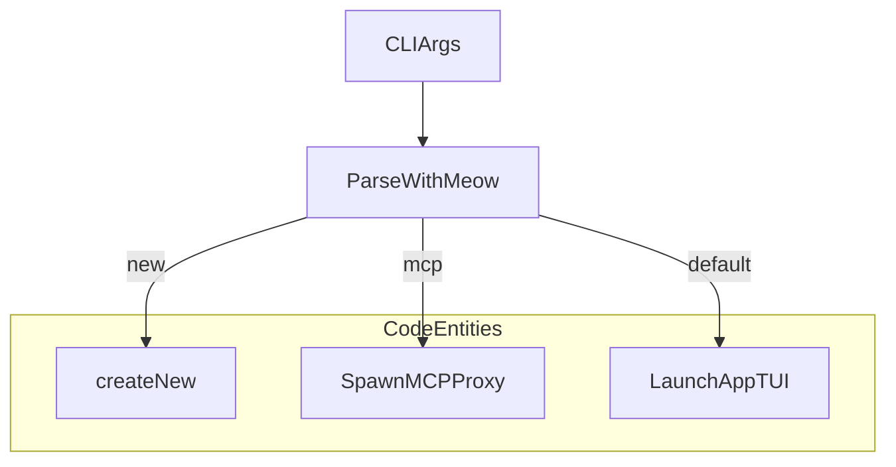
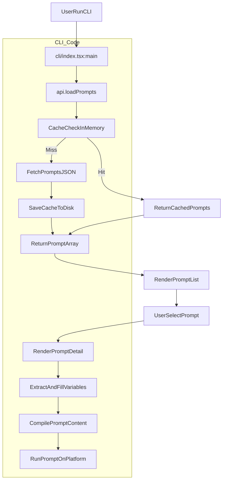
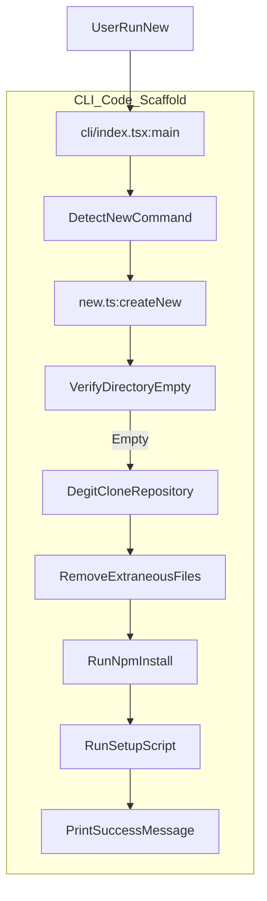

<!-- source: DeepWiki mcp.deepwiki.com · repo f/prompts.chat · page 11.4 CLI Tool · fetched 2026-11-09 -->

# CLI Tool

Relevant source files

The following files were used as context for generating this wiki page:

- [eslint.config.mjs](eslint.config.mjs)
- [packages/prompts.chat/bin/cli.js](packages/prompts.chat/bin/cli.js)
- [packages/prompts.chat/package-lock.json](packages/prompts.chat/package-lock.json)
- [packages/prompts.chat/package.json](packages/prompts.chat/package.json)
- [packages/prompts.chat/scripts/generate-docs.ts](packages/prompts.chat/scripts/generate-docs.ts)
- [packages/prompts.chat/src/builder/index.ts](packages/prompts.chat/src/builder/index.ts)
- [packages/prompts.chat/src/cli/api.ts](packages/prompts.chat/src/cli/api.ts)
- [packages/prompts.chat/src/cli/components/PromptDetail.tsx](packages/prompts.chat/src/cli/components/PromptDetail.tsx)
- [packages/prompts.chat/src/cli/components/PromptList.tsx](packages/prompts.chat/src/cli/components/PromptList.tsx)
- [packages/prompts.chat/src/cli/components/RunPrompt.tsx](packages/prompts.chat/src/cli/components/RunPrompt.tsx)
- [packages/prompts.chat/src/cli/index.tsx](packages/prompts.chat/src/cli/index.tsx)
- [packages/prompts.chat/src/cli/new.ts](packages/prompts.chat/src/cli/new.ts)
- [packages/prompts.chat/src/parser/index.ts](packages/prompts.chat/src/parser/index.ts)
- [packages/prompts.chat/tsconfig.json](packages/prompts.chat/tsconfig.json)
- [packages/prompts.chat/tsup.config.ts](packages/prompts.chat/tsup.config.ts)
- [src/components/ide/examples/generated.ts](src/components/ide/examples/generated.ts)
- [src/components/prompts/skill-diff-viewer.tsx](src/components/prompts/skill-diff-viewer.tsx)
- [src/components/prompts/skill-editor.tsx](src/components/prompts/skill-editor.tsx)
- [src/data/api-docs.ts](src/data/api-docs.ts)
- [src/data/method-options.ts](src/data/method-options.ts)
- [src/data/type-definitions.ts](src/data/type-definitions.ts)

The `prompts.chat` CLI is a terminal-based prompt library tool combining an interactive terminal UI for browsing AI prompts, a project scaffolding mechanism to deploy self-hosted instances, and programmatic builder/parser packages. It serves developers and prompt engineers who want to explore, create, and manage prompt collections efficiently.

This page documents the CLI tool's implementation, including the interactive prompt browser, the project scaffolding command, builder/parser packages, and CLI usage patterns.

---

## Package Overview and Structure

The CLI and associated prompt toolkit reside in `packages/prompts.chat/` [packages/prompts.chat/package.json:1-44](). The package operates both as a standalone CLI application and as a modular library providing prompt building and parsing primitives.

### Key Aspects

- **Binaries:** The package exposes executables `prompts-chat` and `prompts.chat` mapped to `bin/cli.js` [packages/prompts.chat/package.json:9-12](). Runtime requires Node.js `>=18` [packages/prompts.chat/package.json:70-72]().
- **Library Exports:** Publishes ES modules and CommonJS outputs under `dist/`, including `./builder`, `./parser`, `./variables`, `./similarity`, and `./quality` [packages/prompts.chat/package.json:13-44]().
- **UI Dependencies:** Leverages `ink`, `ink-text-input`, `ink-spinner`, `ink-select-input`, and `react` for terminal user interfaces [packages/prompts.chat/package.json:83-88]().

Sources: [packages/prompts.chat/package.json:1-101]()

---

## CLI Commands and Main Entry

The CLI is implemented in `packages/prompts.chat/src/cli/index.tsx`, using `meow` for argument parsing [packages/prompts.chat/src/cli/index.tsx:3, 102-134]().

### Commands Table

| Command | Usage | Description | Code Reference |
|---|---|---|---|
| *(default)* | `npx prompts.chat` | Launch interactive TUI browser | [packages/prompts.chat/src/cli/index.tsx:161-171]() |
| `new` | `npx prompts.chat new <dir>` | Scaffold a new self-hosted instance | [packages/prompts.chat/src/cli/index.tsx:140-149](), [packages/prompts.chat/src/cli/new.ts:1-116]() |
| `mcp` | `npx prompts.chat mcp [args]` | Proxy command to launch MCP server tool | [packages/prompts.chat/src/cli/index.tsx:152-159]() |

The `main()` function reads command-line inputs and dispatches actions accordingly [packages/prompts.chat/src/cli/index.tsx:136-173]().

### Command Dispatch Flow

Sources: [packages/prompts.chat/src/cli/index.tsx:3,102-173](), [packages/prompts.chat/src/cli/new.ts:1-116]()

---

## Interactive Prompt Browser

Running the CLI without arguments launches a terminal UI for browsing, searching, filtering, and executing prompts.

### Implementation Details

- **State Management:** The root `App` component (`src/cli/index.tsx`) manages views (`list` or `detail`), search queries, page numbers, category filters, and selection indices [packages/prompts.chat/src/cli/index.tsx:11-30]().
- **Data Fetching and Caching:** Prompts are fetched from `https://prompts.chat/prompts.json?full_content=true` via `loadPrompts()` in `src/cli/api.ts` [packages/prompts.chat/src/cli/api.ts:5-89](). It caches responses locally in `~/.prompts-chat/prompts.json` [packages/prompts.chat/src/cli/api.ts:6-7]().
- **Filtering:** Client-side filtering and pagination are handled by `filterPrompts()` and `getCategories()` [packages/prompts.chat/src/cli/api.ts:110-168]().
- **Prompt List Component:** `PromptList` renders paginated items with category/search selectors and keyboard handlers (`j/k`, `n/p`, `/`, `c`, `r`) [packages/prompts.chat/src/cli/components/PromptList.tsx:22-199]().
- **Prompt Detail Component:** `PromptDetail` handles variable extraction via `extractVariables()`, variable interactive inputs, compilation, media previews (`terminal-image`), and platform execution [packages/prompts.chat/src/cli/components/PromptDetail.tsx:58-121]().

Sources: [packages/prompts.chat/src/cli/index.tsx:22-100](), [packages/prompts.chat/src/cli/api.ts:1-172](), [packages/prompts.chat/src/cli/components/PromptList.tsx:22-199](), [packages/prompts.chat/src/cli/components/PromptDetail.tsx:58-212]()

---

## Project Scaffolding with `new` Command

The `new` command scaffolds a self-hosted `prompts.chat` instance into a target directory [packages/prompts.chat/src/cli/new.ts:1-116]().

### Workflow Steps

1. **Directory Validation:** Confirms the target directory is empty [packages/prompts.chat/src/cli/new.ts:72-81]().
2. **Repository Cloning:** Runs `npx degit f/prompts.chat <dir>` [packages/prompts.chat/src/cli/new.ts:86-92]().
3. **Cleanup:** Removes extraneous configuration directories (`.github`, `.claude`, `packages`) and internal scripts [packages/prompts.chat/src/cli/new.ts:11-39]().
4. **Dependency Installation:** Executes `npm install` [packages/prompts.chat/src/cli/new.ts:99-104]().
5. **Interactive Setup:** Spawns `node scripts/setup.js` for configuration [packages/prompts.chat/src/cli/new.ts:41-70]().

Sources: [packages/prompts.chat/src/cli/index.tsx:140-149](), [packages/prompts.chat/src/cli/new.ts:1-116]()

---

## Builder and Parser Packages

The toolkit includes modular packages for constructing and parsing prompt representations.

### Builder Package (`./builder`)

- Exposes a fluent Domain-Specific Language (DSL) to construct prompts programmatically [packages/prompts.chat/package.json:34-38]().
- Supports chaining methods for video, audio, and image prompt generation [src/components/ide/examples/generated.ts:4-217]().
- Autocomplete options are supplied via auto-generated configuration mappings in `src/data/method-options.ts` [src/data/method-options.ts:1-37]().

### Parser Package (`./parser`)

- Provides multi-format parsing utilities for Markdown, YAML frontmatter, and skill file structures [packages/prompts.chat/package.json:39-43]().
- `parseSkillFiles` breaks down multi-file skill strings into individual `SkillFile` objects for editors and diff viewers [src/components/prompts/skill-diff-viewer.tsx:24](), [src/components/prompts/skill-editor.tsx:30]().

Sources: [packages/prompts.chat/package.json:34-43](), [src/components/ide/examples/generated.ts:4-217](), [src/data/method-options.ts:1-37](), [src/components/prompts/skill-diff-viewer.tsx:24](), [src/components/prompts/skill-editor.tsx:30]()

---

## CLI Usage Patterns and Interaction

### Interactive Navigation

- **List Navigation:** Use arrow keys or `j/k` to traverse prompts [packages/prompts.chat/src/cli/components/PromptList.tsx:176-182]().
- **Selection:** Press `Enter` to open prompt details [packages/prompts.chat/src/cli/components/PromptList.tsx:184-186]().
- **Search:** Press `/` to search titles, content, authors, or tags [packages/prompts.chat/src/cli/components/PromptList.tsx:165-168]().
- **Pagination:** Press `n` or `p` to change pages [packages/prompts.chat/src/cli/components/PromptList.tsx:188-194]().
- **Copying:** Press `c` for variable-filled copying or `C` for raw copying [packages/prompts.chat/src/cli/components/PromptDetail.tsx:197-209]().

### Running Prompts

The `RunPrompt` component displays supported AI chat, code, and media generation platforms [packages/prompts.chat/src/cli/components/RunPrompt.tsx:1-144](). Users toggle between categories using `h/l` keys and execute prompts directly via platform query strings or clipboard fallback [packages/prompts.chat/src/cli/components/RunPrompt.tsx:39-68]().

Sources: [packages/prompts.chat/src/cli/components/PromptList.tsx:22-199](), [packages/prompts.chat/src/cli/components/PromptDetail.tsx:58-212](), [packages/prompts.chat/src/cli/components/RunPrompt.tsx:1-144]()

---

## Architecture Diagrams

### Diagram 1: Natural Language Space to Code Entity Space: Prompt Browsing Data Flow

Sources: [packages/prompts.chat/src/cli/index.tsx:136-173](), [packages/prompts.chat/src/cli/api.ts:81-108](), [packages/prompts.chat/src/cli/components/PromptDetail.tsx:58-212]()

---

### Diagram 2: Natural Language Space to Code Entity Space: Scaffolding a New Instance

Sources: [packages/prompts.chat/src/cli/index.tsx:136-149](), [packages/prompts.chat/src/cli/new.ts:1-116]()

---

