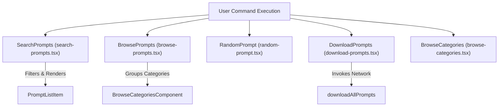
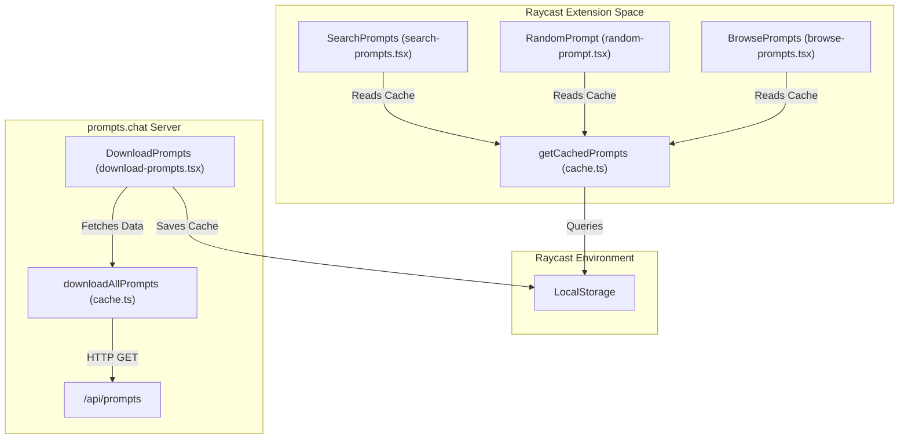

<!-- source: DeepWiki mcp.deepwiki.com · repo f/prompts.chat · page 11.5 Browser Extensions & Desktop Apps · fetched 2026-11-09 -->

# Browser Extensions & Desktop Apps

Relevant source files

The following files were used as context for generating this wiki page:

- [packages/raycast-extension/.gitignore](packages/raycast-extension/.gitignore)
- [packages/raycast-extension/CHANGELOG.md](packages/raycast-extension/CHANGELOG.md)
- [packages/raycast-extension/README.md](packages/raycast-extension/README.md)
- [packages/raycast-extension/assets/icon.png](packages/raycast-extension/assets/icon.png)
- [packages/raycast-extension/eslint.config.mjs](packages/raycast-extension/eslint.config.mjs)
- [packages/raycast-extension/metadata/prompts-chat-1.png](packages/raycast-extension/metadata/prompts-chat-1.png)
- [packages/raycast-extension/metadata/prompts-chat-2.png](packages/raycast-extension/metadata/prompts-chat-2.png)
- [packages/raycast-extension/metadata/prompts-chat-3.png](packages/raycast-extension/metadata/prompts-chat-3.png)
- [packages/raycast-extension/package-lock.json](packages/raycast-extension/package-lock.json)
- [packages/raycast-extension/package.json](packages/raycast-extension/package.json)
- [packages/raycast-extension/raycast-env.d.ts](packages/raycast-extension/raycast-env.d.ts)
- [packages/raycast-extension/src/api.ts](packages/raycast-extension/src/api.ts)
- [packages/raycast-extension/src/browse-categories.tsx](packages/raycast-extension/src/browse-categories.tsx)
- [packages/raycast-extension/src/browse-prompts.tsx](packages/raycast-extension/src/browse-prompts.tsx)
- [packages/raycast-extension/src/cache.ts](packages/raycast-extension/src/cache.ts)
- [packages/raycast-extension/src/components/prompt-detail.tsx](packages/raycast-extension/src/components/prompt-detail.tsx)
- [packages/raycast-extension/src/components/run-prompt.tsx](packages/raycast-extension/src/components/run-prompt.tsx)
- [packages/raycast-extension/src/download-prompts.tsx](packages/raycast-extension/src/download-prompts.tsx)
- [packages/raycast-extension/src/random-prompt.tsx](packages/raycast-extension/src/random-prompt.tsx)
- [packages/raycast-extension/src/search-prompts.tsx](packages/raycast-extension/src/search-prompts.tsx)
- [packages/raycast-extension/src/types.ts](packages/raycast-extension/src/types.ts)

This document covers external client integrations supported by prompts.chat beyond its web interface. This includes the official Raycast desktop extension for macOS, browser extensions/addons for Chrome and Firefox detected dynamically from the web UI, and mobile app integration concepts. These integrations enable users to conveniently search, browse, cache, and run prompts outside a browser tab.

> For command-line tool integration, see [CLI Tool](11.4).  
> For MCP protocol integration with IDEs and advanced workflows, see [MCP Server Integration](11.1).

---

## Purpose and Scope

The goal of browser extensions and desktop apps is to provide users an unobtrusive, fast, and accessible way to interact with the prompts.chat AI prompt library. These tools consume public API endpoints, leverage local caching for offline responsiveness, and facilitate prompt execution across multiple platforms.

**Key capabilities include:**
- **Native macOS Raycast Extension:** Commands to search, browse, and run prompts, featuring local caching for offline use and platform launching `[packages/raycast-extension/package.json:3-52]()`.
- **API Client Layer:** Standardized request handling via `packages/raycast-extension/src/api.ts` supporting configurable base URLs `[packages/raycast-extension/src/api.ts:8-11]()`, prompt fetching `[packages/raycast-extension/src/api.ts:13-41]`, and slug lookups `[packages/raycast-extension/src/api.ts:43-59]()`.
- **Command Caching & Search:** Local cache management and client-side filtering implemented in `packages/raycast-extension/src/search-prompts.tsx` `[packages/raycast-extension/src/search-prompts.tsx:24-60]()` and `packages/raycast-extension/src/random-prompt.tsx` `[packages/raycast-extension/src/random-prompt.tsx:7-38]()`.
- **Multi-Platform Integration:** Enables running prompts on multiple AI and code platforms with deep linking features `[packages/raycast-extension/README.md:25-34]()`.

Sources: `[packages/raycast-extension/package.json:3-52]`, `[packages/raycast-extension/src/api.ts:8-59]`, `[packages/raycast-extension/src/search-prompts.tsx:24-60]`, `[packages/raycast-extension/src/random-prompt.tsx:7-38]`, `[packages/raycast-extension/README.md:25-34]()`

---

## Raycast Extension Architecture

The Raycast extension is packaged under `packages/raycast-extension` `[packages/raycast-extension/package.json:1-84]()`. It is a TypeScript React application interacting with public APIs and Raycast's native extension APIs.

### Command Manifest

Defined in `packages/raycast-extension/package.json` under the `"commands"` array, core commands map directly to React components `[packages/raycast-extension/package.json:16-52]()`:

| Command Name | Component / Handler | Purpose |
| --- | --- | --- |
| `search-prompts` | `SearchPrompts` (`search-prompts.tsx`) | Search all cached prompts and remotely |
| `browse-prompts` | `BrowsePrompts` (`browse-prompts.tsx`) | Browse latest prompts with filter options |
| `random-prompt` | `RandomPrompt` (`random-prompt.tsx`) | Show a random prompt for inspiration |
| `download-prompts` | `DownloadPrompts` (`download-prompts.tsx`) | Fetch and cache all prompts for offline |
| `browse-categories` | `BrowseCategories` (`browse-categories.tsx`) | Explore prompts by category |

Title: "Raycast Command-to-Code Entity Mapping"

Sources: `[packages/raycast-extension/package.json:16-52]`, `[packages/raycast-extension/src/search-prompts.tsx:24-105]`, `[packages/raycast-extension/src/random-prompt.tsx:7-38]()`

---

## API Client & Request Handling

The Raycast extension communicates with the prompts.chat backend via a dedicated API module located at `packages/raycast-extension/src/api.ts` `[packages/raycast-extension/src/api.ts:1-102]()`.

### Key Functions

- `getBaseUrl()`: Reads user preferences to obtain the target instance URL, defaulting to `https://prompts.chat` `[packages/raycast-extension/src/api.ts:8-11]()`.
- `fetchPrompts(options)`: Constructs query parameters (`page`, `perPage`, `type`, `category`, `tag`, `sort`, `q`) and queries `/api/prompts` `[packages/raycast-extension/src/api.ts:13-41]()`.
- `fetchPromptBySlug(username, slug)`: Fetches individual prompt records via `/api/prompts/${slug}` `[packages/raycast-extension/src/api.ts:43-59]()`.
- `searchPrompts(query, limit)`: Performs real-time keyword search against `/api/prompts/search` when query length exceeds 2 characters `[packages/raycast-extension/src/api.ts:61-93]()`.

Sources: `[packages/raycast-extension/src/api.ts:1-102]()`

---

## Caching & Data Flow Layer

The extension implements a local caching layer to store prompt data for offline use and instant search filtering.

Title: "Raycast Caching Data Flow"

- `SearchPrompts` initializes by calling `getCachedPrompts()` to load records into local component state `[packages/raycast-extension/src/search-prompts.tsx:53-60]()`.
- `RandomPrompt` loads cached prompts and passes a randomly selected entry to `PromptDetailView` `[packages/raycast-extension/src/random-prompt.tsx:18-34]()`.
- If no prompts are cached, empty views provide direct action triggers to invoke `downloadAllPrompts()` `[packages/raycast-extension/src/search-prompts.tsx:71-85]`, `[packages/raycast-extension/src/random-prompt.tsx:44-58]()`.

Sources: `[packages/raycast-extension/src/search-prompts.tsx:24-60]`, `[packages/raycast-extension/src/random-prompt.tsx:7-65]()`

---

## Prompt Execution & Variable Interpolation

The Raycast extension provides variable extraction and form-based filling before executing prompts against external chat, code, or media platforms.

- Pressing `Enter` on any prompt list item opens the `RunPromptForm` target `[packages/raycast-extension/src/search-prompts.tsx:117-123]()`.
- Users can copy raw prompts directly via `⌘ C` `[packages/raycast-extension/src/search-prompts.tsx:125-129]()` or open the corresponding web page via `⌘ O` `[packages/raycast-extension/src/search-prompts.tsx:130-134]()`.

Sources: `[packages/raycast-extension/src/search-prompts.tsx:107-167]()`

---

# Summary

| Integration | Description | Code Location |
| --- | --- | --- |
| Raycast Manifest | Extension package definition, commands, and preferences | `packages/raycast-extension/package.json` |
| Raycast API Client | Network wrapper for fetching prompts and search endpoints | `packages/raycast-extension/src/api.ts` |
| Search & Caching | Component implementing cached prompt list and offline download | `packages/raycast-extension/src/search-prompts.tsx` |
| Random Prompt | Component fetching and rendering randomized cached prompts | `packages/raycast-extension/src/random-prompt.tsx` |

Sources:
- `[packages/raycast-extension/package.json:1-84]()`  
- `[packages/raycast-extension/src/api.ts:1-102]()`  
- `[packages/raycast-extension/src/search-prompts.tsx:1-167]()`  
- `[packages/raycast-extension/src/random-prompt.tsx:1-65]()`  
- `[packages/raycast-extension/README.md:1-56]()`

---

