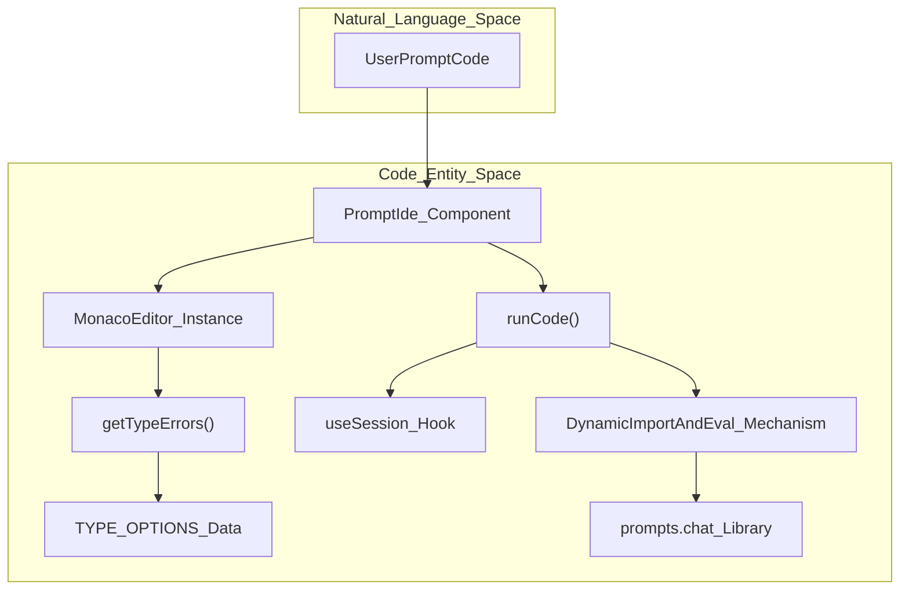
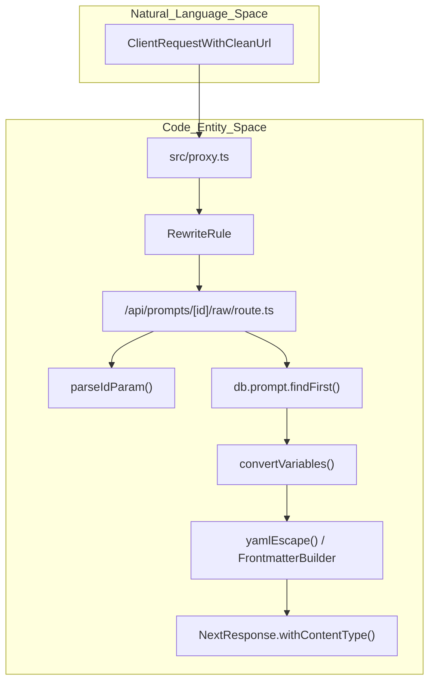

<!-- source: DeepWiki mcp.deepwiki.com · repo f/prompts.chat · page 11.6 Typed-Prompts IDE & Embeds · fetched 2026-11-09 -->

# Typed-Prompts IDE & Embeds

Relevant source files

The following files were used as context for generating this wiki page:

- [src/app/api/prompts/[id]/raw/route.ts](src/app/api/prompts/[id]/raw/route.ts)
- [src/app/developers/page.tsx](src/app/developers/page.tsx)
- [src/app/embed/page.tsx](src/app/embed/page.tsx)
- [src/components/developers/embed-designer.tsx](src/components/developers/embed-designer.tsx)
- [src/components/developers/embed-examples.ts](src/components/developers/embed-examples.ts)
- [src/components/developers/prompt-tokenizer.tsx](src/components/developers/prompt-tokenizer.tsx)
- [src/components/ide/prompt-ide.tsx](src/components/ide/prompt-ide.tsx)
- [src/components/prompts/download-prompt-dropdown.tsx](src/components/prompts/download-prompt-dropdown.tsx)
- [src/proxy.ts](src/proxy.ts)

## Purpose & Scope
This page details the in-browser developer tools available on prompts.chat, including the Typed-Prompts IDE, Prompt Builder, Prompt Tokenizer, and Embed Designer. It also covers the `/embed` page for integrating prompts into external sites and the raw prompt API for programmatic access. These tools assist developers in creating, testing, and integrating AI prompts efficiently.

Sources: [src/app/developers/page.tsx:1-7]()

---

## Typed-Prompts IDE
The Typed-Prompts IDE, accessible via the `/developers` route, provides an interactive environment for writing and testing prompts using the `prompts.chat` JavaScript library [src/components/ide/prompt-ide.tsx:15-28](). This IDE leverages Monaco Editor for code editing, syntax highlighting, type checking, and auto-completion based on the fluent API.

### Features
- **Monaco Editor Integration:** A full-featured TypeScript editor providing syntax highlighting, inline errors, and suggestions for prompt-building code [src/components/ide/prompt-ide.tsx:5-5]().
- **`prompts.chat` Library Usage:** Imports modules like `builder`, `image`, `video`, `audio`, and `chat` from `prompts.chat` to write prompts fluently and test various prompt types interactively [src/components/ide/prompt-ide.tsx:15-28]().
- **Authentication Safeguards:** Requires user session verification via `useSession` ([src/components/ide/prompt-ide.tsx:10-54]()) before executing custom TypeScript evaluation [src/components/ide/prompt-ide.tsx:149-154]().
- **TypeScript Diagnostics & Runtime Reporting:** Aggregates Monaco diagnostics via `getTypeErrors` ([src/components/ide/prompt-ide.tsx:100-146]()) and maps parameter types to valid option definitions (`TYPE_OPTIONS`) [src/components/ide/prompt-ide.tsx:33-33]().
- **API Docs Sidebar & Popups:** Displays an interactive documentation sidebar (`ApiDocsSidebar`) and item details popup (`ApiDetailsPopup`) [src/components/ide/prompt-ide.tsx:36-37]().

### Implementation Details
The `PromptIde` component ([src/components/ide/prompt-ide.tsx:51-1074]()) manages editor state, validation, and execution:
- Validates code imports to ensure only `prompts.chat` packages are evaluated [src/components/ide/prompt-ide.tsx:85-95]().
- Mock console capturing collects `log`, `info`, `warn`, and `error` outputs during sandboxed execution [src/components/ide/prompt-ide.tsx:163-173]().
- Integrates with `RunPromptButton` ([src/components/ide/prompt-ide.tsx:12-12]()) to dispatch prompts to execution endpoints.

**Diagram: Typed-Prompts IDE Data Flow & Execution**

Sources: [src/components/ide/prompt-ide.tsx:1-173](), [src/app/developers/page.tsx:1-7]()

---

## Prompt Builder & Enhancer
The Prompt Builder, located at `/developers`, is an AI-powered conversational interface designed to assist users in crafting and refining prompts.

### Features
- **Conversational Chat Interface:** Takes user input and updates the structured prompt state interactively [src/components/prompts/prompt-builder.tsx:125-136]().
- **AI Model Integration:** Posts message histories, current prompt states (`PromptBuilderState`), and available tags/categories to `/api/prompt-builder/chat` using `gpt-4o-mini` [src/components/prompts/prompt-builder.tsx:72-154]().
- **Tool Calling Support:** Invokes backend tools like `search_prompts` within the assistant loop to retrieve relevant prompt references [src/components/prompts/prompt-builder.tsx:191-198]().
- **Streaming SSE Responses:** Parses incoming chunked data streams (`reader.read()`) handling `text`, `tool_call`, `state`, and `done` events [src/components/prompts/prompt-builder.tsx:161-207]().

Sources: [src/components/prompts/prompt-builder.tsx:1-207](), [src/app/developers/page.tsx:1-7]()

---

## Prompt Tokenizer
The Prompt Tokenizer tool at `/developers` calculates token estimates, context usage, and estimated execution costs.

### Features
- **Heuristic Token Estimation:** Computes character, word, line, and sentence counts via `calculateStats` and `estimateTokens` (~4 characters per token average) [src/components/developers/prompt-tokenizer.tsx:63-79]().
- **Cost & Context Calculations:** Computes context window utilization percentages and monetary costs based on input/output pricing configurations [src/components/developers/prompt-tokenizer.tsx:198-211]().
- **Visual Tokenization:** Uses `tokenizeForVisualization` to decorate subword boundaries directly inside the Monaco editor instance [src/components/developers/prompt-tokenizer.tsx:130-175]().
- **Persistence:** Stores user settings and analysis history in `localStorage` [src/components/developers/prompt-tokenizer.tsx:81-115]().

Sources: [src/components/developers/prompt-tokenizer.tsx:1-212](), [src/app/developers/page.tsx:1-7]()

---

## Embed Designer & `/embed` Page
The Embed Designer at `/developers` enables developers to generate customizable `<iframe>` snippets.

### Features
- **Interactive Configuration:** Configures parameters like prompt text, context lists, models, modes, thinking/reasoning toggles, colors, and file trees [src/components/developers/embed-designer.tsx:25-47]().
- **Query Parameter Parsing:** The `/embed` page extracts search parameters via `useSearchParams` to hydrate `EmbedConfig` objects [src/app/embed/page.tsx:84-109]().
- **File Tree & Context Rendering:** Recursively builds hierarchical file trees via `buildFileTree` and renders context reference pills [src/app/embed/page.tsx:15-59, 166-194]().
- **Theme Synchronization:** Dynamically applies or removes the `dark` CSS class on document elements according to `themeMode` and system color schemes [src/app/embed/page.tsx:111-128]().
- **Example Loading:** Provides predefined `EMBED_EXAMPLES` to quickly populate the designer with common configurations [src/components/developers/embed-designer.tsx:22-23](), [src/components/developers/embed-examples.ts:31-385]().

Sources: [src/app/embed/page.tsx:1-194](), [src/components/developers/embed-designer.tsx:1-198](), [src/components/developers/embed-examples.ts:1-385](), [src/app/developers/page.tsx:1-7]()

---

## Raw Prompt API & Proxy
The Raw Prompt API serves prompt content in Markdown or YAML format, utilizing Next.js middleware for clean URLs.

### Implementation Details
- **Middleware Proxy Routing:** `src/proxy.ts` intercepts requests matching `.prompt.md`, `.prompt.yml`, and `.SKILL.md` suffixes and rewrites them to `/api/prompts/[id]/raw` [src/proxy.ts:7-12]().
- **ID and Format Parsing:** `parseIdParam` extracts the prompt ID, output format (`md` or `yml`), and file type (`prompt` or `skill`) [src/app/api/prompts/[id]/raw/route.ts:12-36]().
- **Variable Conversion:** Automatically converts `${variable:default}` placeholders to `{{variable}}` syntax for template compatibility [src/app/api/prompts/[id]/raw/route.ts:41-43]().
- **Database Query & Response:** Queries `db.prompt.findFirst` for public, non-deleted prompts and returns plain text or YAML responses with correct `Content-Type` headers [src/app/api/prompts/[id]/raw/route.ts:63-124]().
- **Download Dropdown:** The `DownloadPromptDropdown` component provides UI for downloading prompts in `.md` or `.yml` formats, or copying their raw URLs [src/components/prompts/download-prompt-dropdown.tsx:1-180]().

**Diagram: Raw Prompt API & Proxy Routing Architecture**

Sources: [src/proxy.ts:1-29](), [src/app/api/prompts/[id]/raw/route.ts:1-124](), [src/components/prompts/download-prompt-dropdown.tsx:1-180]()

---

# Summary
The Typed-Prompts IDE & Embeds suite provides robust developer tooling:
- The **Typed-Prompts IDE** offers interactive TypeScript evaluation using `prompts.chat`.
- The **Prompt Builder** supplies conversational AI prompt structuring.
- The **Prompt Tokenizer** evaluates token budgets and cost metrics.
- The **Embed Designer** and `/embed` page facilitate external component embedding.
- The **Raw Prompt API** and middleware proxy enable programmatic retrieval of raw prompt formats.

Sources: [src/components/ide/prompt-ide.tsx:1-173](), [src/components/prompts/prompt-builder.tsx:1-207](), [src/components/developers/prompt-tokenizer.tsx:1-212](), [src/app/embed/page.tsx:1-194](), [src/proxy.ts:1-29](), [src/app/api/prompts/[id]/raw/route.ts:1-124]()

---

