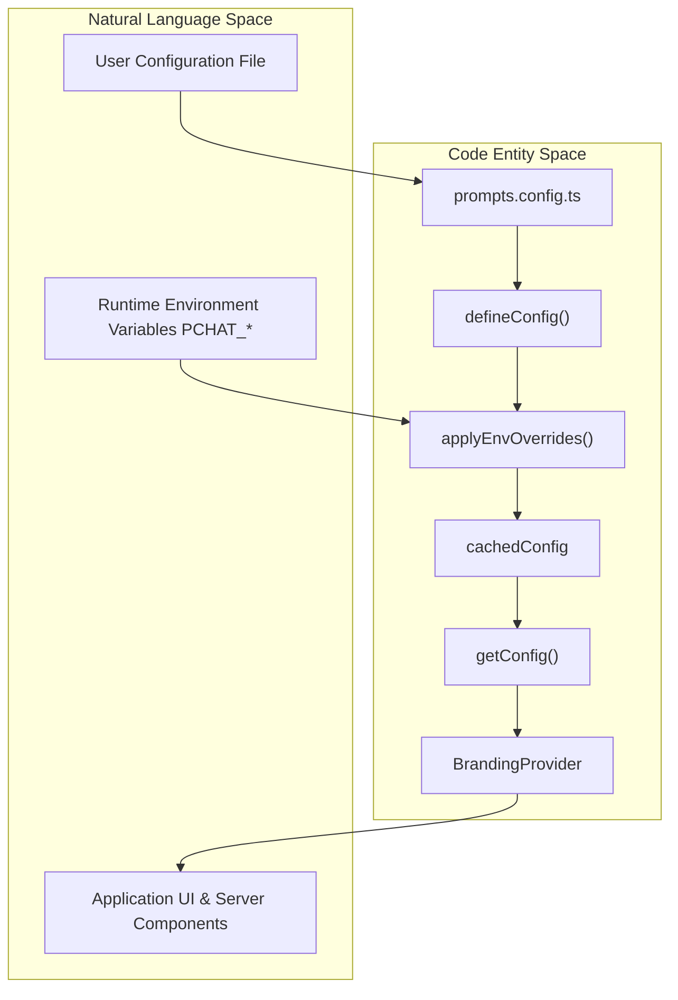
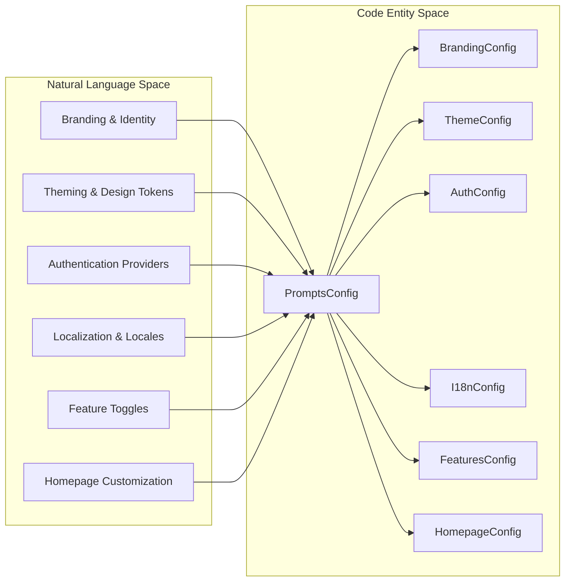

<!-- source: DeepWiki mcp.deepwiki.com · repo f/prompts.chat · page 12 Configuration & Customization · fetched 2026-11-09 -->

# Configuration & Customization

Relevant source files

The following files were used as context for generating this wiki page:

- [.env.example](.env.example)
- [prompts.config.ts](prompts.config.ts)
- [src/app/layout.tsx](src/app/layout.tsx)
- [src/components/layout/announcement-banner.tsx](src/components/layout/announcement-banner.tsx)
- [src/components/layout/header.tsx](src/components/layout/header.tsx)
- [src/components/ui/masonry.tsx](src/components/ui/masonry.tsx)
- [src/lib/config/index.ts](src/lib/config/index.ts)
- [src/lib/db.ts](src/lib/db.ts)
- [src/lib/i18n/config.ts](src/lib/i18n/config.ts)

This page serves as the parent overview for configuration and customization options in `prompts.chat`. It introduces the primary configuration domains, runtime override mechanics, and design systems, linking out to detailed child pages for deeper technical implementation [src/lib/config/index.ts:1-185](), [prompts.config.ts:1-104]().

---

## Configuration Architecture & Loading Pipeline

The configuration framework processes settings through a multi-step pipeline combining build-time static files and runtime environment variable overrides. Configurations are declared using `defineConfig` in `prompts.config.ts` [prompts.config.ts:1-6](), parsed via `getConfig()` [src/lib/config/index.ts:187-198](), and overridden by `PCHAT_*` environment variables for zero-rebuild container deployments [src/lib/config/index.ts:117-185]().

Title: "Configuration Loading and Override Pipeline"

Sources: [src/lib/config/index.ts:97-185](), [prompts.config.ts:1-104]()

---

## Configuration Domains & Schema

The configuration shape is defined by the `PromptsConfig` interface and broken down into distinct functional domains covering branding, themes, authentication, internationalization, feature flags, and homepage layouts [src/lib/config/index.ts:86-95]().

Title: "Configuration Domains Mapping to PromptsConfig"

Sources: [src/lib/config/index.ts:1-96]()

---

## Branding Customization

Branding configuration defines application identity elements such as application name, light/dark logos, favicons, descriptions, and external marketplace links [src/lib/config/index.ts:1-9](). These values propagate through components like `<Header />` and runtime providers [src/components/layout/header.tsx:115-178]().

For detailed branding configuration, see [Branding Customization](#12.2).

Sources: [prompts.config.ts:8-18](), [src/lib/config/index.ts:1-9](), [src/components/layout/header.tsx:115-178]()

---

## Theme Configuration

The theme domain controls border radii (`none`, `sm`, `md`, `lg`), visual variants (`flat`, `default`, `brutal`), layout density (`compact`, `default`, `comfortable`), and color tokens (`primary`, `secondary`, `accent`) [src/lib/config/index.ts:11-22](). These tokens are converted dynamically into CSS custom properties and OKLCH color spaces [src/app/layout.tsx:113-172]().

For a comprehensive explanation of theme setting options and color conversions, see [Theme Configuration](#12.3).

Sources: [prompts.config.ts:21-32](), [src/lib/config/index.ts:11-22](), [src/app/layout.tsx:113-172]()

---

## Feature Flags

Features are controlled via boolean flags within the configuration profile, allowing deployments to toggle capabilities such as private prompts, change requests, categorization, tagging, AI semantic search, AI generation, MCP protocol support, and comments [src/lib/config/index.ts:39-48]().

For details on feature flag usage and effects, see [Feature Flags](#12.4).

Sources: [prompts.config.ts:50-67](), [src/lib/config/index.ts:39-48]()

---

## White-labeling & Clone Branding

The `useCloneBranding` flag allows deployments to suppress official repository links, achievement badges, and sponsor listings, rendering a clean white-labeled instance [src/lib/config/index.ts:58-68](). When enabled or triggered via `PCHAT_NAME`, secondary community elements are hidden across the layout and announcement bars [prompts.config.ts:70-91](), [src/lib/config/index.ts:177-182](), [src/components/layout/announcement-banner.tsx:30-32]().

For instructions on achieving full white-labeling, see [White-labeling & Clone Branding](#12.5).

Sources: [src/lib/config/index.ts:58-68, 177-182](), [prompts.config.ts:4, 70-91](), [src/components/layout/announcement-banner.tsx:30-32]()

---

## Child Pages

For deep technical details on each domain, consult the following child pages:

- [Configuration Overview](#12.1) — Explain `prompts.config.ts` structure, `defineConfig`, configuration domains, and loading pipeline
- [Branding Customization](#12.2) — Document branding parameters and asset rendering across the UI
- [Theme Configuration](#12.3) — Explain theme properties, design tokens, and color conversions
- [Feature Flags](#12.4) — Document feature config variables and functional impacts
- [White-labeling & Clone Branding](#12.5) — Explain `useCloneBranding` and white-label setup procedures

---

