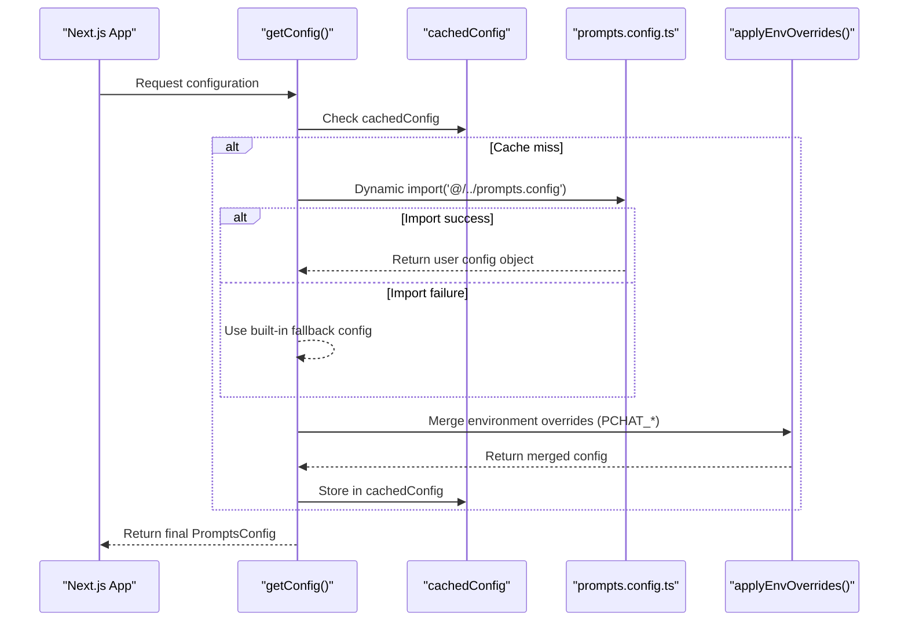
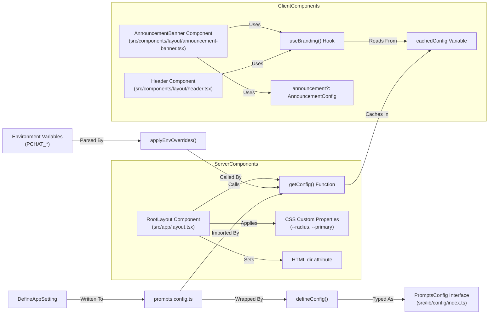

<!-- source: DeepWiki mcp.deepwiki.com · repo f/prompts.chat · page 12.1 Configuration Overview · fetched 2026-11-09 -->

# Configuration Overview

<details>
<summary>Relevant source files</summary>

The following files were used as context for generating this wiki page:

- [.env.example](.env.example)
- [package-lock.json](package-lock.json)
- [package.json](package.json)
- [prisma/reset-admin.ts](prisma/reset-admin.ts)
- [prompts.config.ts](prompts.config.ts)
- [scripts/setup.js](scripts/setup.js)
- [src/app/layout.tsx](src/app/layout.tsx)
- [src/components/layout/announcement-banner.tsx](src/components/layout/announcement-banner.tsx)
- [src/components/layout/header.tsx](src/components/layout/header.tsx)
- [src/components/ui/masonry.tsx](src/components/ui/masonry.tsx)
- [src/lib/config/index.ts](src/lib/config/index.ts)
- [src/lib/db.ts](src/lib/db.ts)
- [src/lib/i18n/config.ts](src/lib/i18n/config.ts)

</details>


This page provides an overview of prompts.chat's configuration system, explaining how the application is configured through `prompts.config.ts`, environment variable overrides, and the multi-stage configuration loading pipeline.

## Purpose and Scope

The configuration system enables extensive customization of prompts.chat to serve different deployment needs:

- **SaaS Mode**: Public prompts.chat instance with default branding and full features.
- **Self-Hosted Mode**: Custom instance with user-defined branding, authentication, and feature sets.
- **White-Label Mode**: Fully rebranded copy hiding all references to prompts.chat, enabled via the `useCloneBranding` flag.

Configurations are primarily declared in the central `prompts.config.ts` file using a type-safe approach with the `defineConfig` function. At runtime, environment variables prefixed with `PCHAT_` allow overrides without recompilation, supporting flexible, container-friendly deployments [prompts.config.ts:1-106](), [src/lib/config/index.ts:98-187]().

Sources: [prompts.config.ts:1-106](), [src/lib/config/index.ts:98-187]()

---

## Configuration File Structure

The core configuration resides in `prompts.config.ts` at the project root. It exports a configuration object describing six primary domains: branding, theme, auth, i18n, features, and homepage [prompts.config.ts:6-106]().

```typescript
import { defineConfig } from "@/lib/config";

export default defineConfig({
  branding: { /* branding settings */ },
  theme: { /* theme design tokens */ },
  auth: { /* authentication providers */ },
  i18n: { /* internationalization */ },
  features: { /* feature toggles */ },
  homepage: { /* homepage customization */ },
});
```

This file uses TypeScript for compile-time type checking and developer experience improvements. The `defineConfig` function itself is a simple pass-through that provides typing hints [prompts.config.ts:1-106](), [src/lib/config/index.ts:98-100]().

Sources: [prompts.config.ts:1-106](), [src/lib/config/index.ts:98-100]()

---

## Configuration Domains

The configuration is typed using the `PromptsConfig` interface, which composes multiple domain-specific interfaces [src/lib/config/index.ts:87-96](). These domains organize concerns logically and enable modular customization.

### Domain Composition Diagram

Title: "PromptsConfig Domain Architecture"

```mermaid
graph TB
    PromptsConfig["PromptsConfig"]
    BrandingConfig["branding: BrandingConfig"]
    ThemeConfig["theme: ThemeConfig"]
    AuthConfig["auth: AuthConfig"]
    I18nConfig["i18n: I18nConfig"]
    FeaturesConfig["features: FeaturesConfig"]
    HomepageConfig["homepage: HomepageConfig"]
    AnnouncementConfig["announcement?: AnnouncementConfig | null"]

    PromptsConfig --> BrandingConfig
    PromptsConfig --> ThemeConfig
    PromptsConfig --> AuthConfig
    PromptsConfig --> I18nConfig
    PromptsConfig --> FeaturesConfig
    PromptsConfig --> HomepageConfig
    PromptsConfig --> AnnouncementConfig

    subgraph BrandingDetails
      BrandingName["name: string"]
      BrandingLogo["logo: string"]
      BrandingFavicon["favicon: string"]
      BrandingAppStore["appStoreUrl?: string"]
      BrandingChromeExt["chromeExtensionUrl?: string"]
    end
    BrandingConfig --> BrandingName
    BrandingConfig --> BrandingLogo
    BrandingConfig --> BrandingFavicon
    BrandingConfig --> BrandingAppStore
    BrandingConfig --> BrandingChromeExt

    subgraph ThemeDetails
      Radius["radius: 'none' | 'sm' | 'md' | 'lg'"]
      Variant["variant: 'flat' | 'default' | 'brutal'"]
      Density["density: 'compact' | 'default' | 'comfortable'"]
      Colors["colors: { primary: string, secondary?: string, accent?: string }"]
    end
    ThemeConfig --> Radius
    ThemeConfig --> Variant
    ThemeConfig --> Density
    ThemeConfig --> Colors

    subgraph FeaturesDetails
      PrivatePrompts["privatePrompts: boolean"]
      ChangeRequests["changeRequests: boolean"]
      Categories["categories: boolean"]
      Tags["tags: boolean"]
      AISearch["aiSearch?: boolean"]
      AIGeneration["aiGeneration?: boolean"]
      MCP["mcp?: boolean"]
      Comments["comments?: boolean"]
      PromptEnhancer["promptEnhancer?: boolean"]
    end
    FeaturesConfig --> PrivatePrompts
    FeaturesConfig --> ChangeRequests
    FeaturesConfig --> Categories
    FeaturesConfig --> Tags
    FeaturesConfig --> AISearch
    FeaturesConfig --> AIGeneration
    FeaturesConfig --> MCP
    FeaturesConfig --> Comments
    FeaturesConfig --> PromptEnhancer

    subgraph HomepageDetails
      UseCloneBranding["useCloneBranding?: boolean"]
      Achievements["achievements?: { enabled: boolean }"]
      Sponsors["sponsors?: { enabled: boolean, items: Sponsor[] }"]
    end
    HomepageConfig --> UseCloneBranding
    HomepageConfig --> Achievements
    HomepageConfig --> Sponsors

    subgraph AnnouncementDetails
      AnnouncementId["id: string"]
      AnnouncementMessage["message: string"]
      AnnouncementMessageShort["messageShort?: string"]
      AnnouncementHref["href?: string"]
      AnnouncementExternal["external?: boolean"]
      AnnouncementCta["cta?: string"]
    end
    AnnouncementConfig --> AnnouncementId
    AnnouncementConfig --> AnnouncementMessage
    AnnouncementConfig --> AnnouncementMessageShort
    AnnouncementConfig --> AnnouncementHref
    AnnouncementConfig --> AnnouncementExternal
    AnnouncementConfig --> AnnouncementCta
```


Sources: [src/lib/config/index.ts:1-96](), [prompts.config.ts:6-106]()

### Domain Descriptions

| Domain         | Interface Name      | Purpose                                                                                               |
|----------------|---------------------|-----------------------------------------------------------------------------------------------------|
| `branding`     | `BrandingConfig`    | Define app identity: name, logo URLs (light/dark), favicon, descriptions, store URLs [src/lib/config/index.ts:1-9]().          |
| `theme`        | `ThemeConfig`       | UI design tokens: border radius, visual variant, density, and colors [src/lib/config/index.ts:11-22]().                       |
| `auth`         | `AuthConfig`        | Authentication providers array and registration toggle [src/lib/config/index.ts:26-32]().                                     |
| `i18n`         | `I18nConfig`        | Supported locales and default language code [src/lib/config/index.ts:34-37]().                                               |
| `features`     | `FeaturesConfig`    | Feature flags enabling/disabling modules like private prompts or MCP [src/lib/config/index.ts:39-49]().                       |
| `homepage`     | `HomepageConfig`    | White-label controls, achievements, sponsors visibility [src/lib/config/index.ts:59-69]().                                    |
| `announcement` | `AnnouncementConfig`| Site-wide announcement bar configuration [src/lib/config/index.ts:71-85]().                                                 |

Sources: [src/lib/config/index.ts:1-96](), [prompts.config.ts:6-106]()

---

## Configuration Loading Pipeline

The application loads configuration in a layered manner combining a user config file, environment variable overrides, and caching [src/lib/config/index.ts:189-248]().

### Loading Sequence Diagram

Title: "getConfig Pipeline Execution Flow"


Sources: [src/lib/config/index.ts:189-248]()

### Pipeline Steps

1.  **File Import**: Dynamically imports the user-defined `prompts.config.ts` file. If missing or import errors occur, falls back to a hardcoded default configuration [src/lib/config/index.ts:189-248]().
2.  **Environment Variable Overrides**: The `applyEnvOverrides` function processes `process.env` for keys beginning with `PCHAT_` and overrides corresponding config values if set. Supported environment variables cover all config domains and allow seamless customization in deployment environments [src/lib/config/index.ts:118-187]().
3.  **Caching**: The resulting config object is cached in `cachedConfig` to avoid repeated file reads and reprocessing in the same server instance session [src/lib/config/index.ts:103]().

Sources: [src/lib/config/index.ts:103](), [src/lib/config/index.ts:118-248]()

---

## Runtime Configuration Access

### Server-Side

Server components and API routes asynchronously fetch runtime configuration via the `getConfig()` function [src/lib/config/index.ts:189-248]():

```typescript
const config = await getConfig();
const primaryColor = config.theme.colors.primary;
```

This enables access to the merged config with environment overrides applied [src/lib/config/index.ts:189-248]().

### Client-Side

Client components do not perform async imports of the config. Instead, they use reactive context providers such as `BrandingProvider` hooked by the `useBranding` React hook which reads branding info transparently from loaded config [src/components/layout/header.tsx:80](). The themes are handled similarly by the theming provider using `useTheme()` [src/components/layout/header.tsx:115]().

Sources: [src/lib/config/index.ts:189-248](), [src/components/layout/header.tsx:80](), [src/components/layout/header.tsx:115]()

---

## Environment Variable Overrides

The config system supports fine-grained environment variable overrides prefixed with `PCHAT_`. This allows docker-compose or cloud deployments to change settings without modifying source files [src/lib/config/index.ts:118-187]().

### Parsing Helpers

-   `envBool(key, fallback)` interprets `"true"`, `"false"`, `"1"`, `"0"` strings as boolean [src/lib/config/index.ts:122-126]().
-   `envArray(key, fallback)` parses comma-separated strings into string arrays [src/lib/config/index.ts:128-132]().

### Environment Variable to Config Mapping

| Env Variable                    | Config Path                          | Notes                               |
|---------------------------------|--------------------------------------|-------------------------------------|
| `PCHAT_NAME`                    | `branding.name`                      | Custom app name [src/lib/config/index.ts:136]() |
| `PCHAT_DESCRIPTION`             | `branding.description`               | App short description [src/lib/config/index.ts:137]() |
| `PCHAT_LOGO`                    | `branding.logo`                      | Light logo URL [src/lib/config/index.ts:138]() |
| `PCHAT_LOGO_DARK`               | `branding.logoDark`                  | Dark mode logo URL [src/lib/config/index.ts:139]() |
| `PCHAT_FAVICON`                 | `branding.favicon`                   | Browser favicon [src/lib/config/index.ts:140]() |
| `PCHAT_COLOR`                   | `theme.colors.primary`               | Primary color hex or oklch [src/lib/config/index.ts:149]() |
| `PCHAT_THEME_RADIUS`            | `theme.radius`                       | UI border radius [src/lib/config/index.ts:145]() |
| `PCHAT_THEME_VARIANT`           | `theme.variant`                      | UI style variant [src/lib/config/index.ts:146]() |
| `PCHAT_THEME_DENSITY`           | `theme.density`                      | UI density [src/lib/config/index.ts:147]() |
| `PCHAT_AUTH_PROVIDERS`          | `auth.providers`                     | Comma-separated list [src/lib/config/index.ts:155-157]() |
| `PCHAT_ALLOW_REGISTRATION`      | `auth.allowRegistration`             | Boolean [src/lib/config/index.ts:158-160]() |
| `PCHAT_LOCALES`                 | `i18n.locales`                       | Comma-separated list [src/lib/config/index.ts:163-165]() |
| `PCHAT_DEFAULT_LOCALE`          | `i18n.defaultLocale`                 | Default locale code [src/lib/config/index.ts:166]() |
| `PCHAT_FEATURE_PRIVATE_PROMPTS` | `features.privatePrompts`            | Boolean [src/lib/config/index.ts:169]() |
| `PCHAT_FEATURE_CHANGE_REQUESTS` | `features.changeRequests`            | Boolean [src/lib/config/index.ts:170]() |
| `PCHAT_FEATURE_CATEGORIES`      | `features.categories`                | Boolean [src/lib/config/index.ts:171]() |
| `PCHAT_FEATURE_TAGS`            | `features.tags`                      | Boolean [src/lib/config/index.ts:172]() |
| `PCHAT_FEATURE_AI_SEARCH`       | `features.aiSearch`                  | Boolean [src/lib/config/index.ts:173]() |
| `PCHAT_FEATURE_AI_GENERATION`   | `features.aiGeneration`              | Boolean [src/lib/config/index.ts:174]() |
| `PCHAT_FEATURE_MCP`             | `features.mcp`                       | Boolean [src/lib/config/index.ts:175]() |
| `PCHAT_FEATURE_COMMENTS`        | `features.comments`                  | Boolean [src/lib/config/index.ts:176]() |
| `PCHAT_FEATURE_PROMPT_ENHANCER` | `features.promptEnhancer`            | Boolean [src/lib/config/index.ts:177]() |

### Special Behavior

-   If `PCHAT_NAME` is set via environment, the homepage configuration automatically switches to `useCloneBranding: true` mode, disabling prompts.chat's default achievements and sponsors to facilitate white-labeling on the fly [src/lib/config/index.ts:179-184]().

Sources: [src/lib/config/index.ts:118-187]()

---

## Internationalization Configuration

The `i18n` domain defines the supported locales and the default language. This setting must be aligned with the internal translation system and locale detection [prompts.config.ts:43-47](), [src/lib/i18n/config.ts:4-6]().

```typescript
i18n: {
  locales: [
    "en", "tr", "es", "zh", "ja",
    "ar", "pt", "fr", "it", "de",
    "nl", "ko", "ru", "he", "el",
    "az", "fa",
  ],
  defaultLocale: "en",
},
```

### Right-to-Left Language Support

The system automatically handles RTL languages using the hardcoded list of right-to-left locales [src/lib/i18n/config.ts:8-14]():

```typescript
const rtlLocales = ["ar", "he", "fa"];
function isRtlLocale(locale: string): boolean {
  return rtlLocales.includes(locale);
}
```

Client code such as the root HTML layout dynamically sets the `dir` attribute based on the current locale's RTL status [src/lib/i18n/config.ts:1-24]().

Sources: [prompts.config.ts:43-47](), [src/lib/i18n/config.ts:1-24]()

---

## Configuration Logic Entity Map

The following diagram links natural language configuration concepts to concrete code artifacts handling them in prompts.chat:

Title: "Configuration Entity and Code Mapping"


Sources: [prompts.config.ts:1-6](), [src/lib/config/index.ts:87-103](), [src/lib/config/index.ts:118-187](), [src/components/layout/header.tsx:80](), [src/components/layout/announcement-banner.tsx:10-14](), [src/app/layout.tsx:156](), [src/app/layout.tsx:169-172](), [src/app/layout.tsx:179]()

---

