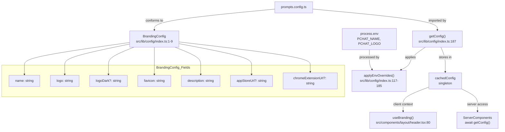
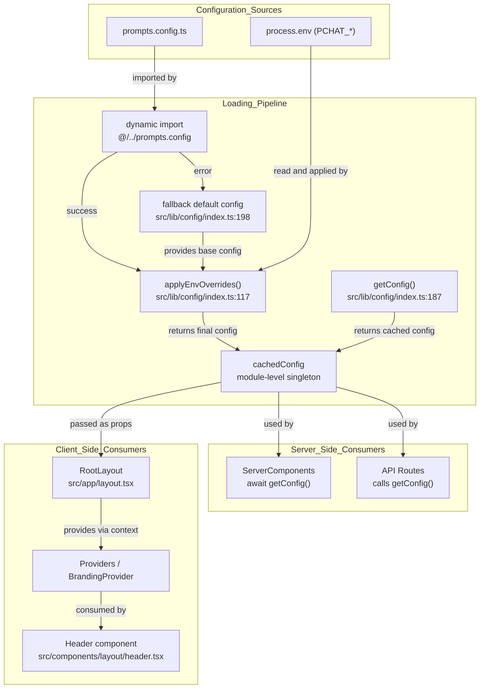
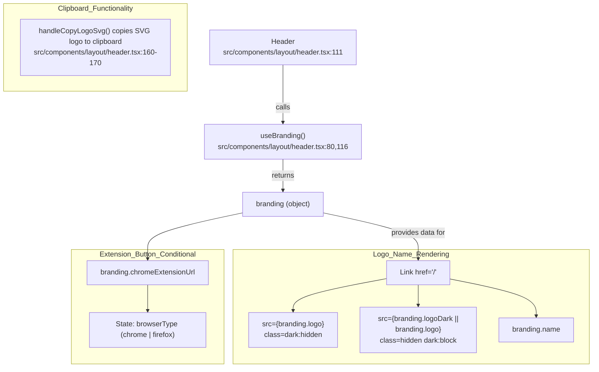
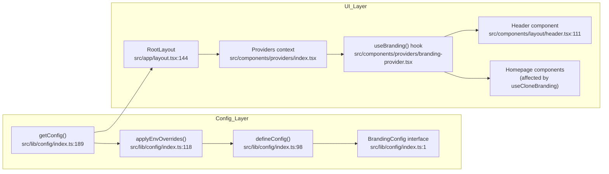

<!-- source: DeepWiki mcp.deepwiki.com · repo f/prompts.chat · page 12.2 Branding Customization · fetched 2026-11-09 -->

# Branding Customization

<details>
<summary>Relevant source files</summary>

The following files were used as context for generating this wiki page:

- [.env.example](.env.example)
- [prompts.config.ts](prompts.config.ts)
- [public/favicon/apple-touch-icon.png](public/favicon/apple-touch-icon.png)
- [public/favicon/favicon-96x96.png](public/favicon/favicon-96x96.png)
- [public/favicon/favicon.ico](public/favicon/favicon.ico)
- [public/favicon/favicon.svg](public/favicon/favicon.svg)
- [public/favicon/site.webmanifest](public/favicon/site.webmanifest)
- [public/favicon/web-app-manifest-192x192.png](public/favicon/web-app-manifest-192x192.png)
- [public/favicon/web-app-manifest-512x512.png](public/favicon/web-app-manifest-512x512.png)
- [src/app/layout.tsx](src/app/layout.tsx)
- [src/components/layout/announcement-banner.tsx](src/components/layout/announcement-banner.tsx)
- [src/components/layout/header.tsx](src/components/layout/header.tsx)
- [src/components/ui/masonry.tsx](src/components/ui/masonry.tsx)
- [src/lib/config/index.ts](src/lib/config/index.ts)
- [src/lib/db.ts](src/lib/db.ts)
- [src/lib/i18n/config.ts](src/lib/i18n/config.ts)
- [tsconfig.json](tsconfig.json)

</details>


## Purpose and Scope

This document covers the **branding customization system** in prompts.chat, which controls the application's visual identity including name, logo (light/dark), description, favicon, and external store links. Branding settings define how your deployment appears to users across all pages and key UI components.

For additional context about configuration loading and environment overrides, see **12.1 Configuration Overview**. For detailed theming properties affecting colors and shapes, see **12.3 Theme Configuration**. For instructions on fully white-labeling or hiding original prompts.chat branding, see **12.5 White-labeling & Clone Branding**.

Sources: [prompts.config.ts:8-18](), [src/lib/config/index.ts:1-9]()

---

## Branding Configuration Structure

Branding customization is implemented as a structured configuration object conforming to the interface `BrandingConfig` defined in the TypeScript declarations at [src/lib/config/index.ts:1-9](). This interface specifies the following fields:

- `name`: string — Application display name
- `logo`: string — The logo URI for light mode (e.g., `/logo.svg`)
- `logoDark?`: string — Optional logo URI for dark mode (fallback to `logo`)
- `favicon`: string — URI of the favicon asset (shown in browser tabs)
- `description`: string — A short descriptive text used in meta tags and homepage
- `appStoreUrl?`: string — Optional URL to Mac App Store listing
- `chromeExtensionUrl?`: string — Optional URL to Chrome Web Store listing

The configuration is instantiated in the root `prompts.config.ts` file under the `branding` key [prompts.config.ts:8-18]().

### Branding Configuration Data Flow



Sources: [src/lib/config/index.ts:1-9](), [src/lib/config/index.ts:70-84](), [src/lib/config/index.ts:117-185](), [src/lib/config/index.ts:187](), [prompts.config.ts:8-18]()

---

## Configuration Interface

The `BrandingConfig` interface fully defines the expected branding properties, each serving a clear visual or functional purpose:

| Field | Type | Required | Description |
| :------------------ | :------- | :------- | :----------------------------------------------------------- |
| `name` | `string` | Yes | Application name displayed in header, title, and throughout UI |
| `logo` | `string` | Yes | Path to light theme logo (relative to `/public`) |
| `logoDark` | `string` | No | Path to dark theme logo (defaults to `logo` if omitted) |
| `favicon` | `string` | Yes | Path to favicon asset used in browser tabs |
| `description` | `string` | Yes | Short descriptive text for meta tags and homepage |
| `appStoreUrl` | `string` | No | URL to Mac App Store; if set, shows App Store button |
| `chromeExtensionUrl` | `string` | No | URL to Chrome Web Store; if set, shows extension button |

Sources: [src/lib/config/index.ts:1-9]()

---

## Setting Branding in Config File

Branding customization is controlled by editing the `branding` object in your `prompts.config.ts` file as shown below:

```typescript
export default defineConfig({
  branding: {
    name: "prompts.chat",
    logo: "/logo.svg",
    logoDark: "/logo-dark.svg",
    favicon: "/logo.svg",
    description: "Collect, organize, and share AI prompts",
    
    // Optional: Delete this if useCloneBranding is true
    appStoreUrl: "https://apps.apple.com/tr/app/prompts-chat/id6756895736",
    chromeExtensionUrl: "https://chromewebstore.google.com/detail/promptschat/eemdohkhbaifiocagjlhibfbhamlbeej",
  },
  // ... other config sections
});
```

### Logo Recommendations
- **Format:** SVG logos are recommended for scalability and crisp display.
- **Light logo:** Typically used on light backgrounds.
- **Dark logo:** Optional logo to use under dark theme; falls back to `logo` if missing.
- **Display size:** Logos in the header are usually rendered at compact heights.

Sources: [prompts.config.ts:8-18](), [src/components/layout/header.tsx:160-175]()

---

## Environment Variable Overrides

Branding values can be overridden at runtime using environment variables prefixed with `PCHAT_`. The function `applyEnvOverrides()` in [src/lib/config/index.ts:117-185]() performs this override logic, allowing Docker or cloud deployments to adjust branding without recompilation.

| Environment Variable | Field Overridden | Type | Fallback |
| :------------------- | :--------------- | :----- | :------------------------------------------ |
| `PCHAT_NAME` | `branding.name` | string | Config default |
| `PCHAT_DESCRIPTION` | `branding.description` | string | Config default |
| `PCHAT_LOGO` | `branding.logo` | string | Config default |
| `PCHAT_LOGO_DARK` | `branding.logoDark` | string | Fallback to `PCHAT_LOGO` or config default |
| `PCHAT_FAVICON` | `branding.favicon` | string | Config default |

**Relevant override logic snippet:**

```typescript
branding: {
  name: env.PCHAT_NAME || config.branding.name,
  description: env.PCHAT_DESCRIPTION || config.branding.description,
  logo: env.PCHAT_LOGO || config.branding.logo,
  logoDark: env.PCHAT_LOGO_DARK || env.PCHAT_LOGO || config.branding.logoDark,
  favicon: env.PCHAT_FAVICON || config.branding.favicon,
  appStoreUrl: config.branding.appStoreUrl,
  chromeExtensionUrl: config.branding.chromeExtensionUrl,
}
```

### Auto-Clone Mode Trigger

If `PCHAT_NAME` is set (indicating custom runtime branding), the system auto-enables clone branding by setting `useCloneBranding: true` in the homepage config [src/lib/config/index.ts:177-184](), hiding default achievements and sponsors to respect white-labeling needs.

Sources: [src/lib/config/index.ts:117-185](), [src/lib/config/index.ts:177-184]()

---

## Configuration Loading Pipeline

The branding config flows through multiple layers before reaching UI components.



Key functions:
- `getConfig()` asynchronously loads user config, applies environment variable overrides, and caches it for reuse [src/lib/config/index.ts:189-248]().
- `applyEnvOverrides()` applies runtime environment-based configuration changes [src/lib/config/index.ts:117-187]().
- `useBranding()` is a React hook that retrieves branding config from context on client side [src/components/layout/header.tsx:80]().

Sources: [src/lib/config/index.ts:117-187](), [src/lib/config/index.ts:189-248]()

---

## Branding Usage in UI Components

### Header Component

The primary UI surface showing the brand name and logos is the `Header` component [src/components/layout/header.tsx:111](). It uses the `useBranding()` hook for accessing branding config dynamically [src/components/layout/header.tsx:80]().



- Logos are conditionally rendered based on theme (dark/light) using the `logo` and `logoDark` URLs [src/components/layout/header.tsx:160-175]().
- `handleCopyLogoSvg` asynchronously fetches the SVG logo source and copies it to clipboard on demand [src/components/layout/header.tsx:160-170]().
- Browser detection logic (Chrome or Firefox) affects which browser extension link to render [src/components/layout/header.tsx:150-158]().

Sources: [src/components/layout/header.tsx:80](), [src/components/layout/header.tsx:111-178](), [src/components/layout/header.tsx:150-170]()

---

### Homepage Branding

The homepage leverages the `useCloneBranding` flag in the configuration to decide whether to display original prompts.chat branding or present a fully customized white-label identity.

Key behaviors:
- When `useCloneBranding` is **true**, repository branding elements such as achievements and sponsor widgets are hidden [prompts.config.ts:73-77]().
- Achievements visibility is controlled by `homepage.achievements.enabled` [prompts.config.ts:75-77]().
- Sponsors visibility and listing items are controlled by `homepage.sponsors.enabled` and `homepage.sponsors.items` [prompts.config.ts:78-92]().
- If a custom `PCHAT_NAME` environment variable is detected, the system auto-enables clone branding with achievements and sponsors disabled to maintain full white-label experience [src/lib/config/index.ts:179-184]().
- `appStoreUrl` and `chromeExtensionUrl` from branding config conditionally display respective external store buttons on supported UI segments [prompts.config.ts:16-17]().

Sources: [prompts.config.ts:4](), [prompts.config.ts:70-93](), [src/lib/config/index.ts:179-184]()

---

## Summary

The branding customization system provides centralized visual identity control over a prompts.chat instance with the following characteristics:

1.  **Configuration Setup:**
    Defined in the `branding` object within `prompts.config.ts`—includes name, logos, favicon, description, and optional external store links.

2.  **Environment Overrides:**
    `PCHAT_*` prefixed environment variables enable runtime overrides of branding config, especially useful for containerized deployments.

3.  **UI Integration:**
    Branding config is loaded server-side via `getConfig()`, passed to client root as props, provided via React context, and consumed primarily by the `Header` component and homepage layout to render consistent logos, titles, and store buttons.

4.  **Clone Branding Mode:**
    Automatically or manually enabled to remove original prompts.chat branding elements, supporting full white-label deployments.

This system enables both ease of customization and dynamic runtime branding changes without source modifications or recompilation.

Sources: [src/lib/config/index.ts](), [prompts.config.ts](), [src/components/layout/header.tsx]()

---

## Appendix: Code Entity Associations for Branding Customization



Sources: [prompts.config.ts:1-92](), [src/lib/config/index.ts:1-187](), [src/lib/config/index.ts:189-248](), [src/app/layout.tsx:144](), [src/components/layout/header.tsx]()

---

