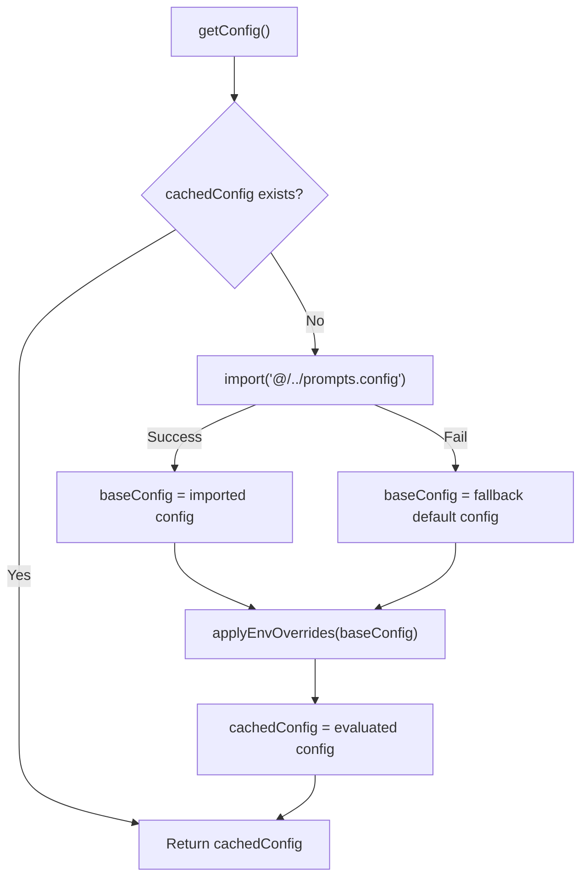
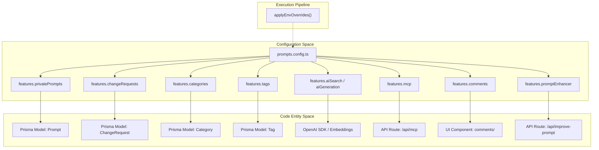

<!-- source: DeepWiki mcp.deepwiki.com · repo f/prompts.chat · page 12.4 Feature Flags · fetched 2026-11-09 -->

# Feature Flags

<details>
<summary>Relevant source files</summary>

The following files were used as context for generating this wiki page:

- [.env.example](.env.example)
- [package-lock.json](package-lock.json)
- [package.json](package.json)
- [prisma/reset-admin.ts](prisma/reset-admin.ts)
- [prompts.config.ts](prompts.config.ts)
- [scripts/setup.js](scripts/setup.js)
- [src/app/layout.tsx](src/app/layout.tsx)
- [src/components/layout/announcement-banner.tsx](src/components/layout/announcement-banner.tsx)
- [src/components/layout/header.tsx](src/components/layout/header.tsx)
- [src/components/ui/masonry.tsx](src/components/ui/masonry.tsx)
- [src/lib/config/index.ts](src/lib/config/index.ts)
- [src/lib/db.ts](src/lib/db.ts)
- [src/lib/i18n/config.ts](src/lib/i18n/config.ts)

</details>


Feature flags control the enablement and disablement of major features in prompts.chat. They are configured in `prompts.config.ts` under the `features` key, and can be dynamically overridden at runtime through environment variables prefixed with `PCHAT_FEATURE_*`. This design allows flexible adaptation of the application to different deployment scenarios, such as public community use or private organizational clones.

These flags directly affect the application’s behavior, data model usage, UI rendering, available API routes, and integration features.

Sources:
[prompts.config.ts:49-69](), [src/lib/config/index.ts:39-49]()

---

## The `FeaturesConfig` Interface

The `FeaturesConfig` interface defines all toggleable features available in the system. It ensures type safety when accessing these flags in code via `getConfig()`.

```typescript
export interface FeaturesConfig {
  privatePrompts: boolean;   // Users can create private prompts
  changeRequests: boolean;   // Versioning and change request workflow enabled
  categories: boolean;       // Categories enabled for prompts
  tags: boolean;             // Tags enabled for prompts
  aiSearch?: boolean;        // AI semantic search functionality (requires OPENAI_API_KEY)
  aiGeneration?: boolean;    // AI generation features (requires OPENAI_API_KEY)
  mcp?: boolean;             // Model Context Protocol features and API keys
  comments?: boolean;        // Comments on prompts enabled
  promptEnhancer?: boolean;  // AI Prompt Enhancer on /developers and /api/improve-prompt
}
```

All features except `privatePrompts`, `changeRequests`, `categories`, and `tags` are optional and default to false or true depending on core defaults. The flags for AI search/generation require external API keys (`OPENAI_API_KEY`) to function fully.

Sources:
[src/lib/config/index.ts:39-49]()

---

## Flag Reference

| Flag             | Type    | Default in `prompts.config.ts` | Fallback Default (if config missing) | Environment Variable Override          | Notes / Dependency                     |
|------------------|---------|---------------------------------|-------------------------------------|--------------------------------------|--------------------------------------|
| `privatePrompts` | boolean | `true`                          | `true`                              | `PCHAT_FEATURE_PRIVATE_PROMPTS`      | Allows users to create private prompts |
| `changeRequests` | boolean | `true`                          | `true`                              | `PCHAT_FEATURE_CHANGE_REQUESTS`      | Enables prompt versioning & edits    |
| `categories`     | boolean | `true`                          | `true`                              | `PCHAT_FEATURE_CATEGORIES`            | Enables prompt categories             |
| `tags`           | boolean | `true`                          | `true`                              | `PCHAT_FEATURE_TAGS`                  | Enables prompt tags                   |
| `aiSearch`       | boolean | `true`                          | `false`                             | `PCHAT_FEATURE_AI_SEARCH`             | Semantic search with OpenAI embeddings |
| `aiGeneration`   | boolean | `true`                          | `false`                             | `PCHAT_FEATURE_AI_GENERATION`         | AI prompt generation/improvement     |
| `mcp`            | boolean | `true`                          | `false`                             | `PCHAT_FEATURE_MCP`                   | Enables MCP server & API key features |
| `comments`       | boolean | `true`                          | `true`                              | `PCHAT_FEATURE_COMMENTS`              | Enables comments on prompt pages     |
| `promptEnhancer` | boolean | `false`                         | `true`                              | `PCHAT_FEATURE_PROMPT_ENHANCER`       | AI Prompt Enhancer on /developers and /api/improve-prompt |

- The defaults in `prompts.config.ts` represent the standard public release configuration.
- The fallback values are hardcoded in `src/lib/config/index.ts` and are used if the config file is missing or fails to import.
- Environment variables override these flags at runtime without requiring a rebuild.

Sources:
[prompts.config.ts:49-69](), [src/lib/config/index.ts:167-177](), [src/lib/config/index.ts:203-225]()

---

## Configuration Methods

### 1. Static Configuration (`prompts.config.ts`)

The primary configuration method is declaring feature flags inside the `features` block of the configuration object passed to `defineConfig()`.

```typescript
export default defineConfig({
  features: {
    privatePrompts: true,
    changeRequests: true,
    categories: true,
    tags: true,
    aiSearch: true,
    aiGeneration: true,
    mcp: true,
    comments: true,
    promptEnhancer: false,
  },
});
```

Sources:
[prompts.config.ts:49-69](), [src/lib/config/index.ts:97-99]()

### 2. Runtime Overrides (Environment Variables)

The `applyEnvOverrides()` function inspects `process.env` for keys prefixed by `PCHAT_FEATURE_` to override static configuration flags dynamically. For example, setting `PCHAT_FEATURE_AI_SEARCH=false` disables semantic search at runtime.

The internal helper `envBool` parses string values (`"true"`, `"1"`, `"false"`, `"0"`) into native booleans.

Sources:
[src/lib/config/index.ts:117-132](), [src/lib/config/index.ts:167-177]()

### 3. Interactive Setup (`scripts/setup.js`)

An interactive command-line utility prompts operators for feature toggles during private clone initialization, automatically writing out a customized `prompts.config.ts`.

Sources:
[scripts/setup.js:139-150]()

---

## Flag Resolution Pipeline

The complete pipeline determining effective feature flag states bridges natural language configuration choices to executable code paths:

Title: "Feature Flag Resolution Flow"


Sources:
[src/lib/config/index.ts:189-225]()

---

## Per-Flag Technical Implementation Details

### AI-Related Flags: `aiSearch`, `aiGeneration`, `promptEnhancer`

- **`aiSearch`** gates semantic search features utilizing OpenAI embeddings.
- **`aiGeneration`** controls AI features like prompt improvement and translation via OpenAI APIs.
- **`promptEnhancer`** specifically enables the AI Prompt Enhancer on the `/developers` page and the `/api/improve-prompt` endpoint.
- Components check these flags before rendering UI controls or invoking backend OpenAI services.

Sources:
[src/lib/config/index.ts:172-173](), [src/lib/config/index.ts:177](), [prompts.config.ts:59-62](), [prompts.config.ts:68-69]()

### Content Organization Flags: `categories`, `tags`

- These flags toggle category and tag filtering taxonomies in the UI.
- When disabled, filtering options are hidden, though database seeding scripts may still provision default taxonomies if active during setup.

Sources:
[src/lib/config/index.ts:170-171](), [prompts.config.ts:55-58]()

### MCP Flag: `mcp`

- Controls the Model Context Protocol server endpoints mounted at `/api/mcp` and API key generation interfaces.

Sources:
[prompts.config.ts:63-65](), [src/lib/config/index.ts:174]()

### Versioning and Social Flags: `changeRequests`, `comments`

- `changeRequests` activates prompt versioning and review workflows.
- `comments` toggles discussion threads on prompt detail views.

Sources:
[src/lib/config/index.ts:169](), [src/lib/config/index.ts:175]()

---

## Code Entity Association

This diagram maps configuration names and feature flags directly to code entities, Prisma models, and API routes.

Title: "Feature Flag to Code Entity Mapping"


Sources:
[src/lib/config/index.ts:39-49](), [src/lib/config/index.ts:117-186](), [prompts.config.ts:49-69]()

---

