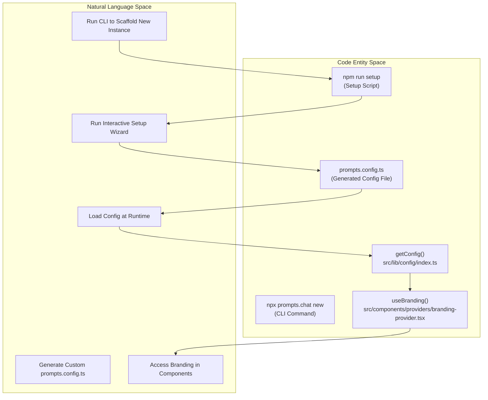
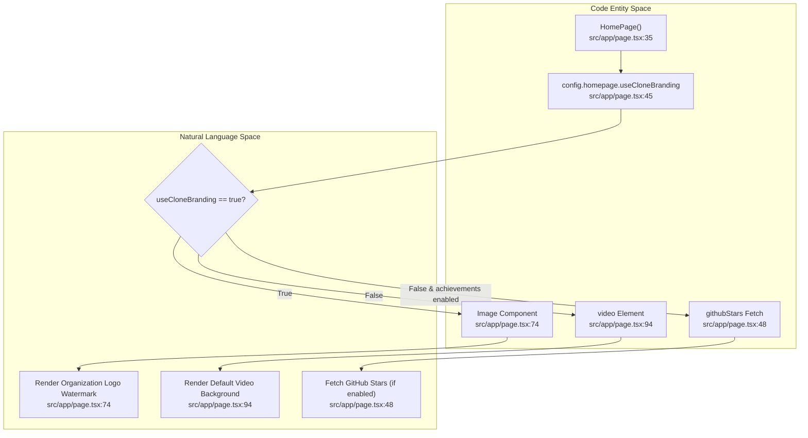

<!-- source: DeepWiki mcp.deepwiki.com · repo f/prompts.chat · page 12.5 White-labeling & Clone Branding · fetched 2026-11-09 -->

# White-labeling & Clone Branding

<details>
<summary>Relevant source files</summary>

The following files were used as context for generating this wiki page:

- [src/app/page.tsx](src/app/page.tsx)

</details>


This page documents the white-labeling and clone branding system enabling deployments of `prompts.chat` with custom branding while hiding references to the upstream repository and community. This feature targets organizations or individuals running their own branded prompt library instance who want to fully rebrand or white-label the site.

For broader configuration context, see [12.1 Configuration Overview](). For deployment details, refer to [13.1 Docker Deployment]().

---

## Overview & Impact of `useCloneBranding`

The white-labeling system is controlled by the boolean flag `useCloneBranding` that toggles the visibility of prompts.chat-specific branding elements across the entire application [src/app/page.tsx:45](). When this flag is set to `true`, elements such as:

- GitHub repository links and stargazer counts (including the dynamic GitHub stars fetch) [src/app/page.tsx:50-62]()
- Achievements, testimonials, and media mentions
- Sponsor acknowledgment sections
- Brand asset context menus, video backgrounds, app store links, and specialized navigation items [src/app/page.tsx:71-132]()

are hidden or replaced to present a fully customized brand identity devoid of upstream repository attribution.

All core functionality of the application—such as prompt browsing, search, user authentication, and MCP features—remains intact, ensuring a polished white-labeled experience.

### Elements Hidden by `useCloneBranding`

| Element | Location | Description |
|---|---|---|
| GitHub stars and repo links | [src/app/page.tsx:50-62]() | Dynamic GitHub stars fetch omitted |
| Achievements and sponsor acknowledgments | [src/app/page.tsx:50-60]() | Sponsor logos and achievements disabled |
| Video background watermark | [src/app/page.tsx:71-88]() | Default video background replaced by logo watermark |
| App Store and Chrome extension links | [src/app/page.tsx:112-132]() | Removed links to official app stores |
| DeepWiki and Context7 links in footer | [src/components/layout/footer.tsx:23-28]() | Links to documentation AI agents are hidden. |
| DeepWiki and Context7 links in self-hosting docs | [src/app/docs/self-hosting/page.tsx:56-108]() | Links to documentation AI agents are hidden. |
| "How to Contribute" section in `CONTRIBUTING.md` | [CONTRIBUTING.md:7-14]() | The section guiding users to contribute via `prompts.chat` is specific to the main instance. |
| "Open Source" section in Privacy Policy | [src/app/privacy/page.tsx:124-131]() | The link to the GitHub repository is hidden. |
| "Description of Service" in Terms of Service | [src/app/terms/page.tsx:34-37]() | The description explicitly mentioning `prompts.chat` is hidden. |
| Issue template for submitting new prompts | [.github/ISSUE_TEMPLATE/config.yml:3-5]() | The link to `prompts.chat/prompts/new` is specific to the main instance. |

Sources: [src/app/page.tsx:45-132](), [src/components/layout/footer.tsx:23-28](), [src/app/docs/self-hosting/page.tsx:56-108](), [CONTRIBUTING.md:7-14](), [src/app/privacy/page.tsx:124-131](), [src/app/terms/page.tsx:34-37](), [.github/ISSUE_TEMPLATE/config.yml:3-5]()

---

## Configuration Architecture & Loading Pipeline

The white-labeling and branding system is driven by the configuration setup script (`scripts/setup.js`) and runtime config loaders. When setting up a private clone, the configuration generator automatically sets `useCloneBranding = true` and configures organization identity properties [SELF-HOSTING.md:151]().

Title: "Config Generation & Setup Pipeline"



Sources: [SELF-HOSTING.md:85-93](), [SELF-HOSTING.md:145-203](), [src/app/page.tsx:39-45](), [src/components/layout/footer.tsx:11]()

---

## The `useCloneBranding` Flag & Component Rendering

### Definition and Propagation

The master control flag for clone branding resides in configuration files and is consumed directly by the homepage server component [src/app/page.tsx:45](). It conditionally disables public achievement counters and external repository fetches:

```typescript
const useCloneBranding = config.homepage?.useCloneBranding ?? false;
```
[src/app/page.tsx:45]()

The `useBranding` hook [src/components/layout/footer.tsx:11]() also accesses this flag from the global configuration to conditionally render elements in the footer.

### Homepage Rendering Flow

The `HomePage` component checks `useCloneBranding` to decide whether to render upstream promotional media or custom organizational logos [src/app/page.tsx:35-88]().

Title: "Homepage Branding Selection Flow"



Sources: [src/app/page.tsx:35-103](), [src/components/layout/footer.tsx:11]()

---

## Complete White-Label Setup Guide

To configure a fully white-labeled prompts.chat instance, follow these steps:

1.  **Run the Setup Script**: Execute the interactive configuration wizard to generate your private configuration. This can be done via `npx prompts.chat new my-prompt-library` [packages/prompts.chat/README.md:31-32]() or `npm run setup` [SELF-HOSTING.md:109]().
2.  **Enable the Master Flag**: Ensure `useCloneBranding = true` is set in your generated `prompts.config.ts` [SELF-HOSTING.md:151]() or configuration provider. The setup wizard typically handles this.
3.  **Specify Custom Branding Assets**: Fill out the `branding` object with organization details for `name`, `logo`, `logoDark`, `favicon`, and `description` [SELF-HOSTING.md:154-159]().
4.  **Disable Achievements and Sponsors**: Set `homepage.achievements.enabled = !useCloneBranding` and `homepage.sponsors.enabled = !useCloneBranding` to hide prompts.chat specific achievements and sponsors [SELF-HOSTING.md:190-196]().
5.  **Customize Theme**: Adjust `theme` properties like `radius`, `variant`, `density`, and primary colors [SELF-HOSTING.md:162-168]().

Sources: [SELF-HOSTING.md:85-203](), [packages/prompts.chat/README.md:31-32]()

---

# References

- Homepage white-label UI logic: [src/app/page.tsx:35-103]()
- Self-hosting configuration example: [SELF-HOSTING.md:145-203]()
- Footer branding logic: [src/components/layout/footer.tsx:11-37]()
- Self-hosting documentation page: [src/app/docs/self-hosting/page.tsx:56-108]()

---

