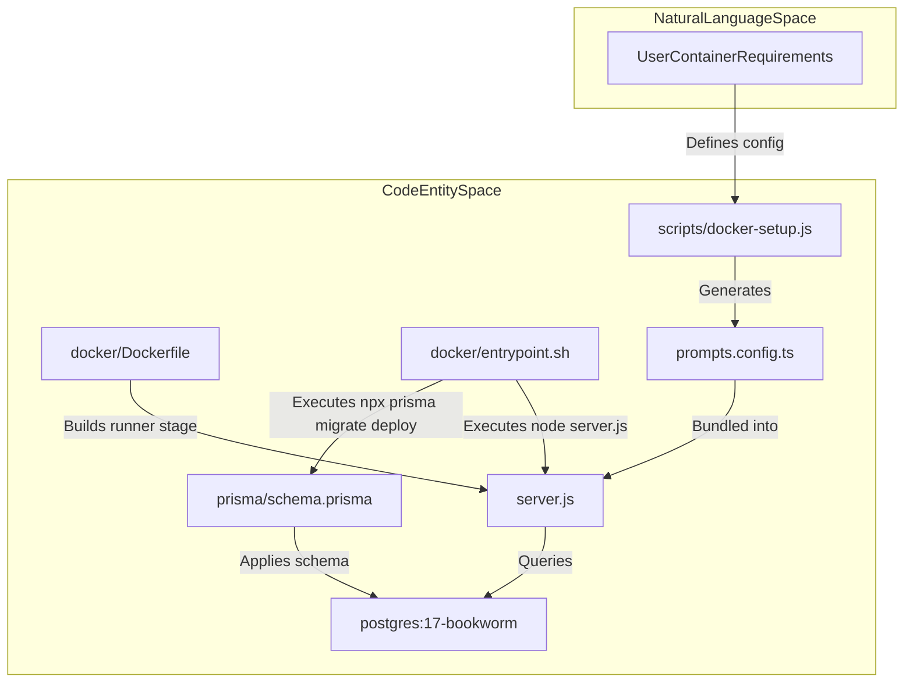
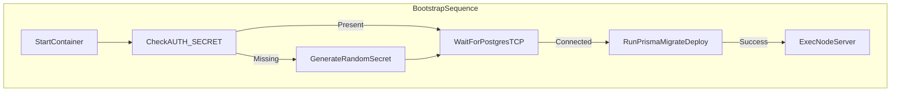
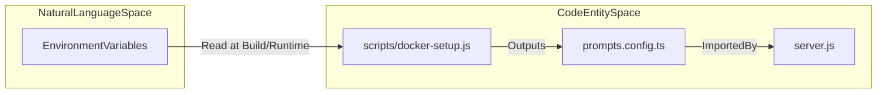

<!-- source: DeepWiki mcp.deepwiki.com · repo f/prompts.chat · page 13 Deployment · fetched 2026-11-09 -->

# Deployment

Relevant source files

The following files were used as context for generating this wiki page:

- [.dockerignore](.dockerignore)
- [DOCKER.md](DOCKER.md)
- [compose.yml](compose.yml)
- [docker/Dockerfile](docker/Dockerfile)
- [docker/entrypoint.sh](docker/entrypoint.sh)
- [scripts/docker-setup.js](scripts/docker-setup.js)
- [src/__tests__/api/improve-prompt.test.ts](src/__tests__/api/improve-prompt.test.ts)

This page serves as the parent guide for deployment operations in `prompts.chat`, covering containerized execution via Docker [DOCKER.md:1-3](), multi-stage builds [docker/Dockerfile:1-94](), and production initialization [docker/entrypoint.sh:1-41]().

As a parent page, this document provides a high-level architectural overview. For deep technical instructions, refer to the child pages:
- For Docker image layers, runtime environment injection, and volume mounts, see [Docker Deployment](#13.1).
- For bare-metal installation, configuration files, and build processes, see [Self-hosting Guide](#13.2).
- For automated GitHub Actions pipelines (`docker-publish.yml`, `update-contributors.yml`), see [CI/CD Pipeline](#13.3).
- For security hardening, `AUTH_SECRET` generation, connection pooling, and Sentry configuration, see [Production Checklist & Observability](#13.4).

Sources: [DOCKER.md:1-3](), [docker/Dockerfile:1-47](), [docker/entrypoint.sh:1-41]()

---

## Deployment Options Overview

Prompts.chat supports both containerized deployments via Docker Compose or standalone Docker containers, as well as manual self-hosting on a Node.js runtime with a configured PostgreSQL database. Configuration is managed through environment variables prefixed with `PCHAT_*` for branding, theme, authentication, internationalization, and feature toggles. These environment variables are transformed into the runtime configuration file `prompts.config.ts` by helper scripts during container builds [scripts/docker-setup.js:6-32]().

| Deployment Mode | Primary Artifact | Configuration Source | Startup Orchestration |
|-----------------|------------------|----------------------|-----------------------|
| **Docker Compose** | Pre-built or locally built Docker image (`ghcr.io/f/prompts.chat` or local build) | `compose.yml` environment variables [compose.yml:19-39]() | Entrypoint shell script [docker/entrypoint.sh:1-41]() |
| **Standalone Docker** | Docker image built from `docker/Dockerfile` | Command line `-e PCHAT_*` env variables | Entrypoint shell script [docker/entrypoint.sh:1-41]() |
| **Manual Self-Hosting** | Node.js 24 runtime process | Manual `prompts.config.ts` and `.env` | Process manager of choice, e.g., pm2 or systemd |

Sources: [compose.yml:19-39](), [docker/Dockerfile:1-94](), [docker/entrypoint.sh:1-41](), [scripts/docker-setup.js:6-32]()

---

## Deployment Architecture

The application's Docker image is built using a multi-stage process outlined in `docker/Dockerfile`. This process results in a minimal production-ready standalone Next.js server bundled with Prisma runtime tools for database migrations [docker/Dockerfile:1-94](). The image includes a multi-stage compilation flow that builds client and server assets, packages them into a runner stage running under the `nextjs` user, and pairs with a companion PostgreSQL container managed by `compose.yml` [compose.yml:1-18]().

Title: Deployment Architecture Mapping Natural Language to Code Entities

**Key Architectural Points:**
- The Prisma schema and migration files are bundled within the Docker image to allow runtime migration execution without rebuilding [docker/Dockerfile:69-70]().
- The configuration file `prompts.config.ts` is generated from environment variables via initialization scripts [scripts/docker-setup.js:120-170]().
- The entrypoint script `docker/entrypoint.sh` ensures the database is reachable before launching `server.js` [docker/entrypoint.sh:12-41]().

Sources: [docker/Dockerfile:1-94](), [docker/entrypoint.sh:1-41](), [scripts/docker-setup.js:1-172](), [compose.yml:1-45]()

---

## Initialization Data Flow

The container startup sequence is orchestrated by `docker/entrypoint.sh` to ensure a smooth launch with zero manual intervention, validating environment variables, database TCP reachability, and executing runtime schema migrations before booting the Next.js server process [docker/entrypoint.sh:1-41]().

Title: Container Initialization Sequence

**Step-by-step details:**
1. The entrypoint script verifies the presence of `AUTH_SECRET` and generates a secure random fallback if absent [docker/entrypoint.sh:4-10]().
2. A TCP socket check validates PostgreSQL availability on its configured port [docker/entrypoint.sh:12-32]().
3. Prisma migrations are deployed against the database via `npx prisma migrate deploy` [docker/entrypoint.sh:34-37]().
4. The standalone Next.js server starts via `exec node server.js` [docker/entrypoint.sh:39-41]().

Sources: [docker/entrypoint.sh:1-41]()

---

## Relating Configuration and Runtime Code

The runtime configuration pipeline translates environment variables (`PCHAT_*`) into the type-safe configuration structure consumed by the Next.js application core [scripts/docker-setup.js:6-32]().

Title: Configuration and Runtime Pipeline Mapping

Sources: [scripts/docker-setup.js:1-172]()

---

## Summary: Deployment Components

| Component | Role | Code Reference |
|-----------|------|----------------|
| `docker/Dockerfile` | Multi-stage build for optimized production image | [docker/Dockerfile:1-94]() |
| `docker/entrypoint.sh` | Bootstrap script for DB readiness, migrations, and server start | [docker/entrypoint.sh:1-41]() |
| `compose.yml` | Defines multi-container orchestration (app + Postgres) | [compose.yml:1-45]() |
| `scripts/docker-setup.js` | Converts env variables into configuration TypeScript file | [scripts/docker-setup.js:1-172]() |
| `prompts.config.ts` | Runtime configuration file loaded by Next.js app | Generated file, see docker-setup.js |

Sources: [docker/Dockerfile:1-94](), [docker/entrypoint.sh:1-41](), [compose.yml:1-45](), [scripts/docker-setup.js:1-172]()

---

For detailed instructions on each deployment topic, consult the respective child pages:
- [Docker Deployment](#13.1) — Image details, entrypoint, compose setup, volume persistence, and configs.
- [Self-hosting Guide](#13.2) — Comprehensive manual deployment with Node.js, DB setup, and production optimization.
- [CI/CD Pipeline](#13.3) — GitHub Actions workflows for build, publish, testing, and maintenance automation.
- [Production Checklist & Observability](#13.4) — Security, secrets management, pooling, error tracking, monitoring, and health checks.

Sources: [DOCKER.md:1-206](), [docker/Dockerfile:1-94](), [compose.yml:1-45](), [docker/entrypoint.sh:1-41](), [scripts/docker-setup.js:1-172]()

---

