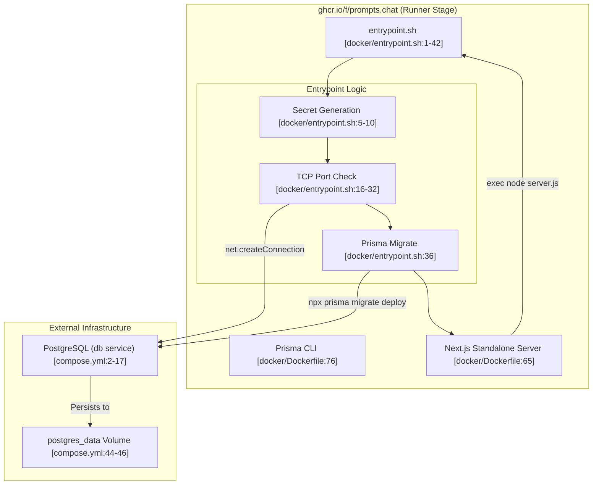
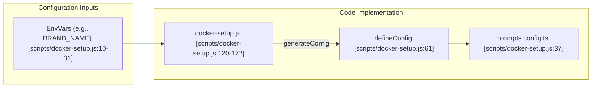
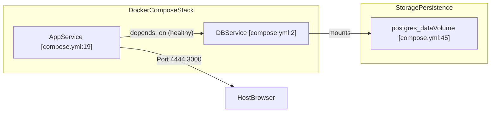

<!-- source: DeepWiki mcp.deepwiki.com · repo f/prompts.chat · page 13.1 Docker Deployment · fetched 2026-11-09 -->

# Docker Deployment

Relevant source files

The following files were used as context for generating this wiki page:

- [.dockerignore](.dockerignore)
- [DOCKER.md](DOCKER.md)
- [compose.yml](compose.yml)
- [docker/Dockerfile](docker/Dockerfile)
- [docker/entrypoint.sh](docker/entrypoint.sh)
- [scripts/docker-setup.js](scripts/docker-setup.js)
- [src/__tests__/api/improve-prompt.test.ts](src/__tests__/api/improve-prompt.test.ts)

This document covers the technical implementation of the Docker deployment architecture for `prompts.chat`. The deployment utilizes a multi-stage production build producing a Next.js standalone output, managed by a dedicated entrypoint script for runtime orchestration, automated migrations, and configuration generation [docker/Dockerfile:1-94](), [docker/entrypoint.sh:1-41](), [scripts/docker-setup.js:1-172]().

---

## Architecture Overview

The `prompts.chat` Docker deployment follows container best practices by separating the build environment from the runtime environment. It uses a 4-stage Dockerfile to produce a lean, production-ready image based on `node:24-bookworm-slim` [docker/Dockerfile:12-47]().

### Container Lifecycle & Process Flow

Sources: [docker/Dockerfile:47-94](), [docker/entrypoint.sh:1-41](), [compose.yml:1-45]()

---

## Dockerfile Structure

The `docker/Dockerfile` implements a multi-stage build to minimize image size and security attack surface by excluding build tools from the final runner stage [docker/Dockerfile:1-46]().

| Stage       | Base Image             | Purpose             | Key Actions                                                                                   |
|-------------|------------------------|---------------------|----------------------------------------------------------------------------------------------|
| **Base**    | `node:24-bookworm-slim`| OS Setup            | Installs `openssl`, `curl`, `ca-certificates` [docker/Dockerfile:12-18]()                   |
| **Deps**    | `base`                 | Dependency Caching  | Copies package manifests and Prisma schema, then runs `npm ci` [docker/Dockerfile:23-33]()  |
| **Builder** | `base`                 | Compilation         | Copies node_modules & sources, runs `npm run build` for standalone Next.js output [docker/Dockerfile:36-44]()  |
| **Runner**  | `node:24-bookworm-slim`| Production Runtime  | Copies build artifacts, Prisma CLI, adds non-root user, sets entrypoint script [docker/Dockerfile:47-94]()     |

**Key implementation notes:**
- The runner stage installs the Prisma CLI (`prisma@6.19`) specifically for executing runtime database migrations [docker/Dockerfile:75-77]().
- The script `docker/entrypoint.sh` is copied, given execution permissions, and set as the container entrypoint [docker/Dockerfile:78-94]().

Sources: [docker/Dockerfile:11-94]()

---

## Runtime Orchestration (`entrypoint.sh`)

The `docker/entrypoint.sh` script orchestrates container startup by securing environment secrets, validating database reachability via TCP probes, running database migrations, and launching the application server [docker/entrypoint.sh:1-41]().

### 1. Dynamic `AUTH_SECRET` Generation
If `AUTH_SECRET` is unset, the script generates a cryptographic 32-byte base64 secret using `openssl rand -base64 32` [docker/entrypoint.sh:5-10](). Production deployments should explicitly supply `AUTH_SECRET` to ensure user sessions persist across restarts [DOCKER.md:147-155]().

### 2. Database Readiness Check
Using a native Node.js TCP socket probe (`net.createConnection`), the script tests the host and port extracted from `DATABASE_URL` [docker/entrypoint.sh:16-32](). It retries up to 30 times with 2-second intervals to prevent premature container crashes [docker/entrypoint.sh:14-31]().

### 3. Automated Prisma Migrations
Once TCP connectivity is established, `npx prisma migrate deploy` executes pending schema migrations against the PostgreSQL database [docker/entrypoint.sh:36]().

### 4. Application Startup
The script executes `exec node server.js` to start the standalone Next.js application on the specified port [docker/entrypoint.sh:40-41]().

Sources: [docker/entrypoint.sh:1-41](), [DOCKER.md:147-155]()

---

## Configuration & Environment Variables (`PCHAT_*`)

`prompts.chat` supports runtime configuration overrides via environment variables prefixed with `PCHAT_`. These map directly to configuration properties defined in `prompts.config.ts` [DOCKER.md:67-136]().

### Branding and Theme Variables

| Env Variable        | Config Path          | Description                          | Default                |
|---------------------|---------------------|------------------------------------|------------------------|
| `PCHAT_NAME`        | `branding.name`      | Application name                   | `My Prompt Library`     |
| `PCHAT_DESCRIPTION` | `branding.description`| App description                   | `Collect, organize...`  |
| `PCHAT_LOGO`        | `branding.logo`      | Logo URL path (in `/public`)      | `/logo.svg`             |
| `PCHAT_LOGO_DARK`   | `branding.logoDark`  | Dark mode logo                    | Same as `PCHAT_LOGO`    |
| `PCHAT_FAVICON`     | `branding.favicon`   | Favicon URL                       | `/logo.svg`             |
| `PCHAT_COLOR`       | `theme.colors.primary`| Primary UI color (hex)             | `#6366f1`               |
| `PCHAT_THEME_RADIUS`| `theme.radius`       | Border radius: `none\|sm\|md\|lg`     | `sm`                    |
| `PCHAT_THEME_VARIANT`| `theme.variant`      | UI style: `default\|flat\|brutal`    | `default`               |
| `PCHAT_THEME_DENSITY`| `theme.density`      | Spacing: `compact\|default\|comfortable` | `default`          |

### Authentication & Internationalization Variables

| Env Variable          | Config Path         | Description                        | Default           |
|-----------------------|---------------------|----------------------------------|-------------------|
| `PCHAT_AUTH_PROVIDERS`| `auth.providers`    | Comma-separated list (`github,google,credentials`) | `credentials` |
| `PCHAT_ALLOW_REGISTRATION` | `auth.allowRegistration` | Enable public user signup       | `true`          |
| `PCHAT_LOCALES`      | `i18n.locales`      | Supported locales (comma-separated) | `en`        |
| `PCHAT_DEFAULT_LOCALE`| `i18n.defaultLocale`| Default locale                  | `en`         |

### Feature Flags

| Env Variable                | Config Path           | Description                                 | Default    |
|-----------------------------|---------------------|---------------------------------------------|------------|
| `PCHAT_FEATURE_PRIVATE_PROMPTS` | `features.privatePrompts` | Enable private prompts                  | `true`     |
| `PCHAT_FEATURE_CHANGE_REQUESTS` | `features.changeRequests` | Enable versioning/change requests       | `true`     |
| `PCHAT_FEATURE_CATEGORIES`       | `features.categories`     | Enable categories                        | `true`     |
| `PCHAT_FEATURE_TAGS`             | `features.tags`           | Enable tags                             | `true`     |
| `PCHAT_FEATURE_COMMENTS`         | `features.comments`       | Enable comments                         | `true`     |
| `PCHAT_FEATURE_AI_SEARCH`        | `features.aiSearch`       | Enable AI semantic search               | `false`    |
| `PCHAT_FEATURE_AI_GENERATION`    | `features.aiGeneration`   | Enable AI generation features           | `false`    |
| `PCHAT_FEATURE_MCP`              | `features.mcp`            | Enable Model Context Protocol support  | `false`    |
| `PCHAT_FEATURE_PROMPT_ENHANCER`  | `features.promptEnhancer` | Enable Prompt Enhancer on `/developers` and `/api/improve-prompt` | `true` |

Sources: [DOCKER.md:86-136](), [compose.yml:29-39]()

---

## Build-time Configuration Generation (`scripts/docker-setup.js`)

When building custom container images, `scripts/docker-setup.js` generates `prompts.config.ts` programmatically from environment inputs [scripts/docker-setup.js:1-172]().

### Implementation Details
- Uses utility functions `env()`, `envBool()`, and `envArray()` to parse environment variables with fallback defaults [scripts/docker-setup.js:39-53]().
- Invokes `defineConfig()` to output a typed TypeScript configuration file [scripts/docker-setup.js:55-118]().
- Automatically configures `useCloneBranding = true` for containerized instances [scripts/docker-setup.js:59]().

### Build-time Config Flow

Sources: [scripts/docker-setup.js:1-172]()

---

## Docker Compose Integration

The `compose.yml` manifest orchestrates a multi-container stack containing the Next.js `app` service and the PostgreSQL `db` service [compose.yml:1-45]().

### Services & Topology
- **db**: Runs `postgres:17-bookworm`, mounts the `postgres_data` volume to `/var/lib/postgresql/data`, and defines a `pg_isready` health check [compose.yml:2-17]().
- **app**: Builds from `docker/Dockerfile` or pulls `ghcr.io/f/prompts.chat:latest`, depends on `db` health, and binds port 4444 to container port 3000 [compose.yml:19-43]().

### Docker Compose Service Topology

Sources: [compose.yml:1-45]()

---

## Volume Persistence and Data Storage

- Database state persistence relies on the named Docker volume `postgres_data`, mounted directly to PostgreSQL's storage directory (`/var/lib/postgresql/data`) inside the `db` container [compose.yml:10-11]().
- This storage model ensures application records, prompts, user credentials, and change requests persist across container restarts, image updates, and rebuild operations.

Sources: [compose.yml:10-11]()

---

