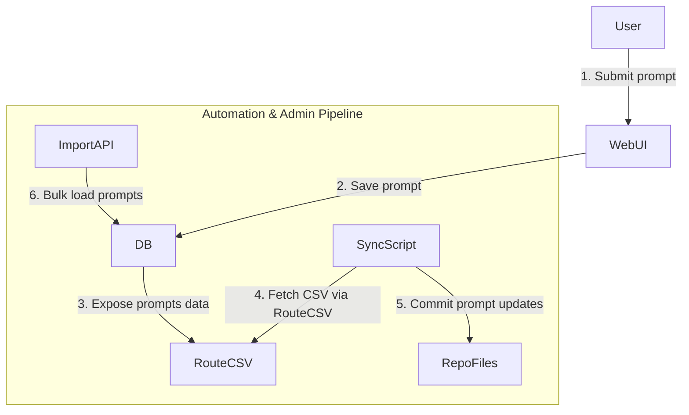
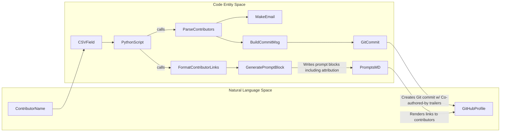

<!-- source: DeepWiki mcp.deepwiki.com · repo f/prompts.chat · page 14 Contributing · fetched 2026-11-09 -->

# Contributing

Relevant source files

The following files were used as context for generating this wiki page:

- [.github/ISSUE_TEMPLATE/config.yml](.github/ISSUE_TEMPLATE/config.yml)
- [CONTRIBUTING.md](CONTRIBUTING.md)

## Purpose and Scope

This page serves as the parent guide for contribution guidelines within the **prompts.chat** ecosystem. The project supports distinct contribution paths for natural language prompt content versus codebase infrastructure, employing an automated attribution system and strict licensing boundaries. 

For detailed technical guidelines and workflows, see the following child pages:
- [Contribution Workflow](#14.1) — Step-by-step guide for submitting prompts via the web UI and code via PRs, issue templates, governance, and licensing.
- [Code Standards](#14.2) — Explanation of coding conventions, ESLint and MDX linting, formatting, and PR best practices.
- [Testing](#14.3) — Documentation on the Vitest testing framework, organization of tests, coverage, and running tests.

Sources: [CONTRIBUTING.md:1-15]()

---

## Contribution Paths

The codebase clearly distinguishes between **content** (prompts) and **infrastructure** (code). Each has a dedicated entry and automation path:

| Contribution Type      | Entry Point                                   | Attribution Method                              | Primary Files / Modules               |
|-----------------------|-----------------------------------------------|------------------------------------------------|-------------------------------------|
| **Prompts**           | [prompts.chat/prompts/new](https://prompts.chat/prompts/new) (Web UI) | Automated Git commits with `Co-authored-by` trailers | `prompts.csv`, `PROMPTS.md` (CSV sync system) |
| **Code & Documentation** | GitHub Pull Requests                         | Standard PR merge authorship                      | `src/*`, `scripts/*`, `.github/*`   |
| **Admin Bulk Import** | Admin Dashboard (import-controls)              | Bulk CSV processing via API                        | API routes, `Prompt` and `User` models |

### Prompt Contributions via Web Interface

The cornerstone for prompt submissions is the web-based UI accessible at `https://prompts.chat/prompts/new`. Contributors log in with GitHub, create prompts, and submit them. The system then automatically syncs prompts to the repository, generates properly formatted entries, and appends Git commits with `Co-authored-by` trailers for attribution [CONTRIBUTING.md:7-14]().

Direct edits to `prompts.csv` in the GitHub repository are discouraged to prevent formatting errors and broken automated workflows. The web interface validates prompt content and metadata before syncing.

For detailed workflow documentation, see [Contribution Workflow](#14.1).

Sources: [CONTRIBUTING.md:7-14]()

---

### Natural Language to Code Entity Mapping: Prompt Submission Flow

This diagram maps user actions and system components bridging natural language intent to code entities managing prompt data submission, storage, and sync.

Prompt Submission Flow

*Note: `WebUI` corresponds to `prompts.chat/prompts/new`, `DB` to the Prisma `Prompt` model, `SyncScript` to `scripts/generate-contributors.sh`, `RepoFiles` to `prompts.csv`/`PROMPTS.md`, and `RouteCSV` to `src/app/prompts.csv/route.ts`.*

Sources: [CONTRIBUTING.md:7-14]()

---

## Attribution System

A key feature of the project is its robust **GitHub attribution system** that credits all prompt contributors accurately even though contributions are largely automated.

- Contributor identities are linked via GitHub usernames or emails stored in the CSV contributor field [CONTRIBUTING.md:14]().
- The contribution script parses contributor metadata to build Git commit messages that include `Co-authored-by` trailers, enabling GitHub's built-in contributor recognition [CONTRIBUTING.md:14]().
- The `PROMPTS.md` file automatically lists contributors linking to their GitHub profiles for public visibility and acknowledgment [CONTRIBUTING.md:14]().

For further details on attribution governance, see [Contribution Workflow](#14.1).

### Natural Language to Code Entity Mapping: Attribution Logic

The following diagram details how contributor data flows from prompt submission fields through scripts to Git history and rendered contributor lists.

Attribution Logic

*Note: `PythonScript` refers to `scripts/generate-contributors.sh`, `ParseContributors` to `parse_contributors`, `MakeEmail` to `make_email`, `BuildCommitMsg` to `build_commit_msg`, `GitCommit` to `git_commit`, `FormatContributorLinks` to `format_contributor_links`, `GeneratePromptBlock` to `generate_prompt_block`, and `PromptsMD` to `PROMPTS.md`.*

Sources: [CONTRIBUTING.md:7-14]()

---

## Licensing & Policies

The project distinguishes logic and content via dual licenses and clear contribution boundaries:

- **Source Code & Documentation:** MIT License for repository infrastructure, code, and site UI.
- **Prompt Content:** Public domain or CC0 terms for shared prompts in `prompts.csv` and `PROMPTS.md`.

### Content & Issue Guidelines

To maintain high-quality contributions and repository health:
- Check for duplicate prompts and test prompts thoroughly before submitting new entries [CONTRIBUTING.md:18-24]().
- Keep content appropriate for all audiences and descriptive with clear titles [CONTRIBUTING.md:21-23]().
- Only submit prompt contributions via the web interface (`https://prompts.chat/prompts/new`) [CONTRIBUTING.md:7-11](), [.github/ISSUE_TEMPLATE/config.yml:3-5]().
- The repository is strictly for AI prompt sharing; advertisements or off-topic issues are closed immediately and reported to GitHub [CONTRIBUTING.md:33-39]().
- Use the configured issue templates and links to report bugs or submit prompts. Blank issues are disabled [.github/ISSUE_TEMPLATE/config.yml:1-8]().

Sources: [CONTRIBUTING.md:16-39](), [.github/ISSUE_TEMPLATE/config.yml:1-8]()

---

## Admin Bulk Import & API

For repository maintainers and administrators, bulk import and export controls are available via administrative APIs and dashboard UI components. This enables programmatic management of prompt catalogs, category bindings, and synchronization routines.

Sources: [CONTRIBUTING.md:1-39]()

---

## Summary

Contributing to prompts.chat can be summarized as:
- Use the **web UI** for adding or editing prompt content, leveraging automatic sync and GitHub attribution ([Contribution Workflow](#14.1)) [CONTRIBUTING.md:7-14]().
- Use **GitHub PRs** for code, documentation, and infrastructure changes with typical review and merge workflows ([Code Standards](#14.2), [Testing](#14.3)) [CONTRIBUTING.md:25-32]().
- Follow community guidelines, issue policies, and licensing restrictions [CONTRIBUTING.md:33-39]().

For more detailed guidance, refer to:
- [Contribution Workflow](#14.1)
- [Code Standards](#14.2)
- [Testing](#14.3)

Sources: [CONTRIBUTING.md:5-39](), [.github/ISSUE_TEMPLATE/config.yml:1-8]()

---

