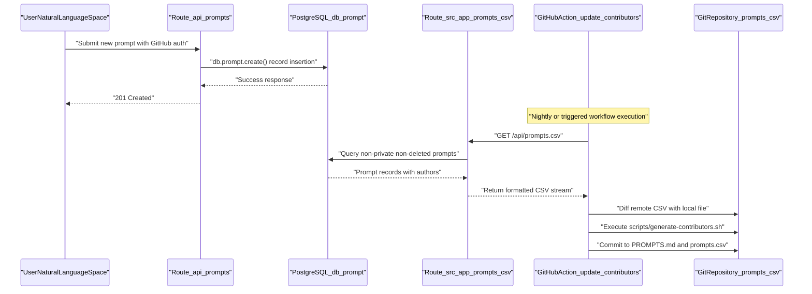
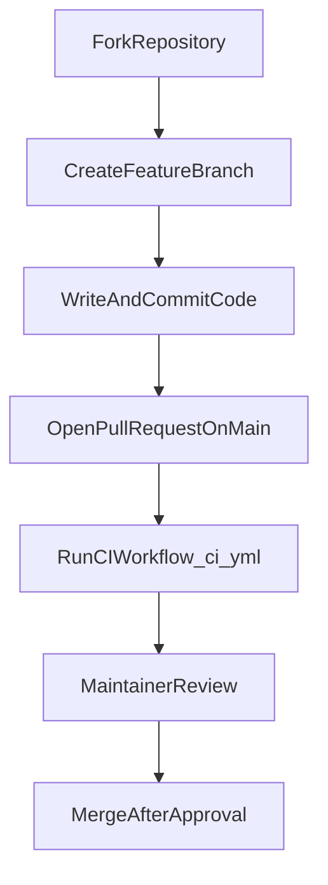
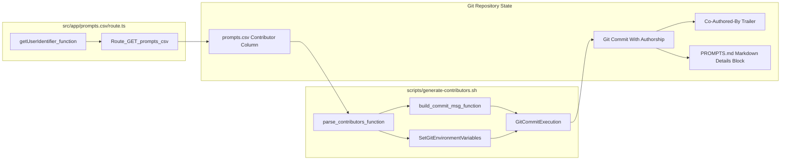

<!-- source: DeepWiki mcp.deepwiki.com · repo f/prompts.chat · page 14.1 Contribution Workflow · fetched 2026-11-09 -->

# Contribution Workflow

Relevant source files

The following files were used as context for generating this wiki page:

- [.github/ISSUE_TEMPLATE/config.yml](.github/ISSUE_TEMPLATE/config.yml)
- [CONTRIBUTING.md](CONTRIBUTING.md)
- [GOVERNANCE.md](GOVERNANCE.md)
- [LICENSE](LICENSE)
- [LICENSE-CC0](LICENSE-CC0)
- [LICENSE-MIT](LICENSE-MIT)
- [OWNERS.md](OWNERS.md)

This page documents the contribution workflow for the `prompts.chat` repository. It covers the dual contribution model (web interface for prompts and GitHub pull requests for code), quality gates, issue templates, automated contributor attribution via CSV/Git synchronization, governance, and licensing models.

Sources: [CONTRIBUTING.md:1-15]()

---

## Two Contribution Paths

The repository accepts contributions through two distinct paths depending on the nature of the change:

| Path | What it covers | Authentication Required |
|---|---|---|
| **Prompt submission via UI** | Adding or updating prompts in the library | GitHub account authentication on `prompts.chat` [CONTRIBUTING.md:9-11]() |
| **Code contribution via PR** | Bug fixes, documentation, feature work | GitHub account on `github.com` [CONTRIBUTING.md:25-32]() |

Directly editing `prompts.csv` via a pull request is discouraged to ensure proper formatting, validation, and automated attribution.

Sources: [CONTRIBUTING.md:7-12]()

---

## Path 1: Prompt Submission via the Web UI

Submitting prompts through the web interface triggers an automated synchronization pipeline that writes data to the PostgreSQL database and propagates changes to `prompts.csv` and `PROMPTS.md` [CONTRIBUTING.md:9-12]().

### Data Flow Overview: Prompt Submission and Sync Pipeline

Sources: [CONTRIBUTING.md:7-14](), [src/app/prompts.csv/route.ts:28-81](), [scripts/generate-contributors.sh:15-130]()

**Implementation Details**:
- The web UI writes submitted prompts to the database using an API endpoint under `src/app/api/prompts`.
- The CSV generated on demand (`GET /api/prompts.csv`) uses `src/app/prompts.csv/route.ts` which selects prompts from the database filtering out private and unlisted entries, and concatenates contributor identifiers into a CSV contributor column [src/app/prompts.csv/route.ts:28-81]().
- The GitHub Action (`update-contributors.yml`) runs periodically or is triggered by PR merges, fetching the remote CSV, diffing against the local `prompts.csv`, and committing prompt additions with attributed authorship via scripted commits in `scripts/generate-contributors.sh` [scripts/generate-contributors.sh:15-130]().

Sources: [CONTRIBUTING.md:7-14](), [src/app/prompts.csv/route.ts:28-81](), [scripts/generate-contributors.sh:15-130]()

### GitHub Authentication & Contributor Identifiers

Prompt submission requires signing in with GitHub on `prompts.chat` to authenticate contributors and correctly record attribution.

- The contributor identifier stored in the contributor column of `prompts.csv` is computed by `getUserIdentifier()` defined in `src/app/prompts.csv/route.ts` [src/app/prompts.csv/route.ts:17-24]():
  1. Uses `githubUsername` if present (GitHub OAuth users).
  2. If the email ends with `@unclaimed.prompts.chat` (an imported GitHub user), uses their `username`.
  3. Otherwise, falls back to the user's email.

Sources: [CONTRIBUTING.md:10-14](), [src/app/prompts.csv/route.ts:17-24]()

### Prompt Quality Gates

`CONTRIBUTING.md` outlines prompt quality requirements enforced through community review and UI design:
- **Test Your Prompt**: Ensure the prompt generates intended results and can be used by others [CONTRIBUTING.md:20]().
- **Be Descriptive**: Give your prompt a clear, concise title [CONTRIBUTING.md:21]().
- **Be Original**: Don't submit duplicates of existing prompts [CONTRIBUTING.md:22]().
- **Be Appropriate**: Keep content suitable for all audiences [CONTRIBUTING.md:23]().

Sources: [CONTRIBUTING.md:18-23]()

---

## Path 2: Code Contributions via Pull Request

For bug fixes, documentation improvements, or other non-prompt contributions, contributors use traditional GitHub fork-and-pull-request workflows.

### Pull Request Workflow

Sources: [CONTRIBUTING.md:25-31]()

- Contributors fork the repository on GitHub [CONTRIBUTING.md:29]().
- Create a branch for your changes [CONTRIBUTING.md:30]().
- Submit a pull request with a descriptive title and explanation [CONTRIBUTING.md:31]().

Sources: [CONTRIBUTING.md:25-31]()

---

## Issue Policy & Templates

The repository disables blank issues via the issue template config (`.github/ISSUE_TEMPLATE/config.yml`) and provides curated contact links for users:
- **Submit a New Prompt**: Links directly to the prompt submission page at `https://prompts.chat/prompts/new` [.github/ISSUE_TEMPLATE/config.yml:3-5]().
- **Report a Bug / Spam**: Opens a bug report issue template with a prefilled title [.github/ISSUE_TEMPLATE/config.yml:6-8]().

Off-topic issues or advertisements will be closed immediately, and posting users reported to GitHub for spam and malicious activity [CONTRIBUTING.md:37-39]().

Sources: [.github/ISSUE_TEMPLATE/config.yml:1-8](), [CONTRIBUTING.md:37-39]()

---

## Contributor Attribution System

To automatically attribute prompt contributions, the system combines CSV metadata and Git commit authorship using scripted workflows.

### Code Entity Mapping for Attribution

Sources: [src/app/prompts.csv/route.ts:17-81](), [scripts/generate-contributors.sh:94-185]()

- `src/app/prompts.csv/route.ts` exports database prompt data into CSV with contributor information by applying `getUserIdentifier()` [src/app/prompts.csv/route.ts:17-24]().
- The automation script `scripts/generate-contributors.sh` parses contributor strings via `parse_contributors()`, builds commit messages with co-author trailers using `build_commit_msg()`, sets Git author environment variables, and commits changes [scripts/generate-contributors.sh:94-130]().

Sources: [src/app/prompts.csv/route.ts:17-24](), [scripts/generate-contributors.sh:94-185]()

---

## Admin Import Tools & History Rebuilding

- The admin interface includes import components (`src/components/admin/import-prompts.tsx`) to bulk import or delete prompts.
- Maintainers can rewrite Git history using `scripts/rebuild-history.sh` to accurately attribute each prompt to its contributors with commits and co-author trailers when necessary.

Sources: [src/components/admin/import-prompts.tsx:35-100](), [scripts/rebuild-history.sh:1-153]()

---

## Governance and Licensing

### Governance Model

The governance of the project is defined in `GOVERNANCE.md` and `OWNERS.md`:
- **Users**: Browse, self-host, use the CLI, or integrate with MCP server [GOVERNANCE.md:10-14]().
- **Contributors**: Submit prompts through the web platform, open PRs, report bugs, improve documentation [GOVERNANCE.md:16-18]().
- **Maintainers**: Commit access, review and merge PRs, triage issues, listed in `OWNERS.md` [GOVERNANCE.md:20-42](), [OWNERS.md:1-15]().
- **Project Lead**: Final decision-making authority on project direction, releases, and governance changes [GOVERNANCE.md:29-32](), [OWNERS.md:7-9]().
- **Decision Process**: Standard PR reviews for day-to-day work; lazy consensus with a 7-day feedback window for architectural changes [GOVERNANCE.md:45-53]().

Sources: [GOVERNANCE.md:1-61](), [OWNERS.md:1-15]()

### Licensing Model

The repository uses a dual-license approach, declared in the top-level `LICENSE` file:
- **Source code and site-authored content**: Licensed under the MIT License (`src/`, `prisma/`, `scripts/`, and all configuration/build files, including interactive book content in `src/content/book/`) [LICENSE:3-7]().
- **Prompt content and data**: Dedicated to the public domain under CC0 1.0 Universal (`prompts.csv`, `PROMPTS.md`, and user-submitted text) [LICENSE:9-11]().
- If unsure, the MIT License applies by default [LICENSE:13-14]().

Sources: [LICENSE:1-14](), [LICENSE-MIT:1-21](), [LICENSE-CC0:1-121]()

---

