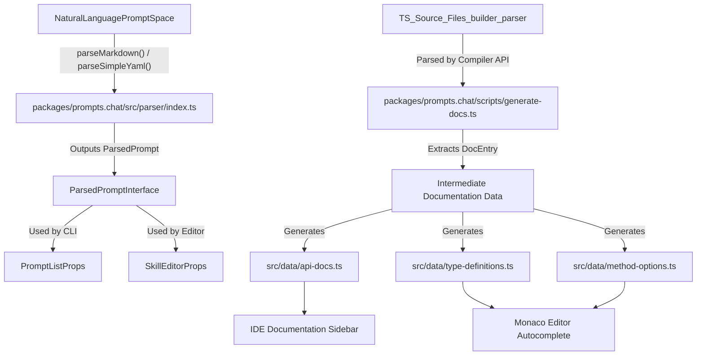
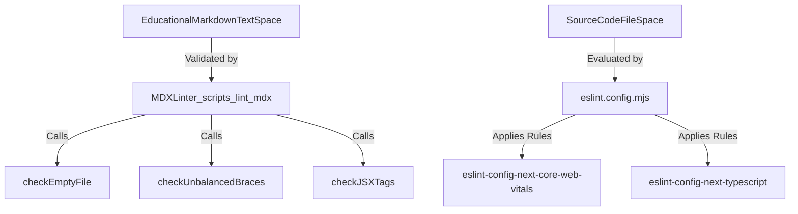
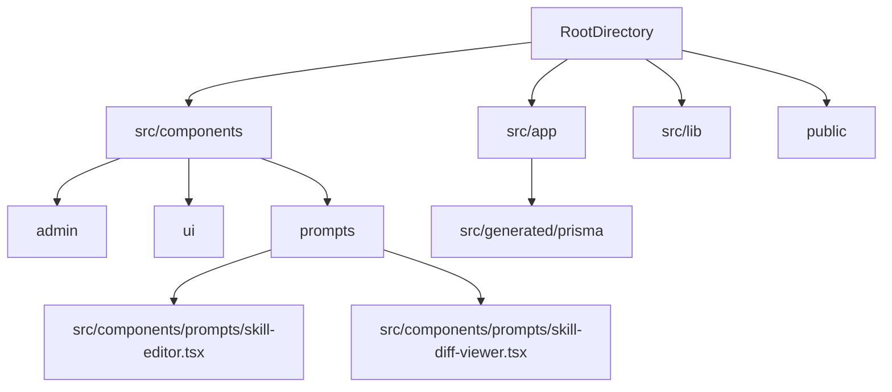
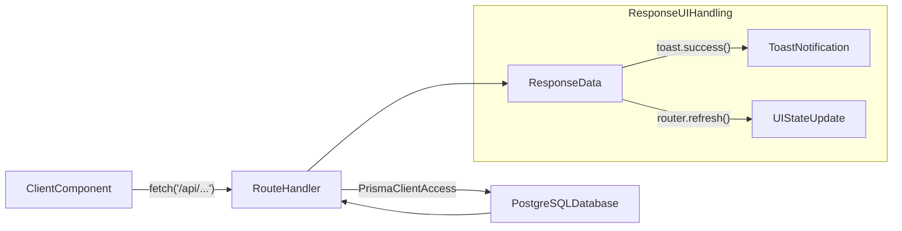

<!-- source: DeepWiki mcp.deepwiki.com · repo f/prompts.chat · page 14.2 Code Standards · fetched 2026-11-09 -->

# Code Standards

Relevant source files

The following files were used as context for generating this wiki page:

- [.github/ISSUE_TEMPLATE/config.yml](.github/ISSUE_TEMPLATE/config.yml)
- [CONTRIBUTING.md](CONTRIBUTING.md)
- [eslint.config.mjs](eslint.config.mjs)
- [packages/prompts.chat/scripts/generate-docs.ts](packages/prompts.chat/scripts/generate-docs.ts)
- [packages/prompts.chat/src/builder/index.ts](packages/prompts.chat/src/builder/index.ts)
- [packages/prompts.chat/src/cli/components/PromptList.tsx](packages/prompts.chat/src/cli/components/PromptList.tsx)
- [packages/prompts.chat/src/parser/index.ts](packages/prompts.chat/src/parser/index.ts)
- [src/components/ide/examples/generated.ts](src/components/ide/examples/generated.ts)
- [src/components/prompts/skill-diff-viewer.tsx](src/components/prompts/skill-diff-viewer.tsx)
- [src/components/prompts/skill-editor.tsx](src/components/prompts/skill-editor.tsx)
- [src/data/api-docs.ts](src/data/api-docs.ts)
- [src/data/method-options.ts](src/data/method-options.ts)
- [src/data/type-definitions.ts](src/data/type-definitions.ts)

This page explains the coding standards, ESLint configuration, custom MDX linting scripts, formatting rules, and Pull Request (PR) guidelines enforced across the `prompts.chat` codebase to ensure maintainability, type safety, and code consistency.

---

## Overview & Scope

The `prompts.chat` project enforces coding standards through automated static analysis, linting, formatting, and strict type checking. These guidelines cover all source code, API routes, React components, and MDX educational content files.

Sources: [eslint.config.mjs:1-46](), [packages/prompts.chat/scripts/generate-docs.ts:1-1261]()

---

## TypeScript & Type Safety

The codebase is implemented entirely in **TypeScript** with strict type checking enabled to prevent runtime errors and ensure strict API contracts.

- **Strict Mode**: Configured via `tsconfig.json` to disallow implicit `any` and enforce strict null checks.
- **Runtime Validation**: External payloads and configuration objects are validated using Zod schemas and parser utilities (e.g., `ParsedPrompt` interface in [packages/prompts.chat/src/parser/index.ts:28-46]()).
- **Explicit Typing**: All exported functions, API handlers, and React component props define explicit types or interfaces (e.g., `PromptListProps` in [packages/prompts.chat/src/cli/components/PromptList.tsx:7-18]() and `SkillEditorProps` in [src/components/prompts/skill-editor.tsx:38-42]()).

### Type System & Parsing Pipeline

The project uses a robust system for generating type definitions and API documentation from TypeScript source files. The `generate-docs.ts` script [packages/prompts.chat/scripts/generate-docs.ts:1-1261]() parses TypeScript files to extract information about interfaces, types, functions, and classes, including JSDoc comments for descriptions, parameters, and examples. This information is then used to generate:
- **API Documentation**: Stored in `src/data/api-docs.ts` [src/data/api-docs.ts:1-3337](), which powers the in-IDE documentation sidebar.
- **Type Definitions**: Stored in `src/data/type-definitions.ts` [src/data/type-definitions.ts:1-948](), providing rich autocomplete and type hints for the prompt builders.
- **Method Options**: Stored in `src/data/method-options.ts` [src/data/method-options.ts:1-37](), used for Monaco editor autocompletion.

### Diagram: Type System & Parsing Pipeline (Natural Language to Code Entity Space)

Sources: [packages/prompts.chat/scripts/generate-docs.ts:1-1261](), [src/data/api-docs.ts:1-3337](), [src/data/type-definitions.ts:1-948](), [src/data/method-options.ts:1-37](), [packages/prompts.chat/src/parser/index.ts:28-46](), [packages/prompts.chat/src/cli/components/PromptList.tsx:7-18](), [src/components/prompts/skill-editor.tsx:38-42]()

---

## Linting, Formatting & Static Analysis

### ESLint Configuration

Static analysis is driven by **ESLint 9**, integrating Next.js core web vitals and TypeScript rules. The setup is defined in `eslint.config.mjs`.

- **Presets**: Extends `eslint-config-next/core-web-vitals` and `eslint-config-next/typescript` [eslint.config.mjs:6-7]().
- **Global Ignores**: Excludes build outputs, generated Prisma code, raycast extensions, and migration scripts via `globalIgnores()` [eslint.config.mjs:9-23]().
- **Rule Downgrades**: To facilitate gradual adoption, strict rules are downgraded to warnings. For example, `react-hooks/set-state-in-effect` and `@typescript-eslint/no-unsafe-function-type` are set to `warn` [eslint.config.mjs:28-36]().

Sources: [eslint.config.mjs:1-46]()

### MDX Linting Pipeline

Educational content authored in MDX is validated via lint scripts to ensure proper JSX syntax and formatting.

- **MDXLinter Class**: Manages file reading and executing verification passes across MDX files [packages/prompts.chat/scripts/generate-docs.ts:1-1261]().
- **Checks**:
  - `checkEmptyFile()`: Catches empty MDX content.
  - `checkUnbalancedBraces()`: Validates matching `{}` and `[]` outside code blocks.
  - `checkJSXTags()`: Validates component pairing against self-closing and block components.

### Diagram: MDX Linter & Static Analysis Entity Flow (Natural Language to Code Entity Space)

Sources: [eslint.config.mjs:1-46](), [packages/prompts.chat/scripts/generate-docs.ts:1-1261]()

---

## File and Directory Conventions

### Naming Patterns

| File Type | Convention | Example |
|---|---|---|
| Page Routes | `page.tsx` | `src/app/page.tsx` |
| API Routes | `route.ts` | `src/app/api/mcp/route.ts` |
| UI Components | `kebab-case.tsx` | `src/components/prompts/skill-editor.tsx` |
| Utilities | `kebab-case.ts` | `src/lib/utils.ts` |
| Tests | `*.test.ts` | `src/__tests__/lib/utils.test.ts` |

### Diagram: Directory Mapping

Sources: [src/components/prompts/skill-editor.tsx:1-556](), [src/components/prompts/skill-diff-viewer.tsx:1-376]()

---

## API Route Standards

API endpoints under `src/app/api/` adhere to Next.js App Router route handler specifications.

- **Method Exports**: Handlers export explicit HTTP verb functions (`GET`, `POST`, `DELETE`).
- **Error Responses**: Standardized JSON error responses with appropriate HTTP status codes (200, 201, 401, 500).
- **Client Synchronization**: Mutations trigger `router.refresh()` on the client to re-fetch Server Component states.

### Diagram: Client-Server Interaction

Sources: [eslint.config.mjs:1-46]()

---

## Pull Request Guidelines

1. **Prompt Submissions**: Web interface contributions automatically handle author attribution and repository synchronization via the website automation [CONTRIBUTING.md:7-12]().
2. **Testing**: Code changes and bug fixes must include unit or integration tests verified via CI [CONTRIBUTING.md:25-31]().
3. **Linting Compliance**: All PRs must pass ESLint and MDX linter checks without errors [eslint.config.mjs:1-46]().
4. **Environment Secrets**: Never commit `.env`, `.env.local`, or build plugins; rely on `.env.example` templates.

Sources: [CONTRIBUTING.md:1-39](), [eslint.config.mjs:1-46]()

---

## Summary

The `prompts.chat` code standards enforce strict type safety, automated linting for code and MDX documentation, consistent directory structures, and structured PR validation workflows to maintain a robust open-source codebase.

Sources: [eslint.config.mjs:1-46](), [CONTRIBUTING.md:1-39](), [packages/prompts.chat/scripts/generate-docs.ts:1-1261]()

---

