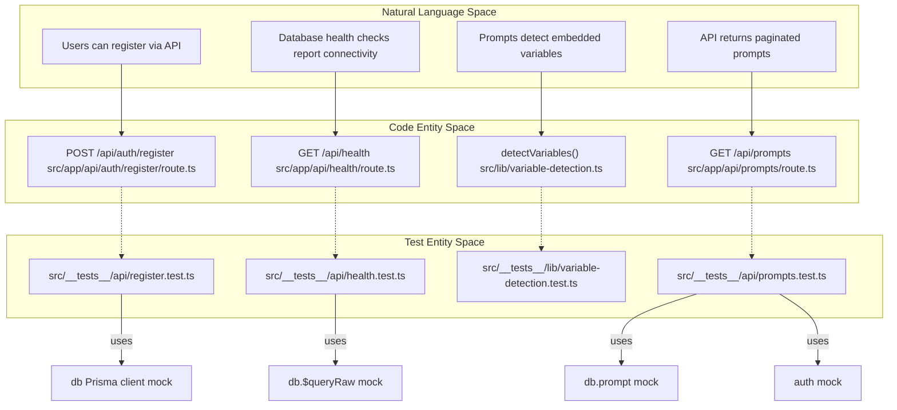
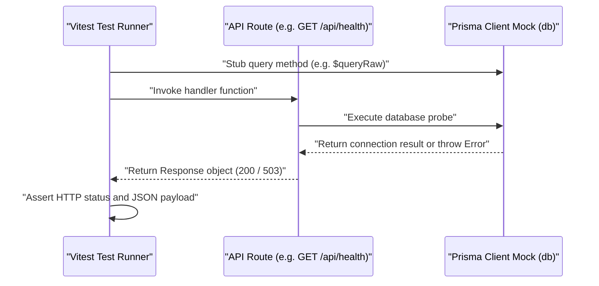

<!-- source: DeepWiki mcp.deepwiki.com · repo f/prompts.chat · page 14.3 Testing · fetched 2026-11-09 -->

# Testing

Relevant source files

The following files were used as context for generating this wiki page:

- [src/__tests__/api/health.test.ts](src/__tests__/api/health.test.ts)
- [src/__tests__/api/prompts.test.ts](src/__tests__/api/prompts.test.ts)
- [src/__tests__/api/register.test.ts](src/__tests__/api/register.test.ts)
- [src/__tests__/lib/date.test.ts](src/__tests__/lib/date.test.ts)
- [src/__tests__/lib/format.test.ts](src/__tests__/lib/format.test.ts)
- [src/__tests__/lib/prompt-list.test.ts](src/__tests__/lib/prompt-list.test.ts)
- [src/__tests__/lib/utils.test.ts](src/__tests__/lib/utils.test.ts)
- [src/__tests__/lib/variable-detection.test.ts](src/__tests__/lib/variable-detection.test.ts)
- [src/app/workflows/page.tsx](src/app/workflows/page.tsx)
- [src/lib/prompt-list.ts](src/lib/prompt-list.ts)
- [vitest.setup.ts](vitest.setup.ts)

This page documents the testing infrastructure, verification patterns, and execution environments for the prompts.chat codebase. It covers the test framework configuration in `vitest.config.ts` (implied by runner configuration) and `vitest.setup.ts` [vitest.setup.ts:1-112](), test organization across API routes, libraries, components, and layouts, coverage reporting via V8, and continuous integration workflows.

For related development standards, see [Code Standards](). For contribution workflows, see [Contribution Workflow]().

Sources: [vitest.setup.ts:1-112]()

---

## Test Framework & Configuration

The prompts.chat codebase uses **Vitest** as its primary test runner and assertion framework, integrated with React testing plugins for component rendering support. Vitest offers native TypeScript execution, fast ESM loading, and a Jest-compatible API.

The configuration environment sets up:
- **Environment**: Set to `jsdom` to simulate a browser DOM context for component and UI tests.
- **Setup Files**: Executes `./vitest.setup.ts` prior to test suites [vitest.setup.ts:9-17]().
- **Test File Matching**: Includes all files matching `src/**/*.{test,spec}.{ts,tsx}`.
- **Path Aliases**: Maps `@/` to `./src` to match Next.js import conventions.

Sources: [vitest.setup.ts:1-112]()

---

## Test Execution Commands

Key test execution tasks are structured around Vitest CLI flags:

| Script / Command | Description |
|------------------|-------------|
| `vitest run` | Execute all test suites once and exit |
| `vitest` | Run tests in interactive watch mode |
| `vitest --ui` | Launch Vitest browser-based dashboard |
| `vitest run --coverage` | Generate code coverage metrics via V8 provider |

Sources: [vitest.setup.ts:1-112]()

---

## Global Test Setup & Mocks

All unit and integration tests initialize within the environment configured in `vitest.setup.ts`. This file intercepts global mocks, Next.js routing and headers, stubs the Prisma client, and provides default configuration mocks.

### Mock Categories in `vitest.setup.ts`
- **Console Silencing**: Overrides `console.error` and `console.log` during test runs to suppress expected error-handling noise [vitest.setup.ts:4-17]().
- **Environment Stubs**: Sets dummy values for `NEXTAUTH_SECRET`, `NEXTAUTH_URL`, and `DATABASE_URL` [vitest.setup.ts:19-23]().
- **Next.js Modules**: Mocks `next/navigation` (`useRouter`, `useSearchParams`, `redirect`, `notFound`), `next/headers` (`cookies`, `headers`), and `next-intl` localization hooks [vitest.setup.ts:24-64]().
- **Prisma Client (`db`)**: Provides `vi.fn()` method stubs for database models (`user`, `prompt`, `category`) as well as raw queries (`$queryRaw`, `$executeRaw`) and transactions (`$transaction`) [vitest.setup.ts:66-99]().
- **Configuration (`getConfig`)**: Mocks application config loading to permit unauthenticated test contexts [vitest.setup.ts:101-112]().

Sources: [vitest.setup.ts:1-112]()

---

## Testing Stack Architecture

The testing infrastructure bridges requirements expressed in natural language to specific code entities and test modules.

### Test Entity Mapping Diagram

Sources: [src/__tests__/api/register.test.ts:1-16](), [src/__tests__/api/health.test.ts:1-11](), [src/__tests__/lib/variable-detection.test.ts:1-8](), [src/__tests__/api/prompts.test.ts:1-27]()

---

## Test Implementation Patterns

Tests are organized into API route integration tests, component tests, and utility unit tests.

### API Route & Endpoint Testing

API route handlers are tested directly by passing constructed `Request` objects and evaluating returned `Response` payloads and status codes.

- **Registration API (`POST /api/auth/register`)**: Validates payload fields (name, username, email, password rules), checks registration feature flags, and verifies handling of Prisma unique constraint violations (`P2002`) [src/__tests__/api/register.test.ts:49-223]().
- **Health Check API (`GET /api/health`)**: Verifies healthy (200 OK) responses when `db.$queryRaw` succeeds and unhealthy (503 Service Unavailable) responses when database connections throw errors [src/__tests__/api/health.test.ts:12-66]().
- **Prompts API (`GET /api/prompts`)**: Tests pagination, filtering by type, category, and search query, and ensures correct exclusion of bot/classifier prompts by default [src/__tests__/api/prompts.test.ts:55-216]().

Sources: [src/__tests__/api/register.test.ts:49-223](), [src/__tests__/api/health.test.ts:12-66](), [src/__tests__/api/prompts.test.ts:55-216]()

### Library & Utility Unit Testing

Pure functions and helper libraries are tested under isolated conditions.

- **Date Formatting (`src/__tests__/lib/date.test.ts`)**: Uses Vitest fake timers (`vi.useFakeTimers()`) to verify relative date calculations (`formatDistanceToNow`, `formatDate`) across multiple locales (`en`, `tr`, `es`, `zh`, `ja`, `ar`) [src/__tests__/lib/date.test.ts:1-147]().
- **Variable Detection (`src/__tests__/lib/variable-detection.test.ts`)**: Asserts correct extraction of prompt variables across different syntaxes (`[[...]]`, `{{...}}`, `[...]`, `{...}`, `<...>`, `%...%`) while filtering out HTML tags and programming keywords [src/__tests__/lib/variable-detection.test.ts:1-192]().
- **Utility Helpers (`src/__tests__/lib/utils.test.ts`)**: Tests CSS class merging via `cn()`, LIKE pattern escaping via `escapeLikePattern()`, and browser user-agent sniffing via `isChromeBrowser()` with stubbed global environments [src/__tests__/lib/utils.test.ts:1-129]().
- **Prompt List Helpers (`src/__tests__/lib/prompt-list.test.ts`)**: Verifies the `trendingPromptListWhere` and `promptListTypeWhere` functions correctly construct Prisma `where` clauses for filtering prompts, specifically handling the exclusion of `BOT` and `CLASSIFIER` types [src/__tests__/lib/prompt-list.test.ts:1-28]().
- **JSON Formatting (`src/__tests__/lib/format.test.ts`)**: Tests `prettifyJson` for correct indentation and `isValidJson` for accurate validation of JSON strings, including handling of malformed input [src/__tests__/lib/format.test.ts:1-161]().

Sources: [src/__tests__/lib/date.test.ts:1-147](), [src/__tests__/lib/variable-detection.test.ts:1-192](), [src/__tests__/lib/utils.test.ts:1-129](), [src/__tests__/lib/prompt-list.test.ts:1-28](), [src/__tests__/lib/format.test.ts:1-161]()

---

### Data Flow in API Tests

Sources: [src/__tests__/api/health.test.ts:12-66]()

---

## Coverage and Continuous Integration

### Coverage Reporting

Test coverage is measured via V8 by executing coverage flags. Exclusions are configured for build outputs, type definitions, and test configuration files to ensure accurate metrics on source code.

Sources: [vitest.setup.ts:1-112]()

### CI Pipeline Integration

Automated checks run on every push and pull request via GitHub Actions workflows, executing dependency installation, linting, and Vitest execution.

Sources: [vitest.setup.ts:1-112]()

---

## Summary

| Testing Aspect | Implementation Details |
|----------------|------------------------|
| Framework | Vitest + `@testing-library/jest-dom` with React support |
| Global Mocks | Next.js navigation/headers, Prisma client, Config [vitest.setup.ts:24-112]() |
| API Testing | Route handlers invoked with Request objects and mocked DB/Auth |
| Unit Testing | Pure functions (`date`, `variable-detection`, `utils`, `prompt-list`, `format`) |
| Coverage | V8 provider with text, json, and html reporters |

Sources: [vitest.setup.ts:1-112]()

---

