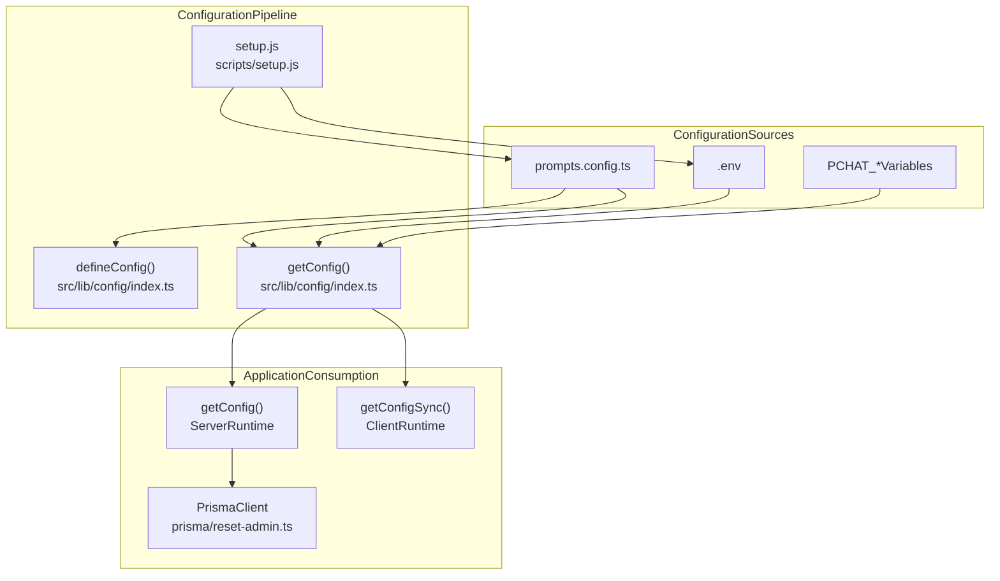
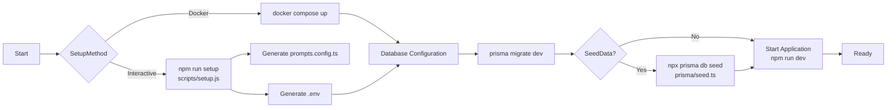
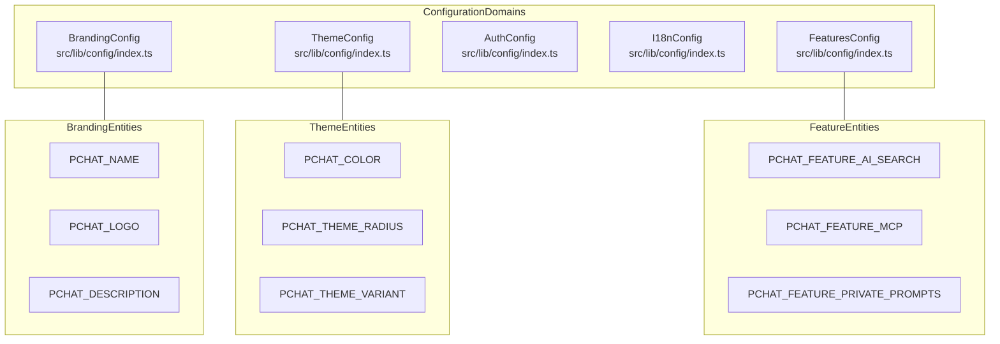
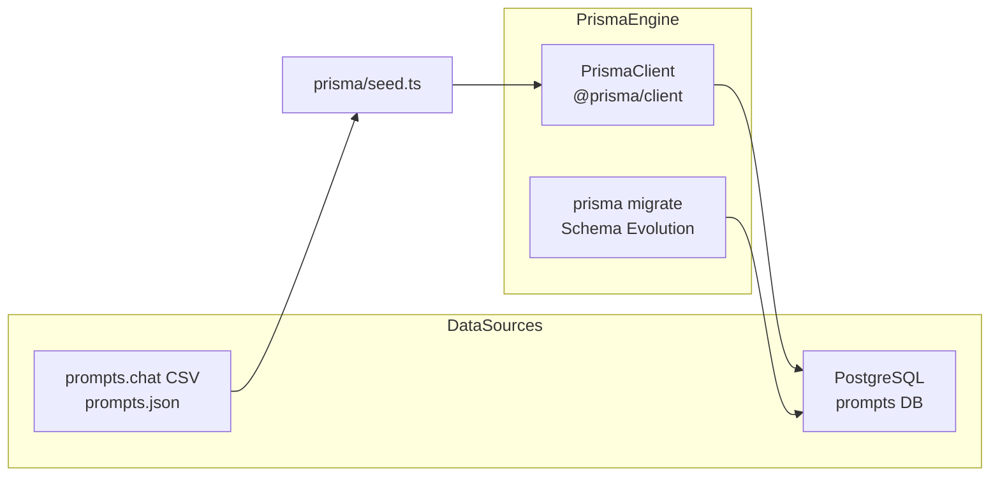

<!-- source: DeepWiki mcp.deepwiki.com · repo f/prompts.chat · page 2 Getting Started · fetched 2026-11-09 -->

# Getting Started

<details>
<summary>Relevant source files</summary>

The following files were used as context for generating this wiki page:

- [package-lock.json](package-lock.json)
- [package.json](package.json)
- [prisma/reset-admin.ts](prisma/reset-admin.ts)
- [scripts/setup.js](scripts/setup.js)

</details>


This page serves as the parent overview for initial setup and configuration guides for `prompts.chat`. It outlines basic setup pathways, the configuration system architecture, database prerequisites, and runtime requirements.

As a parent page, this document provides a high-level architectural view. For detailed installation steps and software requirements, see [Prerequisites & Installation](#2.1). For local development workflow and database migrations, see [Local Development Setup](#2.2). For configuration options and variables, see [Configuration Quickstart](#2.3). For containerized deployment, see [Docker Quick Start](#2.4).

Sources: [package.json:5-123]()

## Setup Paths

`prompts.chat` supports multiple deployment and setup pathways depending on the operational environment:

| Mode | Use Case | Entry Point | Configuration Method |
|------|----------|-------------|---------------------|
| **Local Development** | Development, testing, and customization | `npm install` + `npm run dev` [package.json:5-6]() | Interactive wizard or manual editing |
| **Docker (Self-Hosted)** | Production deployment, single-container | Environment variables (`PCHAT_*`) | `compose.yml` and environment file |
| **Production Build** | Custom production deployment | `npm run build` + `npm start` [package.json:7-9]() | Config file and environment variables |

Each path utilizes the core configuration loader but differs in how variables and persistent data are supplied. For details, see [Prerequisites & Installation](#2.1) and [Docker Quick Start](#2.4).

Sources: [package.json:5-9]()

## Configuration Architecture

The configuration pipeline combines a base TypeScript configuration file (`prompts.config.ts`) with environment variable overrides. For private clones, an interactive setup script handles generation of both files.

### Configuration Flow (Natural Language to Code Entity)


**Configuration Flow Details:**
1. **[scripts/setup.js:95-164]()** — The `generateConfig` function creates the `prompts.config.ts` file based on interactive user inputs during setup.
2. **[src/lib/config/index.ts]()** — Configurations use the `defineConfig` helper to organize branding, theme, and feature flags.
3. **[src/lib/config/index.ts]()** — At runtime, `PCHAT_` prefixed environment variables override specific domains.

For a deep dive into configuration parameters, see [Configuration Quickstart](#2.3).

Sources: [scripts/setup.js:95-164](), [src/lib/config/index.ts]()

## Setup Workflow

### Initialization Sequence


For detailed setup instructions, see [Local Development Setup](#2.2) and [Docker Quick Start](#2.4).

Sources: [scripts/setup.js:171-258](), [package.json:11-19]()

## Core Configuration Domains

The application divides configuration into distinct functional domains. These can be adjusted directly in `prompts.config.ts` or via environment overrides.

### Configuration Entity Mapping (Natural Language to Code Entity)


**Environment Variable Override Examples:**
* Branding: `PCHAT_NAME` overrides `branding.name`
* Theme: `PCHAT_COLOR` overrides `theme.colors.primary`
* Features: `PCHAT_FEATURE_MCP` overrides `features.mcp`

For further details, see [Configuration Quickstart](#2.3).

Sources: [src/lib/config/index.ts]()

## Database Requirements

`prompts.chat` relies on PostgreSQL and uses Prisma as its ORM layer [package.json:46]().

### Database Interaction Layer


**Database Scripts:**
* `npm run db:setup` — Generates client, runs migrations, and executes seeding [package.json:21-21]()
* `npm run db:migrate` — Applies developmental migrations [package.json:12-12]()
* `npm run db:seed` — Populates initial categories, tags, and prompts [package.json:15-15]()
* `npm run db:resetadmin` — Resets the administrative account credentials [prisma/reset-admin.ts:6-31]()

For comprehensive database management guides, see [Local Development Setup](#2.2).

Sources: [package.json:12-21](), [prisma/reset-admin.ts:6-31]()

## Node.js Version Requirement

The application strictly enforces **Node.js 24.x** as configured in package engines [package.json:121-123]().

```json
{
  "engines": {
    "node": "24.x"
  }
}
```

For software prerequisites, see [Prerequisites & Installation](#2.1).

Sources: [package.json:121-123]()

## Initial Admin Account

Running database seeding provisions a default administrative user:
* **Email:** `admin@prompts.chat` [prisma/reset-admin.ts:18-18]()
* **Username:** `admin` [prisma/reset-admin.ts:19-19]()
* **Password:** `password123` [prisma/reset-admin.ts:9-9]()
* **Role:** `ADMIN` [prisma/reset-admin.ts:22-22]()

Sources: [prisma/reset-admin.ts:9-22]()

## Next Steps

For detailed instructions tailored to a specific deployment strategy, refer to the child pages:
- For software requirements and installation steps, see [Prerequisites & Installation](#2.1)
- For setting up the local repository and runner, see [Local Development Setup](#2.2)
- For configuration settings and environment variables, see [Configuration Quickstart](#2.3)
- For containerized execution, see [Docker Quick Start](#2.4)

Sources: [package.json:5-123](), [scripts/setup.js:95-258](), [prisma/reset-admin.ts:6-31]()

---

