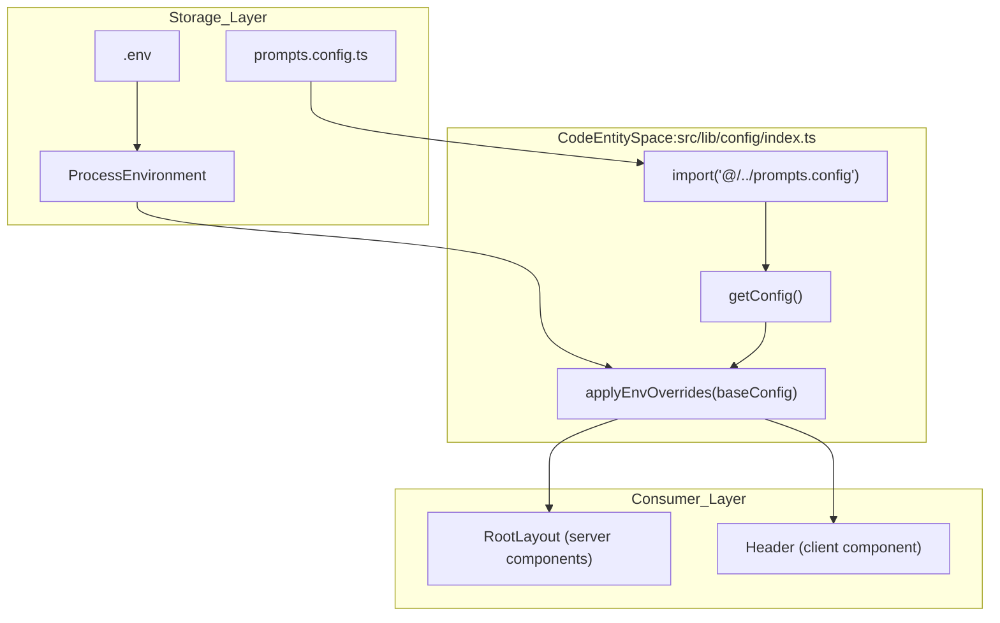
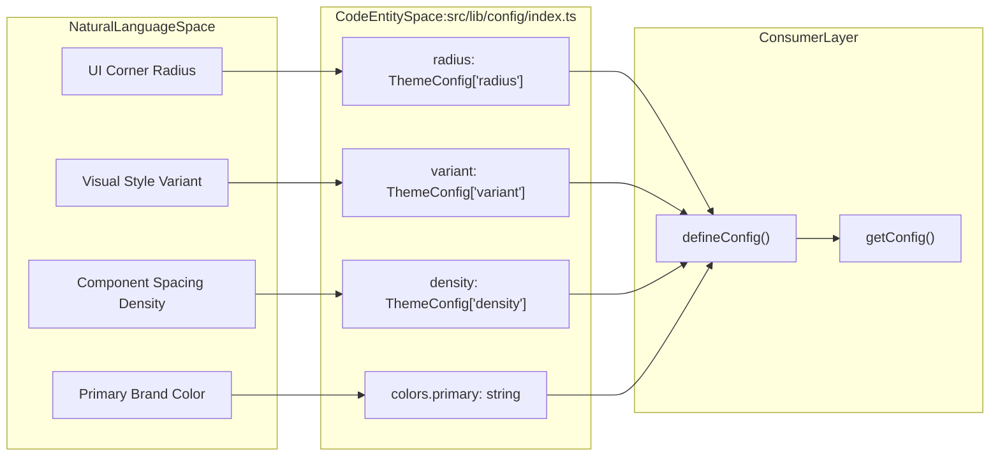
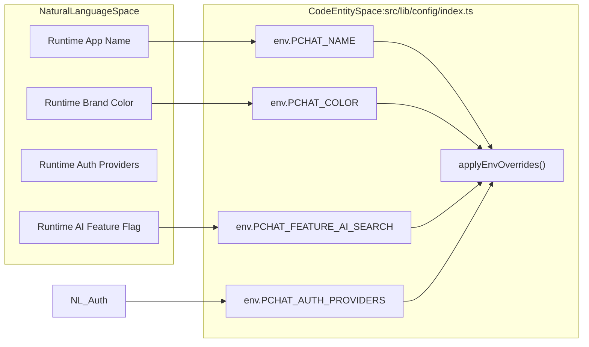

<!-- source: DeepWiki mcp.deepwiki.com · repo f/prompts.chat · page 2.3 Configuration Quickstart · fetched 2026-11-09 -->

# Configuration Quickstart

<details>
<summary>Relevant source files</summary>

The following files were used as context for generating this wiki page:

- [.env.example](.env.example)
- [package-lock.json](package-lock.json)
- [package.json](package.json)
- [prisma/reset-admin.ts](prisma/reset-admin.ts)
- [prompts.config.ts](prompts.config.ts)
- [scripts/setup.js](scripts/setup.js)
- [src/app/layout.tsx](src/app/layout.tsx)
- [src/components/layout/announcement-banner.tsx](src/components/layout/announcement-banner.tsx)
- [src/components/layout/header.tsx](src/components/layout/header.tsx)
- [src/components/ui/masonry.tsx](src/components/ui/masonry.tsx)
- [src/lib/config/index.ts](src/lib/config/index.ts)
- [src/lib/db.ts](src/lib/db.ts)
- [src/lib/i18n/config.ts](src/lib/i18n/config.ts)

</details>


This page guides you through the configuration of a `prompts.chat` instance using the `prompts.config.ts` file, environment variables, and the interactive setup wizard. This system allows extensive white-labeling, theming, and feature toggling for customizable deployments.

---

## Purpose and Scope

The configuration system cleanly separates core application code from instance-specific settings. It enables:

- **White-labeling**: Customize branding (name, logos, description) exposed across the UI and metadata via the `BrandingConfig` interface [src/lib/config/index.ts:1-9]().
- **Theme Customization**: Configure UI radius, variant, density, and primary colors using `ThemeConfig` [src/lib/config/index.ts:11-22]().
- **Authentication Setup**: Enable one or more auth providers with registration control in `AuthConfig` [src/lib/config/index.ts:24-32]().
- **Internationalization**: Define supported locales and defaults through `I18nConfig` [src/lib/config/index.ts:34-37]().
- **Feature Flags**: Toggle features like AI search, MCP integration, comments, and change request workflows via `FeaturesConfig` [src/lib/config/index.ts:39-49]().
- **Runtime Configuration Overrides**: Use environment variables prefixed by `PCHAT_` to override config properties without rebuilding [src/lib/config/index.ts:117-185]().

Sources: [src/lib/config/index.ts:1-185](), [prompts.config.ts:1-106]()

---

## Configuration Data Flow

Configuration resolution occurs in three layers:

1. **Static Source Layer**: `prompts.config.ts`, `.env` file, and runtime environment variables.
2. **Config Loading Logic**: `getConfig()` dynamically imports the configuration and `applyEnvOverrides()` applies runtime `PCHAT_*` overrides [src/lib/config/index.ts:102-185]().
3. **Consuming Layers**: Server and client components fetch the configuration via `getConfig()` or synchronous access helpers [src/lib/config/index.ts:187-245]().

### Diagram: Configuration Resolution Pipeline



Sources: [src/lib/config/index.ts:102-245](), [prompts.config.ts:1-106]()

---

## The `prompts.config.ts` Structure

The configuration file exports a default object via the `defineConfig()` helper ensuring proper typing and structure compliance with `PromptsConfig` [src/lib/config/index.ts:86-99]().

```ts
import { defineConfig } from "@/lib/config";

const useCloneBranding = false;

export default defineConfig({
  branding: { /* ... */ },
  theme: { /* ... */ },
  auth: { /* ... */ },
  i18n: { /* ... */ },
  features: { /* ... */ },
  homepage: { /* ... */ },
  announcement: null,
});
```

### Branding & Homepage Configuration

The `branding` section controls the application's identity:

| Property             | Type     | Description                                                                                   |
|----------------------|----------|-----------------------------------------------------------------------------------------------|
| `name`               | string   | Site title used in page `<title>`, header branding, meta descriptions.                        |
| `logo`               | string   | Path to light mode logo asset used in header and favicon fallback.                           |
| `logoDark`           | string?  | Optional dark mode logo override.                                                            |
| `favicon`            | string   | Path to favicon, used in browser tab icon.                                                  |
| `description`        | string   | Meta description for SEO and social sharing.                                                |
| `appStoreUrl`        | string?  | Link to iOS App Store (optional).                                                           |
| `chromeExtensionUrl` | string?  | Link to Chrome extension in the Chrome Web Store (optional).                               |

The `homepage.useCloneBranding` boolean flag controls hiding the default prompts.chat repository branding, replacing it with custom branding for private clones. If `true`, achievements and sponsors environment from the official repo are disabled.

Sources: [src/lib/config/index.ts:1-9](), [prompts.config.ts:3-18,70-92]()

### Theme System

The `theme` section defines the visual style across the application UI using these properties:

| Property         | Allowed Values                   | Description                                             |
|------------------|----------------------------------|---------------------------------------------------------|
| `radius`         | `"none" | "sm" | "md" | "lg"`   | Controls border-radius of UI elements.                   |
| `variant`        | `"flat" | "default" | "brutal"` | Defines visual styling variant for components.         |
| `density`        | `"compact" | "default" | "comfortable"` | Controls overall UI vertical/horizontal spacing.             |
| `colors.primary` | hex color or CSS oklch           | Primary brand color used globally in themes/buttons.    |

### Diagram: Natural Language to Code Entity Mapping: Theme



Sources: [src/lib/config/index.ts:11-22](), [prompts.config.ts:21-32]()

### Authentication Plugins

The `auth` property configures authentication providers enabling user login:

| Property           | Type            | Description                                                     |
|--------------------|-----------------|-----------------------------------------------------------------|
| `providers`        | string[]        | Activated auth providers, e.g., `["github", "google", "apple"]`. |
| `allowRegistration`| boolean         | Whether new users can register (only affects credentials auth).  |

Sources: [src/lib/config/index.ts:24-32](), [prompts.config.ts:35-41]()

### Internationalization (i18n)

The i18n configuration sets locale options:

| Property        | Type       | Description                                                            |
|-----------------|------------|------------------------------------------------------------------------|
| `locales`       | string[]   | List of supported language locale codes, e.g., `["en", "tr", "es"]`.  |
| `defaultLocale` | string     | Default locale used if none specified.                                |

Sources: [src/lib/config/index.ts:34-37](), [src/lib/i18n/config.ts:1-24](), [prompts.config.ts:43-47]()

### Feature Flags

Feature flags enable or disable core capabilities:

| Flag              | Description                                                    |
|-------------------|----------------------------------------------------------------|
| `privatePrompts`  | Allow users to create private, undiscoverable prompts.        |
| `changeRequests`  | Enable community change request versioning workflow.          |
| `categories`      | Enable prompt categorization.                                 |
| `tags`            | Enable tagging system on prompts.                             |
| `aiSearch`        | Enable AI semantic prompt search (requires OpenAI key).       |
| `aiGeneration`    | Enable AI-powered prompt generation features.                  |
| `mcp`             | Enable Model Context Protocol API features.                    |
| `comments`        | Enable commenting on prompts.                                  |
| `promptEnhancer`  | Enable the AI Prompt Enhancer on `/developers` and `/api/improve-prompt` endpoint (requires OpenAI key). |

Sources: [src/lib/config/index.ts:39-49](), [prompts.config.ts:49-68]()

---

## Environment Variable Configuration (`.env`)

The `.env` file holds sensitive data and infrastructure URLs that must not be checked into source control. The interactive setup wizard generates this file securely.

### Core `.env` Variables

| Variable       | Description                                    | Origin                                    |
|----------------|------------------------------------------------|-------------------------------------------|
| `DATABASE_URL` | PostgreSQL connection URI for Prisma.          | Generated by setup wizard |
| `NEXTAUTH_SECRET`  | Secret used for session encryption and hashing.| Created randomly by setup wizard |
| `NEXTAUTH_URL` | Base URL for the app (http or https).          | Based on domain input |
| `CRON_SECRET`  | Secret used to protect scheduled cron jobs.   | Random 16-byte hex string |

Sources: [.env.example:1-115]()

### Runtime Overrides with `PCHAT_*`

You can override parts of the static configuration at runtime using environment variables prefixed with `PCHAT_`. These are processed by the `applyEnvOverrides` function [src/lib/config/index.ts:118-187]().

### Diagram: Natural Language to Code Entity Mapping: Runtime Overrides



Sources: [src/lib/config/index.ts:117-185]()

---

## Interactive Setup Wizard

`prompts.chat` provides an interactive CLI setup script for smooth user-guided configuration.

### Usage

Run the setup wizard after installing dependencies:

```bash
npm run setup
```

### Key Features

- **Domain Configuration**: Asks for app domain to set `NEXTAUTH_URL`.
- **Database Connection**: Requests PostgreSQL host, port, database name, username, and password to generate `DATABASE_URL`.
- **Branding**: Prompts for organization/app name and description.
- **Theme Customization**: Pick radius, variant, density, primary color.
- **Authentication Providers**: Choose from GitHub, Google, Apple, Azure, and Credentials providers.
- **Feature Toggles**: Enable or disable AI search/generation, change requests, comments, etc.
- **Secrets Generation**: Generates strong random `NEXTAUTH_SECRET` and `CRON_SECRET`.

Sources: [scripts/setup.js:1-599](), [package.json:22-22]()

---

## Implementation Details

### `src/lib/config/index.ts`

- Defines interfaces describing config sections: `BrandingConfig`, `ThemeConfig`, `AuthConfig`, `I18nConfig`, `FeaturesConfig`, `HomepageConfig`, `AnnouncementConfig` [src/lib/config/index.ts:1-95]().
- Exports `defineConfig()` helper for type-safe configuration authoring [src/lib/config/index.ts:97-99]().
- Caches config in `cachedConfig` to avoid repeated dynamic imports [src/lib/config/index.ts:101-103]().
- `getConfig()` asynchronously imports `prompts.config.ts`, falls back to defaults if missing, and calls `applyEnvOverrides()` [src/lib/config/index.ts:189-220]().
- `applyEnvOverrides()` function processes `PCHAT_*` environment variables to dynamically alter the configuration [src/lib/config/index.ts:118-187]().

Sources: [src/lib/config/index.ts:1-245](), [prompts.config.ts:1-106]()

---

