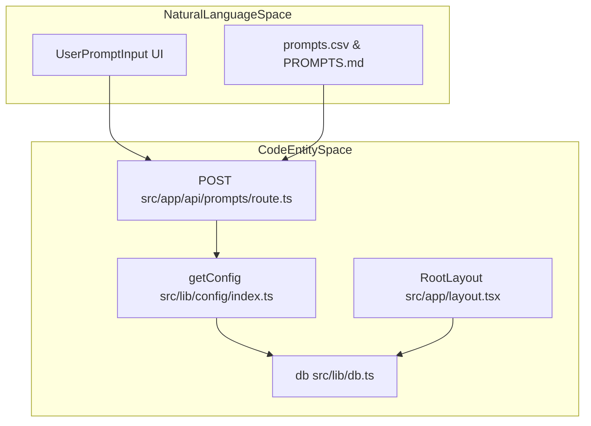
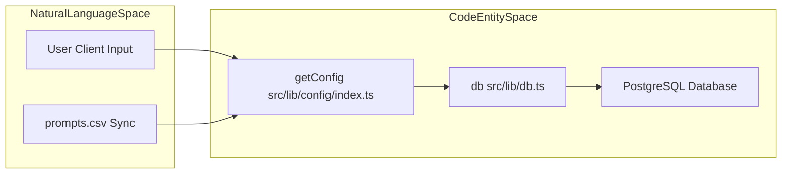

<!-- source: DeepWiki mcp.deepwiki.com · repo f/prompts.chat · page 3 Core Architecture · fetched 2026-11-09 -->

# Core Architecture

Relevant source files

The following files were used as context for generating this wiki page:

- [.env.example](.env.example)
- [prompts.config.ts](prompts.config.ts)
- [src/app/layout.tsx](src/app/layout.tsx)
- [src/components/layout/announcement-banner.tsx](src/components/layout/announcement-banner.tsx)
- [src/components/layout/header.tsx](src/components/layout/header.tsx)
- [src/components/ui/masonry.tsx](src/components/ui/masonry.tsx)
- [src/lib/config/index.ts](src/lib/config/index.ts)
- [src/lib/db.ts](src/lib/db.ts)
- [src/lib/i18n/config.ts](src/lib/i18n/config.ts)

## Purpose and Scope

This page serves as the parent overview for core system architecture concepts in `prompts.chat`. It establishes the high-level design patterns, persistence strategy, configuration pipeline, and component relationships that bridge natural language prompt engineering with a robust technical stack.

For detailed information on specific architectural sub-topics, refer to the child pages:
- CSV synchronization and attribution mechanics: see [CSV Sync System & Contributor Attribution](#3.1)
- Next.js App Router layout and file organization: see [Application Structure](#3.2)
- Configuration loading pipeline and environment variables: see [Configuration System](#3.3)
- Prisma ORM models and relationship graphs: see [Database Schema](#3.4)
- Plugin architecture for storage, auth, and media generation: see [Plugin Architecture](#3.5)

---

## Architectural Principles

`prompts.chat` relies on three fundamental design pillars:

1.  **Dual Persistence Model**: Prompts are stored in a relational PostgreSQL database accessed through Prisma ORM in `src/lib/db.ts` [src/lib/db.ts:1-27]() for efficient queries and transactional integrity, while simultaneously syncing with flat-file CSVs (`prompts.csv`) and Markdown (`PROMPTS.md`) files to enable open-source community contributions through GitHub pull requests.

2.  **Configuration-Driven Customization**: The application dynamically adapts branding, theming, feature toggles, and external API keys through a sophisticated configuration loading pipeline defined in `src/lib/config/index.ts` [src/lib/config/index.ts:98-187](). This includes static configuration files (`prompts.config.ts`) [prompts.config.ts:1-106]() and runtime overrides via environment variables prefixed with `PCHAT_*` [src/lib/config/index.ts:106-132]().

3.  **Safety and Quality Gates**: Incoming prompt submissions undergo strict validation with Zod schemas and helper utilities in `src/lib/config/index.ts` [src/lib/config/index.ts:1-100](), duplicate and similarity detection, rate limiting, and user flag checks before creating or updating database records. These ensure data quality and prevent spam or abuse.

Sources: [src/lib/config/index.ts:1-187](), [src/lib/db.ts:1-27](), [prompts.config.ts:1-106]()

---

## System Architecture Overview

Below is a conceptual diagram bridging the **Natural Language Space**—the user inputs and prompt files—with the **Code Entity Space**—the corresponding source code modules, validation schemas, database entities, and UI components:

Title: "System Architecture Bridge"

This diagram illustrates how user-submitted prompts or changes to prompt markdown files initiate API route handlers, validated by configuration settings from `src/lib/config/index.ts` [src/lib/config/index.ts:189](), and then result in database transactions via the Prisma client in `src/lib/db.ts` [src/lib/db.ts:24](). The React server components (`src/app/layout.tsx` [src/app/layout.tsx:144-156]()) retrieve prompt data to render the UI pages.

Sources: [src/app/layout.tsx:144-156](), [src/lib/config/index.ts:189](), [src/lib/db.ts:24]()

---

## Core Subsystems Overview

### 1. Dual Persistence & CSV Sync

The prompt data is persisted through a hybrid model combining a PostgreSQL relational database and flat CSV files. The database holds rich, normalized data including prompt versions, contributors, tags, categories, media URLs, and metadata, enabling performant searches, versioning, and relations.

Simultaneously, flat CSV (`prompts.csv`) and Markdown files (`PROMPTS.md`) allow contributions via GitHub workflows. The `generate-contributors.sh` script helps maintain author attribution in Git commits with `Co-authored-by` trailers. This dual system balances database efficiency with open collaboration.

- For full details, see [CSV Sync System & Contributor Attribution](#3.1).

Sources: [src/lib/db.ts:1-27]()

### 2. Application Structure & Routing

Built on Next.js App Router, the codebase organizes logic into server components, API route handlers, and page routes for prompt browsing, viewing, and editing. For example, the root layout at `src/app/layout.tsx` [src/app/layout.tsx:144-196]() fetches theme configurations, locale information, and messages via `next-intl/server`, rendering headers, announcement banners (`src/components/layout/announcement-banner.tsx` [src/components/layout/announcement-banner.tsx:10-14]()), and dynamic content providers.

Client components such as the header (`src/components/layout/header.tsx` [src/components/layout/header.tsx:111-173]()) and masonry grid layouts (`src/components/ui/masonry.tsx` [src/components/ui/masonry.tsx:17-22]()) handle responsive navigation, language switching, theme application, and fluid content arrangement.

- For full details, see [Application Structure](#3.2).

Sources: [src/app/layout.tsx:144-196](), [src/components/layout/announcement-banner.tsx:10-14](), [src/components/layout/header.tsx:111-173](), [src/components/ui/masonry.tsx:17-22]()

### 3. Configuration & Overrides

The configuration pipeline is essential for runtime adaptability. A central configuration file (`prompts.config.ts`) [prompts.config.ts:1-106]() defines defaults (branding, themes, features), which are dynamically overridden by environment variables prefixed with `PCHAT_*` via `applyEnvOverrides` in `src/lib/config/index.ts` [src/lib/config/index.ts:118-187](). Runtime helpers `getConfig` [src/lib/config/index.ts:189]() provide access to the merged config state. The `hexToOklch` function in `src/app/layout.tsx` [src/app/layout.tsx:120-142]() is used to convert primary colors for dynamic CSS variable theming.

This system enables white-labeling, feature flags, API credentials, and environment-specific tuning without source changes.

- For full details, see [Configuration System](#3.3).

Sources: [prompts.config.ts:1-106](), [src/lib/config/index.ts:118-198](), [src/app/layout.tsx:120-142]()

### 4. Database Schema

The Prisma schema models rich domain concepts:

-   `Prompt`: Stores prompt metadata including title, content, type, privacy, media requirements, and relations.
-   `PromptVersion`: Tracks version history and change notes for prompts.
-   `User`: Stores user accounts with roles, generation credits, API keys, and flags.
-   `Category`, `Tag`, and `PromptConnection`: Support categorization, tagging, and prompt workflow relations.
-   `ChangeRequest`: Manages user-submitted change proposals pending moderation.

The `db` instance in `src/lib/db.ts` [src/lib/db.ts:14-17]() is configured to omit prompt embeddings by default for performance optimization across server-rendered pages and API endpoints.

- For full details, see [Database Schema](#3.4).

Sources: [src/lib/db.ts:14-17]()

### 5. Plugin Architecture

The modular plugin system located in `src/lib/plugins` facilitates extensibility:

-   Authentication providers support OAuth and credentials-based logins, configured in `prompts.config.ts` [prompts.config.ts:34-41]().
-   Storage backends enable S3, DigitalOcean Spaces, or local storage for media, configured via environment variables in `.env.example` [.env.example:25-39]().
-   Media generators integrate AI-based generation with `fal` and `wiro` provider configurations, also via environment variables [.env.example:56-65]().
-   UI widget registries allow homepage customization, such as the `AnnouncementBanner` [src/components/layout/announcement-banner.tsx:10-14]() which uses the `AnnouncementConfig` [src/lib/config/index.ts:71-85]() from the config system.

This design supports pluggable future integrations and scalability.

- For full details, see [Plugin Architecture](#3.5).

Sources: [.env.example:25-65](), [prompts.config.ts:34-41](), [src/components/layout/announcement-banner.tsx:10-14](), [src/lib/config/index.ts:71-85]()

---

## Data Flow & Persistence Pipeline

This diagram maps the flow of prompt data through the system during creation or update operations, bridging natural language submission layers with persistence code entities:

Title: "Data Flow Pipeline"

Users and synchronization scripts submit prompt data which is governed by configuration loading pipelines (`src/lib/config/index.ts` [src/lib/config/index.ts:189]()). Upon successful validation and safety checks, Prisma ORM (`src/lib/db.ts` [src/lib/db.ts:24]()) persists changes into the PostgreSQL database.

Sources: [src/lib/config/index.ts:189](), [src/lib/db.ts:24]()

---

This overview outlines how `prompts.chat` integrates user-friendly natural language inputs and community workflows with a performant, scalable backend architecture based on Next.js, PostgreSQL, Prisma, and a configuration-driven plugin ecosystem. Each child page drills into the technical details of these subsystems for contributor and developer reference.

---

