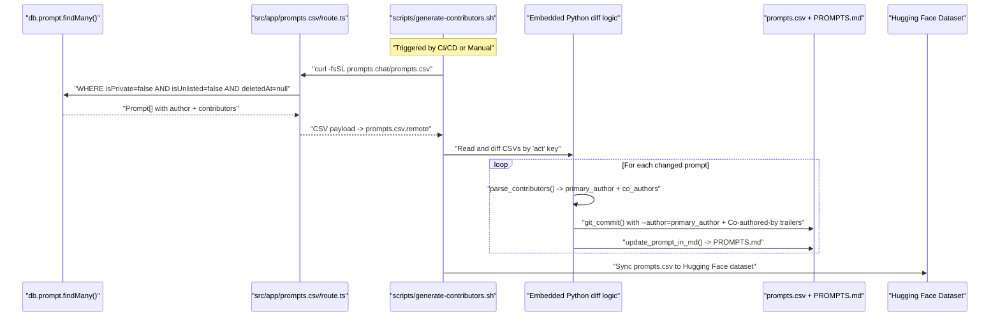
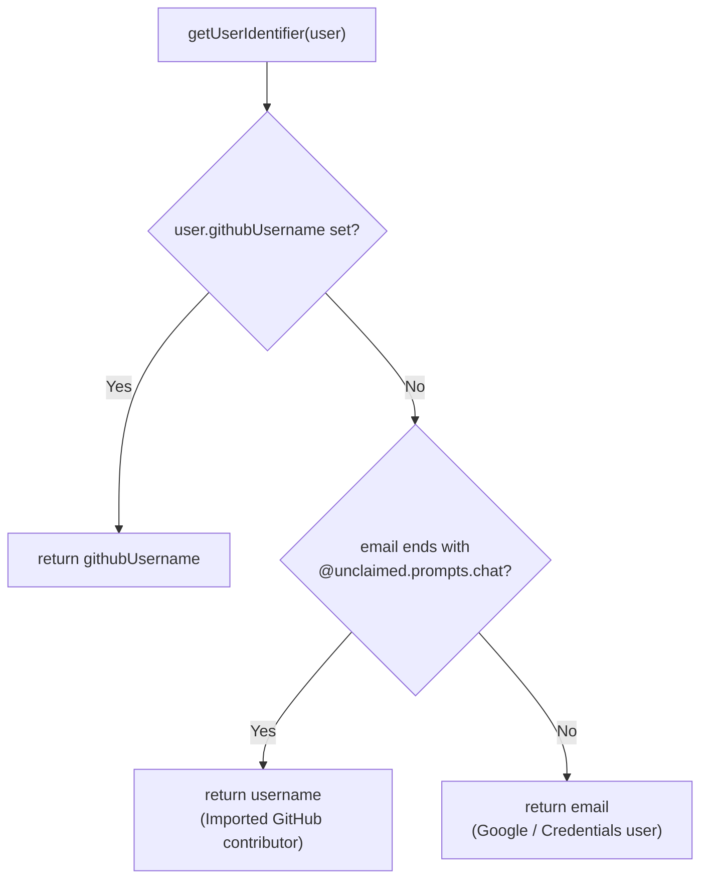
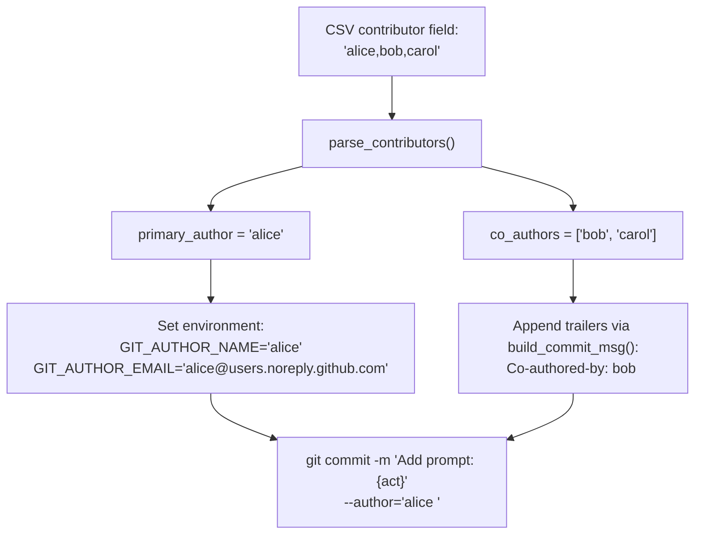
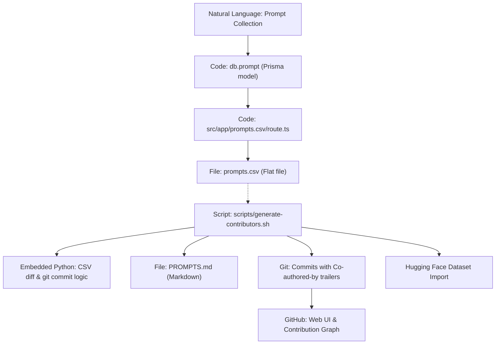
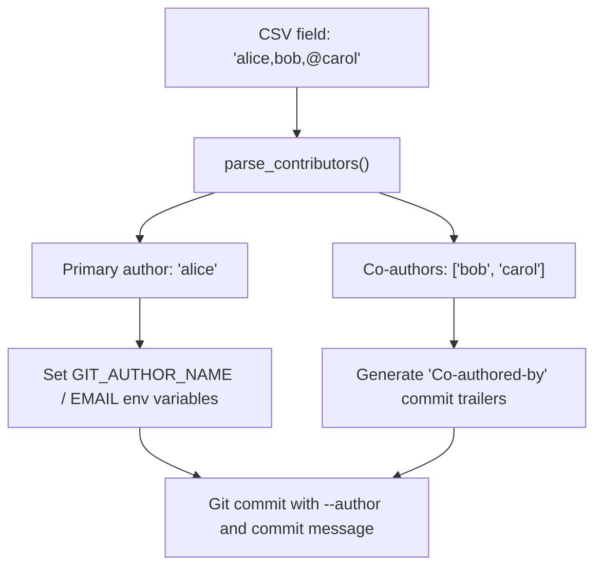

<!-- source: DeepWiki mcp.deepwiki.com · repo f/prompts.chat · page 3.1 CSV Sync System & Contributor Attribution · fetched 2026-11-09 -->

# CSV Sync System & Contributor Attribution

Relevant source files

The following files were used as context for generating this wiki page:

- [.github/PULL_REQUEST_TEMPLATE.md](.github/PULL_REQUEST_TEMPLATE.md)
- [PROMPTS.md](PROMPTS.md)
- [README.md](README.md)
- [next.config.ts](next.config.ts)
- [prompts.csv](prompts.csv)
- [scripts/generate-contributors.sh](scripts/generate-contributors.sh)
- [scripts/rebuild-history.sh](scripts/rebuild-history.sh)
- [src/app/prompts.csv/route.ts](src/app/prompts.csv/route.ts)
- [src/app/prompts.json/route.ts](src/app/prompts.json/route.ts)
- [src/components/admin/import-prompts.tsx](src/components/admin/import-prompts.tsx)
- [tests/generate-contributors-format.test.js](tests/generate-contributors-format.test.js)

This page explains the pipeline that keeps `prompts.csv` in sync with the live database, attributes each prompt to its contributor as a distinct git commit, updates `PROMPTS.md`, and prepares the data for external platforms like Hugging Face. It covers the CSV export route (`src/app/prompts.csv/route.ts`), the automated synchronization script (`scripts/generate-contributors.sh`), and the contributor attribution logic.

For the reverse direction—loading `prompts.csv` back into the database—see the admin import system described in [src/components/admin/import-prompts.tsx:35-100](). For how prompts are created in the first place, see [README.md:68-68]().

---

## Overview

The canonical copy of all public prompts lives in two synchronized tiers:

| Location     | Role                                                                 | Code Representation                |
|--------------|----------------------------------------------------------------------|----------------------------------|
| PostgreSQL   | Live write store; primary source of truth for the web application.   | `db.prompt` via Prisma            |
| `prompts.csv`| Derived canonical snapshot; public record with git-level attribution.| `prompts.csv` root field           |

The synchronization process bridges user actions in the web UI to repository commits, ensuring transparent authorship and contributor stats [README.md:68-68]().

**System-level data flow diagram (Natural Language Space to Code Entity Space):**

Title: CSV Sync and Attribution Pipeline

Sources: [scripts/generate-contributors.sh:1-22](), [src/app/prompts.csv/route.ts:28-95](), [README.md:24-24]()

---

## CSV Export Endpoint (`src/app/prompts.csv/route.ts`)

The Next.js route handler at `src/app/prompts.csv/route.ts` dynamically generates the CSV snapshot consumed by sync scripts and external platforms [src/app/prompts.csv/route.ts:28-95]().

### Query Filters

To prevent private or deleted content from leaking into the public repository, `GET()` queries Prisma with strict filters:

| Filter        | Value   | Code Location                       |
|---------------|---------|-----------------------------------|
| `isPrivate`   | `false` | [src/app/prompts.csv/route.ts:33]() |
| `isUnlisted`  | `false` | [src/app/prompts.csv/route.ts:34]() |
| `deletedAt`   | `null`  | [src/app/prompts.csv/route.ts:35]() |

Results are ordered by `createdAt` ascending to maintain stable append order [src/app/prompts.csv/route.ts:62-62]().

Sources: [src/app/prompts.csv/route.ts:29-63]()

### Output Columns & Mapping

Each prompt is mapped to the five-column CSV schema, with content properly escaped by `escapeCSVField()` [src/app/prompts.csv/route.ts:5-16]():

| CSV Column   | Source Field                               | Transformation / Logic                                           |
|--------------|--------------------------------------------|-----------------------------------------------------------------|
| `act`        | `prompt.title`                             | Escaped prompt title                                            |
| `prompt`     | `prompt.content`                           | Escaped prompt body                                             |
| `for_devs`   | `prompt.category.slug`                     | `"TRUE"` if category slug equals `"coding"`, otherwise `"FALSE"`|
| `type`       | `prompt.structuredFormat`                  | `"STRUCTURED"` if JSON/YAML, else `"TEXT"`                      |
| `contributor`| Concatenation of author and contributors  | Comma-separated identifiers using `getUserIdentifier()`         |

The contributor list concatenates the prompt's author followed by co-contributors, excluding duplicates [src/app/prompts.csv/route.ts:72-80]().

Sources: [src/app/prompts.csv/route.ts:65-83]()

### `getUserIdentifier()` Logic

This helper determines the immutable contributor identity string. Its priority is:

1. Use GitHub username if set (GitHub OAuth users)
2. If email ends with `@unclaimed.prompts.chat`, use username (imported GitHub contributors)
3. Otherwise, use email (Google or credential-based users)

This guarantees consistency and prevents impersonation via username/email switches [src/app/prompts.csv/route.ts:18-25]().

Title: Contributor Identity Resolution

Sources: [src/app/prompts.csv/route.ts:18-25]()

---

## Contributor Generation Script (`scripts/generate-contributors.sh`)

The core synchronization logic runs through `scripts/generate-contributors.sh`. This shell script fetches the remote CSV from the live website, compares it with the local copy, and applies git commits incrementally for any changes, assigning proper contributor authorship [scripts/generate-contributors.sh:15-43]().

### Python Diff & Commit Logic

Embedded within the shell script is a Python program that:

- Reads the local `prompts.csv` and remote `prompts.csv.remote` into ordered lists keyed by the `act` field [scripts/generate-contributors.sh:54-74]()
- Detects additions or updates by comparing normalized rows [scripts/generate-contributors.sh:88-90]()
- Parses contributor fields into a primary author and optional co-authors [scripts/generate-contributors.sh:94-100]()
- Updates the `prompts.csv` local file and synchronizes to `PROMPTS.md` [scripts/generate-contributors.sh:76-83](), [scripts/generate-contributors.sh:182-193]()
- Makes a git commit per changed prompt, setting environment variables for `GIT_AUTHOR_*` and `GIT_COMMITTER_*` [scripts/generate-contributors.sh:116-130]()
- Adds `Co-authored-by` trailers for multi-author commits [scripts/generate-contributors.sh:108-114]()

Title: Git Author Attribution Flow

Sources: [scripts/generate-contributors.sh:38-130]()

### Key Functions in Python Script

- `read_csv(path)`: Reads a CSV file into an ordered list of rows and an index map keyed by `act` [scripts/generate-contributors.sh:54-74]()
- `write_csv(rows, fieldnames, path)`: Writes CSV files deterministically to ensure git-friendly diffs [scripts/generate-contributors.sh:76-83]()
- `parse_contributors(field)`: Splits and cleans contributor strings into primary and co-authors [scripts/generate-contributors.sh:94-100]()
- `build_commit_msg(action, act, co_authors)`: Prepares commit messages with `Co-authored-by` trailers [scripts/generate-contributors.sh:108-114]()
- `git_commit(author_name, author_email, message)`: Stages files and creates git commits with specific author metadata [scripts/generate-contributors.sh:116-130]()

Sources: [scripts/generate-contributors.sh:54-130]()

---

## `PROMPTS.md` Synchronization

Alongside `prompts.csv`, the synchronization script also updates `PROMPTS.md` to keep the markdown version aligned:

- `generate_prompt_block(row)`: Creates a `
` block with a summary and markdown fenced code highlighting based on prompt type (`md`, `json`, `yaml`) [scripts/generate-contributors.sh:155-173]()
- `format_contributor_links(contributor_field)`: Parses contributor entries and renders GitHub profile links or falls back to `@anonymous` for emails or invalid usernames [scripts/generate-contributors.sh:137-154]()
- `append_prompt_to_md(row)` and `update_prompt_in_md(row)`: Initialize or update the markdown file with new or updated prompt blocks [scripts/generate-contributors.sh:182-193]()

The script ensures consistent formatting and contributor attribution visible on the GitHub-hosted `PROMPTS.md`.

This formatting and contributor mapping functionality is verified through unit tests in `tests/generate-contributors-format.test.js` which check for normalization, anonymous fallback, and GitHub username validation [tests/generate-contributors-format.test.js:1-26]().

Sources: [scripts/generate-contributors.sh:137-201](), [tests/generate-contributors-format.test.js:1-26]()

---

## History Management & Automation

### One-Time History Rebuild (`scripts/rebuild-history.sh`)

At project inception, a one-time script was run to reconstruct the git history of `prompts.csv` with granular commit ownership per prompt and proper contributor attribution:

- The script removes `prompts.csv` from git (without deleting the file) [scripts/rebuild-history.sh:101-102]()
- Recreates `prompts.csv` incrementally, committing each prompt row with `GIT_AUTHOR_*` set to the respective contributor [scripts/rebuild-history.sh:118-151]()
- Uses the same `Co-authored-by` commit trailers for co-authors [scripts/rebuild-history.sh:88-98]()
- Outputs instructions to force push the rewritten history [scripts/rebuild-history.sh:154-155]()

Sources: [scripts/rebuild-history.sh:1-170]()

### CI/CD Automation

Ongoing synchronization and contributor commit generation runs automatically in CI/CD (GitHub Actions `.github/workflows/update-contributors.yml`), which runs `scripts/generate-contributors.sh` periodically, pushes updated `prompts.csv` and `PROMPTS.md` commits, and syncs the dataset to Hugging Face [README.md:24-24]().

Sources: [README.md:24-24]()

---

## Summary

This dual architecture leverages the relational PostgreSQL database as the live source of truth while maintaining a git-tracked CSV snapshot `prompts.csv` optimized for transparent contributor attribution and public distribution.

The CSV is published by the Next.js API route, consumed and compared by an automated shell + embedded Python sync script, which commits incremental updates and generates the markdown variant `PROMPTS.md`. Git commit authorship is set per prompt according to its original contributor data with `Co-authored-by` trailers for co-authors.

Sources: [scripts/generate-contributors.sh:1-130](), [src/app/prompts.csv/route.ts:28-95]()

---

## Additional Diagram: Natural Language Entities to Code Artifacts

Title: System Components from Natural Terminology to Codebase

Sources: [scripts/generate-contributors.sh:1-130](), [src/app/prompts.csv/route.ts:28-95](), [README.md:24-24]()

---

## Additional Diagram: CSV Contributor String to Commit Attribution Flow

Title: Contributor String Parsing and Commit Generation

Sources: [scripts/generate-contributors.sh:94-130]()

---

