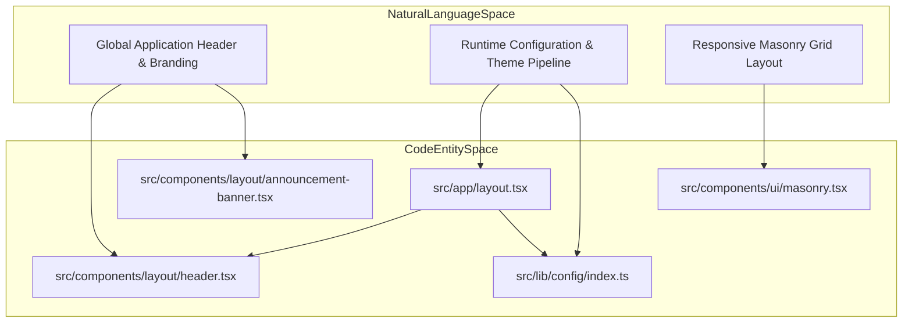

<!-- source: DeepWiki mcp.deepwiki.com · repo f/prompts.chat · page 3.2 Application Structure · fetched 2026-11-09 -->

# Application Structure

<details>
<summary>Relevant source files</summary>

The following files were used as context for generating this wiki page:

- [.env.example](.env.example)
- [prompts.config.ts](prompts.config.ts)
- [src/app/[username]/loading.tsx](src/app/[username]/loading.tsx)
- [src/app/discover/loading.tsx](src/app/discover/loading.tsx)
- [src/app/feed/loading.tsx](src/app/feed/loading.tsx)
- [src/app/layout.tsx](src/app/layout.tsx)
- [src/app/promptmasters/loading.tsx](src/app/promptmasters/loading.tsx)
- [src/app/prompts/[id]/loading.tsx](src/app/prompts/[id]/loading.tsx)
- [src/components/layout/announcement-banner.tsx](src/components/layout/announcement-banner.tsx)
- [src/components/layout/header.tsx](src/components/layout/header.tsx)
- [src/components/ui/masonry.tsx](src/components/ui/masonry.tsx)
- [src/lib/config/index.ts](src/lib/config/index.ts)
- [src/lib/db.ts](src/lib/db.ts)
- [src/lib/i18n/config.ts](src/lib/i18n/config.ts)

</details>


This document outlines the architectural patterns, directory organization, routing structure, loading states, layout management, and server/client component boundaries of the `prompts.chat` codebase built on Next.js 16 App Router.

---

## Directory Structure Overview

The codebase follows Next.js 16 App Router conventions under `src/` and organizes application code into views, layouts, server actions, API routes, shared components, and utility libraries.

```
src/
├── app/                    # Next.js App Router root
│   ├── layout.tsx         # Root layout with server-side theme and provider initialization [src/app/layout.tsx:144-208]()
│   ├── prompts/           # Prompt catalog and dynamic detail views
│   ├── promptmasters/     # Leaderboard views [src/app/promptmasters/loading.tsx:1-39]()
│   ├── feed/              # User personalized feed views [src/app/feed/loading.tsx:1-28]()
│   └── api/               # API endpoint route handlers
├── components/            # React UI components
│   ├── ui/               # Reusable base components (e.g., Masonry layout) [src/components/ui/masonry.tsx:1-184]()
│   ├── layout/           # Structural layout pieces (Header, Footer, banners) [src/components/layout/header.tsx:111-186](), [src/components/layout/announcement-banner.tsx:1-82]()
│   └── providers/        # Context providers and locale detectors [src/app/layout.tsx:189]()
├── lib/                   # Utility functions and core configuration
│   ├── db.ts             # Prisma client singleton implementation [src/lib/db.ts:1-27]()
│   ├── config/           # Runtime configuration loader and types [src/lib/config/index.ts:1-248]()
│   └── i18n/             # Internationalization and localization config [src/lib/i18n/config.ts:1-24]()
└── prompts.config.ts      # Site configuration and branding options [prompts.config.ts:1-106]()
```

Sources: `[src/app/layout.tsx:144-208](), [src/app/promptmasters/loading.tsx:1-39](), [src/app/feed/loading.tsx:1-28](), [src/components/ui/masonry.tsx:1-184](), [src/components/layout/header.tsx:111-186](), [src/components/layout/announcement-banner.tsx:1-82](), [src/lib/db.ts:1-27](), [src/lib/config/index.ts:1-248](), [src/lib/i18n/config.ts:1-24](), [prompts.config.ts:1-106]()`

---

## App Router Architecture

### Route-to-File Mapping and Natural Language to Code Entities

The Next.js 16 App Router maps physical files inside `src/app/` to HTTP endpoints and React Server Components. Dynamic segments like `[id]` handle individual resource views. Special files such as `loading.tsx` handle suspense boundaries for asynchronous route chunks.

Title: "Natural Language to Code Entity Mapping: Routes and Components"
```mermaid
graph TB
    subgraph NaturalLanguageSpace
        PromptDetailReq[""Prompt Detail View""]
        LeaderboardReq[""Promptmasters Leaderboard""]
        FeedReq[""Personalized Feed View""]
        LayoutConfigReq[""Root Layout & Theming""]
    end

    subgraph CodeEntitySpace
        PromptDetailLoading[""src/app/prompts/[id]/loading.tsx""]
        PromptmastersLoadingFile[""src/app/promptmasters/loading.tsx""]
        FeedLoadingFile[""src/app/feed/loading.tsx""]
        RootLayoutFile[""src/app/layout.tsx""]
        ConfigIndex[""src/lib/config/index.ts""]
    end

    PromptDetailReq --> PromptDetailLoading
    LeaderboardReq --> PromptmastersLoadingFile
    FeedReq --> FeedLoadingFile
    LayoutConfigReq --> RootLayoutFile
    RootLayoutFile --> ConfigIndex
```

Sources: `[src/app/layout.tsx:144-208](), [src/app/prompts/[id]/loading.tsx:1-54](), [src/app/promptmasters/loading.tsx:1-39](), [src/app/feed/loading.tsx:1-28](), [src/lib/config/index.ts:1-248]()`

| File Entity Path                | Target Route         | Purpose                                             |
|-------------------------------|----------------------|-----------------------------------------------------|
| `src/app/layout.tsx`           | `/*` (root and children) | Root layout with theme, locales, and providers `[src/app/layout.tsx:144-208]()` |
| `src/app/prompts/[id]/loading.tsx` | `/prompts/[id]`    | Suspense skeleton loader for prompt details `[src/app/prompts/[id]/loading.tsx:1-54]()` |
| `src/app/promptmasters/loading.tsx` | `/promptmasters` | Leaderboard loading skeleton `[src/app/promptmasters/loading.tsx:1-39]()` |
| `src/app/feed/loading.tsx` | `/feed`               | Feed loading skeleton `[src/app/feed/loading.tsx:1-28]()` |

Sources: `[src/app/layout.tsx:144-208](), [src/app/prompts/[id]/loading.tsx:1-54](), [src/app/promptmasters/loading.tsx:1-39](), [src/app/feed/loading.tsx:1-28]()`

---

## Server Components, API Routes, and Database Layer

### Server Components and Data Fetching

The base architecture uses React Server Components to render UI on the server and fetch data directly. Next.js 16 facilitates streaming, server-only code, and async components with granular caching.

- The Prisma client singleton is instantiated in `src/lib/db.ts`. It configures query logging based on `NODE_ENV`, hooks up to `DATABASE_URL`, and automatically omits heavy fields like prompt vector embeddings (`embedding: true`) by default to keep server responses lightweight `[src/lib/db.ts:1-27]()`.

Sources: `[src/lib/db.ts:1-27]()`

---

## Layout, Providers, and Theming Pipeline

The global UI shell and theming are handled by the root layout defined in `src/app/layout.tsx`. This component is a Server Component responsible for:

- Loading configuration via `getConfig()` including themes, branding, and localization `[src/app/layout.tsx:156]()`.
- Resolving active locale and messages using `next-intl` server utilities `[src/app/layout.tsx:4-155]()`.
- Determining text direction (LTR vs RTL) via `isRtlLocale()` for proper font and layout style adjustment `[src/app/layout.tsx:14-157]()`.
- Injecting global font families optimized for Latin, Arabic, and Mono scripts through Google Fonts integration `[src/app/layout.tsx:18-39]()`.

### Theme Computation

It dynamically computes CSS variables and class names for theming on the HTML root element:

- Radius values map to CSS border-radius sizes (`none`, `sm`, `md`, `lg`) `[src/app/layout.tsx:113-118, 169]()`.
- The primary color hex is converted into OKLCH color space with internal utility `hexToOklch()` for perceptual color manipulation `[src/app/layout.tsx:120-142, 161]()`.
- Foreground color is determined based on primary color lightness for proper contrast `[src/app/layout.tsx:163-166]()`.

```typescript
const themeClasses = `theme-${config.theme.variant} density-${config.theme.density}`;
const primaryOklch = hexToOklch(config.theme.colors.primary);

const themeStyles = {
  "--radius": radiusValues[config.theme.radius],
  "--primary": primaryOklch,
  "--primary-foreground": foreground,
} as React.CSSProperties;
```
[src/app/layout.tsx:160-172]()

### Provider Composition

The layout wraps the entire app in context providers imported from `src/components/providers` (`[src/app/layout.tsx:5, 189]()`). These include providers for localization context, theme context, and branding flags.

### Conditional Rendering

Routes with embed or kids namespaces (`/embed`, `/kids`) bypass the full layout with headers and footers and render children directly for minimal UI (`[src/app/layout.tsx:150-152, 190-192]()`).

Sources: `[src/app/layout.tsx:1-208](), [src/lib/config/index.ts:1-248]()`

---

## Loading States and Suspense Architecture

Next.js 16 enables automatic React Suspense boundaries based on the presence of `loading.tsx` files in route directories. This codebase leverages this feature to provide structured skeleton loading components that closely mimic actual page layouts.

- **Prompt Detail Loading:** In `src/app/prompts/[id]/loading.tsx`, skeletons for breadcrumb navigation, title, tags, tabs, and content blocks prepare the UI during detail fetch `[src/app/prompts/[id]/loading.tsx:1-54]()`.
- **Promptmasters Leaderboard Loading:** Rendered by `src/app/promptmasters/loading.tsx`, displaying skeleton rows that resemble leaderboard entries `[src/app/promptmasters/loading.tsx:1-39]()`.
- **Feed Loading:** Rendered by `src/app/feed/loading.tsx`, providing grid and card skeleton placeholders for personalized feeds `[src/app/feed/loading.tsx:1-28]()`.

Sources: `[src/app/prompts/[id]/loading.tsx:1-54](), [src/app/promptmasters/loading.tsx:1-39](), [src/app/feed/loading.tsx:1-28]()`

---

## Client-Side UI Patterns and Components

While most UI components are server-rendered, specific client-side interactivity or DOM manipulations are delegated to client components with `"use client"` annotations.

### Masonry Layout Component

The masonry layout component defined in `src/components/ui/masonry.tsx` renders a responsive multi-column grid with dynamically calculated absolute positioning (`[src/components/ui/masonry.tsx:1-184]()`).

Key features:
- **Responsive Columns Count:** Adjusts column counts based on window width breakpoints (`default`, `md`, `lg`, `xl`) using resize event listeners `[src/components/ui/masonry.tsx:45-62]()`.
- **Text Direction Support:** Detects right-to-left layout changes at the document level and mirrors computed item X positions `[src/components/ui/masonry.tsx:31-42]()`.
- **Absolute Positioning:** Items are absolutely positioned using calculated `translate3d` transforms based on measured height per column `[src/components/ui/masonry.tsx:65-96]()`.

Sources: `[src/components/ui/masonry.tsx:1-184]()`

---

## Summary Diagram of Application Structure and Key Code Entities

Title: "Full System Entity and Layout Architecture Mapping"


Sources: `[src/app/layout.tsx:1-208](), [src/lib/config/index.ts:1-248](), [src/components/layout/header.tsx:1-186](), [src/components/layout/announcement-banner.tsx:1-82](), [src/components/ui/masonry.tsx:1-184]()`

---

## Detailed File Organization per Concern

| Concern           | Location                  | Description                                                  |
|-------------------|---------------------------|--------------------------------------------------------------|
| **App Router Root & Layout** | `src/app/layout.tsx`            | Root React Server Component; theme, locale, global HTML wrapping `[src/app/layout.tsx:144-208]()` |
| **Config Loader & Schema** | `src/lib/config/index.ts`       | Runtime configuration loader and environment variable override parser `[src/lib/config/index.ts:1-248]()` |
| **User Configuration**        | `prompts.config.ts`             | Site-level branding, auth, features, and theme settings `[prompts.config.ts:1-106]()` |
| **Internationalization Config**| `src/lib/i18n/config.ts`       | Supported locales, default locale, and RTL language definitions `[src/lib/i18n/config.ts:1-24]()` |
| **Header Component**          | `src/components/layout/header.tsx` | Client navigation header with locale and session handling `[src/components/layout/header.tsx:1-186]()` |
| **Announcement Banner**       | `src/components/layout/announcement-banner.tsx` | Site-wide announcement bar with dismissal persistence `[src/components/layout/announcement-banner.tsx:1-82]()` |
| **Prompt Detail Loader**      | `src/app/prompts/[id]/loading.tsx` | Suspense loading skeleton for prompt detail views `[src/app/prompts/[id]/loading.tsx:1-54]()` |
| **Promptmasters Loader**      | `src/app/promptmasters/loading.tsx` | Suspense loading skeleton for leaderboards `[src/app/promptmasters/loading.tsx:1-39]()` |
| **Feed Loader**               | `src/app/feed/loading.tsx`      | Suspense loading skeleton for user feeds `[src/app/feed/loading.tsx:1-28]()` |
| **Client-Only Interactive UI**| `src/components/ui/masonry.tsx` | Client component for responsive masonry layouts `[src/components/ui/masonry.tsx:1-184]()` |
| **Database Access**           | `src/lib/db.ts`                 | Prisma client singleton setup for database queries `[src/lib/db.ts:1-27]()` |

Sources: `[src/app/layout.tsx:144-208](), [src/lib/config/index.ts:1-248](), [prompts.config.ts:1-106](), [src/lib/i18n/config.ts:1-24](), [src/components/layout/header.tsx:1-186](), [src/components/layout/announcement-banner.tsx:1-82](), [src/app/prompts/[id]/loading.tsx:1-54](), [src/app/promptmasters/loading.tsx:1-39](), [src/app/feed/loading.tsx:1-28](), [src/components/ui/masonry.tsx:1-184](), [src/lib/db.ts:1-27]()`

---

