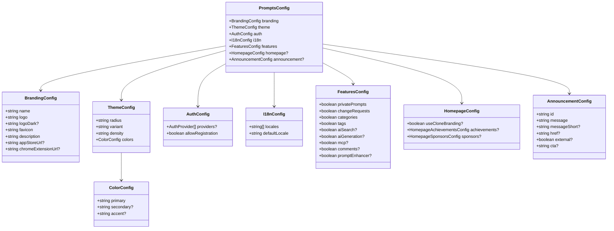
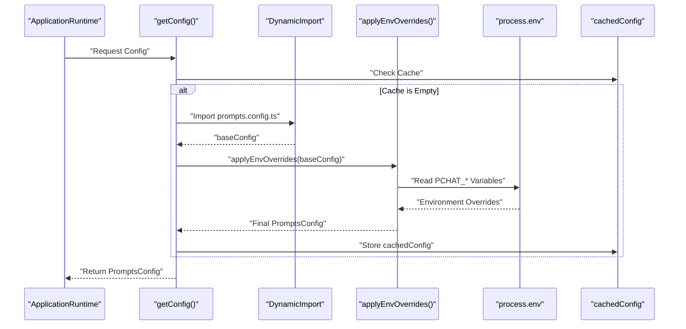
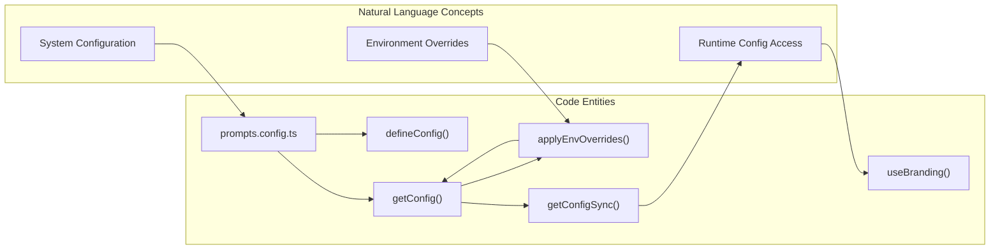

<!-- source: DeepWiki mcp.deepwiki.com · repo f/prompts.chat · page 3.3 Configuration System · fetched 2026-11-09 -->

# Configuration System

Relevant source files

The following files were used as context for generating this wiki page:

- [.env.example](.env.example)
- [prompts.config.ts](prompts.config.ts)
- [src/app/layout.tsx](src/app/layout.tsx)
- [src/components/layout/announcement-banner.tsx](src/components/layout/announcement-banner.tsx)
- [src/components/layout/header.tsx](src/components/layout/header.tsx)
- [src/components/ui/masonry.tsx](src/components/ui/masonry.tsx)
- [src/lib/config/index.ts](src/lib/config/index.ts)
- [src/lib/db.ts](src/lib/db.ts)
- [src/lib/i18n/config.ts](src/lib/i18n/config.ts)

## Purpose and Scope

This document details the configuration subsystem of prompts.chat, covering the static configuration file structure [prompts.config.ts:1-106](), the type-safe `defineConfig` builder function [src/lib/config/index.ts:98-100](), the asynchronous configuration loading pipeline [src/lib/config/index.ts:189-248](), runtime environment variable overrides via `PCHAT_*` prefixes [src/lib/config/index.ts:118-187](), and synchronous/asynchronous runtime access patterns implemented in `src/lib/config/index.ts` [src/lib/config/index.ts:1-248]().

Sources: [src/lib/config/index.ts:1-248](), [prompts.config.ts:1-106]()

---

## Overview

The configuration system provides a centralized mechanism to customize branding, design themes, authentication providers, internationalization, feature flags, and homepage widgets without altering source code. It combines static TypeScript definitions with container-friendly runtime environment overrides.

Sources: [src/lib/config/index.ts:118-187](), [prompts.config.ts:1-106]()

---

## Configuration File Structure

The `prompts.config.ts` file acts as the primary user-editable configuration source [prompts.config.ts:1-106](). It leverages the `defineConfig()` helper function [src/lib/config/index.ts:98-100]() to ensure complete TypeScript autocomplete and compile-time validation.

### System Configuration Map

This diagram bridges natural language configuration domains to their corresponding TypeScript interfaces and fields in code.

```mermaid
graph TB
    subgraph NaturalLanguageSpace["Natural Language Space"]
        BrandingDomain["Visual Identity"]
        ThemeDomain["Design System"]
        AuthDomain["User Access"]
        FeatureDomain["Capability Flags"]
        I18nDomain["Internationalization"]
        HomepageDomain["Homepage Customization"]
        AnnouncementDomain["Site-wide Announcement"]
    end

    subgraph CodeEntitySpace["Code Entity Space"]
        Config["prompts.config.ts"]
        defineConfig["defineConfig()"]
        
        Config --> defineConfig
        defineConfig --> Branding["branding: BrandingConfig"]
        defineConfig --> Theme["theme: ThemeConfig"]
        defineConfig --> Auth["auth: AuthConfig"]
        defineConfig --> I18n["i18n: I18nConfig"]
        defineConfig --> Features["features: FeaturesConfig"]
        defineConfig --> Homepage["homepage: HomepageConfig"]
        defineConfig --> Announcement["announcement: AnnouncementConfig"]
        
        Branding --> BFields["name, logo, logoDark, favicon, description, appStoreUrl, chromeExtensionUrl"]
        Theme --> TFields["radius, variant, density, colors"]
        Auth --> AFields["providers[], allowRegistration"]
        I18n --> IFields["locales[], defaultLocale"]
        Features --> FFields["privatePrompts, changeRequests, aiSearch, mcp, promptEnhancer"]
        Homepage --> HFields["useCloneBranding, achievements, sponsors"]
        Announcement --> AnnFields["id, message, href, external, cta"]
    end

    BrandingDomain -.-> Branding
    ThemeDomain -.-> Theme
    AuthDomain -.-> Auth
    I18nDomain -.-> I18n
    FeatureDomain -.-> Features
    HomepageDomain -.-> Homepage
    AnnouncementDomain -.-> Announcement
```

**Configuration Sections and Their Purposes**

| Section | Purpose | Key Fields |
|---|---|---|
| `branding` | Organization identity and visual assets | `name`, `logo`, `logoDark`, `favicon`, `description`, `appStoreUrl`, `chromeExtensionUrl` |
| `theme` | Design system appearance | `radius`, `variant`, `density`, `colors.primary` |
| `auth` | Authentication providers | `providers[]`, `allowRegistration` |
| `i18n` | Internationalization settings | `locales[]`, `defaultLocale` |
| `features` | Feature flags for optional capabilities | `privatePrompts`, `changeRequests`, `categories`, `tags`, `aiSearch`, `aiGeneration`, `mcp`, `comments`, `promptEnhancer` |
| `homepage` | Homepage customization | `useCloneBranding`, `achievements.enabled`, `sponsors.enabled`, `sponsors.items[]` |
| `announcement` | Site-wide announcement bar | `id`, `message`, `messageShort`, `href`, `external`, `cta` |

Sources: [src/lib/config/index.ts:1-96](), [prompts.config.ts:1-106]()

---

## Configuration Types & `defineConfig`

The configuration schemas are formally defined in `src/lib/config/index.ts` [src/lib/config/index.ts:1-96](). The `defineConfig` helper function accepts a `PromptsConfig` object and returns it unchanged, enforcing typing [src/lib/config/index.ts:98-100]().

Sources: [src/lib/config/index.ts:1-100]()

---

## Configuration Loading Pipeline & Environment Overrides

The configuration loading pipeline is executed via `getConfig()` [src/lib/config/index.ts:189-248](). It performs a dynamic import of `@/../prompts.config`, falls back to default values if the file is missing, applies runtime overrides via `applyEnvOverrides()` [src/lib/config/index.ts:118-187](), and caches the resulting configuration object in memory [src/lib/config/index.ts:189-192]().

### Configuration Pipeline Flow

### Runtime Environment Variable Overrides (`PCHAT_*`)

To support containerized and Docker deployments without rebuilding static assets, `applyEnvOverrides` inspects `process.env` for keys prefixed with `PCHAT_` [src/lib/config/index.ts:118-187]().

| Category | Environment Variable Prefix / Keys | Behavior / Parsing Logic |
|---|---|---|
| Branding | `PCHAT_NAME`, `PCHAT_DESCRIPTION`, `PCHAT_LOGO`, `PCHAT_LOGO_DARK`, `PCHAT_FAVICON` | String override; `logoDark` falls back to `PCHAT_LOGO` if unset [src/lib/config/index.ts:135-143]() |
| Theme | `PCHAT_THEME_RADIUS`, `PCHAT_THEME_VARIANT`, `PCHAT_THEME_DENSITY`, `PCHAT_COLOR` | Casts string values to theme enums and primary color hex/oklch [src/lib/config/index.ts:144-153]() |
| Auth | `PCHAT_AUTH_PROVIDERS`, `PCHAT_ALLOW_REGISTRATION` | Parses comma-separated arrays and boolean values (`"true"`, `"1"`) [src/lib/config/index.ts:122-132](), [src/lib/config/index.ts:154-161]() |
| i18n | `PCHAT_LOCALES`, `PCHAT_DEFAULT_LOCALE` | Parses comma-separated locale strings [src/lib/config/index.ts:128-132](), [src/lib/config/index.ts:162-167]() |
| Features | `PCHAT_FEATURE_PRIVATE_PROMPTS`, `PCHAT_FEATURE_CHANGE_REQUESTS`, `PCHAT_FEATURE_CATEGORIES`, `PCHAT_FEATURE_TAGS`, `PCHAT_FEATURE_AI_SEARCH`, `PCHAT_FEATURE_AI_GENERATION`, `PCHAT_FEATURE_MCP`, `PCHAT_FEATURE_COMMENTS`, `PCHAT_FEATURE_PROMPT_ENHANCER` | Parses case-insensitive boolean flags [src/lib/config/index.ts:122-126](), [src/lib/config/index.ts:168-178]() |

Setting `PCHAT_NAME` automatically enables clone branding mode, disabling default public achievements and sponsor lists [src/lib/config/index.ts:179-184]().

Sources: [src/lib/config/index.ts:118-187]()

---

## Runtime Access: `getConfig` and `getConfigSync`

The application exposes two methods to retrieve configuration at runtime depending on execution context:

1.  **Asynchronous `getConfig()`**: 
    -   Dynamically imports and caches configuration on the server [src/lib/config/index.ts:189-248]().
    -   Safe for use in Server Components, API routes, and Server Actions.
2.  **Synchronous `getConfigSync()`**: 
    -   Retrieves the pre-cached configuration object [src/lib/config/index.ts:221-248]().
    -   Throws an error if the configuration has not yet been initialized by an asynchronous `getConfig()` call.

Sources: [src/lib/config/index.ts:189-248]()

---

## Summary Diagram Bridging Natural Language Concepts to Code Entities

Sources: [src/lib/config/index.ts:98-248](), [prompts.config.ts:1-106]()

---

