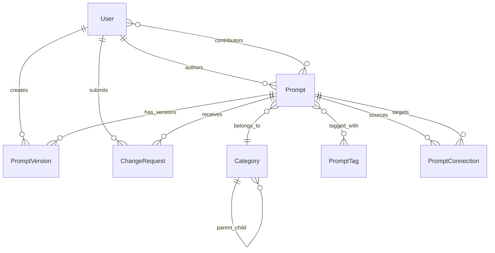
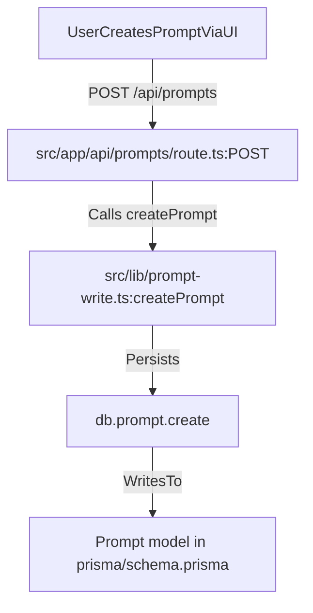
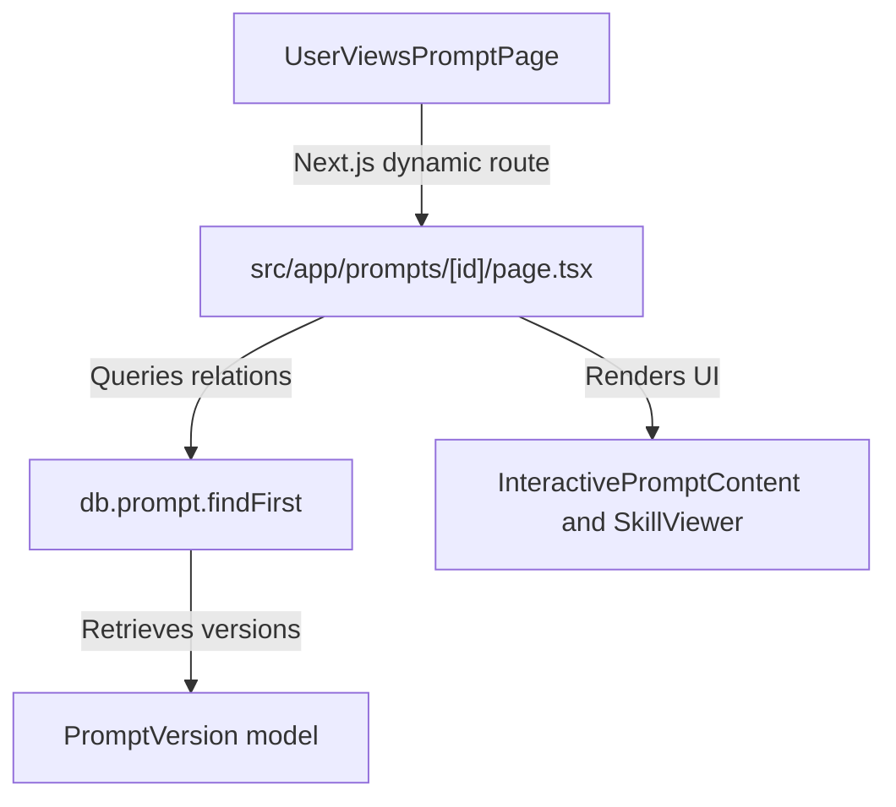

<!-- source: DeepWiki mcp.deepwiki.com · repo f/prompts.chat · page 3.4 Database Schema · fetched 2026-11-09 -->

# Database Schema

Relevant source files

The following files were used as context for generating this wiki page:

- [prisma/schema.prisma](prisma/schema.prisma)
- [prisma/seed.ts](prisma/seed.ts)

## Purpose and Scope

This document details the PostgreSQL database schema used by `prompts.chat`, managed through Prisma ORM [prisma/schema.prisma:1-9](). The schema defines all data models, relationships, enumerations, and indexing strategies supporting the core prompt library, contributor attribution, self-hosting, versioning, workflows, bot platforms, classifiers, change requests, and social features [prisma/schema.prisma:11-150]().

Sources: [prisma/schema.prisma:1-9](), [prisma/schema.prisma:11-150]()

---

## Overview

The database schema is defined in `prisma/schema.prisma` [prisma/schema.prisma:1-9]() and utilizes PostgreSQL with the Prisma Client (`@prisma/client`) [package.json:20](). It organizes models into key functional domains:

- **Core Content & Versioning**: `Prompt`, `PromptVersion`, `PromptConnection`, `Category`, and `Tag` models [prisma/schema.prisma:98-150]().
- **User Management**: `User`, `Account`, `Session`, and `VerificationToken` models [prisma/schema.prisma:11-96]().
- **Collaborative Editing & Change Requests**: `ChangeRequest` model enabling users to propose prompt edits [prisma/schema.prisma:37-37]().
- **Bot and Agent Ecosystem**: Dedicated fields for `BOT` type prompts (`botPlatforms`, `botConfig`, `computerRequirements`, `botPairings`) [prisma/schema.prisma:140-150]().
- **Decision Classifiers**: Models supporting decision trees, criteria, and prompt routing catalogs.
- **Social Interactions**: Voting, collections, comments, and pins supported through models like `PromptVote`, `Collection`, `PinnedPrompt`, and `Comment` [prisma/schema.prisma:41-49]().

All database interactions within the application use the Prisma `db` client instance imported from `src/lib/db` [src/app/prompts/[id]/page.tsx:10-10](), [src/app/api/prompts/route.ts:4-4]().

Sources: [prisma/schema.prisma:1-9](), [src/app/prompts/[id]/page.tsx:10-10](), [src/app/api/prompts/route.ts:4-4]()

---

## High-Level Entity Relationships

### Core Schema Architecture and Relations

Title: "Database Entity Relationship Diagram"

This diagram illustrates essential data relationships including:
- `User` as both prompt author and contributor (many-to-many via `contributors`) [prisma/schema.prisma:42-44]().
- Prompts categorized (`Category`) and tagged (`Tag`) for organization [prisma/schema.prisma:132-133]().
- `PromptConnection` manages directional links for workflows or related prompts [prisma/schema.prisma:134-135]().

Sources: [prisma/schema.prisma:11-150]()

---

## Core Models

### Prompt Model

The `Prompt` model is the foundational content entity representing AI prompts with support for multiple output types, metadata, versioning, contributor attribution, and workflow linking [prisma/schema.prisma:98-150]().

| Field                  | Type             | Description                                                                    |
|------------------------|------------------|--------------------------------------------------------------------------------|
| `id`                   | `String`         | Primary key (CUID), autogenerated [prisma/schema.prisma:99]()                  |
| `title`                | `String`         | Prompt title [prisma/schema.prisma:100]()                                       |
| `slug`                 | `String?`        | URL-safe slug generated from the title, indexed for quick search [prisma/schema.prisma:101]() |
| `description`          | `String?`        | Optional brief summary [prisma/schema.prisma:102]()                             |
| `content`              | `String`         | Full prompt text or instructions [prisma/schema.prisma:103]()                   |
| `type`                 | `PromptType`     | Enum for prompt output type: `TEXT`, `IMAGE`, `VIDEO`, `AUDIO`, `SKILL`, `TASTE`, `BOT`, `STRUCTURED` [prisma/schema.prisma:104]() |
| `isPrivate`            | `Boolean`        | Visibility flag restricting prompt access [prisma/schema.prisma:105]()        |
| `mediaUrl`             | `String?`        | URL to associated media (image/video/audio) [prisma/schema.prisma:106]()       |
| `viewCount`            | `Int`            | Number of views, defaults to 0 [prisma/schema.prisma:107]()                    |
| `embedding`            | `Json?`          | OpenAI vector embedding used for semantic search [prisma/schema.prisma:108]() |
| `requiresMediaUpload`  | `Boolean`        | Whether prompt requires media upload [prisma/schema.prisma:111]()              |
| `requiredMediaType`    | `RequiredMediaType?` | Enum: `"IMAGE"`, `"VIDEO"`, `"DOCUMENT"` [prisma/schema.prisma:110]()       |
| `requiredMediaCount`   | `Int?`           | Number of required media uploads, 1–10 [prisma/schema.prisma:109]()            |
| `structuredFormat`     | `StructuredFormat?` | Enum of input format, `JSON` or `YAML` [prisma/schema.prisma:112]()          |
| `featuredAt`           | `DateTime?`      | Timestamp when featured, null if not featured [prisma/schema.prisma:113]()     |
| `isFeatured`           | `Boolean`        | Featured flag [prisma/schema.prisma:114]()                                    |
| `isUnlisted`           | `Boolean`        | Unlisted flag [prisma/schema.prisma:116]()                                    |
| `unlistedAt`           | `DateTime?`      | Unlisted timestamp [prisma/schema.prisma:117]()                               |
| `delistReason`         | `DelistReason?`  | Reason code for prompt delisting [prisma/schema.prisma:118]()                  |
| `deletedAt`            | `DateTime?`      | Soft-delete timestamp [prisma/schema.prisma:119]()                            |
| `bestWithModels`       | `String[]`       | List of AI model slugs this prompt works best with, max 3 [prisma/schema.prisma:141]() |
| `bestWithMCP`          | `Json?`          | MCP configurations array [prisma/schema.prisma:142]()                          |
| `workflowLink`         | `String?`        | URL pointing to a demo/test of prompt workflow [prisma/schema.prisma:143]()    |
| `botPlatforms`         | `BotPlatform[]`  | BOT prompts only: agent platforms the bot supports [prisma/schema.prisma:145]() |
| `computerRequirements` | `BotComputerRequirement[]` | BOT prompts only: CLOUD and/or LOCAL, empty when the bot needs no computer [prisma/schema.prisma:149]() |
| `botConfig`            | `Json?`          | BOT prompts only: routines, skills, connectors [prisma/schema.prisma:150]()     |

Sources: [prisma/schema.prisma:98-150](), [src/app/api/prompts/route.ts:10-33]()

---

### User Model

Stores user profiles, authentication data, roles, subscription, and usage metadata [prisma/schema.prisma:11-58]().

| Field                      | Type               | Description                                                              |
|----------------------------|--------------------|--------------------------------------------------------------------------|
| `id`                       | `String`           | Primary key CUID [prisma/schema.prisma:12]()                            |
| `email`                    | `String`           | Unique email address [prisma/schema.prisma:13]()                        |
| `username`                 | `String`           | Unique handle used for routing profiles [prisma/schema.prisma:14]()      |
| `name`                     | `String?`          | Optional display name [prisma/schema.prisma:15]()                       |
| `password`                 | `String?`          | Hashed password (nullable for OAuth-only accounts) [prisma/schema.prisma:16]() |
| `avatar`                   | `String?`          | URL for user avatar image [prisma/schema.prisma:17]()                   |
| `bio`                      | `String?`          | User bio text limited to 250 chars [prisma/schema.prisma:18]()          |
| `customLinks`              | `Json?`            | Custom links array for profiles [prisma/schema.prisma:19]()             |
| `role`                     | `UserRole`         | Role enum: `USER` or `ADMIN` [prisma/schema.prisma:20]()                 |
| `locale`                   | `String`           | Preferred locale code, defaults to `"en"` [prisma/schema.prisma:21]()    |
| `verified`                 | `Boolean`          | Verified user flag [prisma/schema.prisma:25]()                           |
| `apiKey`                   | `String?`          | Unique API key for external services [prisma/schema.prisma:27]()         |
| `flagged`                  | `Boolean`          | Flag indicating user is restricted or monitored [prisma/schema.prisma:29]() |
| `dailyGenerationLimit`     | `Int`              | Number of allowed daily AI generations, default 3 [prisma/schema.prisma:32]() |
| `generationCreditsRemaining` | `Int`            | Remaining AI generation credits [prisma/schema.prisma:33]()              |

Sources: [prisma/schema.prisma:11-58]()

---

### Category, Tag, and PromptConnection Models

- **Category**: Supports hierarchical structures via self-referencing relationships and supports pinned states for quick-access filters [prisma/schema.prisma:132-133]().
- **Tag**: Represents descriptive keywords attached to prompts through the `PromptTag` junction table [prisma/schema.prisma:129-129]().
- **PromptConnection**: Handles directed relationships between prompts (`sourceId` and `targetId`), used for workflow chains and related prompt mappings [prisma/schema.prisma:134-135]().

Sources: [prisma/schema.prisma:129-135]()

---

## Natural Language to Code Entity Mapping

### Diagram 1: Prompt Creation Flow in Code

Title: "Prompt Creation Flow Mapping"

This flow shows data input from the user through the API route, invocation of write helpers, and database persistence via Prisma.

Sources: [src/app/api/prompts/route.ts:10-33](), [prisma/schema.prisma:98-150]()

---

### Diagram 2: Prompt Detail and Version Retrieval

Title: "Prompt Retrieval Mapping"

This shows the retrieval of prompt data including related versions and contributors for presentation.

Sources: [src/app/prompts/[id]/page.tsx:153-164](), [prisma/schema.prisma:98-150]()

---

## Migrations History and Management

Database schema changes are managed through Prisma Migrate:

- Migration files reside in `prisma/migrations`.
- Development migrations run via `npm run db:migrate` which executes `prisma migrate dev` [package.json:12]().
- Production deployments use `npm run db:deploy` which runs `prisma migrate deploy` [package.json:8]().
- Seeding with sample data is handled by `prisma/seed.ts` [prisma/seed.ts:1-220]() invoked via `npm run db:seed` [package.json:15]().

Prisma client code generation is triggered by `prisma generate` and automated post-install via script hooks [package.json:7]().

Sources: [package.json:5-31](), [prisma/schema.prisma:1-9](), [prisma/seed.ts:1-220]()

---

