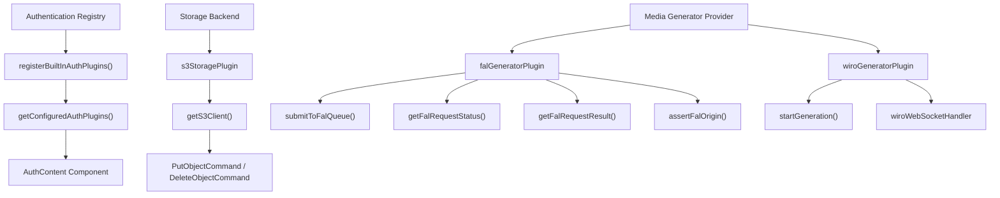
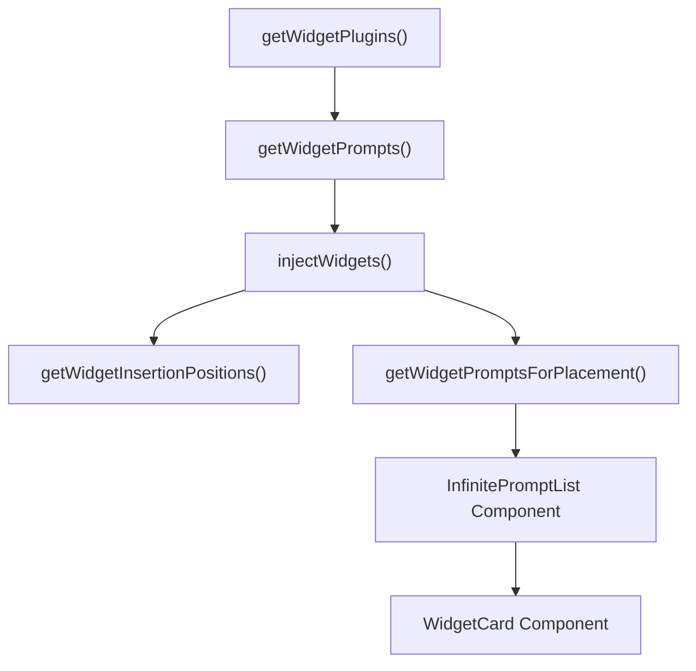

<!-- source: DeepWiki mcp.deepwiki.com · repo f/prompts.chat · page 3.5 Plugin Architecture · fetched 2026-11-09 -->

# Plugin Architecture

Relevant source files

The following files were used as context for generating this wiki page:

- [src/__tests__/components/spacefast-widget.test.tsx](src/__tests__/components/spacefast-widget.test.tsx)
- [src/app/api/leaderboard/route.ts](src/app/api/leaderboard/route.ts)
- [src/app/api/media-generate/status/route.ts](src/app/api/media-generate/status/route.ts)
- [src/components/prompts/audio-player.tsx](src/components/prompts/audio-player.tsx)
- [src/components/prompts/infinite-prompt-list.tsx](src/components/prompts/infinite-prompt-list.tsx)
- [src/components/prompts/prompt-list.tsx](src/components/prompts/prompt-list.tsx)
- [src/components/prompts/widget-card.tsx](src/components/prompts/widget-card.tsx)
- [src/components/widgets/spacefast-widget-card.tsx](src/components/widgets/spacefast-widget-card.tsx)
- [src/lib/plugins/media-generators/fal.ts](src/lib/plugins/media-generators/fal.ts)
- [src/lib/plugins/media-generators/types.ts](src/lib/plugins/media-generators/types.ts)
- [src/lib/plugins/media-generators/wiro.ts](src/lib/plugins/media-generators/wiro.ts)
- [src/lib/plugins/widgets/book.tsx](src/lib/plugins/widgets/book.tsx)
- [src/lib/plugins/widgets/coderabbit.ts](src/lib/plugins/widgets/coderabbit.ts)
- [src/lib/plugins/widgets/index.ts](src/lib/plugins/widgets/index.ts)
- [src/lib/plugins/widgets/spacefast-links.ts](src/lib/plugins/widgets/spacefast-links.ts)
- [src/lib/plugins/widgets/spacefast.tsx](src/lib/plugins/widgets/spacefast.tsx)
- [src/lib/plugins/widgets/textream.tsx](src/lib/plugins/widgets/textream.tsx)
- [src/lib/plugins/widgets/types.ts](src/lib/plugins/widgets/types.ts)

This page documents the extensible subsystem located in `src/lib/plugins`, which provides modular abstractions for authentication providers, file storage backends, AI media generation providers (`fal` and `wiro`), and the homepage widgets registry (`coderabbit`, `book`, `textream`, `commandcode`, `spacefast`).

---

## 1. Authentication Plugins

The authentication plugin subsystem allows dynamic registration and resolution of auth providers based on configuration files like `prompts.config.ts`. 

- **Built-in Registration:** The function `registerBuiltInAuthPlugins()` registers all supported authentication providers, including `credentialsPlugin`, `googlePlugin`, `azurePlugin`, `githubPlugin`, `applePlugin`, `oidcPlugin`, and `oauthPlugin` [src/lib/plugins/auth/index.ts:11-19]().
- **Configuration Loading:** The helper `getConfiguredAuthPlugins()` initializes the plugin system and maps the configured provider IDs to their respective plugins, falling back to credentials if none are specified [src/lib/plugins/index.ts:37-54]().
- **UI Integration:** The `AuthContent` component renders enabled OAuth buttons using provider metadata and displays fallback hints such as GitHub attribution when appropriate [src/components/auth/auth-content.tsx:24-49]().

Sources: `src/lib/plugins/auth/index.ts`, `src/lib/plugins/index.ts`, `src/components/auth/auth-content.tsx`

---

## 2. Storage Backends & File Management

The storage subsystem provides a unified interface for file uploads and deletions, enabling support for multiple backend providers such as AWS S3 and DigitalOcean Spaces.

### Amazon S3 Storage Plugin

Located at `src/lib/plugins/storage/s3.ts`, this plugin integrates with AWS S3 and S3-compatible services using the official AWS SDK.

- **Dynamic SDK Import:** The AWS SDK client (`@aws-sdk/client-s3`) is dynamically imported in the `getS3Client()` helper to prevent bundling it when unused.
- **Configuration Check:** The `isConfigured()` method returns `true` only if all required environment variables (`S3_BUCKET`, `S3_REGION`, `S3_ACCESS_KEY_ID`, `S3_SECRET_ACCESS_KEY`) are set.
- **Uploading Files:** The `upload()` method accepts either JavaScript `File` or `Buffer` objects, normalizes to a `Buffer`, determines content type (MIME), and generates a unique storage key based on a timestamp and random string. It uses the S3 client's `PutObjectCommand` to perform the upload. Support for S3-compatible endpoints like DigitalOcean Spaces is handled through `S3_ENDPOINT` and path-style requests.
- **Deleting Files:** The `delete()` method can accept either a key or complete URL, extracting the correct key from URLs that include the bucket prefix, then issuing the S3 `DeleteObjectCommand`.

The DigitalOcean Spaces plugin follows a similar interface and is implemented in `src/lib/plugins/storage/do-spaces.ts`, also supporting S3-compatible calls.

Sources: `src/lib/plugins/storage/s3.ts`

---

## 3. Media Generator Plugins

These plugins encapsulate AI-driven media generation services, providing standardized APIs for image, video, and audio generation. The system supports multiple providers with configurable environment variables.

### Fal.ai Media Generator Plugin

Located in `src/lib/plugins/media-generators/fal.ts`, the Fal.ai plugin uses Fal.ai's queue-based API to submit generation requests, then polls for status updates and final results.

- **Environment Variables:** Requires `FAL_API_KEY`, and comma-separated lists for `FAL_IMAGE_MODELS`, `FAL_VIDEO_MODELS`, and `FAL_AUDIO_MODELS` to define allowed generation models [src/lib/plugins/media-generators/fal.ts:7-12]().
- **Queue Submission:** The `submitToFalQueue()` function sends authenticated POST requests with generation input to Fal's queue endpoint [src/lib/plugins/media-generators/fal.ts:106-130]().
- **Status Checks:** `getFalRequestStatus()` polls the status URL to read queue position and generation status. All fetched URLs are validated against trusted Fal.ai origins using `assertFalOrigin()` to prevent SSRF attacks [src/lib/plugins/media-generators/fal.ts:38-48]().
- **Result Retrieval:** Once generation completes, `getFalRequestResult()` fetches the generated media URLs [src/lib/plugins/media-generators/fal.ts:159-182]().
- **WebSocket Handling:** Since Fal.ai uses polling rather than WebSocket for status updates, `falWebSocketHandler` is implemented as a no-op for WebSocket messages [src/lib/plugins/media-generators/fal.ts:201-215]().

### Wiro.ai Media Generator Plugin

The Wiro plugin, found in `src/lib/plugins/media-generators/wiro.ts`, utilizes Wiro's REST API for starting jobs and WebSocket connections to receive real-time progress updates.

- **Configuration:** The plugin requires `WIRO_API_KEY` and related model environment variables to enable generation [src/lib/plugins/media-generators/wiro.ts:6-11]().
- **Start Generation:** `startGeneration()` forms a multipart/form-data request including prompt, resolution, video/audio parameters, and optional image input URLs, then posts to Wiro's `/Run/{model}` endpoint [src/lib/plugins/media-generators/wiro.ts:153-218]().
- **Real-time Updates:** The `wiroWebSocketHandler` processes incoming WebSocket messages that report task phases (queued, preprocess, GPU assigned, started, generating, completed, error). It updates progress and status messages accordingly [src/lib/plugins/media-generators/wiro.ts:56-127]().

Sources: `src/lib/plugins/media-generators/fal.ts`, `src/lib/plugins/media-generators/wiro.ts`

---

## 4. Homepage Widgets Registry & Injection Engine

The homepage and prompt listing UI can be enhanced by injecting promotional or sponsored widgets into the prompt feed. This system is managed via centrally registered widget plugins.

### Widget Plugin Registry

The main registry is defined in `src/lib/plugins/widgets/index.ts`. It exports:

- `getWidgetPlugins()` — returns all registered widget plugins [src/lib/plugins/widgets/index.ts:29-31]().
- `getWidgetPrompts()` — aggregates all individual widget prompts from all plugins [src/lib/plugins/widgets/index.ts:36-38]().
- `getWidgetPlugin(id)` and `getWidgetPrompt(pluginId, promptId)` — allow fetching by identifiers [src/lib/plugins/widgets/index.ts:43-53]().

Currently registered widget plugins include:
- `coderabbitWidget` [src/lib/plugins/widgets/coderabbit.ts:3-96]()
- `bookWidget` [src/lib/plugins/widgets/book.tsx:142-173]()
- `textreamWidget` [src/lib/plugins/widgets/textream.tsx:101-152]()
- `commandcodeWidget` [src/lib/plugins/widgets/index.ts:12]()
- `spacefastWidget` [src/lib/plugins/widgets/spacefast.tsx:7-50]()

### Widget Prompt Types & Positioning

Types and interfaces are declared in `src/lib/plugins/widgets/types.ts`:
- `WidgetPrompt` interface describing individual widgets [src/lib/plugins/widgets/types.ts:54-83]().
- `WidgetPositionConfig` defines positioning modes (`"once"` or `"repeat"`) [src/lib/plugins/widgets/types.ts:42-52]().
- `shouldInject(context)` function determining injection eligibility [src/lib/plugins/widgets/types.ts:78]().
- `render(instanceIndex, placement)` ReactNode function for custom rendering [src/lib/plugins/widgets/types.ts:81-82]().
- `WidgetPlacement` defines surfaces where widgets can be injected, such as `"prompts"`, `"bots"`, or `"teams"` [src/lib/plugins/widgets/types.ts:8]().

### Injection Algorithm

The `injectWidgets()` function in `src/lib/plugins/widgets/index.ts` processes prompt lists:
1. Retrieves all widget prompts for the given `placement` using `getWidgetPromptsForPlacement()` [src/lib/plugins/widgets/index.ts:126-127]().
2. Filters them via `shouldInject` against context parameters [src/lib/plugins/widgets/index.ts:140-146]().
3. Computes insertion offsets via `getWidgetInsertionPositions()` [src/lib/plugins/widgets/index.ts:72-103]().
4. Splices widgets into the array marked with `isWidget: true` [src/lib/plugins/widgets/index.ts:168-177]().

The feed UI component `InfinitePromptList` uses `injectWidgets()` after mount to safely render injected widgets [src/components/prompts/infinite-prompt-list.tsx:13,197]().

Sources: `src/lib/plugins/widgets/index.ts`, `src/lib/plugins/widgets/types.ts`, `src/lib/plugins/widgets/coderabbit.ts`, `src/lib/plugins/widgets/book.tsx`, `src/lib/plugins/widgets/textream.tsx`, `src/lib/plugins/widgets/spacefast.tsx`, `src/components/prompts/infinite-prompt-list.tsx`

---

## 5. Architecture Mapping: Natural Language to Code Entity Space

### Diagram Title: "Auth, Storage, and Media Generator Plugins Architecture"

Sources: `src/lib/plugins/auth/index.ts`, `src/lib/plugins/index.ts`, `src/components/auth/auth-content.tsx`, `src/lib/plugins/storage/s3.ts`, `src/lib/plugins/media-generators/fal.ts`, `src/lib/plugins/media-generators/wiro.ts`

### Diagram Title: "Widgets Registry and Injection Pipeline"

Sources: `src/lib/plugins/widgets/index.ts`, `src/components/prompts/infinite-prompt-list.tsx`

---

