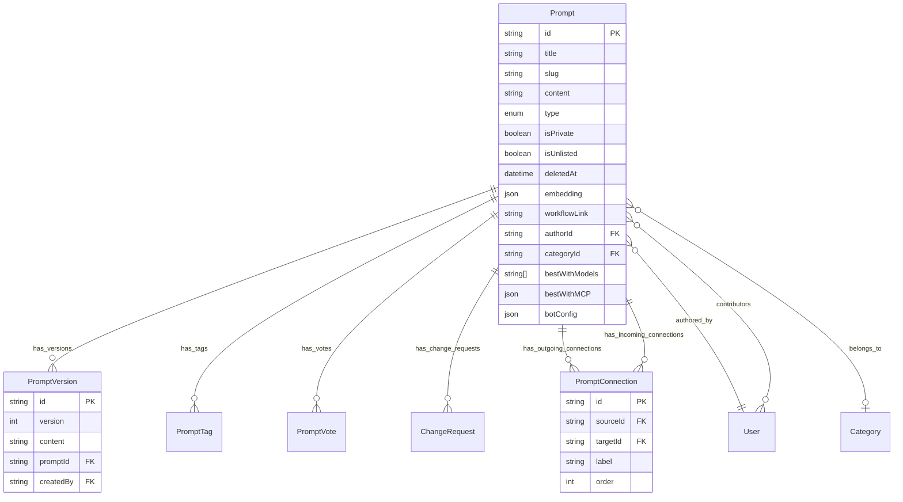
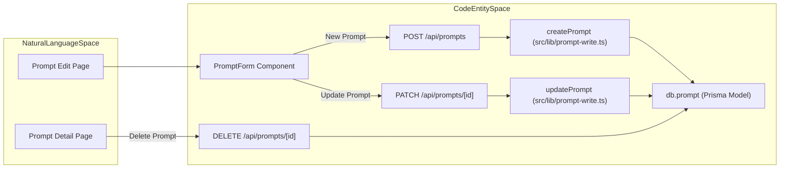
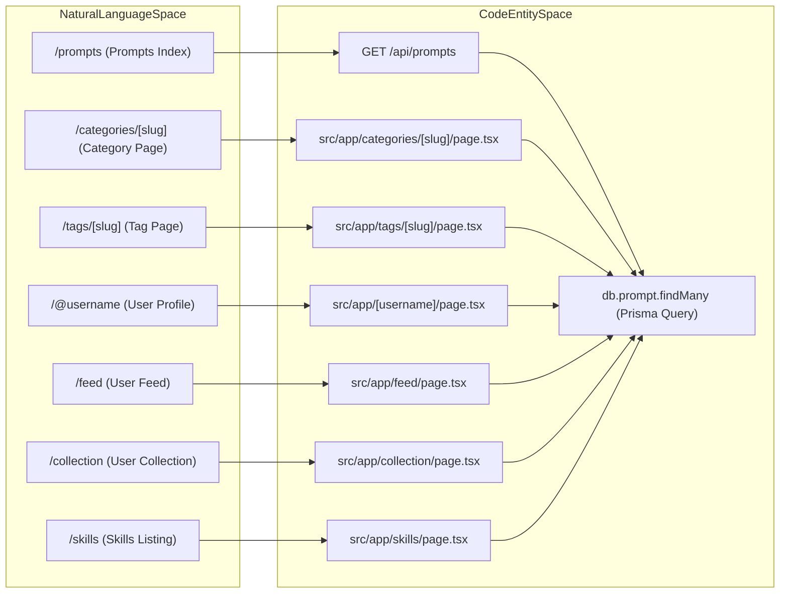

<!-- source: DeepWiki mcp.deepwiki.com · repo f/prompts.chat · page 4 Prompt System · fetched 2026-11-09 -->

# Prompt System

Relevant source files

The following files were used as context for generating this wiki page:

- [src/app/[username]/page.tsx](src/app/[username]/page.tsx)
- [src/app/api/prompts/[id]/route.ts](src/app/api/prompts/[id]/route.ts)
- [src/app/api/prompts/route.ts](src/app/api/prompts/route.ts)
- [src/app/categories/[slug]/page.tsx](src/app/categories/[slug]/page.tsx)
- [src/app/collection/page.tsx](src/app/collection/page.tsx)
- [src/app/feed/page.tsx](src/app/feed/page.tsx)
- [src/app/prompts/[id]/page.tsx](src/app/prompts/[id]/page.tsx)
- [src/app/skills/page.tsx](src/app/skills/page.tsx)
- [src/app/tags/[slug]/page.tsx](src/app/tags/[slug]/page.tsx)
- [src/components/prompts/discovery-prompts.tsx](src/components/prompts/discovery-prompts.tsx)

The Prompt System is the core content management layer of prompts.chat. It handles the entire lifecycle of an AI prompt, including creation, storage, versioning, discovery, execution, export, media generation, and bot configurations. This page provides a high-level overview of the system's structure, core data models, prompt types, and workflows. Each major sub-topic has a dedicated child page for in-depth technical details.

For related areas such as user authentication and content discovery, see the corresponding parent pages [User System](#5) and [Content Discovery](#6).

| Child Page | Description |
|---|---|
| [Prompt CRUD Operations](#4.1) | Document prompt creation, editing, deletion with API endpoints, validation schemas, rate limiting, duplicate detection, quality checking, and uploads |
| [Skills & Multi-file Prompts](#4.2) | Explain Agent Skills with SKILL.md requirement, parseSkillFiles/serializeSkillFiles functions, skill viewer/editor/diff UI, taste.md files, and MCP skill tools |
| [Prompt Discovery & Browsing](#4.3) | Document browsing pages (/prompts, /skills, /workflows, /taste), filtering by category/tag/type, search, and pagination with infinite scroll |
| [Prompt Execution & Run Buttons](#4.4) | Explain RunPromptButton component, platform URL construction, variable filling system, and deep link support for IDEs |
| [Versioning & Change Requests](#4.5) | Document PromptVersion records, change request workflow, approval/rejection flow, and version comparison UI |
| [AI-Powered Features](#4.6) | Explain OpenAI integration for embeddings, semantic search, related prompts discovery, quality checking, translation, SQL generation, and prompt improvement via .prompt.yml files |
| [Workflow Chains & Connected Prompts](#4.7) | Document PromptConnection model, workflowLink field, BFS algorithm for workflow propagation, and flow vs related connections |
| [Import & Export System](#4.8) | Explain CSV/JSON import-export routes, GitHub sync via generate-contributors.sh, HuggingFace dataset integration, and admin bulk operations |
| [Media Generation & Attachments](#4.9) | Document media prompt types, MediaGenerator component, /api/media-generate, fal/wiro provider plugins, generation credits and cron reset, and storage backends |
| [Bots, Teams & Connectors](#4.10) | Document the BOT prompt type: bot schema (instructions, routines, connectors, computer requirement), bot pages/cards/forms, install bundles, bot teams and handoffs, MCP bot/team tools, and bot admin management |
| [Decision Classifiers & Chains](#4.11) | Document the CLASSIFIER prompt type: src/lib/classifiers (schema, store, write, categories, change snapshots), Jev/Kev decision models, question types (choice/score/noul), terminal kinds, /classifiers pages and chains builder, prisma/classifiers fixtures, and admin management |

Sources: [src/app/prompts/[id]/page.tsx:37-224](), [src/app/api/prompts/route.ts:1-207](), [prisma/schema.prisma:93-157]()

---

## Core Data Model

At the foundation of the Prompt System is the `Prompt` Prisma model, which represents each prompt entity with extensive metadata and relations to versions, tags, votes, authors, contributors, change requests, bot configurations, and connected workflows [prisma/schema.prisma:93-147]().

### Database Schema Overview

Title: "PromptSystemER"

This model structure supports complex relationships including contributing users, bot properties, and managed connections for workflows or related prompt links [prisma/schema.prisma:93-147](). For details, see [Prompt CRUD Operations](#4.1).

Sources: [prisma/schema.prisma:93-157]()

---

## Prompt Types & Metadata

Prompts support various output types and specialized formats, validated via API routes and Prisma models [src/app/api/prompts/route.ts:10-33](), [src/app/api/prompts/[id]/route.ts:10-130]().

| Type | Description | Typical Use Case |
|---|---|---|
| `TEXT` | Standard text prompt | Chat LLMs like ChatGPT, Claude |
| `IMAGE` | Image generation prompt | DALL-E, Midjourney |
| `VIDEO` | Video generation prompt | Sora, Kling, Veo |
| `AUDIO` | Audio/speech generation | ElevenLabs, Suno audio models |
| `SKILL` | Multi-file agent prompt | Agent skills with MCP protocol |
| `TASTE` | Style/preference prompt | Personalization use cases |
| `BOT` | Agent bot configuration | OpenClaw, AutoGPT, Dots, Duet, Muse |
| `CLASSIFIER` | Decision model | Jev/Kev decision models, question chains |

Additional metadata fields specify media upload requirements, agent bot properties, and optimized model configurations:
- `requiresMediaUpload`: Flags prompts needing media input (image, video, document).
- `requiredMediaType`: Enum specifying exact media type required [prisma/schema.prisma:110]().
- `requiredMediaCount`: Number of media files required [prisma/schema.prisma:109]().
- `bestWithModels`: Array of up to three model identifiers optimized for this prompt [prisma/schema.prisma:137]().
- `bestWithMCP`: JSON configurations defining MCP toolchains tailored to this prompt [prisma/schema.prisma:138]().
- `workflowLink`: Optional URL to test or demo prompt workflows linking multiple prompts [prisma/schema.prisma:139]().
- `botPlatforms`, `botConfig`, `computerRequirement`: Specialized properties for `BOT` prompt types [prisma/schema.prisma:141-146]().

For details on multi-file agent skills, see [Skills & Multi-file Prompts](#4.2). For bot definitions, see [Bots, Teams & Connectors](#4.10). For classifier definitions, see [Decision Classifiers & Chains](#4.11).

Sources: [prisma/schema.prisma:93-147](), [src/app/api/prompts/route.ts:10-33](), [src/app/api/prompts/[id]/route.ts:10-130]()

---

## Natural Language Space to Code Entity Space: CRUD & Lifecycle

This diagram bridges user-facing prompt editing pages to underlying API route controllers and Prisma database models.

Title: "PromptCrudArchitecture"

Sources: [src/app/prompts/[id]/page.tsx:1-164](), [src/app/api/prompts/route.ts:10-33](), [src/app/api/prompts/[id]/route.ts:102-130](), [src/app/api/prompts/[id]/route.ts:135-219](), [prisma/schema.prisma:93-157]()

---

## Natural Language Space to Code Entity Space: Discovery & Browsing

This diagram maps browsing interfaces (prompts index, category pages, tag pages, user profiles, feed, collections, skills) to their server components and cached database fetching logic.

Title: "PromptDiscoveryArchitecture"

Sources: [src/app/api/prompts/route.ts:56-207](), [src/app/categories/[slug]/page.tsx:139-175](), [src/app/tags/[slug]/page.tsx:80-117](), [src/app/[username]/page.tsx:158-170](), [src/app/feed/page.tsx:45-87](), [src/app/collection/page.tsx:25-60](), [src/app/skills/page.tsx:42-87](), [prisma/schema.prisma:93-157]()

---

## Prompt Lifecycle & Execution

The prompt lifecycle spans creation, validation, AI enrichment, discovery, versioning, and execution. During creation, the system enforces authorization, input validation, duplicate/similarity detection, and rate limiting [src/app/api/prompts/route.ts:10-33]().

Prompts support dynamic variables using variable syntax. The `InteractivePromptContent` component renders prompts with editable spans for in-place variable editing [src/app/prompts/[id]/page.tsx:17](). Additionally, the `RunPromptButton` component constructs platform-specific URLs injecting the resolved prompt text.

For details, see [Prompt Execution & Run Buttons](#4.4) and [Versioning & Change Requests](#4.5).

Sources: [src/app/prompts/[id]/page.tsx:17](), [src/app/api/prompts/route.ts:10-33]()

---

## Quality Control & Moderation

The Prompt System incorporates automated and manual quality controls:
- **Automated Quality Checking**: Analyzes content for instruction quality and depth.
- **Duplicate Detection**: Compares new submissions against recent public prompts.
- **Rate Limiting & Flags**: Enforces cooldowns and daily generation/creation limits for flagged accounts [prisma/schema.prisma:29-34]().
- **Soft Deletion**: Prompts are soft-deleted by setting a `deletedAt` timestamp, making them invisible to public users but recoverable by admins [src/app/api/prompts/[id]/route.ts:203-206](). Owners can delete their own prompts only if they have been delisted for quality issues [src/app/api/prompts/[id]/route.ts:181-193]().

For details, see [Prompt CRUD Operations](#4.1).

Sources: [prisma/schema.prisma:29-34](), [src/app/api/prompts/route.ts:10-33](), [src/app/api/prompts/[id]/route.ts:135-219]()

---

