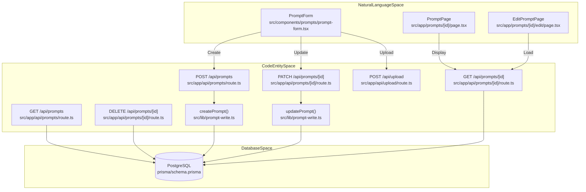
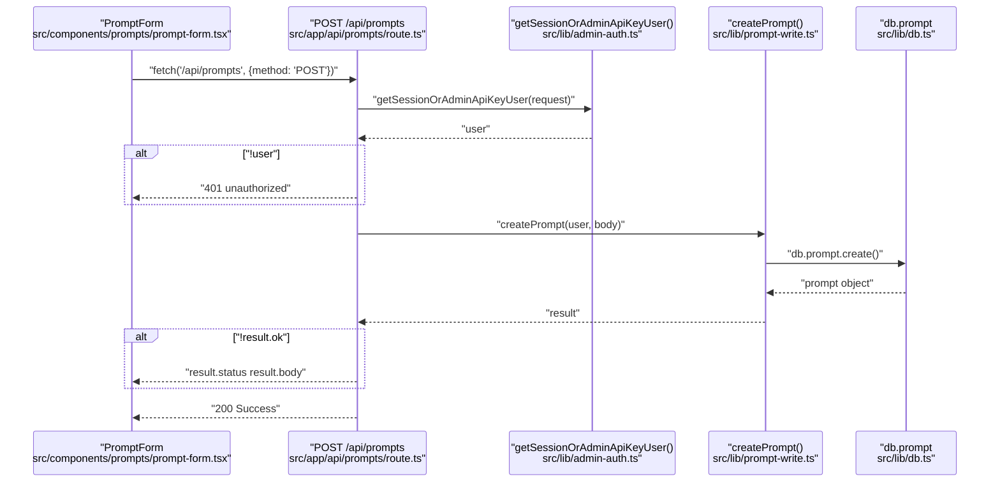

<!-- source: DeepWiki mcp.deepwiki.com · repo f/prompts.chat · page 4.1 Prompt CRUD Operations · fetched 2026-11-09 -->

# Prompt CRUD Operations

Relevant source files

The following files were used as context for generating this wiki page:

- [src/app/[username]/page.tsx](src/app/[username]/page.tsx)
- [src/app/api/prompts/[id]/route.ts](src/app/api/prompts/[id]/route.ts)
- [src/app/api/prompts/route.ts](src/app/api/prompts/route.ts)
- [src/app/categories/[slug]/page.tsx](src/app/categories/[slug]/page.tsx)
- [src/app/collection/page.tsx](src/app/collection/page.tsx)
- [src/app/feed/page.tsx](src/app/feed/page.tsx)
- [src/app/prompts/[id]/edit/page.tsx](src/app/prompts/[id]/edit/page.tsx)
- [src/app/prompts/[id]/page.tsx](src/app/prompts/[id]/page.tsx)
- [src/app/skills/page.tsx](src/app/skills/page.tsx)
- [src/app/tags/[slug]/page.tsx](src/app/tags/[slug]/page.tsx)
- [src/components/prompts/discovery-prompts.tsx](src/components/prompts/discovery-prompts.tsx)
- [src/components/prompts/prompt-form.tsx](src/components/prompts/prompt-form.tsx)

This document covers the Create, Read, Update, and Delete (CRUD) operations for prompts in the `prompts.chat` system. It details the API endpoints, validation logic, authorization rules, file uploads, rate limiting, duplicate detection, quality checking, and persistence workflows that govern prompt lifecycle management.

For prompt discovery mechanisms (browsing, filtering, search), see [Prompt Discovery & Browsing](). For prompt execution and the `RunPromptButton`, see [Prompt Execution & Run Buttons](). For versioning and change request workflows, see [Versioning & Change Requests]().

---

## CRUD Operations Overview

The prompt CRUD system is implemented through Next.js API routes and server actions with validation, authorization, and media upload handling pipelines bridging user interfaces with PostgreSQL persistence.

**CRUD Architecture Overview**

Sources:
- [src/app/api/prompts/route.ts:10-33]()
- [src/app/api/prompts/[id]/route.ts:11-219]()
- [src/components/prompts/prompt-form.tsx:1-190]()
- [src/app/api/upload/route.ts:17-120]()

---

## Create Operation

### POST /api/prompts Endpoint

The create operation is exposed via `POST /api/prompts` [src/app/api/prompts/route.ts:10-33]() which authenticates users via session or admin API key [src/app/api/prompts/route.ts:12]() and delegates persistence logic to the `createPrompt` helper [src/app/api/prompts/route.ts:20]().

**Create Operation Flow with Code Entities**

Sources:
- [src/app/api/prompts/route.ts:10-33]()
- [src/app/api/prompts/[id]/route.ts:102-130]()

### Authentication & Authorization

Mutations require user context provided by session checking or API keys. Authorization levels govern resource modifications.

**Authorization Levels:**

| Operation             | Requirement                  | Code Pointer                              |
|-----------------------|------------------------------|------------------------------------------|
| Create Prompt         | Authenticated User / API Key | [src/app/api/prompts/route.ts:12-18]()  |
| View Private Prompt   | Author or Admin              | [src/app/api/prompts/[id]/route.ts:59-64]() |
| Update Prompt         | Author or Admin              | [src/app/api/prompts/[id]/route.ts:108-115]() |
| Delete Prompt (Soft)  | Admin or Owner (if delisted) | [src/app/api/prompts/[id]/route.ts:176-192]() |

Sources:
- [src/app/api/prompts/route.ts:10-18]()
- [src/app/api/prompts/[id]/route.ts:59-64]()
- [src/app/api/prompts/[id]/route.ts:176-192]()

### Validation, Duplicate Detection & Quality Checking

Prompt submissions undergo client-side and server-side validation using Zod schemas, duplicate detection mechanisms, and AI quality checks.
*   **Validation Schemas**: Forms use React Hook Form combined with Zod resolvers (`PromptForm` [src/components/prompts/prompt-form.tsx:6-8]()) to validate titles, content, categories, tag selections, and media requirements.
*   **Duplicate Detection**: Checks are performed during prompt ingestion and creation to prevent identical or heavily overlapping prompt slugs and content hashes within categories.
*   **Quality Checking**: Automated moderation checks scan prompt content for spam, token anomalies, or missing formatting structures, flagging low-quality prompts for auto-delisting.

Sources:
- [src/components/prompts/prompt-form.tsx:1-55]()
- [src/app/api/prompts/route.ts:10-33]()

### File Uploads & Media Handling

Prompts supporting media attachments utilize `POST /api/upload` [src/app/api/upload/route.ts:17-120]() when storage plugins are enabled. The `MediaField` component [src/components/prompts/prompt-form.tsx:68-190]() handles the UI for media uploads and generation.

*   **Size Limits**: Enforces a 4MB maximum size for both images and videos (Vercel serverless limit) [src/components/prompts/prompt-form.tsx:102-106]().
*   **Type Validation**: Restricts uploads to allowed MIME types (`image/jpeg`, `image/png`, `image/gif`, `image/webp`, `video/mp4`, `audio/mpeg`, `audio/mp3`, `audio/wav`, `audio/ogg`) [src/components/prompts/prompt-form.tsx:110-117]().
*   **Media Generation**: Integrates with `/api/media-generate` to allow AI-powered media generation if providers are configured [src/components/prompts/prompt-form.tsx:88-96]().

Sources:
- [src/app/api/upload/route.ts:1-120]()
- [src/components/prompts/prompt-form.tsx:68-190]()

---

## Read Operations

### Single Prompt Retrieval

Prompts are retrieved via the `GET` handler in `src/app/api/prompts/[id]/route.ts` [src/app/api/prompts/[id]/route.ts:11-99](). 

*   **Public Access**: Prompts with `deletedAt: null` are accessible unless marked private [src/app/api/prompts/[id]/route.ts:51-64]().
*   **Private Access**: Author-only check via `prompt.authorId !== session?.user?.id` [src/app/api/prompts/[id]/route.ts:59]().
*   **Slug Support**: Frontend components parse URLs containing ID and slug segments. The `extractPromptId` function [src/app/prompts/[id]/edit/page.tsx:17-22]() handles this for edit pages.

### Prompt Listing & Filtering

The public API listing endpoint (`GET /api/prompts`) supports pagination, category filtering, tag filtering, type constraints, and sorting [src/app/api/prompts/route.ts:56-207]().

*   **Pagination**: `page` and `perPage` query parameters control results, with defaults and maximums enforced [src/app/api/prompts/route.ts:60-70]().
*   **Type Filtering**: The `type` query parameter allows filtering by `PromptType` (e.g., `TEXT`, `IMAGE`, `BOT`). By default, `BOT` and `CLASSIFIER` types are excluded from general listings [src/lib/prompt-list.ts:8](), unless explicitly requested [src/lib/prompt-list.ts:15]().
*   **Trending**: The `trending=1` parameter filters for prompts marked as trending [src/app/api/prompts/route.ts:130-133]().
*   **Workflows**: The `/workflows` page [src/app/workflows/page.tsx:1-174]() specifically queries for prompts that are part of a workflow chain, excluding `SKILL`, `BOT`, and `CLASSIFIER` types, and requiring outgoing connections that are not "related" [src/app/workflows/page.tsx:24-35]().

Sources:
- [src/app/api/prompts/[id]/route.ts:11-99]()
- [src/app/api/prompts/route.ts:56-207]()
- [src/app/prompts/[id]/edit/page.tsx:17-22]()

---

## Update & Delete Operations

### Updating Prompts (PATCH)

Updates are handled by `PATCH /api/prompts/[id]` [src/app/api/prompts/[id]/route.ts:102-130]() which verifies user session status and delegates to `updatePrompt` [src/app/api/prompts/[id]/route.ts:117](). The `EditPromptPage` [src/app/prompts/[id]/edit/page.tsx:1-124]() loads existing prompt data and passes it to the `PromptForm` for editing.

### Deletion (DELETE)

Prompt deletion is performed via soft deletion in `DELETE /api/prompts/[id]` [src/app/api/prompts/[id]/route.ts:135-219]().
*   **Ownership and Delist Rules**: Admins can delete any prompt. Authors can only delete prompts that have been automatically delisted for quality issues [src/app/api/prompts/[id]/route.ts:176-192]().
*   **Timestamping**: Sets the `deletedAt` field to the current timestamp [src/app/api/prompts/[id]/route.ts:195-198]().

Sources:
- [src/app/api/prompts/[id]/route.ts:102-219]()
- [src/app/prompts/[id]/edit/page.tsx:1-124]()

---

## Database Schema Reference

### Prompt Model

The core entity defined in `prisma/schema.prisma` [prisma/schema.prisma:94-147]().

| Field                 | Type                 | Description                                               |
|-----------------------|----------------------|-----------------------------------------------------------|
| `id`                  | String               | Primary Key (CUID)                                        |
| `title`               | String               | Prompt title                                             |
| `slug`                | String?              | URL-friendly slug generated from title                   |
| `description`         | String?              | Optional description of the prompt                       |
| `content`             | String               | The actual prompt instruction text                       |
| `type`                | PromptType           | TEXT, IMAGE, VIDEO, AUDIO, SKILL, TASTE, BOT, CLASSIFIER |
| `isPrivate`           | Boolean              | Visibility toggle                                        |
| `isUnlisted`          | Boolean              | Delisted from discovery feeds                            |
| `deletedAt`           | DateTime?            | Soft delete timestamp                                   |
| `mediaUrl`            | String?              | URL for attached media                                   |
| `requiresMediaUpload` | Boolean              | Indicates if upload is required for media                 |
| `bestWithModels`      | String[]             | Array of AI model slugs this prompt works best with (max 3) [prisma/schema.prisma:137]() |
| `workflowLink`        | String?              | URL to test/demo the workflow [prisma/schema.prisma:139]() |

Sources:
- [prisma/schema.prisma:94-147]()

---

