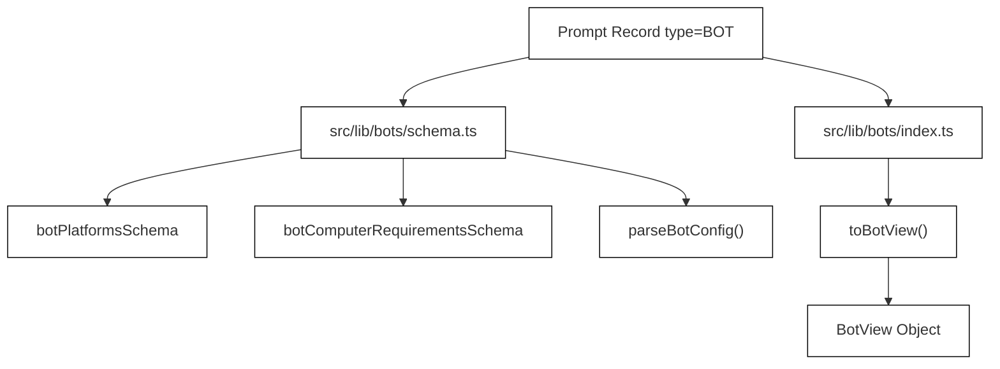
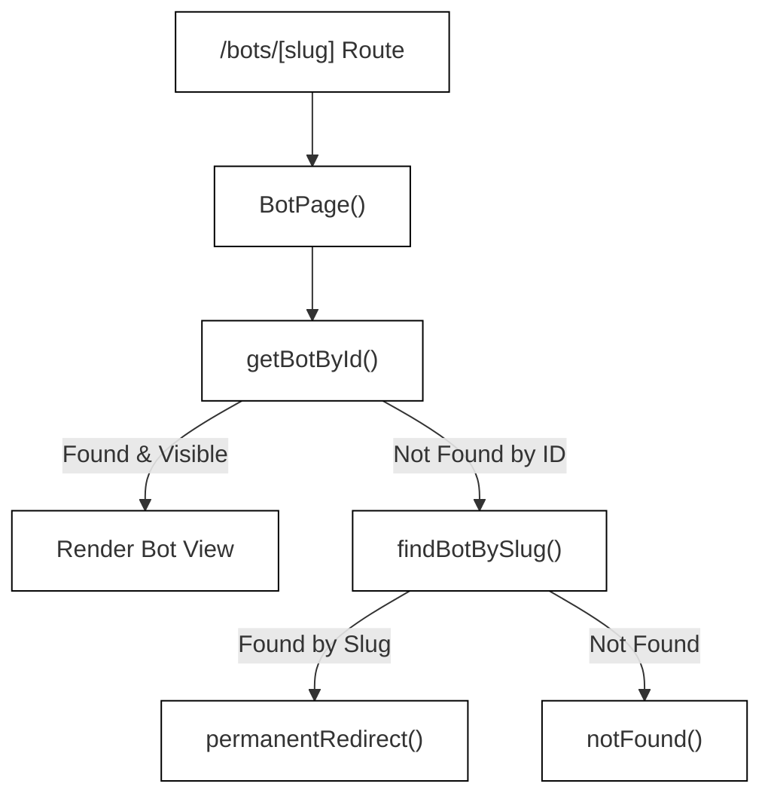
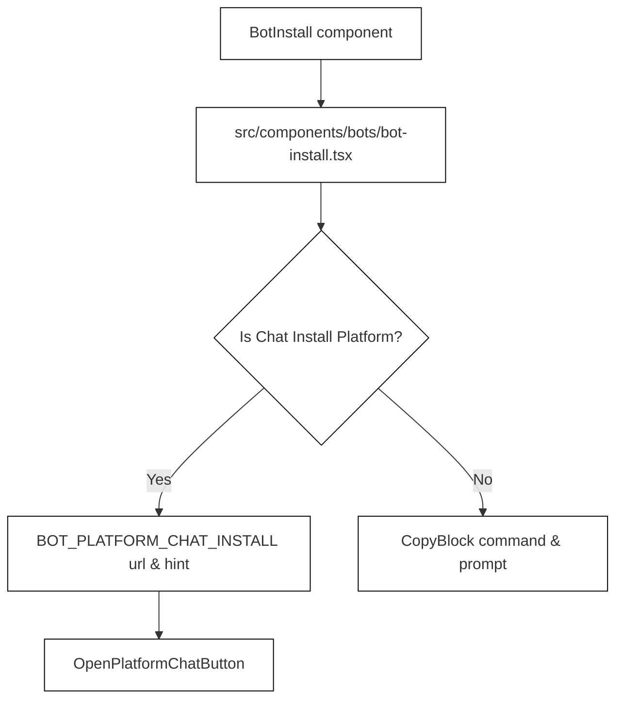
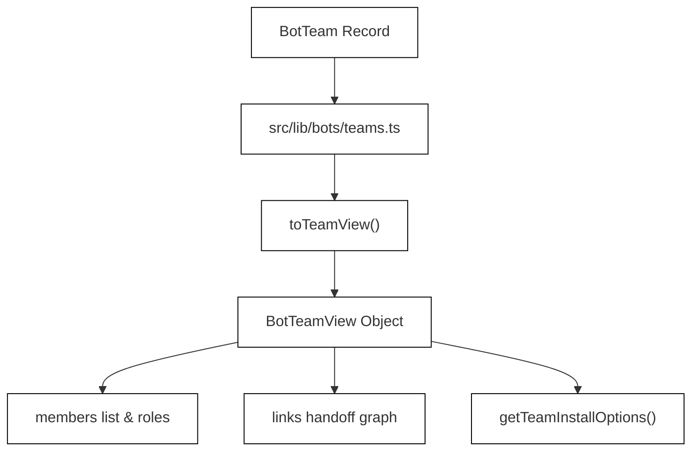
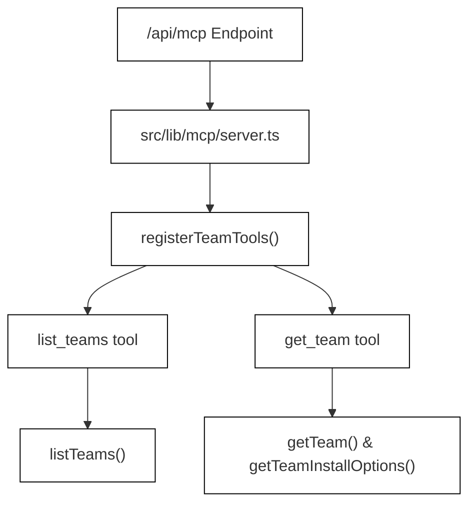

<!-- source: DeepWiki mcp.deepwiki.com · repo f/prompts.chat · page 4.10 Bots, Teams & Connectors · fetched 2026-11-09 -->

# Bots, Teams & Connectors

Relevant source files

The following files were used as context for generating this wiki page:

- [public/bots/autogpt-dark.svg](public/bots/autogpt-dark.svg)
- [public/bots/autogpt.svg](public/bots/autogpt.svg)
- [src/__tests__/api/bot-teams.test.ts](src/__tests__/api/bot-teams.test.ts)
- [src/__tests__/app/bot-page-slug-redirect.test.ts](src/__tests__/app/bot-page-slug-redirect.test.ts)
- [src/__tests__/components/bot-teams-graph-card.test.tsx](src/__tests__/components/bot-teams-graph-card.test.tsx)
- [src/__tests__/components/featured-teams.test.tsx](src/__tests__/components/featured-teams.test.tsx)
- [src/__tests__/lib/bot-list.test.ts](src/__tests__/lib/bot-list.test.ts)
- [src/__tests__/lib/bot-platforms.test.ts](src/__tests__/lib/bot-platforms.test.ts)
- [src/__tests__/lib/bot-slug-lookup.test.ts](src/__tests__/lib/bot-slug-lookup.test.ts)
- [src/__tests__/lib/bot-teams.test.ts](src/__tests__/lib/bot-teams.test.ts)
- [src/app/api/bots/teams/route.ts](src/app/api/bots/teams/route.ts)
- [src/app/bots/[slug]/page.tsx](src/app/bots/[slug]/page.tsx)
- [src/components/admin/bots-management.tsx](src/components/admin/bots-management.tsx)
- [src/components/admin/teams-management.tsx](src/components/admin/teams-management.tsx)
- [src/components/bots/bot-bundle-install.tsx](src/components/bots/bot-bundle-install.tsx)
- [src/components/bots/bot-card.tsx](src/components/bots/bot-card.tsx)
- [src/components/bots/bot-form.tsx](src/components/bots/bot-form.tsx)
- [src/components/bots/bot-install.tsx](src/components/bots/bot-install.tsx)
- [src/components/bots/bot-og-image.tsx](src/components/bots/bot-og-image.tsx)
- [src/components/bots/bot-platform-tabs.tsx](src/components/bots/bot-platform-tabs.tsx)
- [src/components/bots/teams/bot-teams-graph.tsx](src/components/bots/teams/bot-teams-graph.tsx)
- [src/components/bots/teams/featured-teams.tsx](src/components/bots/teams/featured-teams.tsx)
- [src/components/bots/teams/team-card.tsx](src/components/bots/teams/team-card.tsx)
- [src/components/bots/teams/team-title-link.ts](src/components/bots/teams/team-title-link.ts)
- [src/lib/bots/index.ts](src/lib/bots/index.ts)
- [src/lib/bots/schema.ts](src/lib/bots/schema.ts)
- [src/lib/bots/team-graph.ts](src/lib/bots/team-graph.ts)
- [src/lib/bots/teams.ts](src/lib/bots/teams.ts)
- [src/lib/mcp/tools/teams.ts](src/lib/mcp/tools/teams.ts)

## Purpose & Scope
This page documents the **BOT** prompt type within `prompts.chat`, covering its database schema, configuration structure, frontend UI components, multi-platform installation bundles (OpenClaw, AutoGPT, Dots, Duet, Muse, Grok, Hermes), bot teams and multi-agent handoffs, Model Context Protocol (MCP) tools integration, and administrative management workflows.

---

## 1. Bot Schema & Data Structure
Bots are specialized prompt entities stored in the core `Prompt` table where `type = "BOT"`. They aggregate system instructions, execution routines, agent skills, third-party connectors, and hardware/runtime requirements into a unified schema parsed by `src/lib/bots/schema.ts` and normalized via `src/lib/bots/index.ts` [src/lib/bots/index.ts:89-116]().

The supported target platforms are enumerated in `BOT_PLATFORMS`: `GROK_BOT`, `OPENCLAW`, `HERMES`, `AUTOGPT`, `DOTS`, `DUET`, and `MUSE` [src/lib/bots/schema.ts:3-4](). Computer requirements (`BotComputerRequirement`) govern execution context: `CLOUD` (remote container/desktop) or `LOCAL` (local machine/file access) [src/lib/bots/schema.ts:129-130]().

*Diagram 1: Bot Data Normalization Pipeline from Database Model to BotView*

Sources: `[src/lib/bots/schema.ts:1-136]`, `[src/lib/bots/index.ts:24-116]`

---

## 2. Bot Pages, Cards & Forms
User interactions with bots occur through dedicated UI structures. The bot creation and editing interface is backed by form components that validate icon definitions (`BOT_ICONS`) and color themes (`BOT_COLORS`) [src/lib/bots/schema.ts:71-122](). 

Public discovery and individual view pages (`src/app/bots/[slug]/page.tsx`) render metadata summaries via `BotCard`, execution requirements via `BotComputerBadges`, and interactive installation modals [src/app/bots/[slug]/page.tsx:16-23](). Slug resolution and permanent redirection are handled using `findBotBySlug` and `botSlugFromParam` [src/lib/bots/index.ts:1]().

*Diagram 2: Bot URL Routing and Slug Fallback Flow*

Sources: `[src/app/bots/[slug]/page.tsx:43-79]`, `[src/lib/bots/schema.ts:70-122]`, `[src/__tests__/lib/bot-slug-lookup.test.ts:39-106]`

---

## 3. Platform Install Bundles
Bots support automated deployment across multiple agent runtimes. The installation infrastructure is split into single-bot installers (`src/components/bots/bot-install.tsx`) and bundle installers (`src/components/bots/bot-bundle-install.tsx`) [src/app/bots/[slug]/page.tsx:17-22]().

Chat-based deployment targets (`AUTOGPT`, `DOTS`, `DUET`, `MUSE`) rely on `BOT_PLATFORM_CHAT_INSTALL` directives to route users to platform-specific web chats with pre-formatted prompt templates [src/lib/bots/schema.ts:21-37]().

*Diagram 3: Platform Installation Code Flow*

Sources: `[src/lib/bots/schema.ts:21-37]`, `[src/components/bots/bot-install.tsx:65-126]`, `[src/components/bots/bot-bundle-install.tsx:1-97]`

---

## 4. Bot Teams & Handoffs
Bot Teams group multiple agents into collaborative units that execute workflows via directed handoffs (`BotTeamLinkView`). Teams are managed through `src/lib/bots/teams.ts` and exposed via database models including `BotTeam`, `BotTeamMember`, and `BotTeamLink` [src/lib/bots/teams.ts:1-97]().

Each team member has a specific role description and maps to underlying bot prompts [src/__tests__/lib/bot-teams.test.ts:88-112](). Team installation options (`getTeamInstallOptions`) aggregate member instructions into unified deployment prompts.

*Diagram 4: Bot Team Data Structures and View Resolution*

Sources: `[src/lib/bots/teams.ts:41-97]`, `[src/__tests__/lib/bot-teams.test.ts:88-112]`

---

## 5. MCP Bot & Team Tools
The Model Context Protocol (MCP) server exposes dedicated tools for searching, retrieving, and saving bots and team objects programmatically at `/api/mcp`.

- **Bot Tools**: `search_bots`, `get_bot`, `save_bot`, `list_my_bots`, `get_my_bot` [src/lib/mcp/tools/bots.ts:1-1]().
- **Team Tools**: `list_teams`, `get_team`, `save_team` [src/lib/mcp/tools/teams.ts:81-173]().

*Diagram 5: MCP Team Tool Registration and Execution Flow*

Sources: `[src/lib/mcp/tools/teams.ts:78-173]`, `[src/__tests__/api/bot-teams.test.ts:120-139]`

---

## 6. Bot Admin Management
Administrative oversight of bot listings is centralized in admin management views (`src/components/admin/bots-management.tsx` and `src/components/admin/teams-management.tsx`). Administrators can inspect delisted prompts, modify visibility flags (`isPrivate`, `isUnlisted`), enforce quality standards, and manage platform distribution metrics across the system.

Sources: `[src/components/admin/bots-management.tsx:1-1]`, `[src/components/admin/teams-management.tsx:1-1]`

---

