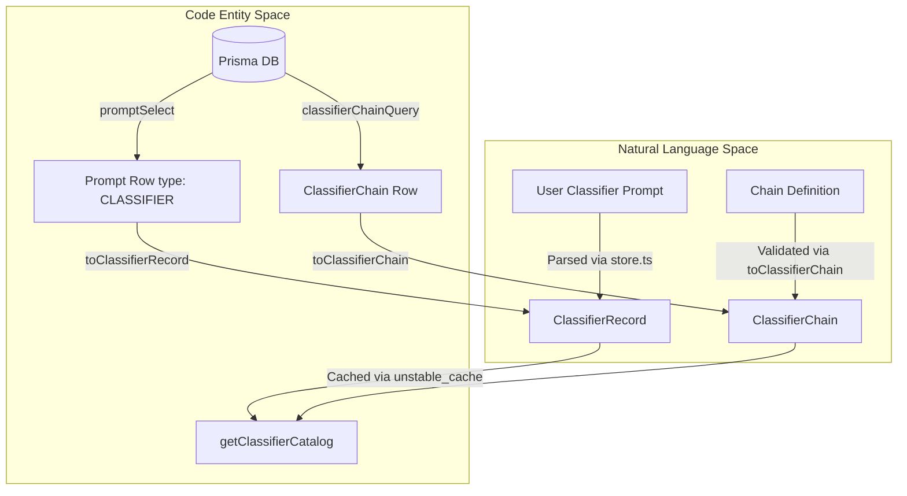
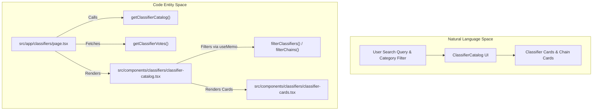
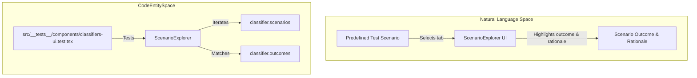

<!-- source: DeepWiki mcp.deepwiki.com · repo f/prompts.chat · page 4.11 Decision Classifiers & Chains · fetched 2026-11-09 -->

# Decision Classifiers & Chains

Relevant source files

The following files were used as context for generating this wiki page:

- [src/__tests__/components/classifiers-ui.test.tsx](src/__tests__/components/classifiers-ui.test.tsx)
- [src/__tests__/components/upvote-ui.test.tsx](src/__tests__/components/upvote-ui.test.tsx)
- [src/__tests__/db/classifiers.db.test.ts](src/__tests__/db/classifiers.db.test.ts)
- [src/app/classifiers/[slug]/page.tsx](src/app/classifiers/[slug]/page.tsx)
- [src/app/classifiers/page.tsx](src/app/classifiers/page.tsx)
- [src/components/classifiers/classifier-cards.tsx](src/components/classifiers/classifier-cards.tsx)
- [src/components/classifiers/classifier-catalog.tsx](src/components/classifiers/classifier-catalog.tsx)
- [src/components/prompts/upvote-button.tsx](src/components/prompts/upvote-button.tsx)
- [src/lib/classifiers/store.ts](src/lib/classifiers/store.ts)

This page documents the `CLASSIFIER` prompt type, its underlying schema, storage mechanisms in `src/lib/classifiers/store.ts`, and how it integrates into the `prompts.chat` ecosystem. It covers decision models, question types, terminal kinds, the catalog UI at `src/app/classifiers/page.tsx`, chains builder, fixtures, and admin management.

Sources: [src/app/classifiers/page.tsx:1-69](), [src/lib/classifiers/store.ts:1-112]()

---

## Classifier Prompt Type Overview

The `CLASSIFIER` prompt type allows users to create structured decision models that guide AI agents or users through a series of questions to reach a conclusion. Classifiers are defined using a structured JSON configuration stored within the database and can be chained together into complex decision graphs.

Sources: [src/lib/classifiers/store.ts:50-70]()

### Classifier Schema

A classifier is a specialized prompt where the `type` field is set to `CLASSIFIER`. Its core definition resides in the prompt's classifier-specific JSON configuration (`classifierConfig`), while core metadata like `title`, `description`, and `slug` are stored on the prompt record itself.

The main components of a classifier definition include:
*   **`slug`**: A unique URL-safe identifier for the classifier [src/lib/classifiers/store.ts:33]()
*   **`name` / `title`**: The display name of the classifier [src/lib/classifiers/store.ts:31]()
*   **`summary` / `description`**: A brief explanation of the classifier's purpose [src/lib/classifiers/store.ts:32]()
*   **`question`**: Defines the primary question or evaluation axis [src/app/classifiers/[slug]/page.tsx:106-106]()
*   **`outcomes`**: Array of possible classification results or conclusions [src/__tests__/db/classifiers.db.test.ts:74-78]()
*   **`scenarios`**: Predefined test cases used for validation and exploration [src/__tests__/db/classifiers.db.test.ts:80-80]()

Sources: [src/app/classifiers/[slug]/page.tsx:106-115](), [src/__tests__/db/classifiers.db.test.ts:54-84](), [src/lib/classifiers/store.ts:29-46]()

### Question Types & Decision Models

Classifiers support various question types and structural models to facilitate structured decision-making:
*   **Choice**: Presents predefined categorical options for selection [src/__tests__/db/classifiers.db.test.ts:66-72]()
*   **Score**: Evaluates inputs along a numerical scale
*   **Noul (Natural Language Understanding)**: Free-form text input evaluated against criteria

Sources: [src/__tests__/db/classifiers.db.test.ts:64-72]()

---

## Classifier Store & Database Layer

Classifier records and chains are loaded, parsed, and cached using dedicated store utilities located in `src/lib/classifiers/store.ts`.

**Diagram: Classifier Storage and Caching Architecture**

Sources: [src/lib/classifiers/store.ts:22-148]()

### Key Functions and Serialization

*   `toClassifierRecord(row)`: Parses raw prompt database rows into structured `ClassifierRecord` objects, validating their JSON configurations [src/lib/classifiers/store.ts:51-70]().
*   `toClassifierChain(row)`: Converts database chain rows into `ClassifierChain` objects, ensuring all member classifiers are valid, public, and non-deleted [src/lib/classifiers/store.ts:82-111]().
*   `getClassifierCatalog()`: Cached function that aggregates all public classifiers, chains, and reference sources using `unstable_cache` [src/lib/classifiers/store.ts:125-164]().
*   `getClassifierVotes(promptIds, userId)`: Fetches vote counts and user-specific voting state outside the catalog cache so votes update instantly [src/lib/classifiers/store.ts:173-195]().

Sources: [src/lib/classifiers/store.ts:51-195]()

---

## User Interface & Catalog

The user interface for browsing classifiers is hosted at `/classifiers` [src/app/classifiers/page.tsx:31-69]() and supported by catalog filtering components [src/components/classifiers/classifier-catalog.tsx:28-183]().

**Diagram: Classifier Catalog Data Flow and Rendering**

Sources: [src/app/classifiers/page.tsx:31-69](), [src/components/classifiers/classifier-catalog.tsx:28-62]()

### Catalog Filtering and State Management

*   `ClassifierCatalog`: Manages client-side query string filtering and synchronizes state with URL search parameters using `window.history.replaceState` [src/components/classifiers/classifier-catalog.tsx:28-73]().
*   `ClassifierCard`: Renders individual classifier summaries, outcome chips, category badges, and upvote counters [src/components/classifiers/classifier-cards.tsx:23-67]().
*   `ChainCard`: Renders workflow chains, step sequences, and endpoint counts [src/components/classifiers/classifier-cards.tsx:74-105]().

Sources: [src/components/classifiers/classifier-catalog.tsx:28-105](), [src/components/classifiers/classifier-cards.tsx:23-105]()

---

## Chain Building & Scenario Explorer

Chains allow multiple classifiers to execute in sequence, where the terminal outcome of one classifier informs the input of the next.

### Scenario Explorer

The `ScenarioExplorer` component allows users to switch between predefined scenarios, inspect decision paths, and view rationales [src/__tests__/components/classifiers-ui.test.tsx:88-103]().

**Diagram: Scenario Explorer Component Mapping**

Sources: [src/__tests__/components/classifiers-ui.test.tsx:88-103]()

---

## Fixtures & Administration

Database seeding, import scripts, and automated tests ensure the integrity of the classifier catalog.

*   `prisma/classifiers/fixtures`: Contains seed definitions for pre-populating classifiers, sources, and chains [src/__tests__/db/classifiers.db.test.ts:29-29]().
*   `importClassifierCatalog`: Imports fixtures into the Prisma database, validating slugs, ownership, and relations [src/__tests__/db/classifiers.db.test.ts:121-155]().
*   Admin workflows allow administrators to inspect version histories [src/app/classifiers/[slug]/page.tsx:126-144](), review change requests, and manage unlisted or private classifiers.

Sources: [src/__tests__/db/classifiers.db.test.ts:121-155](), [src/app/classifiers/[slug]/page.tsx:86-144]()

---

