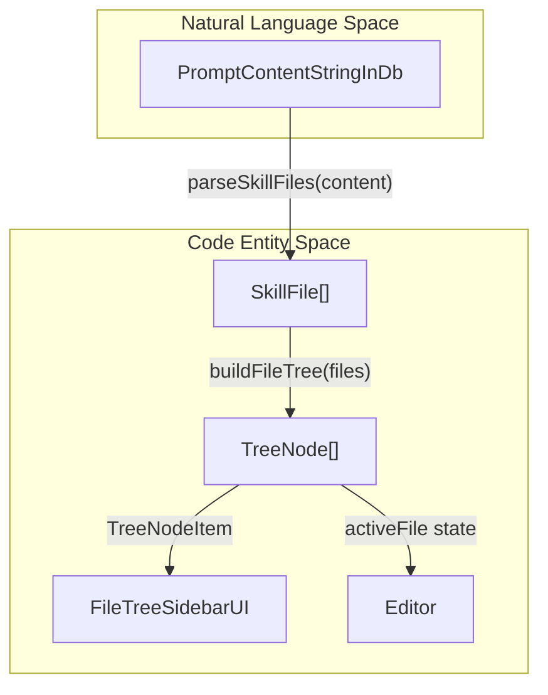
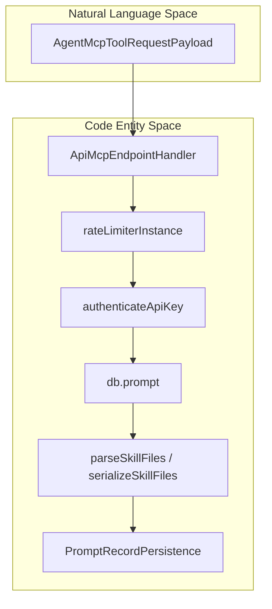

<!-- source: DeepWiki mcp.deepwiki.com · repo f/prompts.chat · page 4.2 Skills & Multi-file Prompts · fetched 2026-11-09 -->

# Skills & Multi-file Prompts

<details>
<summary>Relevant source files</summary>

The following files were used as context for generating this wiki page:

- [src/app/api/prompts/[id]/skill/route.ts](src/app/api/prompts/[id]/skill/route.ts)
- [src/components/prompts/skill-viewer.tsx](src/components/prompts/skill-viewer.tsx)
- [src/lib/skill-files.ts](src/lib/skill-files.ts)

</details>


This page documents the **Skill** prompt type in prompts.chat, which enables managing complex multi-file bundles as a single prompt entity. It covers serialization format requirements (`SKILL.md`), key functions for parsing and serializing skill files, UI components for skill viewing, editing, and diff navigation, `taste.md` files, archive export routes, and Model Context Protocol (MCP) skill tools for programmatic agent interaction.

Sources: [src/lib/skill-files.ts:1-21](), [src/app/api/prompts/[id]/skill/route.ts:35-44]()

---

## Purpose & Scope

The skill system bridges natural language instructions with structured multi-file packaging. It allows developers and prompt engineers to package complete coding environments, instruction sheets, reference documentation, and scripts into a single database record (`Prompt.type = "SKILL"`). These records can then be parsed, inspected via a hierarchical file tree UI, downloaded as a `.skill` archive, or manipulated programmatically via the MCP server.

Sources: [src/lib/skill-files.ts:1-21](), [src/app/api/prompts/[id]/skill/route.ts:35-44]()

---

## What is a Skill?

A **Skill** is a specialized prompt entity stored in the database with `type = "SKILL"`. Unlike standard single-string prompts, a skill bundles multiple related files into a single serialized text string within the `Prompt.content` database field.

The entry point for every skill is `SKILL.md` (defined as `DEFAULT_SKILL_FILE`), which contains frontmatter metadata and top-level instructions. Skills are designed for consumption by AI coding tools and IDE agents (such as Cursor, Windsurf, and Claude Code).

- `DEFAULT_SKILL_FILE` = `"SKILL.md"` [src/lib/skill-files.ts:30-30]()
- Database query filter for skills: `type = "SKILL"` and `content` storing serialized multi-file payloads [src/app/api/prompts/[id]/skill/route.ts:35-44]()

Sources: [src/lib/skill-files.ts:30-30](), [src/app/api/prompts/[id]/skill/route.ts:35-44]()

---

## Serialization Format & Core Functions

To persist multiple files inside a single relational database text column without risk of injection or delimiter collisions, prompts.chat uses ASCII control characters as injection-proof file separators.

| Control Char | Name | ASCII Hex | Usage |
|--------------|------|-----------|-------|
| `\x1F` | Unit Separator | 0x1F | Marks start of file header (`FILE:<filename>`) [src/lib/skill-files.ts:4-15]() |
| `\x1E` | Record Separator | 0x1E | Marks end of file header [src/lib/skill-files.ts:4-15]() |

### Serialization Format Layout

```
[SKILL.md content]
\x1FFILE:<filename.ext>\x1E
[file content]
\x1FFILE:<another-file.js>\x1E
[another file content]
```

### Key Library Functions

- `parseSkillFiles(content: string): SkillFile[]`: Parses a serialized skill string into an array of `{ filename, content }` structures. Defaults to a single `SKILL.md` entry if content is empty or un-separated [src/lib/skill-files.ts:52-82]().
- `serializeSkillFiles(files: SkillFile[]): string`: Reconstructs a single serialized string from an array of `SkillFile` objects, ensuring `SKILL.md` always leads the payload [src/lib/skill-files.ts:88-105]().
- `sanitizeFilename(filename: string): string | null`: Server-side path sanitization utility that blocks path traversal sequences (like `..`), null bytes, and invalid characters to prevent Zip Slip vulnerabilities [src/lib/skill-files.ts:201-211]().
- `getLanguageFromFilename(filename: string): string`: Maps file extensions (e.g. `.ts`, `.md`, `.py`) to Monaco editor language identifiers [src/lib/skill-files.ts:110-194]().

Sources: [src/lib/skill-files.ts:1-211]()

---

## Skill File Tree Structure & Data Flow

To bridge the gap between flat database storage and the nested workspace expected by users, the frontend transforms flat `SkillFile` arrays into a hierarchical directory tree.

Title: "Skill Parsing and Tree Construction Data Flow"

Sources: [src/components/prompts/skill-viewer.tsx:46-88](), [src/lib/skill-files.ts:52-82]()

---

## SkillViewer, Editor & Diff UI Components

The `SkillViewer` component (`src/components/prompts/skill-viewer.tsx`) provides a dual-pane workspace containing a file tree sidebar and a syntax-highlighted code editor. Additional components like editor wrappers and diff viewers provide full editing and version comparison capabilities.

- **File Tree Navigation:** Rendered via the recursive component `TreeNodeItem`, supporting folder expansion/collapse states and active file highlighting [src/components/prompts/skill-viewer.tsx:100-168]().
- **Language Detection:** Dynamically configures `@monaco-editor/react` using `getLanguageFromFilename` [src/components/prompts/skill-viewer.tsx:189-193](), [src/lib/skill-files.ts:110-194]().
- **Clipboard & Export Actions:** Provides utilities to copy active file contents to the clipboard or download individual files [src/components/prompts/skill-viewer.tsx:226-245]().
- **Filename Validation:** Client-side validation using `validateFilename` guards against duplicate filenames and reserved naming violations [src/lib/skill-files.ts:229-250]().

Sources: [src/components/prompts/skill-viewer.tsx:1-245](), [src/lib/skill-files.ts:110-194](), [src/lib/skill-files.ts:229-250]()

---

## Taste.md Files & Multi-File Artifacts

In addition to core executable skills (`SKILL.md`), prompts.chat supports specialized auxiliary files such as `taste.md`. These files capture stylistic guidelines, preferences, design tokens, and aesthetic constraints for AI agents. When bundled within a multi-file skill prompt or standalone taste record, `taste.md` provides contextual taste profiles that agents load alongside instructions to align output tone and style with user expectations.

Sources: [src/lib/skill-files.ts:30-46]()

---

## Archive Download Endpoint

Users can export an entire skill bundle as a `.skill` archive (ZIP format).

- **Route:** `GET /api/prompts/[id]/skill` [src/app/api/prompts/[id]/skill/route.ts:27-30]()
- **Implementation Details:**
  1. Parses the prompt ID, trimming any `.skill` extensions or slug suffixes [src/app/api/prompts/[id]/skill/route.ts:10-25]().
  2. Queries `db.prompt.findFirst` ensuring `type: "SKILL"`, `deletedAt: null`, and `isPrivate: false` [src/app/api/prompts/[id]/skill/route.ts:35-44]().
  3. Parses skill records using `parseSkillFiles` [src/app/api/prompts/[id]/skill/route.ts:51]() and sanitizes each filename via `sanitizeFilename` [src/app/api/prompts/[id]/skill/route.ts:63]().
  4. Bundles files into an archive using `JSZip` with DEFLATE compression [src/app/api/prompts/[id]/skill/route.ts:54-75]().
  5. Returns a binary response with `Content-Type: application/octet-stream` and a slugified attachment filename [src/app/api/prompts/[id]/skill/route.ts:81-86]().

Sources: [src/app/api/prompts/[id]/skill/route.ts:1-87]()

---

## MCP Skill Tools

The Model Context Protocol server at `/api/mcp` exposes dedicated tools for programmatic skill discovery, retrieval, creation, and incremental file manipulation.

Title: "MCP Skill Tool Execution Pipeline"


### Available MCP Skill Tools
- **`search_skills`**: Searches prompts filtered by `type='SKILL'` and query parameters [src/pages/api/mcp.ts:130-175]().
- **`get_skill`**: Retrieves a skill prompt by ID or slug and parses its contents into individual files [src/pages/api/mcp.ts:213-230]().
- **`save_skill`**: Creates a new multi-file skill record for authenticated users [src/pages/api/mcp.ts:32-53]().
- **`add_file_to_skill`** / **`update_skill_file`** / **`remove_file_from_skill`**: Atomically modify individual files within an existing skill payload using parse-modify-serialize cycles.

### Rate Limiting & Security
MCP endpoints enforce strict rate limiting via `RateLimiter` instances defined in `src/lib/rate-limit.ts`:
- General requests: 20 req/min (`mcpGeneralLimiter`) [src/lib/rate-limit.ts:84]()
- Tool calls: 10 req/min (`mcpToolCallLimiter`) [src/lib/rate-limit.ts:87]()
- Write mutations (saves, file additions): 5 req/min (`mcpWriteToolLimiter`) [src/lib/rate-limit.ts:90]()
- AI tools: 2 req/min (`mcpAiToolLimiter`) [src/lib/rate-limit.ts:93]()

API key authentication uses an in-memory cache with a 5-minute TTL to optimize validation overhead [src/pages/api/mcp.ts:28-30]().

Sources: [src/pages/api/mcp.ts:1-53](), [src/pages/api/mcp.ts:130-230](), [src/lib/rate-limit.ts:22-93]()

---

