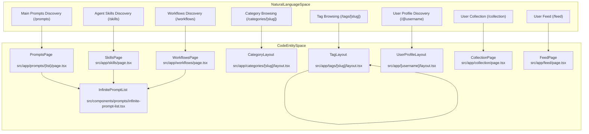
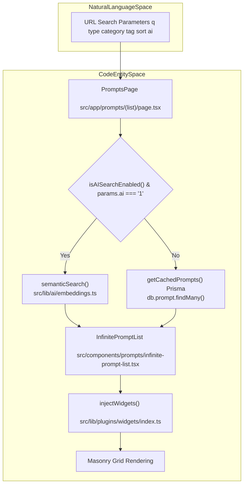
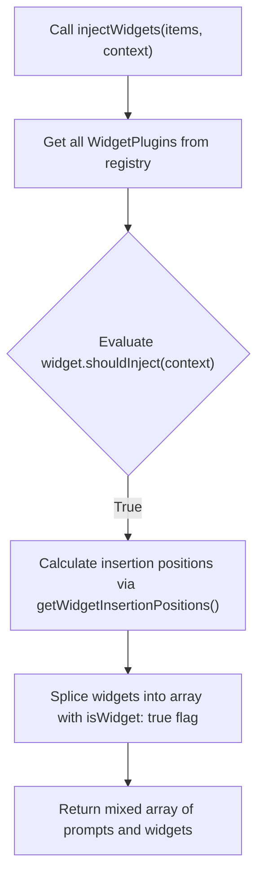

<!-- source: DeepWiki mcp.deepwiki.com · repo f/prompts.chat · page 4.3 Prompt Discovery & Browsing · fetched 2026-11-09 -->

# Prompt Discovery & Browsing

Relevant source files

The following files were used as context for generating this wiki page:

- [src/__tests__/api/prompts.test.ts](src/__tests__/api/prompts.test.ts)
- [src/__tests__/lib/prompt-list.test.ts](src/__tests__/lib/prompt-list.test.ts)
- [src/__tests__/lib/seo.test.ts](src/__tests__/lib/seo.test.ts)
- [src/app/[username]/layout.tsx](src/app/[username]/layout.tsx)
- [src/app/categories/[slug]/layout.tsx](src/app/categories/[slug]/layout.tsx)
- [src/app/prompts/(list)/page.tsx](src/app/prompts/(list)/page.tsx)
- [src/app/tags/[slug]/layout.tsx](src/app/tags/[slug]/layout.tsx)
- [src/app/workflows/page.tsx](src/app/workflows/page.tsx)
- [src/components/prompts/prompt-filters.tsx](src/components/prompts/prompt-filters.tsx)
- [src/lib/prompt-list.ts](src/lib/prompt-list.ts)
- [src/lib/seo.ts](src/lib/seo.ts)

This document covers the technical implementation of prompt discovery, browsing interfaces, filtering mechanisms, search capabilities, and pagination with infinite scroll in the `prompts.chat` codebase. It elaborates on key routes, server-side data fetching, UI components, and the data flow that bridges user inputs to rendered prompt listings.

---

## Discovery Entry Points & Route Architecture

`prompts.chat` provides multiple specialized routes for browsing prompts, agent skills, workflows, and taste-based collections. Each route delegates to specific server components and data-fetching utilities.

Title: Discovery Routes to Code Entities Architecture

- **`/prompts`**: Handled by `PromptsPage`, serving as the primary hub with client-side infinite scrolling (`InfinitePromptList`) [src/app/prompts/(list)/page.tsx:1-20](), [src/app/workflows/page.tsx:164-171]().
- **`/skills`**: Lists agent skills (`type: "SKILL"`) via `SkillsPage` [src/app/skills/page.tsx:1-100]().
- **`/workflows`**: Lists connected execution workflows via `WorkflowsPage` [src/app/workflows/page.tsx:10-109]().
- **`/categories/[slug]`**: Handled by `CategoryLayout`, validating range parameters before rendering category-filtered prompts [src/app/categories/[slug]/layout.tsx:21-39]().
- **`/tags/[slug]`**: Handled by `TagLayout`, enforcing tag validation and pagination bounds [src/app/tags/[slug]/layout.tsx:22-40]().
- **`/@username`**: Handled by `UserProfileLayout`, showing user-authored public/private prompts, contributions, and pinned items [src/app/[username]/layout.tsx:24-59]().
- **`/collection`**: Displays a user's bookmarked prompts via `CollectionPage` [src/app/collection/page.tsx:1-72]().
- **`/feed`**: Shows a personalized feed based on subscribed categories via `FeedPage` [src/app/feed/page.tsx:1-94]().

Sources:
[src/app/prompts/(list)/page.tsx:1-20](),
[src/app/skills/page.tsx:1-100](),
[src/app/workflows/page.tsx:10-174](),
[src/app/categories/[slug]/layout.tsx:21-39](),
[src/app/tags/[slug]/layout.tsx:22-40](),
[src/app/[username]/layout.tsx:24-59]()

---

## Main Prompts Page Implementation (`/prompts`)

The core browsing interface at `/prompts` parses search parameters (`q`, `type`, `category`, `tag`, `sort`, `ai`) to query the database, utilizing either AI semantic search or relational filtering via helper utilities like `promptListTypeWhere` [src/lib/prompt-list.ts:14-16]().

Title: Prompt Search and Filtering Data Flow

### Search & Filtering Logic
- When `ai=1` and `q` is specified, `semanticSearch()` evaluates vector embeddings across prompts [src/app/prompts/(list)/page.tsx:15-15]().
- Type filters are governed by `promptListTypeWhere()` which abstracts out `BOT` and `CLASSIFIER` records unless explicitly requested [src/lib/prompt-list.ts:14-16]().
- Visibility and hierarchy filters automatically enforce:
  - `isPrivate: false`
  - `isUnlisted: false`
  - `deletedAt: null`
  - Exclusion of intermediate flow steps via relational queries [src/app/workflows/page.tsx:20-36]().

Sources:
[src/app/prompts/(list)/page.tsx:1-20](),
[src/lib/prompt-list.ts:14-16](),
[src/app/workflows/page.tsx:20-36]()

---

## Category, Tag, and Profile Layout Guards

### Category Layout (`/categories/[slug]`)
- Validates category existence using `db.category.findUnique()` [src/app/categories/[slug]/layout.tsx:23-24]().
- Enforces strict out-of-range page interception via `isPageOutOfRange()` to return real `404` errors before rendering [src/app/categories/[slug]/layout.tsx:30-36]().

### Tag Layout (`/tags/[slug]`)
- Looks up tags by slug using `db.tag.findUnique()` [src/app/tags/[slug]/layout.tsx:24-24]().
- Verifies pagination offsets against `tagPromptsWhere()` counts [src/app/tags/[slug]/layout.tsx:30-37]().

### User Profile Layout (`/@username`)
- Parses `@username` identifiers, decoding percent-encoded strings and validating username existence case-insensitively [src/app/[username]/layout.tsx:25-37]().
- Verifies page limits for authenticated user sessions depending on private prompt visibility [src/app/[username]/layout.tsx:43-56]().

Sources:
[src/app/categories/[slug]/layout.tsx:21-39](),
[src/app/tags/[slug]/layout.tsx:22-40](),
[src/app/[username]/layout.tsx:24-59]()

---

## Skills, Workflows, and Curated Discovery

- **Skills (`/skills`)**: Queries agent skills using `getCachedSkills` where `type: "SKILL"` with keyword matching and sorting options [src/app/skills/page.tsx:13-100]().
- **Workflows (`/workflows`)**: Identifies execution chains using `getCachedWorkflows` which filters out skills and enforces strict non-related outgoing flow connections [src/app/workflows/page.tsx:10-109]().
- **Curated Discovery (`DiscoveryPrompts`)**: Aggregates featured, trending, latest, and most upvoted prompt groups [src/components/prompts/discovery-prompts.tsx:1-134]().

Sources:
[src/app/skills/page.tsx:13-100](),
[src/app/workflows/page.tsx:10-109](),
[src/components/prompts/discovery-prompts.tsx:1-134]()

---

## Infinite Scroll, Pagination, and Clamping

### Pagination Bounds & Validation
- Pagination parameters are safely parsed and clamped [src/__tests__/api/prompts.test.ts:105-118]().
- Request clamping ensures `perPage` values do not exceed configured backend limits (e.g., maximum 100 items per page) [src/__tests__/api/prompts.test.ts:115-118]().
- Malformed page parameters automatically fall back to page `1` and default items per page [src/__tests__/api/prompts.test.ts:90-103]().

Sources:
[src/__tests__/api/prompts.test.ts:90-118]()

---

## Widget Injection Pipeline

`injectWidgets` modifies prompt listings by weaving in sponsored or promotional widget prompts based on contextual rules.

Title: Widget Injection Pipeline Data Flow

- **Positioning Modes**: Configured via widget position settings with modes such as once or repeat intervals.
- **Context Filtering**: Widgets define `shouldInject` functions to suppress insertion on specific routes or query parameters.

Sources:
[src/components/prompts/discovery-prompts.tsx:1-134]()

---

## Summary of Filtering & Sorting Strategies

| Filter Type | Implementation Mechanics | Code Reference |
| ----------- | ------------------------ | -------------- |
| Text Search | Prisma `contains` with `insensitive` mode; comma-separated terms map to `OR` clauses. Fallback to `semanticSearch()` when `ai=1`. | [src/app/prompts/(list)/page.tsx:15-15]() |
| Prompt Types | Managed via `promptListTypeWhere()` excluding `BOT` and `CLASSIFIER` by default. | [src/lib/prompt-list.ts:14-16]() |
| Category | Foreign key match via `categoryId` or category `slug` with layout guard checks. | [src/app/categories/[slug]/layout.tsx:23-24]() |
| Tag | Relation filter via tag association with layout validation. | [src/app/tags/[slug]/layout.tsx:24-24]() |
| Sort Options | Mapped to Prisma `orderBy` clauses (`createdAt`, `votes._count`, etc.). | [src/app/workflows/page.tsx:138-146]() |
| Trending | Filters prompts based on `trendingUntil` field using `trendingPromptListWhere()` [src/lib/prompt-list.ts:22-30](). | [src/lib/prompt-list.ts:22-30]() |
| Date Filter | Used on user profiles to filter prompts by `createdAt` within specific bounds [src/app/[username]/layout.tsx:50-51](). | [src/app/[username]/layout.tsx:50-51]()

Sources:
[src/app/prompts/(list)/page.tsx:15-15](),
[src/lib/prompt-list.ts:14-30](),
[src/app/categories/[slug]/layout.tsx:23-24](),
[src/app/tags/[slug]/layout.tsx:24-24](),
[src/app/workflows/page.tsx:138-146](),
[src/app/[username]/layout.tsx:50-51]()

---

