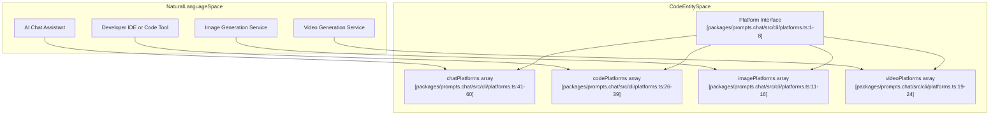
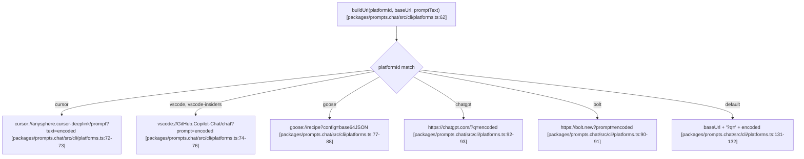
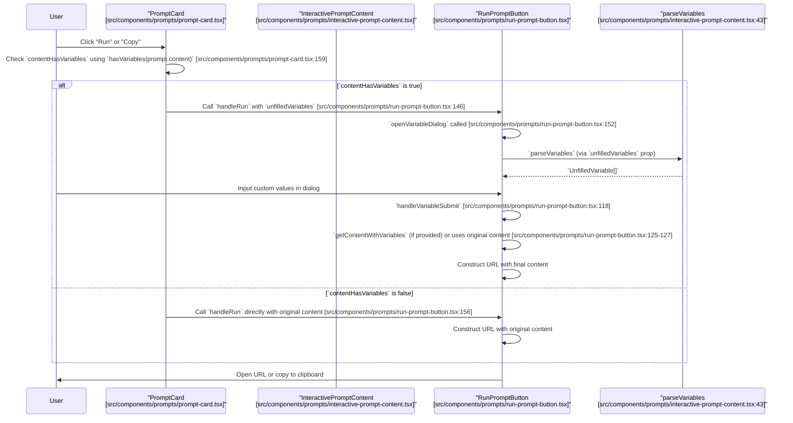

<!-- source: DeepWiki mcp.deepwiki.com · repo f/prompts.chat · page 4.4 Prompt Execution & Run Buttons · fetched 2026-11-09 -->

# Prompt Execution & Run Buttons

<details>
<summary>Relevant source files</summary>

The following files were used as context for generating this wiki page:

- [packages/prompts.chat/src/__tests__/platforms.test.ts](packages/prompts.chat/src/__tests__/platforms.test.ts)
- [packages/prompts.chat/src/cli/platforms.ts](packages/prompts.chat/src/cli/platforms.ts)
- [packages/raycast-extension/src/utils.ts](packages/raycast-extension/src/utils.ts)
- [src/__tests__/lib/works-best-with.test.ts](src/__tests__/lib/works-best-with.test.ts)
- [src/components/prompts/interactive-prompt-content.tsx](src/components/prompts/interactive-prompt-content.tsx)
- [src/components/prompts/prompt-card.tsx](src/components/prompts/prompt-card.tsx)
- [src/components/prompts/run-prompt-button.tsx](src/components/prompts/run-prompt-button.tsx)
- [src/lib/works-best-with.ts](src/lib/works-best-with.ts)

</details>


## Purpose and Scope

This document provides an in-depth technical overview of the prompt execution system within `prompts.chat`. It covers the `RunPromptButton` component [src/components/prompts/run-prompt-button.tsx:1-431](), platform URL construction logic [packages/prompts.chat/src/cli/platforms.ts:62-134](), the dynamic variable filling system [src/components/prompts/interactive-prompt-content.tsx:43-68](), and deep link support for launching IDEs or AI platforms seamlessly [packages/prompts.chat/src/cli/platforms.ts:26-31]().

Sources: [src/components/prompts/run-prompt-button.tsx:1-431](), [packages/prompts.chat/src/cli/platforms.ts:62-134](), [src/components/prompts/interactive-prompt-content.tsx:43-68](), [packages/prompts.chat/src/cli/platforms.ts:26-31]()

---

## Platform Architecture & Data Model

External platforms are classified into typed categories via `Platform` interfaces, declared in web and CLI modules:
- `src/lib/run-platforms.ts` (Web UI runtime, imported by `src/components/prompts/run-prompt-button.tsx`)
- `packages/prompts.chat/src/cli/platforms.ts` (CLI utility)
- `packages/raycast-extension/src/utils.ts` (Raycast integration)

### Platform Categories

| Category | Description | Key Code Entity | Notable Platforms |
| --- | --- | --- | --- |
| Chat Platforms | Web-based AI assistants | `chatPlatforms` [packages/prompts.chat/src/cli/platforms.ts:41-60]() | ChatGPT, Claude, DeepSeek |
| Code Platforms | IDEs and code generation tools with deep links | `codePlatforms` [packages/prompts.chat/src/cli/platforms.ts:26-39]() | VS Code, Windsurf, Cursor, Goose |
| Image Platforms | Image generation services | `imagePlatforms` [packages/prompts.chat/src/cli/platforms.ts:11-16]() | Mitte.ai (Nano Banana, Flux 2) |
| Video Platforms | Video generation services | `videoPlatforms` [packages/prompts.chat/src/cli/platforms.ts:19-24]() | Mitte.ai (Veo 3.1, Sora 2) |

Each platform object conforms to the `Platform` interface containing `id`, `name`, `baseUrl`, `supportsQuerystring`, `isDeeplink`, and `sponsor` [packages/prompts.chat/src/cli/platforms.ts:1-8]().

### Platform Routing from Natural Language to Code Entities



Sources: [packages/prompts.chat/src/cli/platforms.ts:1-60](), [src/components/prompts/run-prompt-button.tsx:36-42](), [packages/raycast-extension/src/utils.ts:44-232]()

---

## URL Construction System

The `buildUrl` function formats execution targets by encoding prompt content, titles, and descriptions according to individual platform parameters [packages/prompts.chat/src/cli/platforms.ts:62-134]().

### URL Encoding and URI Schemes
- **IDE Deep Links**: `cursor`, `vscode`, and `vscode-insiders` append parameters via custom URI schemes (`?text=` or `?prompt=`) [packages/prompts.chat/src/cli/platforms.ts:72-76]().
- **Goose**: Packages a JSON payload containing prompt text, title, description, and activities into a base64-encoded string assigned to the `config` query parameter [packages/prompts.chat/src/cli/platforms.ts:77-88]().
- **Web Chat / Builders**: Appends query strings using platform-specific parameter names (`?q=`, `?prompt=`, `&prompt=`) [packages/prompts.chat/src/cli/platforms.ts:92-130]().

### URL Construction Flow



Unit tests verifying correct URL generation are located at `packages/prompts.chat/__tests__/platforms.test.ts` [packages/prompts.chat/__tests__/platforms.test.ts:1-22]().

Sources: [packages/prompts.chat/src/cli/platforms.ts:62-134](), [packages/prompts.chat/__tests__/platforms.test.ts:1-22]()

---

## Variable Filling System

Prompts containing template variables structured as `${variableName:defaultValue}` support runtime input substitution [src/components/prompts/interactive-prompt-content.tsx:43-68]().

### Core Variable Functions
- `parseVariables(content: string)`: Scans strings for `${...}` blocks and extracts variable names and default fallback values [src/components/prompts/interactive-prompt-content.tsx:43-57]().
- `getUniqueVariables()`: Filters duplicate variable declarations to yield distinct form fields [src/components/prompts/interactive-prompt-content.tsx:60-68]().
- `hasVariables(content: string)`: Determines whether variable substitution UI is necessary [src/components/prompts/prompt-card.tsx:159]().
- `compilePrompt(template, values)`: Replaces template tokens with user-supplied values [packages/raycast-extension/src/utils.ts:31-42]().

### Variable Processing Data Flow



Sources: [src/components/prompts/prompt-card.tsx:159](), [src/components/prompts/interactive-prompt-content.tsx:43-68](), [src/components/prompts/run-prompt-button.tsx:108-172](), [packages/raycast-extension/src/utils.ts:9-42]()

---

## RunPromptButton Component Implementation

The `RunPromptButton` component manages platform selection menus, dispatches analytics events via `analyticsPrompt` [src/components/prompts/run-prompt-button.tsx:32](), and opens the constructed URLs.

### Responsive UI Rendering
- **Mobile (`useIsMobile === true`)**: Renders platforms inside a bottom sheet container (`<Sheet>`) [src/components/prompts/run-prompt-button.tsx:26-31]().
- **Desktop**: Renders platforms using nested dropdown menus (`<DropdownMenu>`) categorized by type [src/components/prompts/run-prompt-button.tsx:16-24]().

The component dynamically determines the default active tab ("chat" or "code") based on the prompt's category or parent category name, checking for keywords like "code" or "coding" [src/components/prompts/run-prompt-button.tsx:66-77](). Media-specific platforms (image, video) are also dynamically included based on the `promptType` prop [src/components/prompts/run-prompt-button.tsx:188-190]().

Sources: [src/components/prompts/run-prompt-button.tsx:1-431]()

---

## Component Integration & Data Flow

`RunPromptButton` integrates with higher-level content viewers and cards to execute prompts.

```mermaid
graph LR
    InteractivePromptContent["InteractivePromptContent<br/>[src/components/prompts/interactive-prompt-content.tsx]"]
    RunPromptButton["RunPromptButton<br/>[src/components/prompts/run-prompt-button.tsx]"]
    PromptCard["PromptCard<br/>[src/components/prompts/prompt-card.tsx]"]

    PromptCard -- "renders" --> RunPromptButton
    InteractivePromptContent -- "renders" --> RunPromptButton

    subgraph "RunPromptButton Internal Logic"
        A[Check for variables] --> B{Variables present?}
        B -- Yes --> C[Open variable dialog]
        C --> D[User fills variables]
        D --> E[Get final content]
        B -- No --> E
        E --> F[Build platform URL]
        F --> G[Execute (open URL / copy)]
    end

    RunPromptButton -- "passes content, variables, callbacks" --> A
```

Sources: [src/components/prompts/interactive-prompt-content.tsx:10-170](), [src/components/prompts/run-prompt-button.tsx:1-431](), [src/components/prompts/prompt-card.tsx:15-178]()

---

# Summary

The prompt execution system unifies cross-platform deep linking, interactive variable filling, and responsive UI components into a cohesive workflow. Through `buildUrl()` and `RunPromptButton`, users can effortlessly transition prompts from the web repository into active IDE sessions or AI assistants.

---

# References

- RunPromptButton component: [src/components/prompts/run-prompt-button.tsx:1-431]()
- CLI platform utilities: [packages/prompts.chat/src/cli/platforms.ts:1-134]()
- Interactive Prompt Content: [src/components/prompts/interactive-prompt-content.tsx:43-218]()
- Prompt Card execution bindings: [src/components/prompts/prompt-card.tsx:15-178]()
- Raycast extension utilities: [packages/raycast-extension/src/utils.ts:1-270]()
- Platform URL tests: [packages/prompts.chat/__tests__/platforms.test.ts:1-22]()

---

