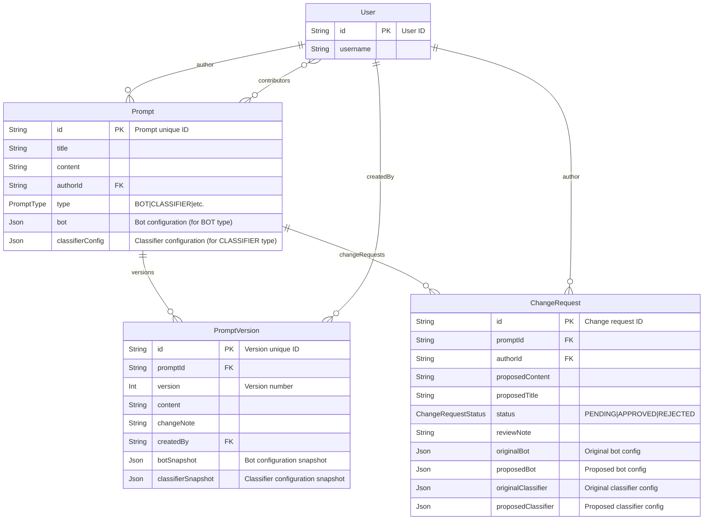
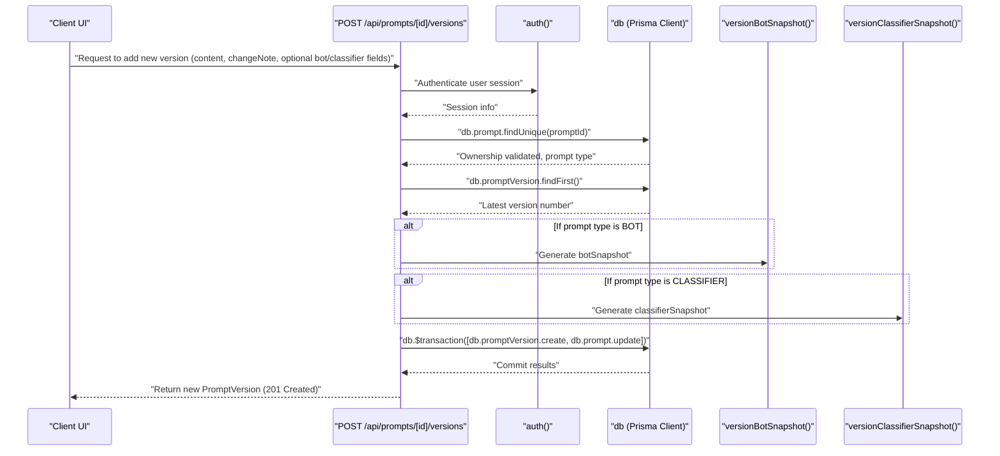
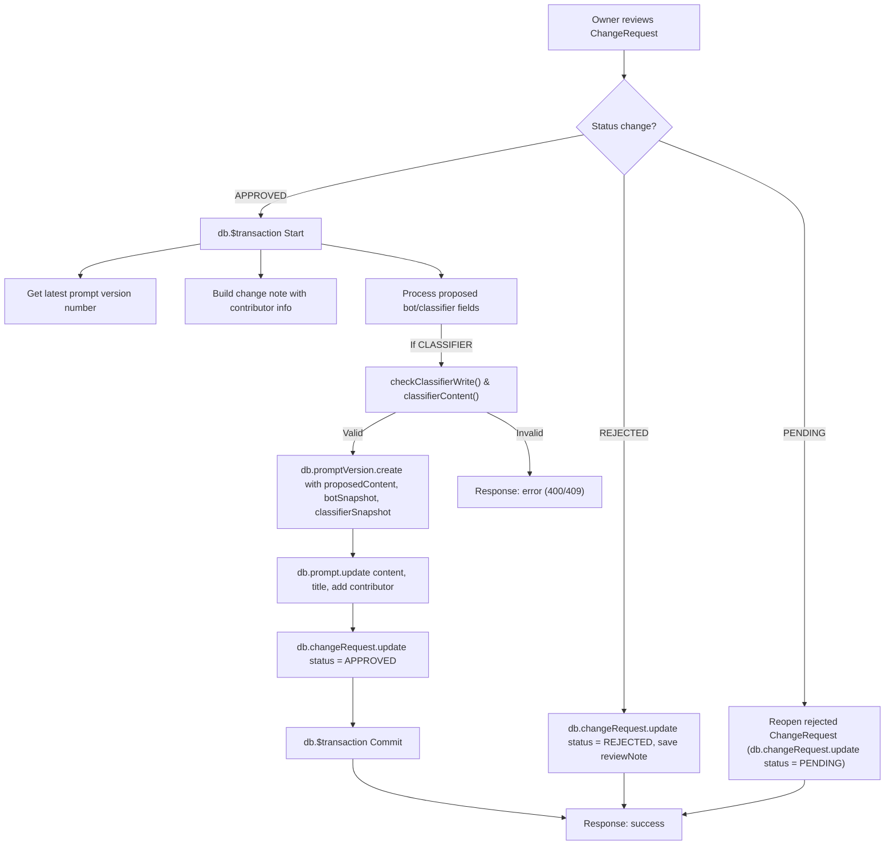

<!-- source: DeepWiki mcp.deepwiki.com · repo f/prompts.chat · page 4.5 Versioning & Change Requests · fetched 2026-11-09 -->

# Versioning & Change Requests

Relevant source files

The following files were used as context for generating this wiki page:

- [src/app/api/prompts/[id]/changes/[changeId]/route.ts](src/app/api/prompts/[id]/changes/[changeId]/route.ts)
- [src/app/api/prompts/[id]/changes/route.ts](src/app/api/prompts/[id]/changes/route.ts)

## Purpose and Scope

This document details the implementation of prompt versioning and the change request workflow in `prompts.chat`. It describes how `PromptVersion` records track the evolution of prompt content, and how community-driven `ChangeRequest` records allow users to propose edits subject to prompt owner review and approval. The page covers relevant Prisma models (`db.PromptVersion`, `db.ChangeRequest`), API routes (`/api/prompts/[id]/versions`, `/api/prompts/[id]/changes`, `/api/prompts/[id]/changes/[changeId]`), approval/rejection flows, and the user interface components that facilitate version management and comparison.

For related functionality, see the [Prompt CRUD Operations](4.1) page for prompt creation and editing, and [Workflow Chains & Connected Prompts](4.7) for prompt relationship management.

Sources: [prisma/schema.prisma:11-183](), [src/app/api/prompts/[id]/changes/route.ts:13-169](), [src/app/api/prompts/[id]/changes/[changeId]/route.ts:10-185]()

---

## System Overview & Architecture Mapping

The prompt versioning and change request subsystems bridge user intent expressed in natural language into structured database updates and server API interactions via Prisma ORM (`db`).

| System | Purpose | User Action | Code Entity / Route | Result |
|---|---|---|---|---|
| **Versioning** | Track prompt evolution | Prompt owner/admin edits | `POST /api/prompts/[id]/versions` [src/app/api/prompts/[id]/versions/route.ts:13-110]() | New `db.promptVersion` created, version incremented |
| **Change Requests** | Enable community prompt edits | Non-owner proposes change | `POST /api/prompts/[id]/changes` [src/app/api/prompts/[id]/changes/route.ts:18-168]() | `db.changeRequest` saved for review |
| | Review & approve/reject changes | Prompt owner reviews | `PATCH /api/prompts/[id]/changes/[changeId]` [src/app/api/prompts/[id]/changes/[changeId]/route.ts:15-185]() | Request marked approved/rejected, prompt updated |

### Code Entities and Their Relationships (Natural Language to Code Space)

Title: "Prisma Schema Model Relationships for Versioning and Change Requests"

Sources: [prisma/schema.prisma:11-183]()

---

## Data Models Detail

### PromptVersion

The `PromptVersion` Prisma model stores historical snapshots of a prompt’s content, allowing retrieval of past versions and audit trails:

- `version`: sequential integer, incremented on every version creation [prisma/schema.prisma:1-157]().
- `content`: full prompt text at this version [prisma/schema.prisma:1-157]().
- `changeNote`: an optional note describing the change [prisma/schema.prisma:1-157]().
- `createdBy`: foreign key linking to the user who created this version [prisma/schema.prisma:1-157]().
- `botSnapshot`: JSON snapshot of bot-specific fields for `BOT` type prompts [prisma/schema.prisma:1-157]().
- `classifierSnapshot`: JSON snapshot of classifier-specific fields for `CLASSIFIER` type prompts [prisma/schema.prisma:1-157]().

Sources: [prisma/schema.prisma:1-157]()

### ChangeRequest

Community members can submit `ChangeRequest` entities to propose edits to a prompt they do not own:

- `status`: one of `PENDING`, `APPROVED`, or `REJECTED` [prisma/schema.prisma:1-157]().
- `proposedContent` and optional `proposedTitle`: the suggested edits [src/app/api/prompts/[id]/changes/route.ts:18-27]().
- `reason`: optional message explaining the change [src/app/api/prompts/[id]/changes/route.ts:18-27]().
- `reviewNote`: owner’s response note upon review [src/app/api/prompts/[id]/changes/[changeId]/route.ts:10-13]().
- The original prompt content/title snapshot (`originalContent`, `originalTitle`) to support differential review [src/app/api/prompts/[id]/changes/route.ts:150-153]().
- `originalBot` and `proposedBot`: JSON fields for bot-specific changes [src/app/api/prompts/[id]/changes/route.ts:159-162]().
- `originalClassifier` and `proposedClassifier`: JSON fields for classifier-specific changes [src/app/api/prompts/[id]/changes/route.ts:163-166]().
- Linked to both `Prompt` and `User` (author of the change request) [prisma/schema.prisma:1-157]().

Sources: [prisma/schema.prisma:1-157](), [src/app/api/prompts/[id]/changes/route.ts:18-168](), [src/app/api/prompts/[id]/changes/[changeId]/route.ts:10-13]()

---

## Version Management System

### Version Creation Workflow (API & DB)

Versions can be created explicitly by prompt owners or admins using the endpoint:
`POST /api/prompts/[id]/versions` [src/app/api/prompts/[id]/versions/route.ts:13-110]()

The workflow includes:

1. **Authentication & Authorization:**
   Validate user session via `auth()` and confirm user owns the prompt before allowing version creation [src/app/api/prompts/[id]/versions/route.ts:18-46]().

2. **Fetch Latest Version Number:**
   Query `db.promptVersion` records for the prompt, retrieve max version [src/app/api/prompts/[id]/versions/route.ts:69-75]().

3. **Transactionally Create New Version and Update Prompt:**
   Use a Prisma transaction (`db.$transaction`) to guarantee atomic creation of the version and update of the prompt's `content` [src/app/api/prompts/[id]/versions/route.ts:78-100](). For `BOT` and `CLASSIFIER` prompt types, `botSnapshot` or `classifierSnapshot` are also created using `versionBotSnapshot` [src/lib/bots/change-snapshot:6-6]() or `versionClassifierSnapshot` [src/lib/classifiers/change-snapshot:7-7]() respectively.

4. **Return Created Version:**
   API returns the new `PromptVersion` record including author information [src/app/api/prompts/[id]/versions/route.ts:102]().

Title: "Sequence Diagram for Version Creation (`POST /api/prompts/[id]/versions`)"

Sources: [src/app/api/prompts/[id]/versions/route.ts:13-110](), [prisma/schema.prisma:11-183](), [src/lib/bots/change-snapshot:6-6](), [src/lib/classifiers/change-snapshot:7-7]()

---

## Change Request Workflow

### Change Request Submission

Users who are **not** the prompt owner can submit a change request for public prompts via:

`POST /api/prompts/[id]/changes` [src/app/api/prompts/[id]/changes/route.ts:29-169]()

- Validations prevent owners from requesting changes on their own prompts [src/app/api/prompts/[id]/changes/route.ts:57-63]().
- Private prompts do not allow change requests [src/app/api/prompts/[id]/changes/route.ts:65-71]().
- The request must include at minimum proposed content, and optionally proposed title and reason [src/app/api/prompts/[id]/changes/route.ts:18-27]().
- For `BOT` prompts, `proposedBot` fields can be included and are validated using `botFieldsInputSchema` [src/app/api/prompts/[id]/changes/route.ts:23-24]() and parsed via `botFieldsFromInput` [src/app/api/prompts/[id]/changes/route.ts:140-140]().
- For `CLASSIFIER` prompts, `proposedClassifier` fields can be included and are validated using `classifierFieldsInputSchema` [src/app/api/prompts/[id]/changes/route.ts:25-26](). The `proposedContent` for classifiers is derived from these fields using `classifierContent` [src/app/api/prompts/[id]/changes/route.ts:122-122]() after validation with `checkClassifierWrite` [src/app/api/prompts/[id]/changes/route.ts:112-112]().
- A new `db.changeRequest` is created linking to the prompt and user, storing the initial content snapshot for contextual comparison [src/app/api/prompts/[id]/changes/route.ts:150-168]().

Sources: [src/app/api/prompts/[id]/changes/route.ts:29-169]()

### Owner Review and Approval/Rejection

The prompt owner reviews change requests and updates their status via:

`PATCH /api/prompts/[id]/changes/[changeId]` [src/app/api/prompts/[id]/changes/[changeId]/route.ts:15-185]()

- Only the prompt’s owner can perform review actions [src/app/api/prompts/[id]/changes/[changeId]/route.ts:43-48]().
- Valid transitions:
  - From `PENDING` to `APPROVED` or `REJECTED` [src/app/api/prompts/[id]/changes/[changeId]/route.ts:88-94]().
  - From `REJECTED` to `PENDING` (reopening) [src/app/api/prompts/[id]/changes/[changeId]/route.ts:103-109]().
- Approving triggers a transaction (`db.$transaction`) that:
  - Creates a new `db.promptVersion` with the approved content [src/app/api/prompts/[id]/changes/[changeId]/route.ts:163-175](). For `BOT` prompts, `botSnapshot` is created using `versionBotSnapshot` [src/app/api/prompts/[id]/changes/[changeId]/route.ts:172-172](). For `CLASSIFIER` prompts, `classifierSnapshot` is created using `versionClassifierSnapshot` [src/app/api/prompts/[id]/changes/[changeId]/route.ts:173-173]().
  - Updates the prompt’s `content` and optionally `title` [src/app/api/prompts/[id]/changes/[changeId]/route.ts:176-181]().
  - Adds the change request author as a contributor [src/app/api/prompts/[id]/changes/[changeId]/route.ts:182-182]().
  - Marks the change request status as `APPROVED` [src/app/api/prompts/[id]/changes/[changeId]/route.ts:183-185]().
- Rejecting updates the `db.changeRequest` status to `REJECTED` and optionally passes a review note [src/app/api/prompts/[id]/changes/[changeId]/route.ts:112-117]().

Sources: [src/app/api/prompts/[id]/changes/[changeId]/route.ts:15-185]()

Title: "Flowchart for Change Request Approval and Rejection Logic"

Sources: [src/app/api/prompts/[id]/changes/[changeId]/route.ts:15-185]()

---

## Privacy and Security Considerations

- Access control is strictly enforced using authorization checks (`checkPromptAccess`) [src/lib/prompt-access.ts:1-49]():
  - Only owners or admins can view private prompts, their versions, or change requests [src/lib/prompt-access.ts:1-49]().
  - Unauthorized requests to private prompt endpoints return `404 Not Found` or `401 Unauthorized` to prevent prompt existence disclosure.

Sources: [src/lib/prompt-access.ts:1-49]()

---

## UI Components for Versioning & Change Requests

The following React components power the prompt page versioning and change request UI features, exposed primarily on `/prompts/[id]` [src/app/prompts/[id]/page.tsx:1-50]():

| Component | File Path | Description |
|---|---|---|
| `AddVersionForm` | `src/components/prompts/add-version-form` | Form for owners to manually add a new version with a change note |
| `DeleteVersionButton` | `src/components/prompts/delete-version-button` | Button to delete older versions (history pruning) |
| `VersionCompareButton` | `src/components/prompts/version-compare-button` | Triggers modal to compare two versions side-by-side |
| `VersionCompareModal` | `src/components/prompts/version-compare-modal` | Modal showing side-by-side version diff |

Sources: [src/app/prompts/[id]/page.tsx:1-50]()

---

## Summary Diagram: From User Action to Code Entities

Title: "Architecture Flow from User Actions to Route Handlers and Prisma Models"

```mermaid
flowchart TD
    UserAction["User (Owner or Contributor)"]

    UserAction -- "Submit Change Request (proposedContent, proposedTitle, proposedBot, proposedClassifier, reason)" --> ChangesPOST["POST /api/prompts/[id]/changes"]
    ChangesPOST --> ValidateInput["Validate input (zod schemas)"]
    ChangesPOST -- "If CLASSIFIER" --> CheckClassifierWrite["checkClassifierWrite() & classifierContent()"]
    ChangesPOST --> DB_CR["db.changeRequest.create()"]
    DB_CR -- "Stores original/proposed content, title, bot, classifier" --> PrismaClient

    UserAction -- "Review & Approve/Reject (status, reviewNote)" --> ChangesPatch["PATCH /api/prompts/[id]/changes/[changeId]"]
    ChangesPatch --> AuthCheckOwner["Auth: Check prompt owner"]
    ChangesPatch --> ValidateStatusTransition["Validate status transition"]
    ChangesPatch -- "If APPROVED" --> GetLatestVersion["Get latest prompt version"]
    ChangesPatch -- "If APPROVED" --> ProcessBotClassifierApproval["Process proposed bot/classifier for snapshot"]
    ChangesPatch -- "If APPROVED" --> DB_Transaction["db.$transaction"]
    DB_Transaction --> DB_PVersion["db.promptVersion.create()"]
    DB_Transaction --> DB_Prompt["db.prompt.update(content, title, contributors)"]
    DB_Transaction --> DB_CR_Update["db.changeRequest.update(status=APPROVED)"]
    DB_Transaction --> PrismaClient

    ChangesPatch -- "If REJECTED/PENDING" --> DB_CR_Update_Simple["db.changeRequest.update(status, reviewNote)"]
    DB_CR_Update_Simple --> PrismaClient

    UserAction -- "Create Version (owner/admin) (content, changeNote, optional bot/classifier fields)" --> VersionsPOST["POST /api/prompts/[id]/versions"]
    VersionsPOST --> AuthCheckOwner["Auth: Check prompt owner"]
    VersionsPOST --> GetLatestVersion["Get latest prompt version"]
    VersionsPOST --> ProcessBotClassifierVersion["Process bot/classifier for snapshot"]
    VersionsPOST --> DB_Transaction_Version["db.$transaction"]
    DB_Transaction_Version --> DB_PVersion["db.promptVersion.create()"]
    DB_Transaction_Version --> DB_Prompt["db.prompt.update(content, title)"]
    DB_Transaction_Version --> PrismaClient

    AuthCheckOwner -- "Auth check" --> AuthLib["auth()"]
    ValidateInput -- "Validation" --> ZodLib["zod"]
    CheckClassifierWrite -- "Classifier logic" --> ClassifierLib["src/lib/classifiers/write"]
    ProcessBotClassifierApproval -- "Bot/Classifier logic" --> BotClassifierLib["src/lib/bots/change-snapshot"]
    ProcessBotClassifierVersion -- "Bot/Classifier logic" --> BotClassifierLib
```

Sources: [src/app/api/prompts/[id]/changes/route.ts:29-169](), [src/app/api/prompts/[id]/changes/[changeId]/route.ts:15-185](), [src/app/api/prompts/[id]/versions/route.ts:13-110](), [prisma/schema.prisma:11-183](), [src/lib/bots/change-snapshot:1-10](), [src/lib/classifiers/change-snapshot:1-15](), [src/lib/classifiers/write:1-20]()

---

## References

- Prisma schema models: [prisma/schema.prisma:11-183]()
- Prompt version API: [src/app/api/prompts/[id]/versions/route.ts:13-110]()
- Change request API:
  - Create & list: [src/app/api/prompts/[id]/changes/route.ts:29-169]()
  - Review & update: [src/app/api/prompts/[id]/changes/[changeId]/route.ts:15-185]()
- Prompt page UI with versioning components: [src/app/prompts/[id]/page.tsx:1-50]()
- Prompt privacy check: [src/lib/prompt-access.ts:1-49]()
- Bot change snapshot utilities: [src/lib/bots/change-snapshot:1-10]()
- Classifier change snapshot utilities: [src/lib/classifiers/change-snapshot:1-15]()
- Classifier write validation: [src/lib/classifiers/write:1-20]()

---

