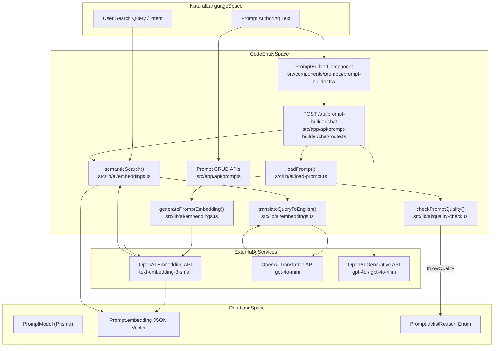
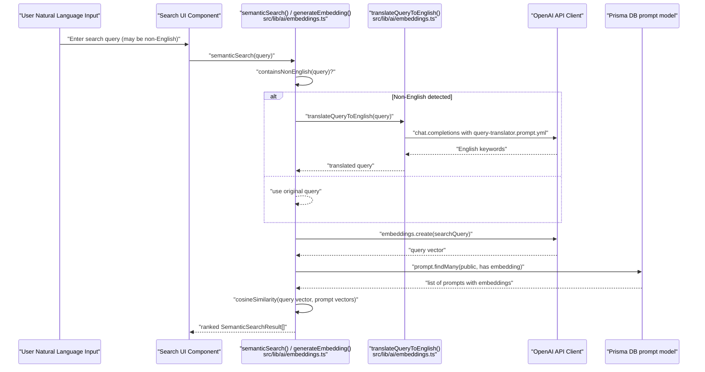

<!-- source: DeepWiki mcp.deepwiki.com · repo f/prompts.chat · page 4.6 AI-Powered Features · fetched 2026-11-09 -->

# AI-Powered Features

<details>
<summary>Relevant source files</summary>

The following files were used as context for generating this wiki page:

- [prisma/migrations/20251217173000_add_delist_reason/migration.sql](prisma/migrations/20251217173000_add_delist_reason/migration.sql)
- [src/app/api/prompt-builder/chat/prompt-builder-agent.prompt.yml](src/app/api/prompt-builder/chat/prompt-builder-agent.prompt.yml)
- [src/app/api/prompt-builder/chat/route.ts](src/app/api/prompt-builder/chat/route.ts)
- [src/lib/ai/embeddings.ts](src/lib/ai/embeddings.ts)
- [src/lib/ai/load-prompt.ts](src/lib/ai/load-prompt.ts)
- [src/lib/ai/quality-check.prompt.yml](src/lib/ai/quality-check.prompt.yml)
- [src/lib/ai/quality-check.ts](src/lib/ai/quality-check.ts)
- [src/lib/ai/query-translator.prompt.yml](src/lib/ai/query-translator.prompt.yml)
- [src/lib/ai/sql-generation.prompt.yml](src/lib/ai/sql-generation.prompt.yml)
- [src/lib/ai/translate.prompt.yml](src/lib/ai/translate.prompt.yml)

</details>


This page explains the AI-powered capabilities that enhance prompt discovery, quality control, content generation, and expert prompt engineering in prompts.chat. These features leverage OpenAI's APIs and specialized YAML-defined prompts (`.prompt.yml` files) to provide semantic search, automated quality checking, translation, and agentic prompt construction.

Sources: [src/lib/ai/embeddings.ts:1-233](), [src/lib/ai/quality-check.ts:1-173](), [src/lib/ai/load-prompt.ts:1-44]()

---

## Overview of AI Features

The platform integrates several AI-driven features powered by OpenAI models (typically `gpt-4o`, `gpt-4o-mini`, and `text-embedding-3-small`):

| Feature | Purpose | Trigger | Key Code Entity |
|---|---|---|---|
| **Embeddings Generation** | Enable semantic search | Prompt creation or update | `generatePromptEmbedding` [src/lib/ai/embeddings.ts:81-109]() |
| **Quality Check** | Auto-delist low-quality prompts | Prompt creation or update | `checkPromptQuality` [src/lib/ai/quality-check.ts:72-164]() |
| **Semantic Search** | Find prompts by semantic meaning | Search with query input | `semanticSearch` [src/lib/ai/embeddings.ts:214-233]() |
| **Prompt Builder Agent** | Expert agent for prompt creation and edits | Prompt Builder UI | `prompt-builder-agent.prompt.yml` [src/app/api/prompt-builder/chat/prompt-builder-agent.prompt.yml:1-131]() |
| **Query Translation** | Translate non-English search queries | Semantic search query input | `translateQueryToEnglish` [src/lib/ai/embeddings.ts:32-60]() |
| **SQL Generation** | Generate SQL queries for HF dataset viewing | HF dataset explorer UI | `sql-generation.prompt.yml` [src/lib/ai/sql-generation.prompt.yml:1-35]() |

These features improve prompt discoverability, quality assurance, multilingual support, and prompt authoring workflow with tight integration between AI models and the platform’s data.

Sources: [src/lib/ai/embeddings.ts:1-233](), [src/lib/ai/quality-check.ts:1-173](), [src/app/api/prompt-builder/chat/prompt-builder-agent.prompt.yml:1-131](), [src/lib/ai/sql-generation.prompt.yml:1-35]()

---

## AI Features Architecture

This section bridges the **Natural Language Space** (user queries, intent, prompt text) to the **Code Entity Space** (functions, API routes, database models), illustrating the data flow and key components.

### AI Processing Data Flow



Sources: [src/lib/ai/embeddings.ts:70-233](), [src/lib/ai/quality-check.ts:72-164](), [src/app/api/prompt-builder/chat/prompt-builder-agent.prompt.yml:1-131](), [src/lib/ai/load-prompt.ts:30-44]()

---

## Embeddings & Semantic Search

### Embeddings Generation

When a public prompt is created or updated, the system generates a vector embedding representing its semantic content. The process is:

1.  **Concatenation** — The prompt’s `title`, `description`, and `content` fields are combined with newlines into a single text blob [src/lib/ai/embeddings.ts:96-101]().
2.  **Embedding API Call** — The combined text is sent to OpenAI's embedding generation API (`text-embedding-3-small` or configured model) using `generateEmbedding(text)` [src/lib/ai/embeddings.ts:70-79]().
3.  **Database Storage** — The resulting embedding vector (array of floats) is saved in the prompt’s `embedding` field in the Prisma `Prompt` model [src/lib/ai/embeddings.ts:104-108]().
4.  **Bulk Regeneration** — The `generateAllEmbeddings` function iterates over all non-private prompts lacking embeddings and generates them with 1-second rate limiting to avoid API throttling [src/lib/ai/embeddings.ts:115-160]().

Sources: [src/lib/ai/embeddings.ts:70-160]()

### Semantic Search Execution

The `semanticSearch` function enables searching using natural language queries as follows:

-   **Non-English Query Translation**: Queries containing non-ASCII (non-English) characters are translated into English keywords using the `translateQueryToEnglish` function, which employs a dedicated `query-translator.prompt.yml` system prompt and a cheap generative model [src/lib/ai/embeddings.ts:32-60]().
-   **Query Embedding**: The translated (or original) query is embedded using the same embedding model.
-   **Prompt Retrieval**: All public prompts with valid embeddings are fetched from the database.
-   **Similarity Scoring**: Cosine similarity between the query embedding and each prompt's embedding is computed to rank relevance [src/lib/ai/embeddings.ts:162-174]().
-   **Result Return**: The top results are returned as a rich `SemanticSearchResult` object with prompt metadata [src/lib/ai/embeddings.ts:176-208]().

#### Semantic Search Flow Diagram



Sources: [src/lib/ai/embeddings.ts:32-233](), [src/lib/ai/query-translator.prompt.yml:1-22]()

---

## Quality Check System

To maintain prompt quality standards, prompts undergo an automated quality checking pipeline using both heuristic and AI methods:

### Automated Delisting Pipeline

Prompts are checked on creation or update through `checkPromptQuality` which performs:

1.  **Length Heuristics**: Basic length requirements enforce a minimum of 50 characters and 10 words in the prompt content [src/lib/ai/quality-check.ts:43-66]().
2.  **AI-Powered Quality Validation**: If heuristic checks pass, an AI call is made to OpenAI's `gpt-4o` model leveraging the `quality-check.prompt.yml` system prompt to assess:
    -   Whether the prompt is in English
    -   If the prompt is high quality (not gibberish)
    -   Whether the prompt is a valid instruction for generative AI
3.  **Delist Decision**: The AI returns a JSON indicating if the prompt should be delisted, reason codes, confidence, and details. Only results with confidence ≥ 0.85 result in delisting [src/lib/ai/quality-check.ts:72-164]().

### Delist Reasons Enum

The system uses the following delist reasons matching the Prisma schema enum added in migration `20251217173000_add_delist_reason`:

| Reason | Description |
|---|---|
| `TOO_SHORT` | Content too brief or has insufficient words |
| `NOT_ENGLISH` | Prompt is primarily non-English |
| `LOW_QUALITY` | Gibberish, random characters, or meaningless text |
| `NOT_LLM_INSTRUCTION` | Not an AI generative prompt (ex: recipe, note) |
| `MANUAL` | Manual delisting by admins |

Sources: [src/lib/ai/quality-check.ts:1-173](), [src/lib/ai/quality-check.prompt.yml:1-62](), [prisma/migrations/20251217173000_add_delist_reason/migration.sql:1-5]()

---

## Prompt Builder Agent & `.prompt.yml` Files

The platform features an AI expert agent to assist in writing new prompts or editing existing ones with stylistic consistency.

### Prompt Builder Agent

-   The agent is configured in the `src/app/api/prompt-builder/chat/prompt-builder-agent.prompt.yml` file.
-   It instructs the AI to first search existing prompts for relevant examples before constructing new prompts, emphasizing structure, quality, and reuse of variables [src/app/api/prompt-builder/chat/prompt-builder-agent.prompt.yml:11-13]().
-   The agent supports workflows for building new prompts, editing content, and converting prompts into structured JSON formats to support advanced prompt types and multi-file skills [src/app/api/prompt-builder/chat/prompt-builder-agent.prompt.yml:21-67]().
-   The agent API route at `POST /api/prompt-builder/chat` implements session validation, rate limiting, and streams responses progressively to clients [src/app/api/prompt-builder/chat/route.ts:64-191]().

Sources: [src/app/api/prompt-builder/chat/prompt-builder-agent.prompt.yml:1-131](), [src/app/api/prompt-builder/chat/route.ts:64-191]()

### `.prompt.yml` Prompt Definition Format

All AI-powered workflows in the system load their core prompt configurations from `.prompt.yml` files using the `loadPrompt` function [src/lib/ai/load-prompt.ts:30-44]().

A prompt YAML file includes:

-   `name` and `description` metadata [src/lib/ai/load-prompt.ts:14-15]()
-   The OpenAI model name (`model`) and parameters (temperature, maxTokens) [src/lib/ai/load-prompt.ts:16-20]()
-   A list of chat `messages` with roles `system`, `user`, or `assistant` [src/lib/ai/load-prompt.ts:21]()
-   Optional `testData` for automated testing [src/lib/ai/load-prompt.ts:22]()

Example:

```yaml
name: Prompt Builder Agent
description: An expert prompt engineer agent...
model: openai/gpt-4o-mini
modelParameters:
  temperature: 0.7
  maxTokens: 2000
messages:
  - role: system
    content: |
      You are an expert prompt engineer agent...
```

The system interpolates variables in prompt templates using `interpolatePrompt` for dynamic content insertion [src/lib/ai/load-prompt.ts:62-71]().

Sources: [src/lib/ai/load-prompt.ts:1-71]()

---

## Content Translation & SQL Generation

### Content Translation

To support multilingual users, the platform can utilize the `translate.prompt.yml` prompt to translate prompt contents or queries into target languages while preserving formatting and variable placeholders. Typical usage scenarios:

-   Translating interface or prompt content (`${variable}` placeholders are conserved with translated default values)
-   Translation calls employ OpenAI `gpt-4o-mini` with a system prompt instructing professional fidelity and formatting retention [src/lib/ai/translate.prompt.yml:1-27]().

Sources: [src/lib/ai/translate.prompt.yml:1-27]()

### SQL Generation for Dataset Exploration

For advanced exploration of the prompts dataset on Hugging Face, a dedicated prompt `sql-generation.prompt.yml` guides the construction of efficient DuckDB SQL queries based on user natural language inputs:

-   It defines rules to generate SQL selecting prompt acts and content matching keywords [src/lib/ai/sql-generation.prompt.yml:11-22]().
-   The prompt instructs the AI to produce concise SQL without explanations [src/lib/ai/sql-generation.prompt.yml:14]().
-   Example outputs translate user intents like `"Find prompts about coding"` into appropriate SQL filtering queries [src/lib/ai/sql-generation.prompt.yml:27-35]().

Sources: [src/lib/ai/sql-generation.prompt.yml:1-35]()

---

# Summary

prompts.chat seamlessly integrates OpenAI services for embeddings, semantic search, translation, quality checks, and prompt authoring assistance, all orchestrated through a configuration of `.prompt.yml` files and robust server-side APIs. This infrastructure enables scalable, high-quality prompt discovery and collaborative editing backed by sophisticated AI models and domain-specific prompt templates.

Sources:
[src/lib/ai/embeddings.ts:1-233](),
[src/lib/ai/quality-check.ts:1-173](),
[src/lib/ai/load-prompt.ts:1-71](),
[src/app/api/prompt-builder/chat/prompt-builder-agent.prompt.yml:1-131](),
[src/lib/ai/translate.prompt.yml:1-27](),
[src/lib/ai/sql-generation.prompt.yml:1-35](),
[src/app/api/prompt-builder/chat/route.ts:1-191](),
[prisma/migrations/20251217173000_add_delist_reason/migration.sql:1-5]()

---

