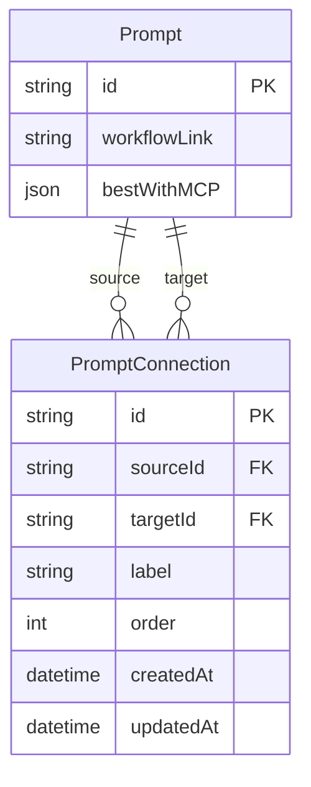
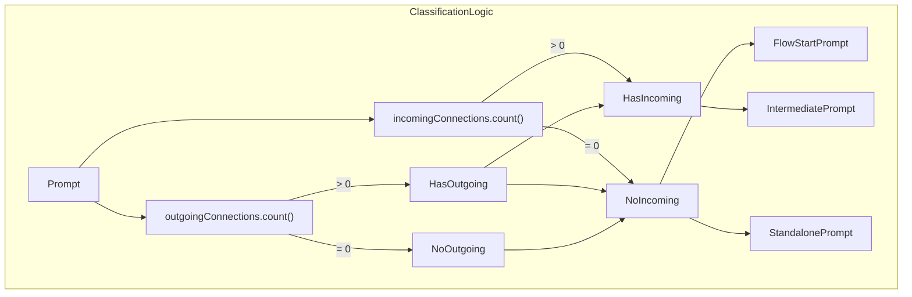
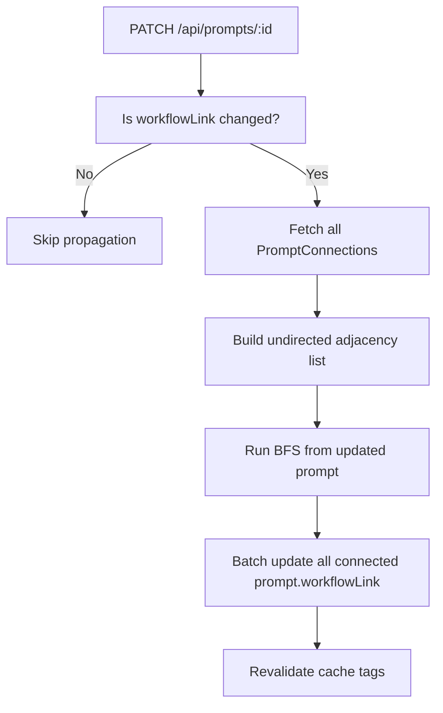
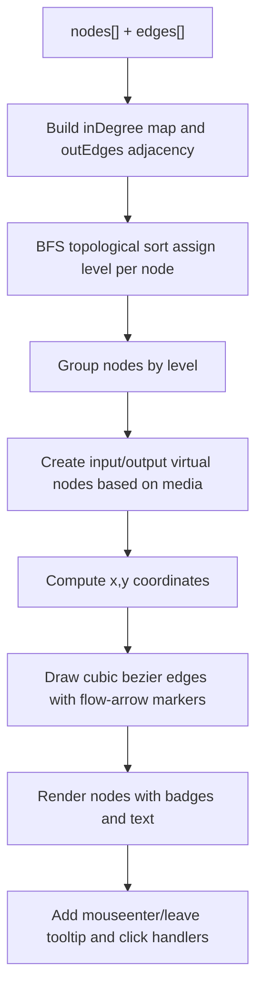
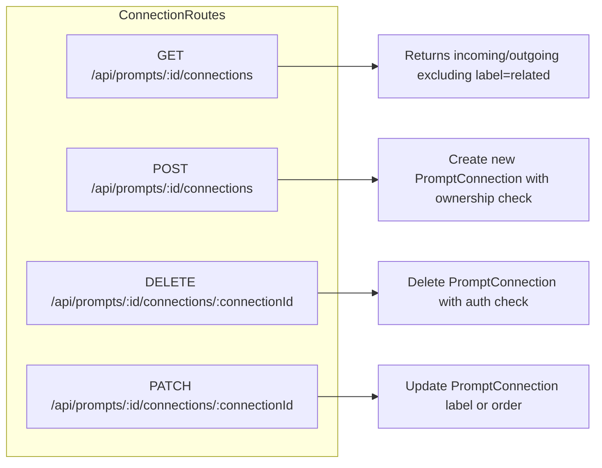
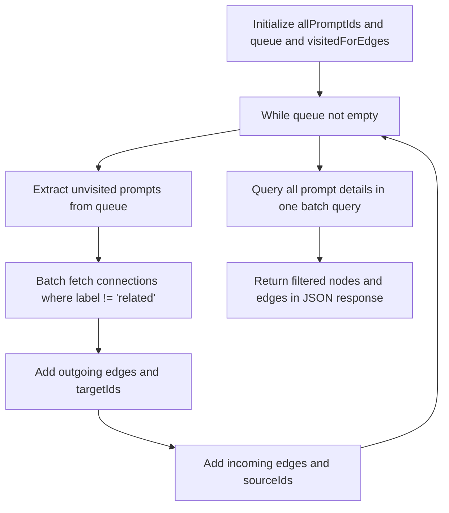
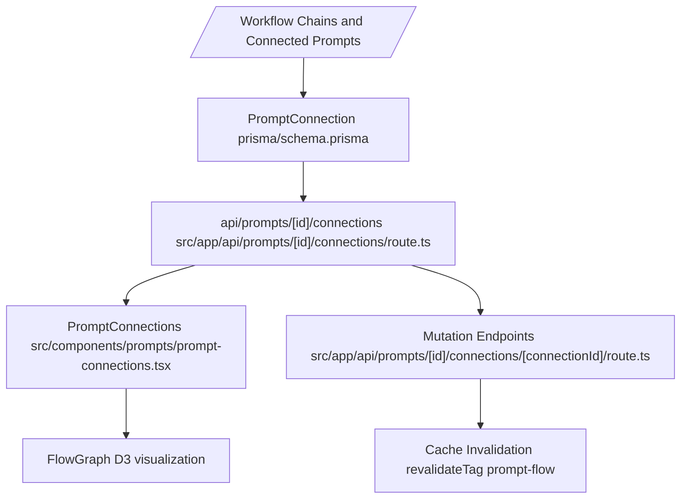
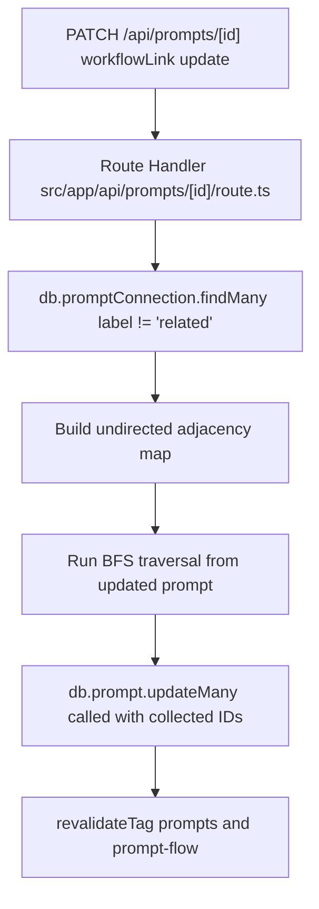

<!-- source: DeepWiki mcp.deepwiki.com · repo f/prompts.chat · page 4.7 Workflow Chains & Connected Prompts · fetched 2026-11-09 -->

# Workflow Chains & Connected Prompts

<details>
<summary>Relevant source files</summary>

The following files were used as context for generating this wiki page:

- [src/app/api/prompts/[id]/connections/[connectionId]/route.ts](src/app/api/prompts/[id]/connections/[connectionId]/route.ts)
- [src/app/api/prompts/[id]/connections/route.ts](src/app/api/prompts/[id]/connections/route.ts)
- [src/app/api/prompts/[id]/flow/route.ts](src/app/api/prompts/[id]/flow/route.ts)
- [src/components/prompts/prompt-connections.tsx](src/components/prompts/prompt-connections.tsx)

</details>


## Purpose and Scope

This document details the workflow chain system within `prompts.chat`. The system allows linking prompts via directed connections (`PromptConnection`) to compose multi-step pipelines where the output of one prompt feeds as input to another. These workflow graphs enable complex AI-assisted tasks, chaining modular prompt components seamlessly.

Key topics covered:
- `PromptConnection` model and `workflowLink` field usage
- BFS algorithm for propagating `workflowLink` changes across prompt components
- Differentiation between workflow and "related" connections
- API endpoints for managing connections
- D3-based `FlowGraph` visualization and UI components

Related topics:
- For AI similarity-based "related" prompts, see [AI-Powered Features]()
- For multi-file prompt packaging with skills, see [Skills & Multi-file Prompts]()
- For prompt CRUD and editing flows, see [Prompt CRUD Operations]()

Sources: [src/components/prompts/prompt-connections.tsx:1-213](), [prisma/schema.prisma:378-393]()

---

## PromptConnection Model

The graph topology for workflow chains is realized through the `PromptConnection` model. Each record represents a directed edge from a source prompt to a target prompt.

### Database Schema

Title: PromptConnection ER Diagram


- `sourceId` and `targetId` denote the connected prompt pair.
- `label` distinguishes the type of connection (e.g., workflow or related).
- `order` defines a user-controlled sequence to represent multiple outgoing edges.

Sources: [prisma/schema.prisma:378-393](), [prisma/schema.prisma:93-143]()

### Connection Types (`label` Field)

Two main semantic usages of the connection `label` field exist:

| Label Value | Role | Created By | Direction |
| --- | --- | --- | --- |
| `"related"` | AI-suggested similar prompts | Embeddings service | Bidirectional (conceptual) |
| Other string | Workflow chain step connections | User-created via UI/API | Directed (source→target) |

**Note:** The workflow graph endpoints and client components exclude `"related"` labeled connections when building execution pipelines.

**Implementation detail:** Queries filter via `{ label: { not: "related" } }` to focus on intended workflow links [src/app/api/prompts/[id]/connections/route.ts:33-49]().

Sources: [src/app/api/prompts/[id]/connections/route.ts:33-49]()

---

## Flow Start vs Intermediate Prompts

The system classifies prompts in a workflow based on their connection topology to control visibility and behavior.

### Logical Classification

Title: Prompt Workflow Classification Logic


- **Flow Start Prompt:** Has outgoing connections but no incoming, shown in browsing lists as entry points.
- **Intermediate Prompt:** Has both incoming and outgoing connections, hidden from general lists to avoid clutter.
- **Standalone Prompt:** No connections at all, treated as independent prompts.

### Browsing Filter Example

Browsing APIs exclude intermediate flow prompts by filtering on lack of incoming workflow connections not labeled `"related"` [src/app/workflows/page.tsx:28-38]():

```typescript
where: {
  incomingConnections: { 
    none: { 
      label: { not: "related" } 
    } 
  }
}
```

Sources: [src/app/workflows/page.tsx:28-38]()

---

## Workflow Link Propagation

The `workflowLink` field on each prompt stores a URL or identifier related to the workflow execution environment. When this field is updated on a single prompt, the system propagates the change to all directly or indirectly connected prompts in the workflow, ensuring consistency.

### Propagation via BFS Algorithm

When a prompt's `workflowLink` is changed (via PATCH on `/api/prompts/:id`):

Title: Workflow Link Propagation Flow


**Algorithm Steps:**
1. Query all workflow connections (excluding `"related"`) from `promptConnection` [src/app/api/prompts/[id]/route.ts:280-336]().
2. Build an undirected adjacency from `sourceId` and `targetId` pairs to allow traversal in both directions [src/app/api/prompts/[id]/route.ts:280-336]().
3. Initialize BFS with starting prompt ID, collecting all reachable prompt IDs [src/app/api/prompts/[id]/route.ts:280-336]().
4. Batch update all collected prompts to set their `workflowLink` to the new value [src/app/api/prompts/[id]/route.ts:280-336]().
5. Revalidate cache tags to refresh UI and flow data [src/app/api/prompts/[id]/route.ts:339-340]().

Sources: [src/app/api/prompts/[id]/route.ts:280-340]()

---

## UI Components and Data Flow

### PromptConnections Component

- File: `src/components/prompts/prompt-connections.tsx`
- Props include prompt ID, title, edit permissions, and optionally a `workflowLink` for live testing links [src/components/prompts/prompt-connections.tsx:38-48]().
- Loads and renders incoming and outgoing connections and the flow graph visualization.
- Allows users to add, edit, or delete connections with context-aware UI.
- Fetches connections from `/api/prompts/:id/connections` and flow graph data from `/api/prompts/:id/flow`.

### FlowGraph Visualization

- Implements a directed acyclic graph display using D3.js [src/components/prompts/prompt-connections.tsx:7-123]().
- Computes topological sorting and assigns vertical levels to prompts [src/components/prompts/prompt-connections.tsx:180-213]().
- Renders connections as curved cubic Bézier paths with arrow markers.
- Displays input/output virtual nodes for prompts requiring or producing media [src/components/prompts/prompt-connections.tsx:760-800]().
- Supports hover tooltips and click interactions to navigate to prompt detail pages [src/components/prompts/prompt-connections.tsx:150-176]().

#### FlowGraph Layout Pipeline

Title: FlowGraph Layout Pipeline


Sources: [src/components/prompts/prompt-connections.tsx:1-213]()

---

## API Endpoints for Connections

Below is the overview of key RESTful routes managing prompt connections:

Title: Connection REST Endpoints


### Detailed Routes

- **GET /api/prompts/:id/connections**  
  Retrieves incoming and outgoing connections for the prompt excluding `"related"`. Filters out private prompts the user cannot access [src/app/api/prompts/[id]/connections/route.ts:17-87]().

- **POST /api/prompts/:id/connections**  
  Creates a new prompt connection after verifying the user owns both source and target prompts. Prevents self-links and duplicates. Returns full created connection data [src/app/api/prompts/[id]/connections/route.ts:89-211]().

- **DELETE /api/prompts/:id/connections/:connectionId**  
  Deletes a connection if the user owns the source prompt or has admin role. Revalidates caches post deletion [src/app/api/prompts/[id]/connections/[connectionId]/route.ts:16-74]().

- **PATCH /api/prompts/:id/connections/:connectionId**  
  Allows updating the connection's `label` or `order` with ownership validation. Triggers cache revalidation [src/app/api/prompts/[id]/connections/[connectionId]/route.ts:76-149]().

Sources: [src/app/api/prompts/[id]/connections/route.ts:1-211](), [src/app/api/prompts/[id]/connections/[connectionId]/route.ts:1-149]()

---

## Flow Graph Endpoint and BFS for Connected Prompts

The flow visualization needs the full connected subgraph including prompts reachable by any workflow edge from the starting prompt.

### GET /api/prompts/[id]/flow Endpoint

- Utilizes a batch BFS traversal over prompt connections (excluding `"related"`) to collect all related prompt IDs [src/app/api/prompts/[id]/flow/route.ts:33-116]().
- Fetches all prompt details in one database query by gathering all connected prompt IDs [src/app/api/prompts/[id]/flow/route.ts:118-146]().
- Filters prompts by user permission (visibility) [src/app/api/prompts/[id]/flow/route.ts:176-210]().
- Returns JSON of nodes and edges for UI rendering [src/app/api/prompts/[id]/flow/route.ts:212-216]().

### BFS Algorithm in Flow Endpoint

Title: BFS Flow Graph Traversal


- Uses caching with Next.js `unstable_cache` keyed on `"prompt-flow"` tag, expiring after 60 seconds or when related data changes [src/app/api/prompts/[id]/flow/route.ts:33-150]().

Sources: [src/app/api/prompts/[id]/flow/route.ts:1-225]()

---

## Cache Invalidation

Any mutation to prompts or connections affecting workflows triggers invalidation of cached data to maintain synchronization:

```typescript
revalidateTag("prompts");      // General prompt catalog refresh
revalidateTag("prompt-flow");  // Workflow graph cache refresh
```

This occurs after creating, updating, or deleting connections and after changing a prompt's `workflowLink`.

Sources: [src/app/api/prompts/[id]/connections/route.ts:198](), [src/app/api/prompts/[id]/connections/[connectionId]/route.ts:64-136](), [src/app/api/prompts/[id]/route.ts:339-340]()

---

## Bridging Natural Language Space to Code Entities

### Workflow Chain Concept to Code Entities

Title: Workflow Chain to Code Entity Mapping


Sources: [prisma/schema.prisma:378-393](), [src/app/api/prompts/[id]/connections/route.ts:1-211](), [src/components/prompts/prompt-connections.tsx:1-213]()

### Workflow Propagation Algorithm to Implementation

Title: Workflow Propagation Algorithm Mapping


Sources: [src/app/api/prompts/[id]/route.ts:280-340]()

---

## Summary

The workflow chains in `prompts.chat` implement a robust directed graph system using the `PromptConnection` model. The system distinguishes workflow connections from AI-suggested related prompts via the `label` field. The BFS propagation algorithm ensures atomic consistency of the `workflowLink` field across all connected prompts, facilitating smooth execution of multi-step AI workflows. Comprehensive APIs and React UI components including D3 visualizations provide management and exploration of these workflows in the app.

Sources: [src/components/prompts/prompt-connections.tsx:1-213](), [src/app/api/prompts/[id]/flow/route.ts:1-225](), [prisma/schema.prisma:378-393]()

---

