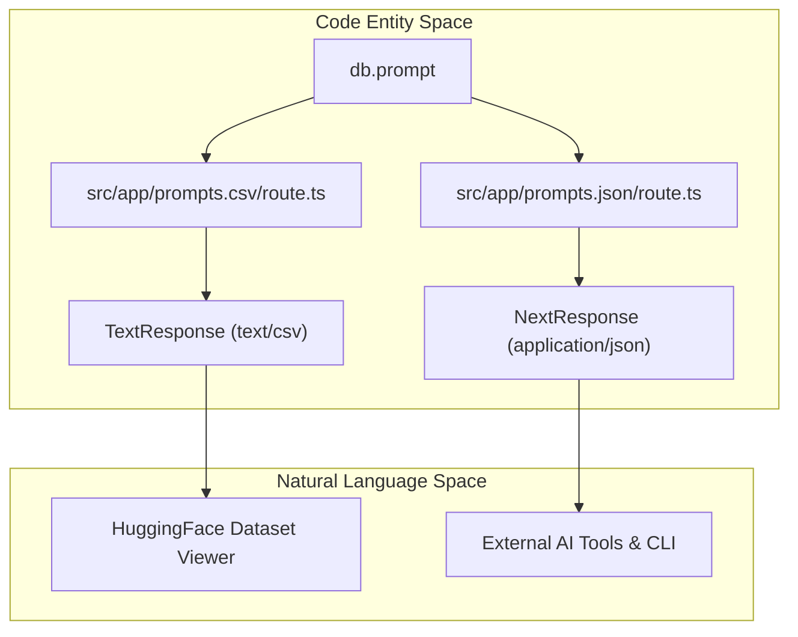
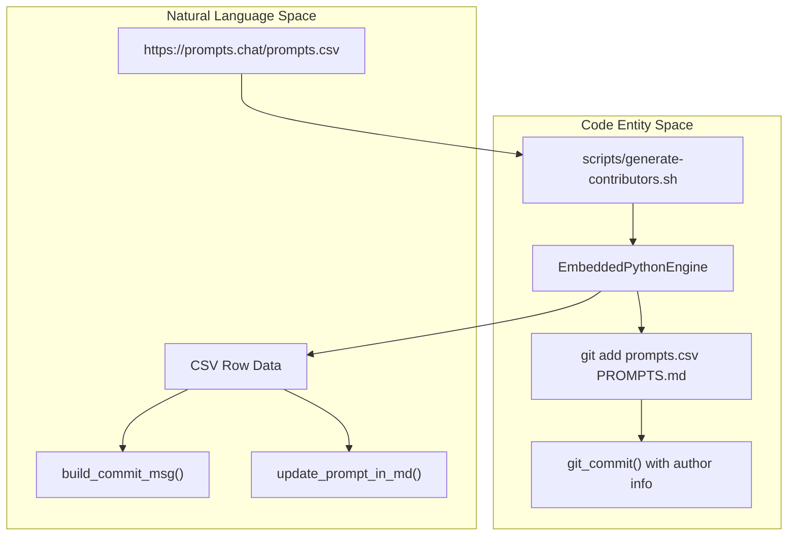

<!-- source: DeepWiki mcp.deepwiki.com · repo f/prompts.chat · page 4.8 Import & Export System · fetched 2026-11-09 -->

# Import & Export System

Relevant source files

The following files were used as context for generating this wiki page:

- [.github/PULL_REQUEST_TEMPLATE.md](.github/PULL_REQUEST_TEMPLATE.md)
- [PROMPTS.md](PROMPTS.md)
- [README.md](README.md)
- [next.config.ts](next.config.ts)
- [prompts.csv](prompts.csv)
- [scripts/generate-contributors.sh](scripts/generate-contributors.sh)
- [scripts/rebuild-history.sh](scripts/rebuild-history.sh)
- [src/app/prompts.csv/route.ts](src/app/prompts.csv/route.ts)
- [src/app/prompts.json/route.ts](src/app/prompts.json/route.ts)
- [src/components/admin/import-prompts.tsx](src/components/admin/import-prompts.tsx)
- [src/components/prompts/hf-data-studio-dropdown.tsx](src/components/prompts/hf-data-studio-dropdown.tsx)
- [tests/generate-contributors-format.test.js](tests/generate-contributors-format.test.js)

This page covers the comprehensive import and export architecture of `prompts.chat`, explaining how data flows between the PostgreSQL database, the `prompts.csv` and `prompts.json` export routes, the GitHub repository synchronization scripts (`generate-contributors.sh`), and the HuggingFace dataset integration.

---

## System Purpose & Scope

The import and export subsystem addresses several key architectural needs:

1.  **Public Data Distribution**: Exposes clean CSV (`/prompts.csv`) and JSON (`/prompts.json`) endpoints for external integrations, SDKs, and HuggingFace datasets [src/app/prompts.csv/route.ts:28-95](), [src/app/prompts.json/route.ts:25-223]().
2.  **Git-Driven Workflow**: Maintains a dual state where prompt contributions made via the web UI or repository sync update both database models and GitHub commit history with precise contributor attribution [scripts/generate-contributors.sh:1-201]().
3.  **Administrative Bulk Operations**: Allows administrators to perform bulk import, export, or wipe prompt records through admin panel components and backend API endpoints [src/components/admin/import-prompts.tsx:1-50]().

Sources: [src/app/prompts.csv/route.ts:28-95](), [src/app/prompts.json/route.ts:25-223](), [scripts/generate-contributors.sh:1-201](), [src/components/admin/import-prompts.tsx:1-50]()

---

## CSV & JSON Export Routes

### CSV Export Endpoint (`GET /prompts.csv`)

The CSV route serves a static export of all public prompts as a CSV file, suitable for direct data import, analysis, or feeding other tools.

-   **Route File**: [src/app/prompts.csv/route.ts:1-95]()
-   **Revalidation**: Cache is revalidated every hour (`export const revalidate = 3600`) to keep the export fresh [src/app/prompts.csv/route.ts:27-27]().
-   **Filtering**: Only includes prompts where `isPrivate` and `isUnlisted` are false, excluding deleted prompts (`deletedAt: null`) [src/app/prompts.csv/route.ts:31-37]().
-   **Fields & Formatting**:
    -   `act`: Escaped prompt title with CSV quoting rules [src/app/prompts.csv/route.ts:5-16](), [src/app/prompts.csv/route.ts:67-67]().
    -   `prompt`: Full prompt content, escaped [src/app/prompts.csv/route.ts:68-68]().
    -   `for_devs`: Boolean flag string `"TRUE"` if the prompt category slug is `"coding"`, else `"FALSE"` [src/app/prompts.csv/route.ts:69-69]().
    -   `type`: Either `"STRUCTURED"` if the format is JSON/YAML, or `"TEXT"` for plain text prompts [src/app/prompts.csv/route.ts:70-70]().
    -   `contributor`: Comma-separated string of contributor identifiers, including the primary author and co-contributors, determined through `getUserIdentifier()` [src/app/prompts.csv/route.ts:18-25](), [src/app/prompts.csv/route.ts:74-80]().

This endpoint returns CSV content with appropriate headers and MIME type `text/csv; charset=utf-8`.

---

### JSON Export Endpoint (`GET /prompts.json`)

The JSON route exposes a paginated API listing of prompts with rich metadata, including authorship, categories, tags, and votes.

-   **Route File**: [src/app/prompts.json/route.ts:1-246]()
-   **Dynamic Content**: Declared with `dynamic = "force-dynamic"` allowing fresh data on demand [src/app/prompts.json/route.ts:18-18]().
-   **Conditional Requests**: Generates an ETag by hashing the total prompt count and latest update timestamp to support HTTP 304 caching [src/app/prompts.json/route.ts:21-72]().
-   **Pagination Support**: Supports `page` and `limit` query parameters with sensible defaults and maximum limit (`MAX_LIMIT = 100`) [src/app/prompts.json/route.ts:29-41](), [src/app/prompts.json/route.ts:145-148]().
-   **Content Preview**: Returns either `contentPreview` (truncated to 500 characters) or full `content` when `full_content=true` query parameter is set [src/app/prompts.json/route.ts:29-38](), [src/app/prompts.json/route.ts:153-169]().
-   **Response Schema**: Includes prompt fields such as id, title, slug, description, type, category information, author and contributors (with user identifiers), tags, vote and comment counts, media fields, and timestamps [src/app/prompts.json/route.ts:74-213]().

---

Title: "CSV and JSON Export Data Flow"

Sources: [src/app/prompts.csv/route.ts:4-95](), [src/app/prompts.json/route.ts:1-246]()

---

## Contributor Attribution & Git Synchronization

`prompts.chat` maintains proper GitHub-based attribution for every prompt contribution by linking the `prompts.csv` and `PROMPTS.md` repository files to the live database copy, using automated scripts and careful commit message crafting.

### `generate-contributors.sh`

This shell script automates updating the local repository from the live deployment's CSV export:

1.  **Fetch Remote CSV**: Downloads the latest prompts CSV from `https://prompts.chat/prompts.csv` into a temporary file `prompts.csv.remote` [scripts/generate-contributors.sh:13-21]().
2.  **Python Diffing & Update**:
    -   Reads the remote and local CSVs with Python's `csv.DictReader`, normalizing line endings and handling CSV errors gracefully [scripts/generate-contributors.sh:38-74]().
    -   Detects new or updated prompts by comparing existing rows with remote source data.
3.  **Commit Attribution**:
    -   Extracts the primary contributor and co-authors from the `contributor` field with `parse_contributors()` [scripts/generate-contributors.sh:94-114]().
    -   Commits changes to `prompts.csv` and `PROMPTS.md` with author metadata set via environment variables `GIT_AUTHOR_NAME` and `GIT_AUTHOR_EMAIL`.
    -   Adds `Co-authored-by:` trailers for co-contributors in commit messages for GitHub's contributor graph [scripts/generate-contributors.sh:116-130]().
4.  **Markdown Sync**:
    -   Manages `PROMPTS.md` by adding or updating prompt details inside collapsible `
` blocks, preserving a human-readable repository representation synced to the CSV [scripts/generate-contributors.sh:175-193]().

### `rebuild-history.sh`

This one-time administrative script is used for rewriting the entire `prompts.csv` git history to ensure accurate contributor attribution from scratch:

-   Removes `prompts.csv` from Git tracking [scripts/rebuild-history.sh:100-102]().
-   Creates an empty initial commit with the CSV header [scripts/rebuild-history.sh:104-116]().
-   Iterates through every prompt in a backup CSV, appending each row and committing with the correct `GIT_AUTHOR_NAME` and `GIT_AUTHOR_EMAIL`, and adding co-author trailer lines [scripts/rebuild-history.sh:39-153]().

---

Title: "Git Contribution Synchronization Pipeline"

Sources: [scripts/generate-contributors.sh:16-130](), [scripts/generate-contributors.sh:174-193](), [scripts/rebuild-history.sh:39-153]()

---

## HuggingFace Dataset Integration

`prompts.chat` is published as an actively used dataset on HuggingFace under `fka/prompts.chat`, providing users with integration capabilities for AI training and exploration [README.md:24-40]().

### HFDataStudioDropdown Component

The client-side React component `HFDataStudioDropdown` facilitates exploration and query generation for the HuggingFace dataset:

-   **File**: [src/components/prompts/hf-data-studio-dropdown.tsx:1-185]()
-   **Features**:
    -   Provides a dropdown with predefined SQL query examples loaded from static JSON (`sql-examples.json`) [src/components/prompts/hf-data-studio-dropdown.tsx:21-23]().
    -   Includes a direct link button (`🤗`) that opens the dataset viewer in HuggingFace’s Data Studio [src/components/prompts/hf-data-studio-dropdown.tsx:39-47]().
    -   Supports AI-powered SQL generation from natural language inputs by POSTing to `/api/generate/sql` [src/components/prompts/hf-data-studio-dropdown.tsx:49-69]().
    -   Monaco editor integration for editing and previewing SQL [src/components/prompts/hf-data-studio-dropdown.tsx:158-175]().
    -   Responsive UI with popover-based dropdown and run query button [src/components/prompts/hf-data-studio-dropdown.tsx:71-185]().

This enhances ease of querying the prompt dataset with complex filters and facilitates data-driven prompt research directly from the web application.

Sources: [src/components/prompts/hf-data-studio-dropdown.tsx:1-185](), [README.md:24-40]()

---

## Admin Bulk Operations

The admin interface offers bulk import/export management features allowing administrators to ingest large prompt datasets or perform cleanups:

-   **Component**: [src/components/admin/import-prompts.tsx:1-210]()
-   **Supported Operations**:
    -   Bulk import prompts into the database from uploaded CSV files or other sources. The `handleImport` function makes a `POST` request to `/api/admin/import-prompts` [src/components/admin/import-prompts.tsx:44-73]().
    -   Delete bulk prompt records for cleaning or resetting the database. The `handleDelete` function makes a `DELETE` request to `/api/admin/import-prompts` [src/components/admin/import-prompts.tsx:76-100]().
-   **Integration**: Uses Prisma ORM to create or update `Prompt` models en masse, ensuring data integrity and trigger validation [src/components/admin/import-prompts.tsx:44-100]().

This empowers maintenance tasks for large scale data handling and migration scenarios.

Sources: [src/components/admin/import-prompts.tsx:1-210]()

---

# Summary

This Import & Export sub-system of `prompts.chat` tightly integrates prompt data sources between live PostgreSQL storage, GitHub versioned CSV/Markdown files, public HTTP export routes, and dataset hosting on HuggingFace. The robust scripting for contributor attribution and the rich JSON/CSV exports support both community contribution workflows and external integration needs. The admin bulk facilities provide powerful tooling for managing the dataset lifecycle at scale.

---

